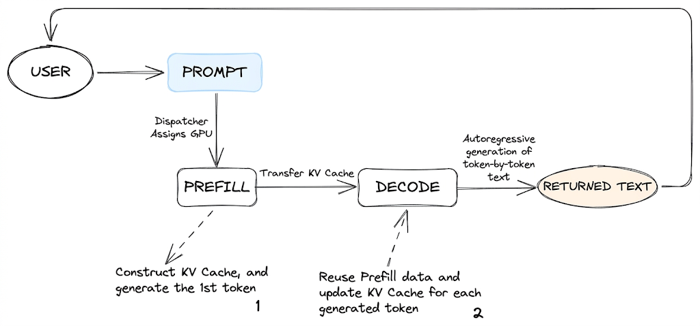
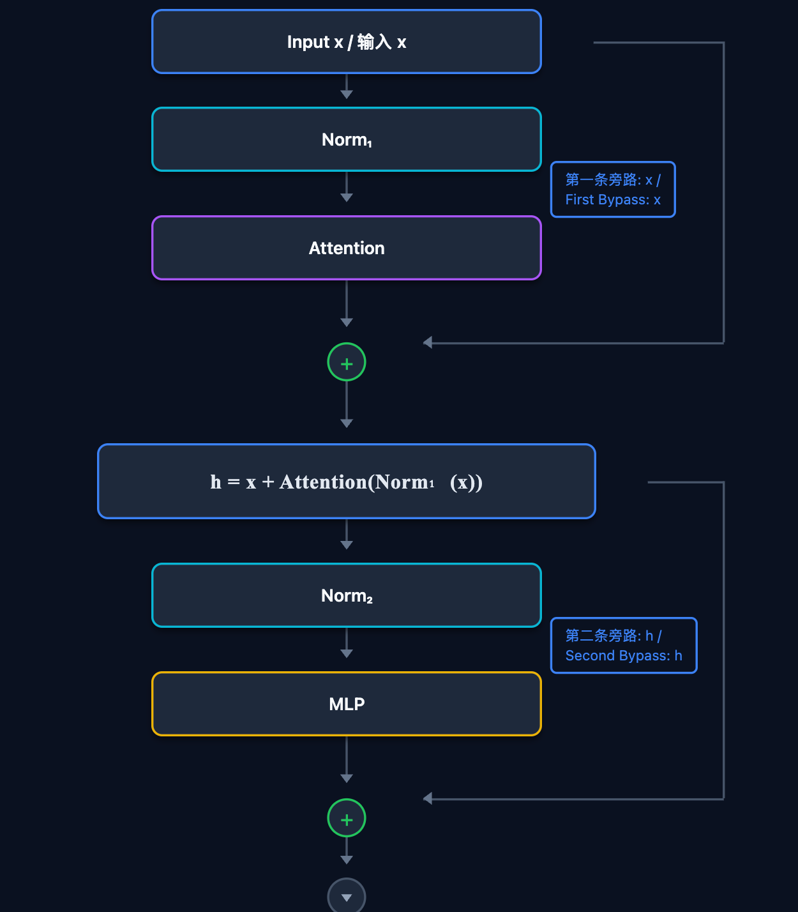
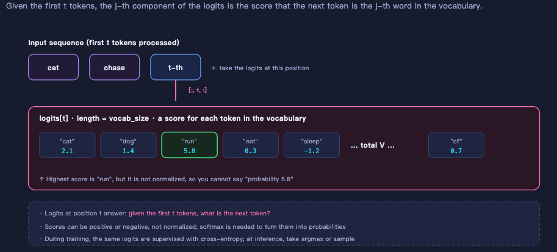

# 从自回归生成看大模型推理为什么慢

```{contents} 本页目录
---
depth: 2
local: true
---
```

同一个模型，可能迟迟不出第一个 token，也可能已经开始输出，却一个 token 接一个 token 地往外慢吐。两种延迟落点不同：首包等待主要受排队与 Prefill 影响，流式吐字速度主要取决于 Decode。长 Prompt、长回复、多轮工具调用和高并发会分别放大这两段成本。

本章把服务阶段与模型单次前向合在同一条主线上：先从自回归依赖区分 Prefill 与 Decode，再拆解文本如何经 tokenizer、embedding、Transformer block、LM Head 和采样器走完一次 **token ID → hidden state → logits → token ID** 闭环。

## 模型一次只预测一个 token

用户输入先经过 tokenizer 变成 token IDs，再经 embedding 进入 Transformer。模型根据当前上下文计算下一个 token 的概率分布，采样得到新 token，把它放回上下文后继续预测，直到生成 EOS 或达到长度上限。这就是 autoregressive inference。

$$P(\mathrm{token}_i \mid \mathrm{token}_1, \ldots, \mathrm{token}_{i-1})$$

训练和推理在单步上都估计词表上的概率分布，差别在前文从哪里来。训练时，完整的真实序列已经给定，causal mask 允许多个位置并行计算损失；推理时，后一个 token 依赖模型刚刚生成的前一个 token，所以生成步骤不能并行展开。

| 维度 | 训练 | 推理 |
|-|-|-|
| 参数 | 执行前向与反向传播，并更新参数 | 参数固定，只做前向计算 |
| 前文来源 | 标注数据中的真实序列 | Prompt 加模型已经生成的 token |
| 位置关系 | 可并行计算多个位置的损失 | 后一个 token 依赖前一个 token |
| 主要资源压力 | 计算、激活与优化器状态 | 权重读取、KV Cache 与逐步生成 |

<callout emoji="💡">
**一句话记忆：**推理在 token 与 token 之间串行，单个 token 内部的矩阵计算仍有大量并行。
</callout>

## 一次请求先经历 Prefill，再进入 Decode

推理引擎收到请求后，由 Scheduler 选择本轮可运行的请求并组成 Batch，再交给模型执行。单实例内的 GPU 或 TP GPU 组通常在启动时已确定；跨实例选择由路由或负载均衡层负责。模型先处理未缓存的输入，再逐步生成；输出 token ID 经 Detokenizer 还原成文本。



| 维度 | Prefill | Decode |
|-|-|-|
| 输入 | 一段或全部 Prompt token | 上一步新生成的 token |
| 执行方式 | 并行处理多个输入 token | 多轮执行，每轮为每条序列继续生成 |
| KV Cache | 建立并写入初始缓存 | 读取可见历史，并追加新 token 的 K/V |
| 用户侧指标 | 主要影响首 token 延迟 TTFT | 主要影响逐 token 延迟与输出速度 |
| 典型特征 | 算术强度较高，长序列或较大 batch 更可能受计算限制 | batch 较小且上下文较长时，通常受显存带宽限制 |

Decode 每生成一个新 token 都要读取上文。KV Cache 把各层已算好的历史 Key 和 Value 留在显存中，后续步骤只为新 token 追加 K/V，免去历史投影的重复计算，但仍需在每步 Attention 中读取这段历史并付出容量与带宽代价。精确容量公式与分页取整账本统一在第 3 章展开。

## Agent 和长对话会放大上下文成本

真实应用不会只发一次短 Prompt。Agent 把工具定义与执行结果写回上下文，多轮对话持续携带历史消息，多 Agent 串行协作还会把上一个 Agent 的输出变成下一个 Agent 的输入。这些变化最终都会落到 Prefill 长度、KV Cache 占用和调度等待上。

| 场景 | 上下文怎样增长 | 主要影响 |
|-|-|-|
| Agent 工具循环 | 系统提示、工具定义、历史消息和工具结果不断累积 | 前缀未命中缓存时，会反复执行更长的 Prefill |
| 多 Agent 串行协作 | Agent 输出进入下一个 Agent 的输入 | Prefill 增长，并叠加网络、序列化与串行等待 |
| 多轮对话 | 每轮携带更长的历史 | 前缀未复用时 TTFT 上升，KV Cache 持续占用显存 |
| 长上下文 | 可见历史 KV 规模增大 | Decode 读取压力上升，可并发请求数下降 |

可以做一个便于理解的估算：假设没有 prefix caching，每轮新增 200 token，Prefill 速度始终为 1000 token/s，那么首轮 TTFT 约为 200 ms，第十轮约为 2000 ms。真实曲线还会受到 Attention 二次项、调度、截断与缓存命中的影响，因此这只是理想化示例。

## 优化先看慢在哪个阶段

- **第一个 token 慢：**先看队列等待、Prompt 长度、Prefill 吞吐和前缀缓存命中率。
- **后续 token 慢：**先看 Decode 的显存带宽、batch、上下文长度与 GPU 竞争。
- **容易 OOM 或并发上不去：**先算 KV Cache 的单请求容量和总预算。
- **Agent 越跑越慢：**先看工具结果与历史是否不断膨胀，以及公共前缀是否被重复 Prefill。

定位推理慢在哪个阶段后，下一步要看清 Prefill 与 Decode 共同调用的模型前向究竟算了什么。无论一次处理整段 Prompt 还是只推进一个新 token，底层都沿同一条计算链把输入 token ID 变成下一个 token ID。

## 模型接收的是 token ID，不是字符串

Tokenizer 负责把字符串切成 token，再按词表映射成整数 ID。它决定“文本如何编码”，但不参与 Transformer 内部的浮点计算。模型接收形如 `[B, T]` 的 ID 张量，其中 `B` 是批大小，`T` 是序列长度。


*文本先被编码为 token ID，再通过 embedding 查表得到连续向量。图片来自 Zero to SGLang 原课程。*

Embedding 可以看成一张形状为 `[vocab_size, d_model]` 的可学习表。某个 ID 对应一次按行查表；一批序列查表后，张量形状从 `[B, T]` 变成 `[B, T, d_model]`。此时每个位置拿到的是该 token 的初始表示，还没有结合上下文。

词表 ID 本身没有大小关系。ID 123 不比 ID 122“更接近”某个概念，语义来自 embedding 行向量在训练中学到的位置。模型从这里开始处理向量，不再直接处理字符串。

## Transformer block 让每个位置形成上下文表示

Embedding 只说明“这个 token 是谁”，不能说明“它出现在什么位置、应该关注哪些历史内容”。Decoder-only Transformer 通过位置编码、因果 Attention 和逐位置 MLP，反复更新每个位置的 hidden state。

### RoPE 用二维旋转把相对位置编进 Q 和 K

单纯查 embedding 与位置无关，同一 token 出现在句首或句尾会得到相同的初始向量。现代大模型普遍采用 RoPE（Rotary Position Embedding）：把每个 head 维度 $d_h$ 两两配对成 $d_h/2$ 个二维平面，在第 $i$ 个平面上按绝对位置 $m$ 施加角度为 $m\theta_i$ 的正交旋转，其中基础频率通常取 $\theta_i=\mathrm{base}^{-2i/d_h}$：

$$R(\theta_i,m)=\begin{pmatrix}\cos m\theta_i & -\sin m\theta_i \\ \sin m\theta_i & \cos m\theta_i\end{pmatrix}$$

正交旋转满足 $R(\theta_i,m)^{\mathsf T}R(\theta_i,n)=R(\theta_i,n-m)$。把整组块对角旋转记作 $R_{\Theta,m}$，位置 $m$ 的 Query 与位置 $n$ 的 Key 做内积时，绝对位置自动消去，只留下相对距离 $n-m$：

$$(R_{\Theta,m}q_m)^{\mathsf T}(R_{\Theta,n}k_n)=q_m^{\mathsf T}R_{\Theta,n-m}k_n$$

这一性质直接带来三条推理引擎约束：第一，RoPE 只作用于 Q 和 K，V 不参与旋转；第二，写入 KV Cache 的 K 通常已经乘过对应位置的旋转矩阵，因此跨请求复用前缀要求相同 token 处在兼容位置（若改变前置提示词长度，已缓存 K 的位置角就会错位）；第三，长上下文扩展（如 Llama 3 分段频率平滑与 YaRN 波长斜坡插值）本质上都是改写 $\theta_i$ 的分布，第 9 章将结合源码核对具体实现。

### Attention 负责跨 token 读取信息

对某一层输入 $H$ 做线性投影，可以得到 Query、Key 和 Value：

$$Q=HW_Q,\quad K=HW_K,\quad V=HW_V$$

直观地说，Q 表示当前位置想找什么，K 表示各位置能用什么键被检索，V 则是匹配后真正汇入当前位置的信息。单个 head 的缩放点积 Attention 可以写成：

$$\operatorname{Attention}(Q,K,V)=\operatorname{softmax}\!\left(\frac{QK^{\mathsf T}}{\sqrt{d_h}}+M\right)V$$

其中 $M$ 是 causal mask。对当前位置之后的列，它加入负无穷，使第 $t$ 个位置只能读取 $1\ldots t$，不能偷看未来 token。多头 Attention 会让不同 head 在不同子空间中独立计算，再把结果拼接并投影回 `d_model`。

<callout emoji="💡">
**不要把 Attention 等同于“永远最耗算力的模块”。**Attention 的代价随序列长度增长，长上下文时尤其关键；但在许多 dense LLM 中，MLP 也会占据很大一部分 FLOPs。究竟由谁主导，要同时看模型结构、序列长度、批量和算子实现。
</callout>

### MLP 负责逐 token 变换，残差连接保留主干

Attention 在 token 之间交换信息，MLP/FFN 则对每个位置独立做非线性变换。常见的 Pre-Norm block 可以抽象成：

$$U_l=H_l+\operatorname{Attention}(\operatorname{Norm}(H_l))$$

$$H_{l+1}=U_l+\operatorname{MLP}(\operatorname{Norm}(U_l))$$



*Pre-Norm Transformer block：Attention 与 MLP 各有一条残差支路。图片来自 Zero to SGLang 原课程。*

Norm 控制进入子层的数值尺度，残差连接让更新量叠加在原表示上。堆叠多层后，每个位置的 hidden state 已经融合了它可以看到的历史。不同模型会使用 RMSNorm、SwiGLU、MoE、GQA 等变体，但“跨位置聚合，再逐位置变换”的主干没有改变。

## LM Head 把 hidden state 投影到词表空间

最后一层 Transformer block 输出的仍是 `[B, T, d_model]`。经过 final norm 后，LM Head 用线性投影把最后一维从 `d_model` 变成 `vocab_size`：

$$Z=\operatorname{FinalNorm}(H_N),\qquad L=ZW_{\mathrm{vocab}}^{\mathsf T}$$

于是 logits $L$ 的形状为 `[B, T, vocab_size]`。每个位置都有一组覆盖整个词表的原始分数；这些数可以为负，也不要求和为 1，所以还不是概率。



*Final norm 与 LM Head 把 hidden state 映射成词表中每个候选 token 的 logits。图片来自 Zero to SGLang 原课程。*

位置 t 的 logits 表示给定截至 t 的上下文，下一 token 的各候选分数。训练可以用所有位置计算 next-token loss；在线生成通常只需要每条序列最后一个有效位置。LM Head 是否与输入 embedding 共享权重，由模型配置 `tie_word_embeddings` 决定；共享时两者引用同一份参数，未共享时分别加载，不能把共享当作所有现代 LLM 的默认条件。

## 采样器把 logits 变成一个 token ID

对 logits 做 softmax 后，才能得到词表上的概率分布。加入 temperature $\tau$ 时，第 $i$ 个候选的概率为：

$$p_i=\frac{\exp(z_i/\tau)}{\sum_j\exp(z_j/\tau)}$$

$\tau=1$ 保持原分布；小于 1 会放大分数差异，让分布更尖；大于 1 会压缩差异，让更多候选获得机会。实际系统通常把 greedy 当成独立分支处理，而不是把 temperature 真设为 0。

生成策略并不是模型参数的一部分。同一组 logits 可以采用不同的选择规则：

| 策略 | 做了什么 | 候选集合 | 结果特点 |
|-|-|-|-|
| Greedy | 直接选择最大 logit | 只保留 argmax | 确定性强，也更容易僵硬或重复 |
| Temperature | 缩放 logits 的差异 | 不负责截断 | 控制分布尖锐或平坦 |
| Top-k | 只保留分数最高的 $k$ 个候选 | 固定大小 | $k=1$ 等价于 greedy |
| Top-p | 保留累计概率达到 $p$ 的最小集合 | 随分布动态变化 | 分布集中时少留，分散时多留 |

Top-k 与 Top-p 的共同点是去掉低概率长尾，再对保留候选重新归一化并抽样。实现上可以先屏蔽 logits 再做 softmax，也可以在概率上过滤；判断语义是否一致，要看过滤、归一化和随机抽样的实际顺序。

**一组小概率算例：**设 softmax 后五个候选的概率依次为 0.40、0.30、0.15、0.10、0.05。Top-k=2 保留前两个，重新归一化后约为 0.571 和 0.429；Top-p=0.8 需要保留前三个（前两个仅累计到 0.70，前三个达到 0.85），归一化后约为 0.471、0.353、0.176；Greedy 直接选第一个。Temperature 会先改变这组概率，再影响 Top-p 所需的候选数，组合过滤的先后顺序以采样库接口语义为准。

## 一次 forward 只预测一步，生成靠循环完成

![这张图对应大模型自回归生成的过程，清晰展示了一次forward循环的完整流程：初始的logits（维度为[B, T, V]）会取最后部分的结果输入采样策略环节，该环节采用top-k或top-p的方式，选出下一个token next_id（为单个token），再将其作为新序列加入后形成维度为[B, T+1]的序列，随后开启下一轮自回归的forward过程。整个循环会运行，直至遇到停止条件，如到达EOS标记、达到最大新token数、达到最大上下文长度等，循环终止后返回完整生成的序列，匹配了上下文所描述的自回归生成每轮仅预测一个token、靠循环完成的核心逻辑。](https://feishu.cn/file/UanPbwGcno63u4xe2XMmPKkcyjh)

*自回归生成：每轮用已有上下文预测一个 token，再把它带入下一轮。图片来自 Zero to SGLang 原课程。*

1. 已有 token ID 进入模型；
2. 最后一个有效位置产生一组 logits；
3. 采样器选出下一个 token ID；
4. 新 token 进入下一轮 forward；
5. 遇到 EOS、长度上限、停止串、结构化输出完成或外部取消时结束。

第一轮处理整段 Prompt，属于 Prefill；它已经用最后一个 Prompt 位置的 logits 采样出第一个输出 token。下一轮 Decode 才消费这个 token，并预测再下一个。训练能够利用已知答案并行计算多个位置，在线推理却必须等待上一步选出 token，因此生成阶段天然存在逐步依赖。

## 小结

- 自回归生成在 token 与 token 之间串行推进：Prefill 一次并行处理输入 Prompt 并采出首个输出 token，Decode 逐步消费上一步结果并受历史读取制约。
- Tokenizer 只负责文本与整数 ID 的双向编码，Embedding 查表产出无位置语义的初始向量。
- Transformer block 内，RoPE 把相对位置旋转进 Q/K，因果 Attention 跨位置聚合可见历史，MLP 逐位置做非线性变换，Pre-Norm 与残差连接维持深层数值稳定。
- Final Norm 与 LM Head 把最后一个有效位置的 hidden state 投影成词表维度的 logits，采样器再按 Greedy、Temperature、Top-k 或 Top-p 选出下一个 token ID。

模型语义上的单步闭环已经清楚。下一章把这条计算链放到 GPU 硬件上，分析 SM、存储层级、矩阵分块与 Online Softmax 如何执行这些算子，并用 Roofline 模型定量区分 Prefill 与 Decode 的瓶颈。
