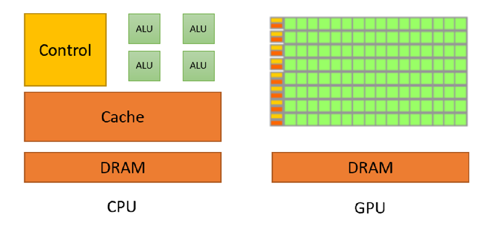
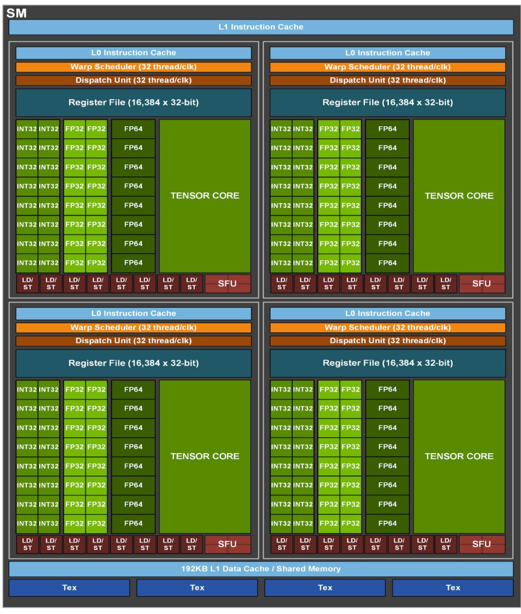
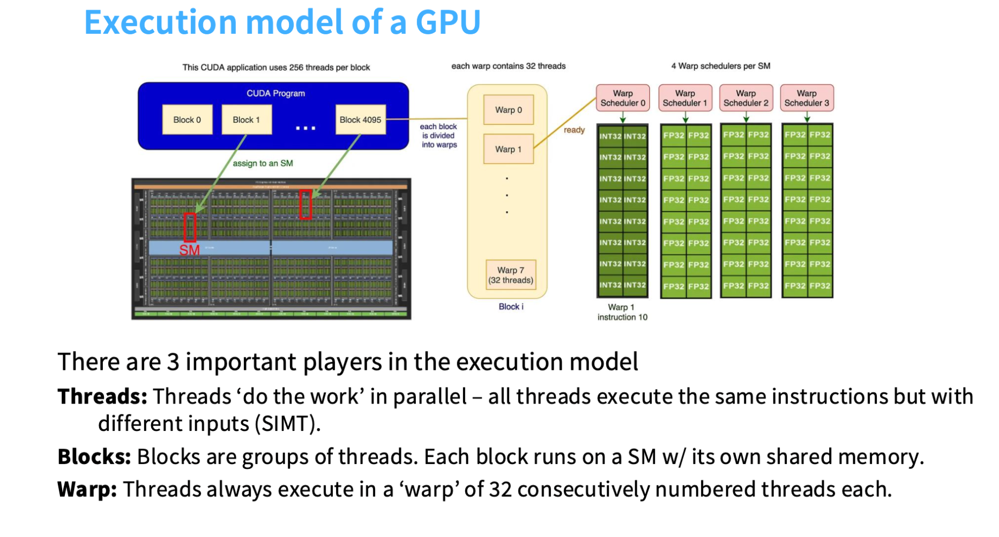
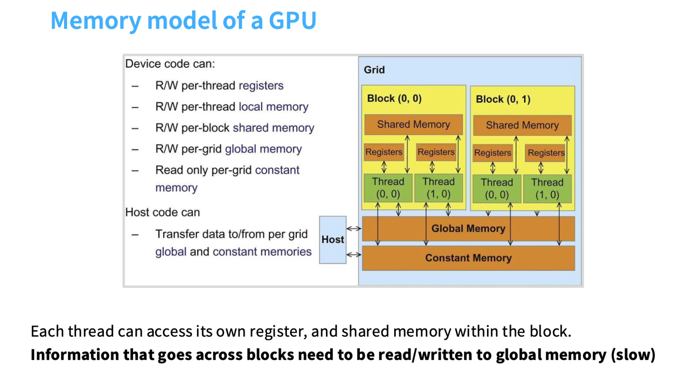
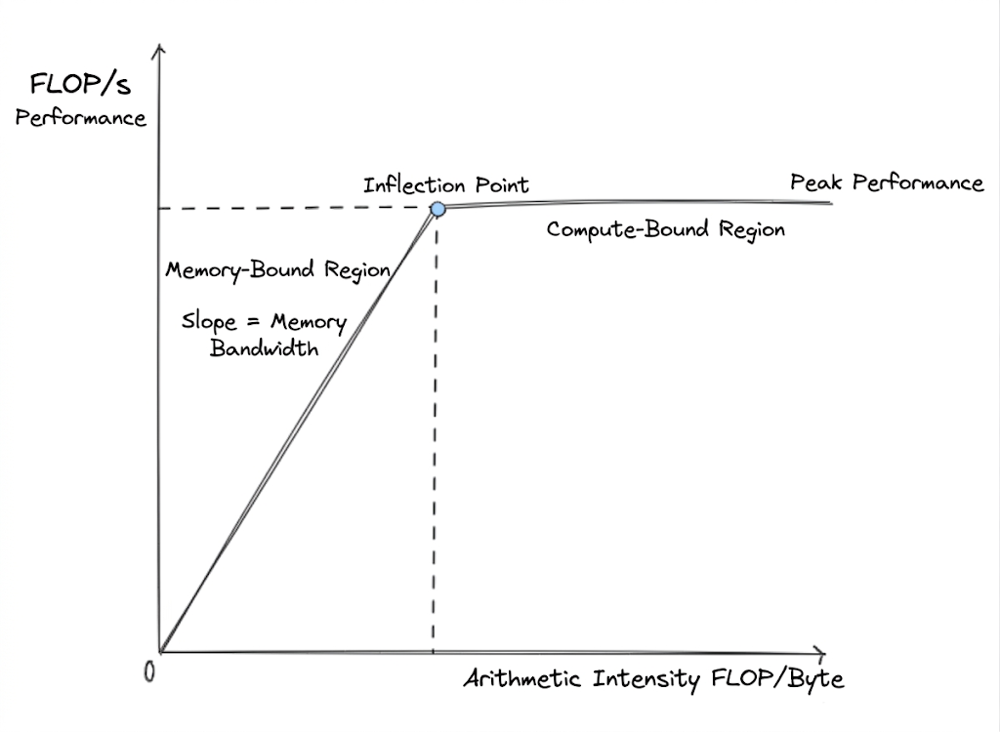

# GPU 执行模型与 Roofline 瓶颈判断

```{contents} 本页目录
---
depth: 2
local: true
---
```

上一章沿着 token ID、Transformer block、LM Head 和 sampling 走完了一次 forward 与生成循环。接下来把同一条计算链放到 GPU 上：一段矩阵计算怎样被拆成并行任务，谁来调度这些任务，数据又放在哪里。把这三件事连起来，Tensor Core、Tiling、算子融合和 Continuous Batching 就不再是一组零散术语。

GPU 的高吞吐也不能简单归结为“核心多”。大量执行通道只是起点。程序还要暴露足够的并行工作，调度器要能在 Warp 之间隐藏等待，数据也要尽量留在离计算更近的位置。只要其中一环跟不上，峰值算力就落不到真实任务上。

## 图形任务让 GPU 选择了吞吐

早期 3D 图形处理已经具备 GPU 最擅长的工作形态。场景由大量顶点和三角形图元组成，顶点变换、光栅化与属性插值会对许多数据执行相似计算。CPU 当然也能完成这些工作，而且现代 CPU 同样具备多核、乱序执行和 SIMD；GPU 则把更多芯片资源用于并行执行通道，以更高的聚合吞吐处理规模更大的规则计算。

两种处理器优化的重点不同。CPU 核心侧重少量指令流的低延迟执行，依靠较大的缓存、分支预测和复杂控制提高单线程及少量线程的性能。GPU 允许大量线程同时驻留。当一个 Warp 因数据依赖或访存而暂时不能发射时，调度器可以选择另一个已经就绪的 Warp，从而遮蔽一部分等待时间。



这也解释了矩阵计算为何适合 GPU。矩阵乘法包含大量结构一致的乘加操作，既容易拆出并行任务，又能让一批数据在多次运算中复用。GPU 仍然在乎延迟，只是更依赖足够的并行度来遮蔽延迟，并把硬件利用率换成整体吞吐。

## SM 承接真正的计算任务

在 CUDA 编程模型里，CPU 发起 Kernel，软件或编译器定义 Grid 和 Thread Block。GPU 再把这些 Block 分配给 Streaming Multiprocessor，也就是 SM。GPC 和 TPC 负责在芯片上组织多组资源；真正承接 Block、调度 Warp 并驱动执行单元工作的基本单位是 SM。

以 A100 为例，完整 GA100 设计包含 8 个 GPC、64 个 TPC 和 128 个 SM；实际 A100 产品启用 7 个 GPC、54 个 TPC 和 108 个 SM，每个 GPC 启用 7 或 8 个 TPC。每个 A100 SM 有 64 条 FP32 CUDA Core 执行通道和 4 个第三代 Tensor Core，整卡合计 6912 条 FP32 执行通道与 432 个 Tensor Core。

| 层次 | A100 语境 | 主要职责 |
|-|-|-|
| GPC / TPC | 7 个 GPC、54 个 TPC | 在芯片上组织 SM 与图形、缓存等资源 |
| SM | 108 个 | 接收 Block，维护驻留线程状态，选择可发射的 Warp |
| CUDA Core | 每 SM 64 条 FP32 执行通道 | 执行标量浮点运算；不能与 CPU Core 按数量直接比较 |
| Tensor Core | 每 SM 4 个 | 由 Warp 协作发出 MMA 指令，执行矩阵乘加 |



Tensor Core 面向矩阵乘加 MMA，和普通标量 FMA 的执行方式不同。A100 支持 TF32、FP16、BF16、INT8 和 FP64 等路径。它的 2:4 结构化稀疏还要求软件先按支持的布局完成剪枝、压缩和编码，Sparse MMA 才能跳过对应的零乘法。理论峰值翻倍只描述执行单元上限，端到端速度还会受访存、调度和其他算子影响。

## Block 落到 SM，Warp 推动线程执行

一个 Grid 包含多个 Block，一个 Block 又包含多个 Thread。Block 从开始到结束驻留在同一个 SM，不能拆到多个 SM；同一个 SM 可以同时驻留多个 Block。Block 只占用从 SM 资源池分配给它的寄存器和 Shared Memory，并不会独占整个 SM。



Warp 由 32 个 Thread 组成，是指令发射的基本单位。调度器向一个 Warp 当前活跃的 Lane 发射共同指令。遇到数据相关分支时，不同路径通常借助 Active Mask 分阶段执行，这就是 Warp Divergence。它会减少同一时刻真正参与计算的 Lane，但损失没有固定比例，还取决于各分支的指令长度、活跃 Lane 数和重汇合情况。

Volta 之后的 Independent Thread Scheduling 为线程维护更独立的执行状态，底层仍保留 Warp 级 SIMT 发射。A100 每个 SM 最多可驻留 32 个 Block、64 个 Warp 和 2048 个 Thread，这些只是架构上限。Kernel 使用的寄存器、Shared Memory 和每 Block 线程数会共同决定实际 Occupancy。更多驻留 Warp 往往能提供更多可调度工作，却不能保证性能线性提高。

<callout emoji="💡">
**看 GPU 执行时要分清三个尺度：**Block 决定任务怎样落到 SM，Warp 是硬件发射指令的基本单位，Thread 提供程序员看到的标量执行语义。一个 Thread 不会固定绑定某条 CUDA Core，也不会独占一个 Tensor Core。
</callout>

## 峰值算力取决于数据能否及时到位

GPU 存储层级同时包含两种关系。一种是程序可见性：Register 属于 Thread，Shared Memory 属于 Block，Global Memory 可被整个 Grid 中的 Thread 访问。另一种是物理位置和缓存层级：Register 与 Shared Memory 位于 SM 内，L2 由全 GPU 共享，Global Memory 位于 HBM。下面这张图主要表达前一种关系，不应把它当成固定延迟表。



| 层级 | 可见范围 | A100 规模 | 管理与作用 |
|-|-|-|-|
| Register File | Thread 私有 | 每 SM 64K 个 32-bit Register，即 256 KiB | 由编译器分配，保存操作数和累加结果；占用过多会限制 Occupancy |
| L1 / Shared Memory | SM / Block | 统一容量 192 KiB；每 SM 最多 164 KiB 可作 Shared Memory | L1 由硬件管理；Shared Memory 由程序显式组织和同步 |
| L2 Cache | 全 GPU 共享 | 40 MB | 缓存 HBM 数据并服务多个 SM；不能替代 Atomic、Fence 或同步 |
| HBM2e | 设备 Global Memory | A100 PCIe 80GB 标称 80GB、1935 GB/s | 容纳权重、KV Cache 和中间结果，容量大但搬运成本高 |

Register 也不是“零延迟”。指令依赖、Register File 访问和流水线都会影响发射。若寄存器不足，变量还可能 Spill 到 Local Memory；Local Memory 虽然在线程地址空间中私有，物理上通常落在 Device Memory 并经过缓存，并非一层额外的片上高速存储。

因此，性能调优经常要在复用和并行度之间取平衡。更大的 Tile 可能提高复用，却会占用更多 Register 或 Shared Memory；资源占用上升后，SM 能同时驻留的 Warp 可能减少，遮蔽延迟的余地也随之缩小。

## 矩阵乘法靠切块复用数据

设矩阵乘法为 $C=A\times B$。直接计算时，A 的一行和 B 的一列会被反复读取。高性能 GEMM Kernel 会在软件层把输出矩阵划分为 Tile，再为每个 Block 或 Warp 安排相应的输入 Tile 和累加工作。CUDA 硬件调度器负责把已经生成的 Block 映射到 SM，并不会替程序自动拆分大矩阵。

常见数据路径可以概括为：从 Global Memory 读取输入 Tile，暂存在 Shared Memory，Warp 再把需要的数据送入 Register 并发出 Tensor Core MMA。部分架构和 Kernel 也会使用 `cp.async` 等机制重叠搬运与计算。结果通常保存在 Accumulator Register 中，经过 Epilogue 后直接写回 Global Memory，不必沿原路再经过 Shared Memory。

### 用一个 Tile 算出数据复用

设 FP16 的 A、B 都是 64×64，计算一个 64×64 输出 Tile，忽略输出写回与其他流量。若 64×64×64 个乘加都独立读取两个 2-byte 操作数，理想输入量为 1 MiB；若 A、B 各搬入一次并充分复用，输入量只有 16 KiB。计算量都是 524,288 FLOP，对应理想输入算术强度从 0.5 提高到 32 FLOP/Byte。这只是展示复用潜力，真实 Kernel 还受缓存、Tile 分工、输出写回和片上容量限制。

| 动作 | 解决的问题 | 常见风险 |
|-|-|-|
| Tiling | 把大矩阵拆成可映射、可复用的小块 | Tile 形状不合适会浪费执行通道或片上容量 |
| Shared Memory 复用 | 让同一 Block 多次使用已经搬入片上的数据 | 容量占用会压低 Occupancy，还需避免 Bank Conflict |
| Coalesced Access | 把同一 Warp 对齐且连续的地址访问合并成较少事务 | 离散或未对齐地址会增加事务并浪费有效带宽 |
| Warp 调度 | 在等待数据或依赖时发射其他就绪 Warp | 并行度不足或资源占用过高时，可选择的 Warp 变少 |

这条路径解释了许多 Kernel 优化。算子融合可以减少中间结果落回 HBM，更好的数据布局能让访问合并，量化可以减少需要搬运的字节，合适的 Tile 与流水线则提高数据复用和 Tensor Core 利用率。它们都在解决同一个问题：让数据在片上多做几次有用计算，再回到显存。

### Online Softmax 让分块 Attention 免于物化完整分数矩阵

普通 GEMM 的输出块只需把各段部分和直接相加，而 Attention 中间夹着非线性且全局耦合的 Softmax：标准写法要先算出整行 $s_j=q^{\mathsf T}k_j/\sqrt{d_h}$、求全局最大值与指数和，再乘 $V$。序列长度为 $N$ 时，若把 $N\times N$ 分数矩阵写回 HBM 再读出，访存复杂度和临时显存都会随 $N^2$ 膨胀。

FlashAttention 采用的 Online Softmax 把全局归一化改写成可跨分块递推的统计量。设两段互不重叠的 KV 分块各自算出了局部最大值 $m^{(1)},m^{(2)}$、局部缩放指数和 $\ell^{(1)},\ell^{(2)}$ 以及局部归一化输出 $o^{(1)},o^{(2)}$（其中 $\ell^{(r)}=\sum_{j\in B_r}e^{s_j-m^{(r)}}$，$o^{(r)}=\frac{1}{\ell^{(r)}}\sum_{j\in B_r}e^{s_j-m^{(r)}}v_j$），合并两块只需用新最大值重缩放旧统计量：

$$m^{(1:2)}=\max\!\left(m^{(1)},m^{(2)}\right),\qquad \ell^{(1:2)}=e^{m^{(1)}-m^{(1:2)}}\ell^{(1)}+e^{m^{(2)}-m^{(1:2)}}\ell^{(2)}$$

$$o^{(1:2)}=\frac{e^{m^{(1)}-m^{(1:2)}}\ell^{(1)}}{\ell^{(1:2)}}o^{(1)}+\frac{e^{m^{(2)}-m^{(1:2)}}\ell^{(2)}}{\ell^{(1:2)}}o^{(2)}$$

工程实现常把每块的归一化分母记作对数指数和 $\mathrm{LSE}_r=m^{(r)}+\ln \ell^{(r)}$。因为合并关系严格满足结合律，GPU Kernel 可以在片上 SRAM 中逐块流式扫描 K/V 并原地更新累加器，全程不向 HBM 写出 $N\times N$ 中间矩阵；后续第 10 章的 PagedAttention 离散页读取、单卡多 CTA 的 `split-KV` 归约，以及第 15 章跨 GPU 的 Decode Context Parallel，全都直接建立在这组重缩放公式之上。

## Prefill 与 Decode 吃 GPU 的方式不同

下面用同一组假设比较两个阶段：LLaMA-7B，32 层，隐藏维度 `d=4096`，SwiGLU FFN 的中间维度近似取 `8d/3`，BF16，单条 3000-token 序列。以下公式只统计 Transformer block 的主干矩阵乘法。为便于量级比较，Attention 按完整矩阵的 dense-equivalent FLOP 计数；具体 causal kernel 可能利用三角结构，实际执行量还会受到融合、缓存命中与并行策略影响。

$$C_{\mathrm{prefill}} \approx L(24nd^2+4n^2d)$$

$$C_{\mathrm{decode}} \approx L(24d^2+4Sd)$$

这里，`n` 是 Prefill 处理的序列长度，`S` 是 Decode 当前可见的 KV Cache 长度，包含 Prompt 和已经缓存的生成 token。

这两式可以从矩阵尺寸推出来。按一次乘加计 2 FLOP，MHA 的 Q/K/V 与 O 投影每个 token 合计约 $8d^2$；SwiGLU 的 gate、up、down 三个矩阵在中间维 $I\approx8d/3$ 时合计约 $16d^2$。所以线性层共 $24nd^2$。Prefill 的 QK 与 AV 各约 $2n^2d$，Decode 的单 Query 对 S 个位置各约 $2Sd$。这里为了量级比较采用近似 FFN 宽度，未计 embedding、LM Head、Norm、激活和实现中的额外流量。

| 场景 | 计算量 | 简化 HBM 流量 | 直观结果 |
|-|-|-|-|
| Prefill 处理 3000 token | 约 43.37 TFLOP | 约 16.03 GB | 一次权重读取服务大量 token，计算单元更容易被充分利用 |
| 第一次 Decode step，历史长度约 3000 | 约 14.46 GFLOP | 约 14.46 GB | 计算量很小，却仍要读取权重与历史 KV，数据搬运占主导 |

若采用 A100 40GB 的 dense BF16 Tensor Core 理论峰值 312 TFLOP/s，Decode 这点计算的理论下界约为 0.046 ms；若把 HBM 带宽近似为 1.6 TB/s，搬运 14.46 GB 的理论下界约为 9.04 ms。两者相差两个数量级，说明 batch=1 的这个 Decode 算例受显存带宽限制。

表中的 GB 使用十进制字节，KV 容量示例的 GiB 使用二进制字节。简化账把主干权重按 12Ld² 个元素读取一次，BF16 约为 12.88 GB。Prefill 把整段 KV 写入缓存，再按一次完整读取计量，读写各约 1.57 GB，合计约 16.03 GB；Decode 读取权重和历史 KV，再追加一份新 KV，约 14.46 GB。这是一次读写的理想近似，未完整计入激活、中间结果和额外往返；L2 命中及融合还会改变实际 HBM 流量，因此不能当作具体 Kernel 的严格下界。

## Roofline 把瓶颈变成可计算的判断

Roofline model 把硬件上限和工作负载放进同一个坐标系。横轴是算术强度 arithmetic intensity，表示每搬运一个 Byte 能完成多少 FLOP；纵轴是可达到的计算吞吐。

$$\mathrm{AI}=\frac{\mathrm{FLOPs}}{\mathrm{Bytes}}$$

$$\mathrm{Ridge\ Point}=\frac{P_{\mathrm{peak}}}{\mathrm{Memory\ Bandwidth}}$$

$$P_{\mathrm{attainable}} \le \min(P_{\mathrm{peak}},\mathrm{AI}\times\mathrm{BW})$$



AI 小于 ridge point 时，内存带宽形成上限；AI 大于 ridge point 时，峰值算力形成上限；两者相等时，两条理想上限在转折点相交。这个判断依赖具体模型、硬件、batch 和序列长度，不是模型永久不变的标签。

沿用前面的 A100 近似参数，ridge point 为 `312 TFLOP/s ÷ 1.6 TB/s ≈ 195 FLOP/Byte`。在这套聚合的理想最小流量模型下，3000-token Prefill 的 AI 上界约为 2706，从简化 Roofline 看位于计算侧；batch=1、历史长度约 3000 的 Decode AI 约为 1，明显位于带宽侧。这个结果解释的是阶段量级，不能替代对具体 kernel 的实测分析。

| 诊断结果 | 优化目标 | 常见方向 |
|-|-|-|
| Prefill 偏计算受限 | 提高计算单元利用率 | batching、算子融合、Tensor Core 优化 |
| Decode 偏带宽受限 | 少搬数据，摊薄权重读取 | 权重或 KV 量化、合理 batching、GQA/MQA、kernel 与数据布局优化 |
| 重复 Prefill 或 KV 容量受限 | 复用前缀，降低缓存占用 | prefix caching、RadixAttention、分页管理、KV 量化或压缩 |

RadixAttention 的主要收益是复用共享前缀，减少重复 Prefill 和重复 KV 存储；它不会免除当前 Decode step 对可见历史 KV 的读取。

## 把阶段瓶颈映射回引擎优化手段

把 SM 调度、存储层级与 Roofline 放在一起，后续章节的各项系统设计便都能对号入座：Continuous Batching 凑大有效批次，让 Decode 线性层从访存受限的窄矩阵向片上权重复用推进；Paged KV Cache 与 Radix 前缀树消除显存碎片与重复 Prefill；算子融合与 Online Softmax 省掉中间张量往返 HBM；低精度量化压缩权重与 KV 搬运字节；Tensor Parallel 则把权重与计算拆到多张卡上。

Decode 阶段最核心的跨步状态正是 KV Cache：它省去了历史投影重算，也把 HBM 容量和带宽约束直接绑在并发规模上。下一章先把这笔缓存的计算账与容量账彻底算清。
