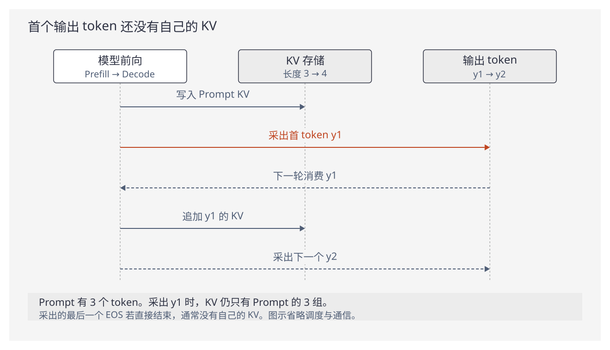

# KV Cache 用显存换取历史 K/V 复用

```{contents} 本页目录
---
depth: 2
local: true
---
```

KV Cache 把 GPU 的存储层级与请求状态接到了一起。它让 Decode 免于重复计算历史 token 的 Key 和 Value，也会随着上下文和并发增长，逐渐限制一块 GPU 能同时服务多少条请求。

理解 KV Cache 要同时看两笔账。一笔是计算账，哪些结果能够跨 Decode step 复用；另一笔是容量账，每写入一个 token，会在多少层、多少个 KV head 上增加多少字节。两笔账合起来，才能解释推理引擎为何把显存管理放在核心位置。

## KV Cache 只保留后续 token 会复用的 K 和 V

在第 $\ell$ 层，位置 $t$ 的隐藏状态会经过该层自己的投影，得到 Query、Key 和 Value：

$$q_t^{(\ell)}=h_t^{(\ell)}W_Q^{(\ell)},\quad k_t^{(\ell)}=h_t^{(\ell)}W_K^{(\ell)},\quad v_t^{(\ell)}=h_t^{(\ell)}W_V^{(\ell)}$$

当前 Query 随后读取当前位置及其之前的 K/V。用单个 Query head 的写法表示：

$$o_t=\operatorname{softmax}\!\left(\frac{q_tK_{1:t}^{\mathsf T}}{\sqrt{d_h}}\right)V_{1:t}$$

历史 token 的 K/V 由已经确定的隐藏状态和层权重产生，后续每个 Query 都会继续读取它们，因此适合缓存。历史 Query 只服务于各自位置当时的 Attention；生成下一个位置时，模型会重新计算这个位置的 Query，所以 Q 没有跨 step 复用价值。

有了 KV Cache，每次 Decode 只需为新输入的 token 计算 Q/K/V，再把新 K/V 写入缓存。它仍要读取可见历史，完成 $QK^{\mathsf T}$、Softmax 和对 V 的加权求和。对于标准 dense full attention，单步 Attention 的读取量和计算量仍随有效上下文长度线性增长。KV Cache 省掉的是历史 K/V 投影的重复计算，并没有省掉当前 Query 对历史的注意力计算。

缓存必须按层区分。第 ℓ 层以自己的子层输入和投影权重产生 K/V，常见 Pre-Norm 模型还会先做归一化；采用 RoPE 时，缓存中的 K 已按位置旋转。后续层的输入已经经过前面各层处理，不能复用第一层的 K/V。物理布局可以按层、token 或分页块组织，逻辑上仍需让每层找到属于该请求的历史。

MHA 中每个 Query head 都有对应的 KV head；GQA 让一组 Query heads 共享一个 KV head；MQA 通常只保留一个 KV head。后两种结构通过减少 $n_{\mathrm{kv}}$，直接缩小每个 token 的缓存体积与 Decode 读取量。

## Prefill 已经预测首个输出 token

KV Cache 的计数容易差一个 token，原因在 Prefill 和 Decode 的交界处。设 Prompt 含 $S_{\mathrm{prompt}}$ 个 token。Prefill 写入这批 token 的 K/V，并用最后一个位置的隐藏状态产生 logits，随后采样出第一个输出 token $y_1$。此时 $y_1$ 已经交给生成循环，但模型还没有消费它，所以缓存里没有 $y_1$ 的 K/V。

| 阶段 | 送入模型的 token | KV Cache 动作 | 这次前向的输出 |
|-|-|-|-|
| Prefill | Prompt 的全部 token，或 chunked prefill 的当前分块 | 写入已处理 Prompt 的 K/V | 最后一块完成后预测 $y_1$ |
| Decode | 上一步刚采样的 $y_i$ | 写入 $y_i$ 的 K/V，并读取可见历史 | 预测 $y_{i+1}$ |
| 请求结束 | 没有新的前向计算 | 释放请求持有的缓存，或按引擎策略保留为可复用前缀 | 返回 EOS、长度上限或取消前已经产生的结果 |

第一次 Decode forward 消费 $y_1$，为它写入 K/V，再预测 $y_2$。若生成在采样出 EOS 或达到长度上限后立即停止，最后采样出的 token 通常不会再次送入模型，也就没有对应的 KV。后面的容量公式用“当前实际已经写入 KV 的 token 数”计数，可以避开可见输出 token 数带来的偏差。



图：Prompt 为 3 个 token 的逻辑时序。Prefill 写入 3 组 KV 后采出 $y_1$，第一次 Decode 消费 $y_1$ 后 KV 长度才变成 4；最后采出的 EOS 若直接结束，通常没有自己的 KV（横向分成模型、KV 存储和输出三条线，省略调度、网络与多卡通信）。

这一区别在监控里很实用。若只看生成部分，已写入 KV 的生成 token 数通常比已采样的生成 token 数少 1；总 KV 长度还包含已经处理的 Prompt，不能直接与客户端输出 token 数相减。EOS 是否计入客户端输出，也取决于引擎的解码与输出策略。容量指标以实际槽位或 block 占用为准，不能直接拿输出条数代替。

## 容量由实际写入 KV 的 token 数决定

设批次中有 $B$ 条请求，第 $b$ 条请求当前实际写入 KV 的 token 数为 $S_b$；模型有 $L$ 层、每层 $n_{\mathrm{kv}}$ 个 KV head，每个 head 的维度为 $d_h$，KV cache dtype 的每个元素占 $s$ 字节。单副本、dense KV 的原始 payload 为：

$$M_{\mathrm{KV}}=2L n_{\mathrm{kv}}d_hs\sum_{b=1}^{B}S_b$$

系数 2 对应 K 和 V。若所有请求都写入了相同数量 $S$，公式可写成 $M_{\mathrm{KV}}=2BLSn_{\mathrm{kv}}d_hs$。这套写法同时覆盖 Prefill 与 Decode，只需让 $S_b$ 跟着每条请求的实际写入进度变化。

<callout emoji="📐">
**公式口径：**$s$ 由 KV cache dtype 决定，未必与权重 dtype 相同。BF16/FP16 通常取 2 字节，FP8 的理想原始 payload 取 1 字节。公式给出的是全模型单副本数据量，不能直接当成每块 GPU 的实际占用。
- Tensor Parallel 只有在 KV heads 被切分且没有复制时，单卡 payload 才能近似按并行度缩小；KV head 数较少时，一些实现会复制。
- Pipeline Parallel 让每个 stage 只保存本地层的 KV；Data Parallel 则让各副本保存各自接收请求的 KV。
- 分页尾块、内存对齐、block table、引用与分配器元数据会增加实际占用；共享、淘汰和滑动窗口又会改变保留的数据量。
</callout>

以 Qwen3-4B-Thinking-2507 为例。模型使用 GQA，32 个 Query heads 共享 8 个 KV heads。下面按 BF16 KV Cache 计算，不计分页、对齐、元数据和并行切分。

| 配置项 | 取值 | 对容量的作用 |
|-|-|-|
| Transformer 层数 $L$ | 36 | 每层都保存自己的 K/V |
| Query heads | 32 | 与 GQA 分组关系有关，不直接代入 payload 公式 |
| KV heads $n_{\mathrm{kv}}$ | 8 | 每个 KV head 由 4 个 Query heads 共享 |
| Head dimension $d_h$ | 128 | 决定每个 head 保存多少元素 |
| KV cache dtype | BF16，$s=2$ | 每个元素占 2 字节 |

每写入一个 token，原始 KV payload 增加：

$$2\times36\times8\times128\times2=147{,}456\ \mathrm{B}=144\ \mathrm{KiB}=0.140625\ \mathrm{MiB}$$

若同样的 32 个 Query heads 全部配备独立 K/V（即同维度的 MHA），单 token payload 会扩大四倍至 576 KiB；换成第 2 章 Roofline 算例使用的 32 层 LLaMA-7B（MHA，$n_{\mathrm{kv}}=32,d_h=128$，BF16），每 token 原始 KV 恰好为 $2\times32\times32\times128\times2=512\ \mathrm{KiB}$，3,000 个 token 约占 1.465 GiB。Qwen3-4B 的 8 个 KV heads 将单层每 token 体积压到同维度 MHA 的四分之一；本书后续章节凡涉及标准全注意力 KV 容量，均直接引用本节公式与单 token 字节口径，不再重复推导。

| 场景 | 实际写入量 | 单副本 dense KV payload |
|-|-|-|
| 单请求写入 100 个 token | 100 | 14.0625 MiB |
| 每新增 1 个已写入 token | 1 | 0.140625 MiB |
| 单请求写满 4K | 4,096 | 576 MiB（0.5625 GiB） |
| 单请求写满 32K | 32,768 | 4,608 MiB（4.5 GiB） |
| 8 条请求各写满 32K | 262,144 | 36,864 MiB（36 GiB） |

这张表只算 KV 数据本身。单条 32K 请求已经需要 4.5 GiB，八条同长度请求则需要 36 GiB，还没加模型权重、临时 workspace、激活与运行时预留。上下文越长、并发越高，KV Cache 越容易先碰到显存容量上限。

**分页后的向上取整开销：**沿用上面的 144 KiB/token，若页大小为 16 token，三条无共享前缀的请求分别已写入 17、31、32 个 token，原始有效 payload 为 $80\times144\ \mathrm{KiB}=11.25\ \mathrm{MiB}$；按整页分配则各占 2 页，合计 6 页（96 个物理槽位、13.5 MiB），16 个未写满槽位分散在各自尾页。存在公共前缀时应按唯一物理页计数，不能把各请求的逻辑长度简单相加。

## 连续缓存会把长度差异变成显存浪费

若每条请求都使用独立的连续缓存，推理引擎需要在“预留多大”和“何时扩容”之间取舍。按最大上下文一次预留，后续追加很简单，却会让短请求长期占着尚未使用的空间。只按当前长度分配可以少预留，但相邻地址被占用后，扩容往往要另找更大的连续区域，并迁移已有 K/V。

在线服务里的请求长度和结束时间各不相同。旧请求释放后会留下大小不一的空洞；总空闲容量看似足够，也可能找不到某条长请求需要的连续区域。为了腾出空间而搬迁缓存，又会占用显存带宽并干扰正在进行的 Decode。调度器还要同时追踪每条请求的当前位置、剩余容量和迁移状态，批次变化越频繁，管理成本越明显。

若计算 Kernel 为了得到规则形状，把不同长度请求的缓存整理成矩形张量，还需要把短序列补到批次中的最大长度。填充位置既没有有效历史，也可能带来额外存储或无效读取。在线 Continuous Batching 会不断加入新请求、移走已完成请求，批次边界持续变化，使这种固定布局更难保持紧凑。

重复前缀还会放大这笔容量账。系统提示词和多轮对话历史常被多条请求共享；如果每条请求各自持有一份缓存，同一段 K/V 就会反复占用显存。连续分配留下碎片与扩容成本，重复前缀又带来冗余存储，这两类问题会在后文的 Paged KV Cache、Prefix Cache 和 RadixAttention 中分别处理。

在进入具体引擎之前，还需要先建立一把统一的性能标尺。下一章会统一指标、工作负载和观测边界，用 TTFT、TPOT、吞吐、Goodput 与尾延迟判断优化究竟改善了什么。
