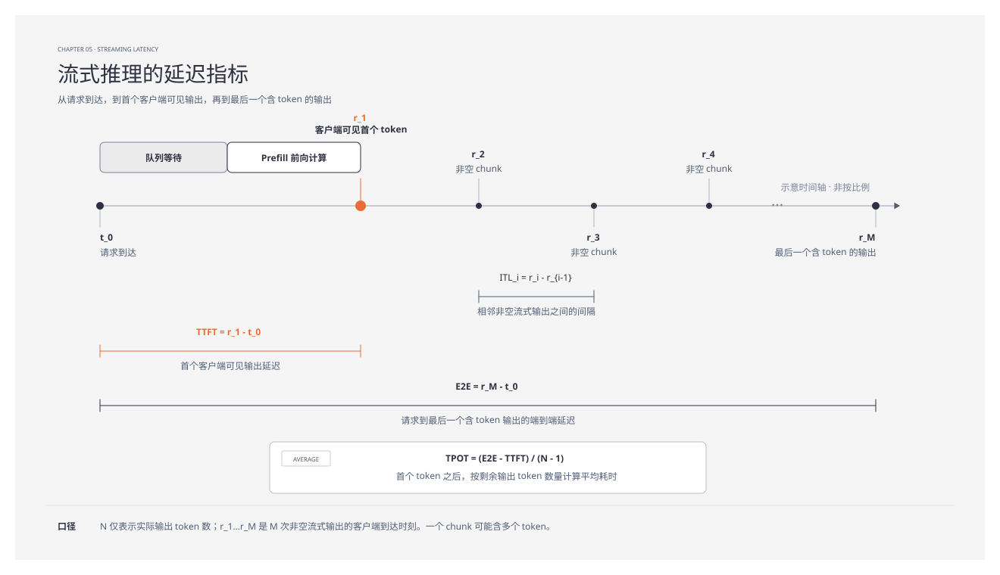
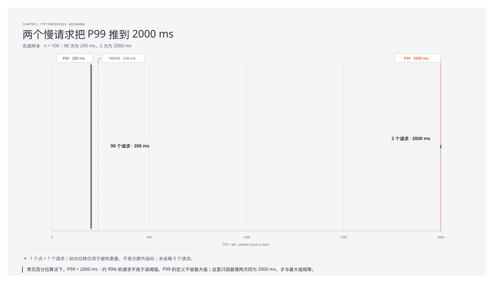

# 推理基准：延迟、吞吐、Goodput 与观测边界

```{contents} 本页目录
---
depth: 2
local: true
---
```

前面已经解释模型前向、GPU 执行和 KV Cache 的成本。现在把这些机制变成可验证的工程判断：一项优化改善了哪段延迟、在怎样的请求下有效，又能否由别人复现。Benchmark 提供这套测量方法。

推理服务没有脱离条件的“速度”。模型、tokenizer、硬件、服务配置、请求分布和施压方式都会改变结果。可靠的 Benchmark 先固定这些输入，再比较延迟、吞吐与失败情况；缺少实验条件的单个 token/s 数字，很难支持工程决策。

## 能力评测与推理压测回答不同问题

模型能力评测考查输出质量，推理压测观察一个已经部署的服务怎样处理请求。两者可以使用同一个模型，却不能共用结论。MMLU、GSM8K、HumanEval 或 SWE-bench 的分数不能说明服务能承受多少并发；推理延迟很低，也不能证明回答更准确。

| 评测对象 | 输入 | 常见指标 | 回答的问题 |
|-|-|-|-|
| 模型能力 | 有标准答案或评分规则的任务 | 准确率、Pass@k、任务得分 | 模型回答得怎样 |
| 推理工作负载 | 真实或合成的请求序列 | TTFT、TPOT、ITL、E2E、吞吐与失败率 | 服务跑得怎样 |

本章所说的 Benchmark 都指后一类。它适合验证系统优化、比较部署配置，也适合在给定响应目标后寻找容量边界。结果可以写成一个带条件的函数：

$$R=f(\text{模型与 tokenizer},\text{硬件},\text{服务配置},\text{请求分布},\text{负载方式})$$

可复现性与代表性需要同时交代。固定长度、固定并发的合成请求便于隔离变量，却未必像线上流量；生产 trace 更接近真实分布，也会带入热门前缀、用户行为和时段差异。验证优化时，可以先用受控负载确认收益，再用接近业务的分布检查收益是否仍然存在。

跨模型比较 token/s 还要固定 tokenizer。不同 tokenizer 会把同一段文字切成不同数量的 token，分子一旦变化，token/s 就不能直接解释成用户看到的文本速度。

## 一次请求同时产生四种延迟

对流式请求，把客户端发出请求的时刻记为 $t_0$。客户端收到第一个非空、含 token 的流式输出记为 $r_1$，最后一个含 token 的输出记为 $r_M$；$M$ 是非空输出块数量，$N$ 是实际输出 token 数。尾随空响应、usage-only 块和 `[DONE]` 不计入这里的结束时刻。

| 指标 | 客户端口径 | 它回答的问题 | 解释边界 |
|-|-|-|-|
| TTFT | $r_1-t_0$ | 用户多久看到首段输出 | 包含网络、排队、首段计算与返回，不等于纯 Prefill |
| E2E | $r_M-t_0$ | 最后一段有效输出多久到达 | 按最后一个含 token 的输出结束 |
| TPOT | $\frac{\mathrm{E2E}-\mathrm{TTFT}}{N-1}$ | 首个 token 之后，平均每个输出 token 花多久 | $N=1$ 时无定义；必须使用实际输出量 |
| ITL | $r_i-r_{i-1}$ | 相邻非空流式输出之间有没有停顿 | 一个 chunk 可能包含多个 token，因此客户端 ITL 未必是逐 token 延迟 |



*图：一次流式请求的客户端时间线。横向位置用于说明先后关系；一个非空 chunk 可能携带多个 token。*

四个指标观察的是同一请求的不同阶段。输入变长、队列变深或前缀缓存状态变化，往往先推高 TTFT。长输出会让 E2E 更受后续生成影响，ITL 则更容易暴露生成过程中的停顿。定位问题时，先确认哪段时间变了，再回到服务端 trace 或 profiler 查原因。

上表采用“内容完成”口径，把最后一个含 token 的输出作为 E2E 终点。工具的实现未必相同：提交 `b252acef` 的 SGLang serving 客户端会在解析每个非空 SSE 帧之前刷新请求 latency，因此尾随元数据或 `[DONE]` 可能进入工具输出的 E2E 与 TPOT，具体取决于 backend 返回的帧。对比结果前要核对解析路径；需要严格使用内容完成口径时，应从原始流式事件重新计算。

非流式响应也要单独标注。客户端只能在完整响应到达后计时，无法观测真正的首段等待；把这个时间命名为 TTFT 会混淆口径。报告还应写明 backend、是否流式，以及 token 数来自服务端 usage 还是重新计数。

## 吞吐必须和 SLO 一起看

设正式测量的墙钟时长为 $T$，成功完成的请求数为 $K$，第 $i$ 个成功请求的输入、输出 token 数分别为 $I_i$、$O_i$。常见吞吐需要把分子写清：

$$Q_{req}=\frac{K}{T},\qquad Q_{out}=\frac{\sum_i O_i}{T},\qquad Q_{total}=\frac{\sum_i(I_i+O_i)}{T}$$

| 指标 | 单位 | 分子 | 报告时还要说明 |
|-|-|-|-|
| 请求吞吐 | request/s | 成功请求数 | 总请求数、失败数与超时规则 |
| 输出吞吐 | token/s | 实际输出 token 总数 | 是否包含提前结束的请求 |
| 总 token 吞吐 | token/s | 输入与输出 token 总数 | tokenizer 与计数口径 |

并发增加后，GPU 可能获得更饱满的 batch，队列等待也可能随之增长。吞吐因此要和预先声明的服务目标 SLO 一起看。设适用的 TTFT、TPOT 或 E2E 阈值已经在测试前确定，按请求计算的 Goodput 可以写成：

$$G=\frac{\left|\{i\mid i\text{ 成功且满足全部适用 SLO}\}\right|}{T}$$

这个定义的单位是 request/s。`sglang.benchmark.serving` 会输出多种吞吐和延迟统计，但不直接计算这项 Goodput。`--output-details` 保存逐请求 TTFT、ITL、输出长度、生成文本与错误等字段，可按其中已有的字段离线筛选；它不导出逐请求的工具口径 E2E 或 TPOT。SLO 若包含后两项，需要另加观测或从原始流式事件按统一口径重算。SLO 是本次测试采用的服务目标，不应在没有合同语境时写成 SLA。

容量测试也不能停在一个压力点。保持模型、数据集和服务配置不变，逐步提高到达率或并发上限，记录成功率、尾延迟、吞吐与 Goodput，才能看到低负载、排队和饱和区间。可用容量应落在 SLO 仍然成立的区域内。同样一组请求由不同层级的工具观察，会保留不同的系统开销，因此下一步要先确定 Benchmark 的观测边界。

**并发上限与到达率的稳态耦合（Little 定律）：**在统计边界一致的稳态区间内，平均在途请求数满足 $\bar N=\lambda\bar W$。若单请求平均耗时 $\bar W\approx 2\ \mathrm{s}$，希望维持 $\lambda=16\ \mathrm{request/s}$ 的发出速率，平均需要约 32 个在途槽位；若客户端把并发上限锁在 8，同样响应时间下实际发出速率最高只能到约 4 request/s。开放负载压测应同时记录计划到达时刻与实际发出时刻，防止客户端信号量掩盖服务端的真实排队。

## 不同工具观察推理链路的不同边界

SGLang 的四个 Benchmark 工具经过不同层级。只有先确定自己要保留哪些开销，数字才有解释空间。

| 工具 | HTTP | Scheduler | 观察边界与用途 |
|-|-|-|-|
| `python -m sglang.benchmark.serving` | 是 | 是 | 在线动态负载，覆盖客户端、HTTP、调度与模型执行；用于 TTFT、TPOT、ITL、E2E、吞吐和分位数 |
| `python -m sglang.benchmark.one_batch_server` | 是 | 是 | 默认发送一次静态 HTTP batch；启用 multi-batch 后 Scheduler 可拆成多轮，不代表稳态 serving |
| `python -m sglang.benchmark.offline_throughput` | 否 | 是 | 默认直接调用 Engine.generate，绕过 HTTP、保留 Scheduler；用于离线吞吐 |
| `python -m sglang.benchmark.one_batch` | 否 | 否 | 直接驱动 ModelRunner 的 extend／decode；覆盖一次模型前向中的多个算子与 kernel，不是单 kernel Benchmark |

`one_batch` 的数字通常比在线请求少了排队、调度与网络开销，却仍然包含模型前向中的多种计算。若要把收益归因到某个 kernel，需要配合 profiler 或专门的 microbenchmark。不同工具可以逐层缩小问题，结果不能互相替代。选定观测边界后，还要让请求分布与目标场景相符，否则测得再精确，也会回答错问题。

**稳态测量窗口约束：**SGLang 官方文档建议在线 serving 压测至少满足 `num-prompts >= 5 * max-concurrency`（例如并发上限 16 时至少发 80 条请求），以摊薄冷启动爬坡与尾段排空占比；是否真正进入稳态，仍需结合活跃并发、吞吐与延迟随时间的变化曲线核验。

静态 batch 工具需要另外解释测量窗口：

| 测试方式 | 可以回答什么 | 不能直接推出什么 |
|-|-|-|
| `one_batch_server` 默认单 batch | 一批请求经过 HTTP、调度与模型后的延迟 | 稳态在线服务的容量与尾延迟 |
| `one_batch_server --enable-multi-batch` | 让超出服务端活跃上限的请求排队，观察多批次整体吞吐 | 原文只将 `overall_throughput` 视为该模式的主要结论；其他吞吐、`last_ttft` 和 ITL 含跨批排队，需单独解释 |
| `one_batch_server --disable-ignore-eos` | 真实 prompt 下允许提前结束，保留 EOS 行为 | 整场输出吞吐仍包含 batch 逐渐缩小的尾段；稳态列只覆盖最后一个请求首 token 到第一个请求结束的共同 Decode 窗口 |
| `one_batch` | 隔离固定 batch 的模型前向，便于分析算子和 kernel | 它绕过 Scheduler，没有动态准入和 Prefill 切块，可能在真实服务能调度的 batch size 上 OOM |

当前官方示例还支持通过 `--load-format dummy` 使用合成权重，以及通过 `--json-model-override-args` 改变模型配置，适合快速检查形状、显存和执行路径；这类结果不能验证输出质量，改过层数或 KV head 数后的数字也不能当作原模型性能。

以上补充按 2026 年 11 月 10 日读取的 [SGLang Benchmark and Profiling](https://docs.sglang.io/docs/developer_guide/benchmark_and_profiling) 整理，独立于前文 serving 客户端的固定提交。参数是否存在、默认值及统计字段，应以目标环境的 `--help` 和结果文件为准。

## 请求分布决定 Benchmark 测到了什么

工作负载至少要描述输入长度、实际输出长度、到达过程和前缀共享。单轮或多轮、EOS 策略、采样参数也会改变服务实际执行的工作。数据集的名字只是入口，报告仍要写出筛选与构造方式。

| 数据集 | 请求怎样构造 | 适合观察 | 主要边界 |
|-|-|-|-|
| `sharegpt` | 从真实会话中抽取 prompt 与目标输出长度 | 对话长度分布下的在线表现 | 具体版本未必回放完整多轮 |
| `random` | 截断或重复 ShareGPT 文本，使其达到采样的目标长度 | 受控长度下的容量与饱和区间 | 不保留真实请求分布与前缀热度 |
| `generated-shared-prefix` | 让多组请求共享合成前缀 | 前缀复用和缓存命中 | 不能自动代表线上前缀热度 |
| `agentic-trace` | 按多轮消息增量回放上下文 | 上下文增长与多轮服务开销 | 外部工具执行时间不在模型服务结果内 |

有限的 `--request-rate λ` 用指数分布采样相邻到达间隔，对应平均到达率为 $\lambda$ 的泊松过程。`--max-concurrency C` 用客户端信号量限制在途请求数。它是客户端上限，不是服务端 batch size。两者同时设置时，并发槽位不足会限制实际发出的流量。

信号量之前的等待也有明确边界：它不进入单请求 TTFT 或 E2E，因为请求计时在取得并发槽位后才开始；它仍然进入整场 Benchmark 的墙钟时间，因而会影响总吞吐。若业务关心请求进入本地待发送队列后的完整等待，需要另外记录 admission-to-completion 延迟。

下面是一条按固定提交核验过的 serving 示例。服务需要提前在 `127.0.0.1:30000` 启动；这条命令只运行客户端。原生 `sglang` backend 不会用 `--model` 切换服务端模型，该参数主要用于 tokenizer 与数据准备，因此服务端实际加载的模型也要单独核对。

```bash
python -m sglang.benchmark.serving \
  --backend sglang \
  --base-url http://127.0.0.1:30000 \
  --model Qwen/Qwen2.5-7B-Instruct \
  --dataset-name random \
  --num-prompts 160 \
  --request-rate 16 \
  --max-concurrency 32 \
  --random-input-len 1024 \
  --random-output-len 256 \
  --random-range-ratio 1.0 \
  --seed 42 \
  --output-details \
  --output-file benchmark-results.jsonl
```

`--request-rate 16` 生成平均每秒 16 个请求的泊松到达，`--max-concurrency 32` 限制客户端在途请求。`--random-range-ratio 1.0` 把目标输入、输出长度固定在参数给出的值；默认 `0.0` 会分别在 1 到上限之间采样。`--seed 42` 固定客户端随机过程，`--output-details` 保存逐请求明细。`--output-file` 以 JSONL 追加写入，批量实验应为每次运行使用唯一文件名，避免把多轮结果误当成一轮。负载定义清楚后，最后还要固定实验条件，并检查平均值可能掩盖的尾延迟。

## 可比结果需要固定条件并检查尾延迟

平均值会把少量慢请求摊薄。下面的合成样本包含 100 个请求：98 个 TTFT 为 200 ms，2 个为 2000 ms。均值只有 236 ms，P50 仍是 200 ms；按 nearest-rank 计算，P99 已经达到 2000 ms。这里 P99 与最大值重合，只因为最慢的两个样本取值相同，P99 按定义并不等于最大值。



*图：100 个合成 TTFT 样本。每个点代表一个请求，横轴是线性延迟尺度，纵向展开只用于避免点重叠。*

高分位数还依赖样本量与算法。请求很少时，P99 可能只由极少数观测决定；不同分位数实现也可能在样本之间采用不同插值。报告应保留原始逐请求数据，注明分位数算法，运行多轮并给出各轮离散程度。失败请求即使没有进入成功延迟集合，也必须单独报告。

| 类别 | 需要固定或披露的条件 |
|-|-|
| 软件 | SGLang commit、依赖与 kernel 版本、服务启动参数 |
| 模型 | 权重、tokenizer、精度或量化、上下文上限、采样与 EOS 策略 |
| 硬件 | GPU 型号与数量、并行方式、互连、功耗状态与共享负载 |
| 工作负载 | 数据集版本、过滤规则、输入与实际输出长度分布、共享前缀和多轮方式 |
| 施压方式 | 请求总数、request-rate、max-concurrency、预热、缓存状态与正式测量窗口 |
| 结果 | 成功率、各吞吐分子的定义、TTFT／TPOT／ITL／E2E 的 P50、P95、P99，以及 SLO 和 Goodput 规则 |

预热请求用于让初始化、编译和内存分配趋于稳定，不应混入正式样本。缓存是否清空则由问题决定：冷前缀测试需要控制清空时点，稳定命中测试需要固定请求顺序并披露缓存状态。后台任务、功耗状态或同机租户发生变化时，应重跑实验。

至此，延迟指标（TTFT、TPOT、ITL、E2E）、有效吞吐（Goodput）、测试工具层级与尾延迟统计口径已经统一。客户端压测工作流（AIPerf 容量扫描与轨迹回放）和服务端 Profiler 时间线归因统一放在第 24 章生产调优篇展开；下一章直接进入 Mini-SGLang 源码，从进程拆分与一条真实请求的全链路开始拆解推理引擎。
