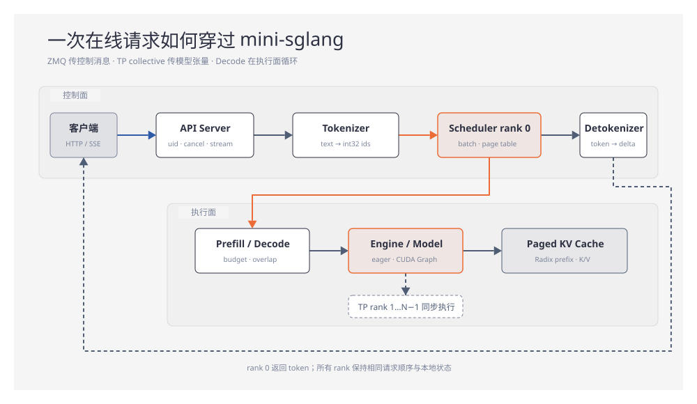
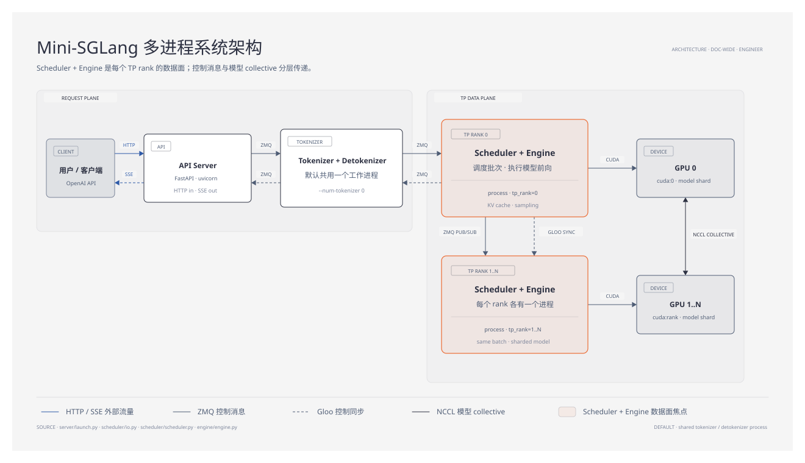
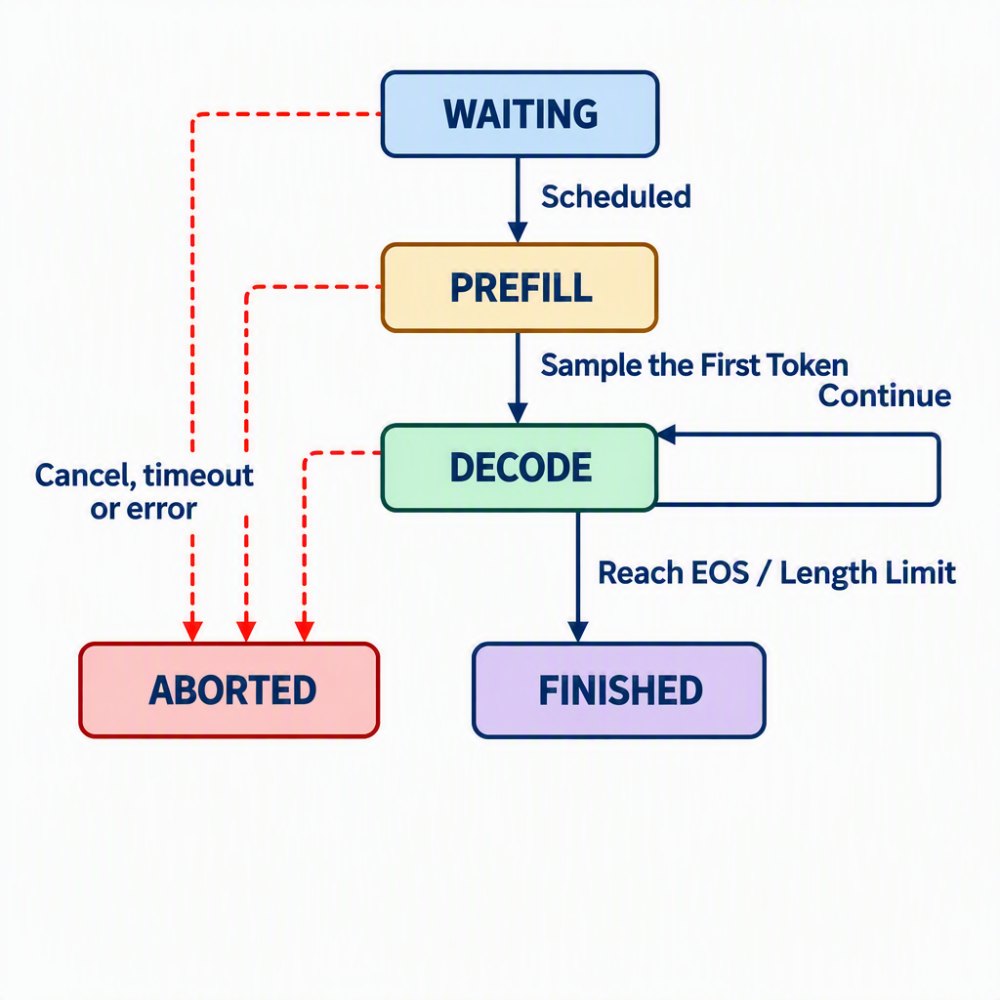
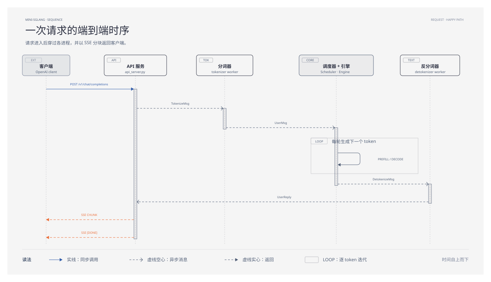

# Mini-SGLang 系统骨架与请求全链路

```{contents} 本页目录
---
depth: 2
local: true
---
```

前四章建立了自回归生成、GPU Roofline、KV 容量与 Benchmark 口径。从本章起进入第二篇源码走读：先搭起 Mini-SGLang 的静态进程拓扑与核心状态对象，再紧随一条固定聊天请求 `R0` 走完从 `POST /v1/chat/completions` 到 SSE 流式返回的完整闭环。本篇源码以官方主干提交 `9a91cfa` 为统一基线；本地仓库扩展提交 `467f2eb` 新增的延迟准入机制在第 6 章单独标明。

## 系统边界从进程拆分开始

在线服务由一个 API Server、一个默认兼任输入分词的 Detokenizer worker，以及每张 TP GPU 对应的 Scheduler/Engine 进程组成。配置 `num_tokenizer>0` 后，输入分词交给独立 Tokenizer worker。控制消息通过 ZeroMQ 传递，TP 数值通信通过 PyNCCL 或 torch.distributed 完成。不同进程可以推进不同请求的阶段，同时保留单请求内部依赖。



*图：在线请求穿过进程边界，并在 Scheduler/Engine 内形成逐 token 闭环。*

上图采用 `num_tokenizer>0` 的拓扑；默认 `num_tokenizer=0` 时，输入 Tokenizer 与 Detokenizer 由同一个 worker 承担。

| 运行入口 | 是否经过 HTTP / ZMQ | 分词、执行与返回方式 |
|-|-|-|
| `python -m minisgl` | 经过 HTTP；worker 间经过 ZMQ + msgpack | 启动 FastAPI、Tokenizer/Detokenizer 与各 TP rank 的 `Scheduler`；聊天消息套 chat template，增量解码后返回 SSE 或一次性 JSON。 |
| `--shell-mode` / `minisgl.shell` | 不经过 HTTP，仍走 ZMQ 后端链路 | 在主进程直接构造请求并维护本地对话历史，复用完整的 Tokenizer、Scheduler 与 Detokenizer 进程组。 |
| `minisgl.llm.LLM` | 不经过 HTTP、ZMQ 或独立 worker | 继承 `Scheduler` 并置 `offline_mode=True`，单进程内编码 Prompt、运行 Engine，收齐全部输出 token ID 后一次性 `decode()`（不自动套在线 chat template）。 |

### 拆进程让不同阶段同时推进

HTTP 收发主要等待网络，分词与增量解码主要消耗 CPU，模型 forward 则把工作交给 GPU。把这些阶段放进不同进程后，请求 A 在 GPU 上继续 Decode 时，Tokenizer 可以处理请求 B 的长输入，API Server 也能继续接收新连接。这里重叠的是不同请求或不同阶段的工作，单个请求内部的先后依赖并没有消失。

进程拆分也给扩缩容提供了观察边界。如果长输入堆在分词队列，而 GPU 经常等不到可运行请求，增加 `num_tokenizer` 才可能缩短供给时间；如果 GPU 已经饱和，继续增加 Tokenizer 只会把等待转移到 Scheduler 前面。该扩哪个 worker，应由队列长度、CPU 占用和 GPU timeline 共同决定。

Tensor Parallel 的 worker 不能按普通副本理解。Mini-SGLang 为每张 GPU 启动一个 Scheduler 进程，各 rank 共同处理同一个 Batch，必须保持请求顺序和 collective 次序一致，不能各自挑选不同请求；第 8 章〈[Tensor Parallel 让多个 Rank 计算同一批请求](https://bytedance.larkoffice.com/wiki/EZcawGzFrirc8bkkvuqclJCpnXd#doxmyDT2nZNI5SZU6lBDH87YNqb)〉会系统展开这组同步条件。

代价也随边界出现：消息要经过 ZeroMQ 与 msgpack，启动时要同步状态，进程退出后还可能留下其他组件正在等待的请求。清晰的进程归属有助于沿 uid 定位故障，却不会自动带来恢复能力；关闭、超时与重启仍需协调。理解这组取舍后，再看下一节的职责视图，就能把“谁在运行”和“系统要完成什么”分开。

### 启动入口与进程配置

| 进程 | 启动位置 | 职责 |
|-|-|-|
| API Server | `python/minisgl/server/api_server.py:411-452` | 接收 HTTP，维护 uid 与异步等待状态，输出 JSON 或 SSE。 |
| Scheduler，按 TP rank 各一个 | `python/minisgl/server/launch.py:59-69` | 管理请求、KV cache、批处理和本 rank 的 Engine。 |
| 唯一 detokenizer worker | `python/minisgl/server/launch.py:71-87` | 接收生成 token，增量解码并回复前端；默认配置下也负责输入 tokenize。 |
| 可选 tokenizer workers | `python/minisgl/server/launch.py:88-103` | 仅在 `num_tokenizer > 0` 时创建，分担输入 tokenization。 |

`python/minisgl/__main__.py` 直接调用 `launch_server()`：主进程先绑定前端 ZMQ 队列，再拉起后端子进程，最后启动 uvicorn。`ServerArgs.num_tokenizer` 默认是 `0`，此时 `share_tokenizer` 为真，名为 `minisgl-detokenizer-0` 的单个 worker 运行 `tokenize_worker()`，同时分派 `TokenizeMsg`、`DetokenizeMsg` 和 `AbortMsg`。

若传入 `--num-tokenizer 1`，输入和输出才走不同地址：独立 tokenizer 接收前端请求，唯一 detokenizer 接收 scheduler 返回。这个开关改变进程拓扑，不改变后续消息结构。

## 职责视图区分控制路径与数据路径

进程边界回答谁在运行，职责视图回答系统必须完成什么。Mini-SGLang 可以归纳为接口与生命周期、请求编排、模型执行、状态与内存管理四类职责；这是逻辑划分，不等同于源码类或运行时进程。

Scheduler 选择本轮请求并组织 Batch；数据路径承载 `input_ids`、position、logits 与 KV Cache，逻辑视图主要经过 Batch、Model Runner 和 Attention backend。Model Runner 是逻辑职责；它分散在 `Scheduler._prepare_batch()`、`Scheduler._forward()` 与 `Engine.forward_batch()`，没有同名源码类。

读调度、缓存或 Attention 代码时，先判断变化属于哪条路径，再追两条路径在 Batch 契约上的汇合点，能避免把调度决策和张量执行混为一谈。

Mini-SGLang 的核心结构可以用一句话概括：多进程控制面把文本和 token 送到 rank 0，每个 TP rank 内都有一套 `Scheduler + Engine`，模型层再用 collective 合并各 rank 的局部结果。



*图：Mini-SGLang 控制路径（ZMQ + Gloo）与数据路径（各 TP rank 内的 Engine 前向及 NCCL 集合通信）职责分界。*

图中的控制面与数据面要分开理解。API、Tokenizer、Detokenizer 和 Scheduler 之间使用 ZMQ 与 msgpack，传递请求元数据和 CPU token。多 rank 的消息数量同步与初始化信息交换使用 Gloo。模型张量的 all-reduce、all-gather 走 NCCL，默认由本仓库的 TVM-FFI 包装器调用原生 NCCL C API。

## Req、Batch 与 Context 构成状态主轴

`Req` 是贯穿推理循环的核心对象。它同时记录 CPU token、页表行号、前缀缓存命中长度、当前设备长度、最大设备长度、采样参数和缓存句柄。三个长度之间保持下面的关系：

$$0\leq cached_len<device_len\leq max_device_len$$

`cached_len` 表示已拥有可读 K/V 的前缀长度，`device_len` 表示本轮输入区间的逻辑终点，`max_device_len` 表示输入长度加最大输出额度。单步推进函数 `complete_one()` 与容器状态机的完整演进放在第 6 章集中核对。

| 对象 | 保存什么 | 为何存在 |
|-|-|-|
| `Req` | 单个请求的 token、长度、页表索引与缓存句柄 | 把请求生命周期、显存占用和采样终止条件放到同一状态上。 |
| `Batch` | 本轮请求、Prefill/Decode 阶段、输入位置、写入位置与 Attention 元数据 | 把 Python 请求状态冻结成一次 GPU 前向的数据协议。 |
| `Context` | 全局context：页表、KV Cache、Attention/MoE 后端与当前 Batch | 让模型层读取运行时布局，避免把同一批元数据逐层传参。 |

`Context.forward_batch()` 是一个进程内上下文管理器。进入模型前设置当前 batch，退出时清空，并拒绝嵌套调用。它简化了模型接口，也意味着全局 Context 是进程局部状态：每个 TP worker 都要独立初始化，不能跨进程共享 Python 对象。

### 请求状态图只用于讲清流程

`Req` 保存单个请求的进度，`Batch` 描述本轮模型执行，`Context` 提供一次 forward 共享的运行时依赖。把它们放回请求生命周期，可以得到一张便于推演的概念图：



- `WAITING` 表示请求已经接收，还没有进入模型计算。
- `PREFILL` 处理输入 prompt，建立初始 KV Cache，并计算首个输出 token 所需的 logits。
- `DECODE` 每轮处理新生成的 token，并把新的 K/V 追加到缓存。
- `FINISHED` 表示已经生成 EOS，或达到最大生成长度。
- `ABORTED` 表示概念上的中止状态；mini-sglang当前只显式处理取消，没有超时状态，也不保存同名枚举。

**图中的状态名用于讲清流程，不是源码里的持久化枚举名称。**Prefill 和 Decode 由 `Batch.phase` 明确区分；`Req.extend_len = device_len - cached_len` 只表示单个请求本轮需要计算的 token 数，不能单独判断阶段。

### 用运行时对象定位后续代码

| 对象 | 它回答的问题 | 源码入口 |
|-|-|-|
| `SamplingParams` | 这个请求怎样采样、何时停止？ | `python/minisgl/core.py:15` |
| `Req` | 单个请求当前算到哪里、缓存到哪里、还能生成多少？ | `python/minisgl/core.py:28` |
| `Batch` | 这一轮 GPU forward 要一起算哪些请求？ | `python/minisgl/core.py:71` |
| `Context` | 模型层如何拿到当前 Batch、KV pool 和 backend？ | `python/minisgl/core.py:100` |
| `Scheduler` | 下一轮算 prefill 还是 decode，资源如何准备？ | `python/minisgl/scheduler/scheduler.py:45` |
| `CacheManager` | 请求需要的物理 KV 页从哪里来、何时归还？ | `python/minisgl/scheduler/cache.py:15` |
| `Engine` | 单个 rank 如何装配模型、执行 forward、采样并复制结果？ | `python/minisgl/engine/engine.py:29` |
| `BaseAttnBackend` | KV 怎样写入，paged attention 怎样读取历史上下文？ | `python/minisgl/attention/base.py:18` |

<callout emoji="🔑">
**贯穿全篇的关键：**`Batch` 是 Scheduler、Engine、Attention metadata、CUDA Graph 和 Sampler 之间的进程内运行时契约。它不会跨 ZMQ 传输，跨进程传递的是各种消息对象。
</callout>

## 调度与缓存共同把请求变成可执行批次

Scheduler 在 Prefill 与 Decode 之间选择本轮请求，页表把逻辑 token 位置映射到物理 KV 槽位，Radix Cache 再复用页对齐的公共前缀。准入预算与分块 Prefill 见第 6 章〈[Scheduler 把请求组织成可执行的 Batch](https://bytedance.larkoffice.com/wiki/EZcawGzFrirc8bkkvuqclJCpnXd#doxmyOsEF19gE265nfAXa4tWjSd)〉，物理池与页所有权交接见第 7 章〈[KV Cache 管理请求历史与显存](https://bytedance.larkoffice.com/wiki/EZcawGzFrirc8bkkvuqclJCpnXd#doxmysdTE7gsDSqZ2bPNy2Vtxbf)〉，双流重叠时序见第 11 章〈[CUDA Graph 与双流流水线隐藏 Decode 开销](https://bytedance.larkoffice.com/wiki/EZcawGzFrirc8bkkvuqclJCpnXd#doxmyX1IsQtSwPsMTTOoye90aqg)〉。

## 初始化顺序先划定显存与后端边界

Engine 依次建立设备与 CUDA stream、TP 通信、`meta` device 上的模型结构和当前 rank 的权重分片，再根据加载前后的可用显存规划 KV Cache。这个顺序避免临时权重抢占缓存空间，也为后端和 CUDA Graph 的初始化提供稳定依赖。

模型加载前后各测一次可用显存，据此计算 KV 页数：

$$bytes_{page}=2\times L\times H_{kv}^{local}\times D\times S\times bytes_{dtype}$$

$$P=\left\lfloor\frac{memory_ratio\times M_{before}-M_{model}}{bytes_{page}}\right\rfloor$$

每个 TP rank 都执行同一段页数计算；计算前先跨 rank 同步可用显存，差异超过 2 GiB 时直接报错，再用同步后的值算出一致页数。KV 池还预留一页 dummy page，随后才能创建页表、Attention 与可选 MoE 后端、Sampler 和 GraphRunner：Attention 依赖 KV Cache，Graph capture 又依赖模型、缓存、后端与固定缓冲区全部就绪。

## 跨层协议决定请求能否持续推进

Mini-SGLang 的性能来自一组连续成立的契约。Scheduler 维护的长度状态决定页表怎样预留；页表决定新 K/V 的写入位置和 Attention 元数据；稳定的 Decode 形状让 CUDA Graph 可以 replay；一致的请求顺序保证各个 TP rank 进入相同的 collective，并得到一致的采样结果；Detokenizer 最后把 token 流还原成稳定的增量文本。任何一层改变接口，影响都会沿这条链继续传递。

因此，修改调度策略时要同时检查缓存预留和多 rank 顺序；接入 Attention backend 时要覆盖 eager、capture 与 replay 的元数据协议；增加模型时要对齐注册、权重命名、TP 分片和 LM Head；扩展采样能力时还要贯通 API 参数、消息序列化、GPU Sampler 与各 rank 的随机状态。这里先明确这些接口关系，具体实现分别交给后续章节。

静态骨架明确后，本篇后续七章严格顺着请求与张量的执行依赖逐层下钻（先在第 8 章立住多卡通信与分片规则，再在第 9 章读取单卡分片后的局部张量形状）：

| 后续章节 | 核心问题 | 主要源码落点 |
|-|-|-|
| Scheduler 把请求组织成可执行的 Batch | 连续批处理、准入预留、延迟准入与分块 Prefill | `core.py`、`scheduler/{scheduler,prefill,decode,table}.py` |
| KV Cache 管理请求历史与显存 | 物理池、token 级页表、Radix 树分裂与四段交接 | `kvcache/`、`scheduler/cache.py` |
| Tensor Parallel 让多个 Rank 计算同一批请求 | Rank 0 消息广播、PyNCCL 与同序集合通信 | `distributed/`、`scheduler/io.py`、`pynccl.cu` |
| 模型执行与采样：从 Batch 到 token | `meta` 构造、RoPE 扩展、局部 Shape 账本与 Sampler | `models/`、`layers/`、`engine/sample.py` |
| Attention Backend 把 Q/K/V 接入 Paged KV Cache | FA / FI / TRTLLM 页表转换、`plan` 与卡内 `split-KV` | `attention/{base,fa,fi,trtllm}.py` |
| CUDA Graph 与双流流水线隐藏 Decode 开销 | Bucket 捕获重放、dummy 隔离与双流 `wait_stream` | `engine/{engine,graph}.py` |
| 自定义 Kernel 与系统收官实验 | TVM FFI、融合 MoE Triton 算子与全系统消融验收 | `kernel/`、`tests/`、`benchmark/` |

下面先固定一条在线流式请求 `R0`，沿着已建立的进程与 ZMQ 通道追完它的正反向生命周期。

## 先固定一条示例请求

### R0 是一条流式聊天请求

后文都以 R0 为例。它包含一条 system 消息和一条 user 消息，要求最多生成 16 个 token，并使用确定性采样。

```json
{
  "model": "Qwen/Qwen3-0.6B",
  "messages": [
    {"role": "system", "content": "你是一个简洁的技术助手。"},
    {"role": "user", "content": "用一句话解释 KV cache。"}
  ],
  "max_tokens": 16,
  "temperature": 0,
  "top_k": 1,
  "stream": true
}
```

FastAPI 用 `OpenAICompletionRequest` 接收 R0。`messages` 中的元素先成为 Pydantic `Message`，随后通过 `model_dump()` 还原成只含 `role` 和 `content` 的字典。这里尚未 tokenization，也没有进入 GPU。

### R0 会先获得一个 uid

`FrontendManager.new_user()` 从进程内计数器取得整数 `uid`，同时创建 `ack_map[uid]` 和 `event_map[uid]`。前者暂存返回的 `UserReply`，后者唤醒正在等待该用户输出的异步协程。这个 `uid` 会贯穿整条链路；它是请求关联键，不是认证信息，也不是由客户端传入的 OpenAI request id。

## 跨进程传递的是消息，不是 Python 调用栈

### 四类主消息完成两次表示转换

| 消息 | 关键字段 | 方向与含义 |
|-|-|-|
| `TokenizeMsg` | `uid`、`text`、`sampling_params` | API Server → tokenizer。`text` 可以是字符串，也可以是消息字典列表。 |
| `UserMsg` | `uid`、`input_ids`、`sampling_params` | tokenizer → scheduler。`input_ids` 是 CPU 上的一维 `torch.int32` Tensor。 |
| `DetokenizeMsg` | `uid`、`next_token`、`finished` | scheduler rank 0 → detokenizer。每条消息携带一个生成 token 和结束标记。 |
| `UserReply` | `uid`、`incremental_output`、`finished` | detokenizer → API Server。数字 token 已变成可向用户发送的增量文本。 |
| `AbortMsg` / `AbortBackendMsg` | `uid` | 前端取消先到 tokenizer，再转换成 scheduler 能处理的后端消息。 |

### 消息先变成字典，再由 msgpack 编码

`python/minisgl/message/utils.py` 的 `serialize_type()` 会写入 `__type__`，递归处理 dataclass、列表和字典。Tensor 目前只允许一维，序列化结果包含原始字节 `buffer` 和 `dtype`；反序列化时先用 NumPy 解释字节，再复制成 CPU Tensor。`python/minisgl/utils/mp.py` 的各类 ZMQ Queue 把这个字典交给 msgpack，并通过 PUSH/PULL 或 PUB/SUB socket 发送。

这解释了两个常见误区。第一，跨进程传递的 `UserMsg` 不是共享同一个 Python 对象；接收端重新构造了对象。第二，大模型张量不会沿这条 msgpack 通道来回传送。控制消息与 token 走 ZMQ，TP rank 间的模型计算通信由 torch.distributed 或 PyNCCL 负责。

### 批量消息只负责装箱，不改变单条语义

三个方向各有批量包装：`BatchTokenizerMsg`、`BatchBackendMsg` 和 `BatchFrontendMsg`，字段都只有一个 `data` 列表。worker 会先把批量包装拆成单条消息，按实际类型分组处理；输出数量为一时又退回单条消息。批量包装的目的，是减少队列发送次数，并不把多个用户合并成一个 uid，也不改变每条请求的采样参数。

`tokenize_worker()` 中的 `local_bs` 控制一次从队列聚合多少消息。当前启动代码给 tokenizer 与 detokenizer 都传入 1，所以在线默认路径通常以单条消息收发，批量类型仍为后续扩展和 scheduler 一次回复多个请求保留。读代码时要把“消息批量”与“GPU Batch”分开：前者是 IPC 装箱，后者才是一次模型 forward 的计算集合。

## R0 的正向链路从 HTTP 走到模型

### API Server 把协议对象收窄成 TokenizeMsg

`v1_completions()` 位于 `python/minisgl/server/api_server.py:255-310`。它选择 `messages` 或 `prompt`，创建 uid，并把当前已支持的采样字段写进 `SamplingParams`。R0 最终成为一个 `TokenizeMsg`，由 `FrontendManager.send_one()` 异步写入 tokenizer 的 ZMQ PUSH 队列。到这里，HTTP 请求对象已经完成职责；后端只认识仓库自己的消息类型。

### Tokenizer 把对话模板和分词分成两步

`tokenize_worker()` 在 `python/minisgl/tokenizer/server.py:30-108` 中循环收消息。对于 R0，`TokenizeManager.tokenize()` 发现 `text` 是消息列表，先调用 tokenizer 的 `apply_chat_template(..., tokenize=False, add_generation_prompt=True)` 得到完整 prompt 字符串，再调用 `encode(..., return_tensors="pt")`。结果被压成一维并转为 `torch.int32`，随后包装为 `UserMsg` 发往 backend 地址。

chat template、BOS、EOS 和具体 token 切分都由模型对应的 Hugging Face tokenizer 决定。Mini-SGLang 的加载入口是 `python/minisgl/utils/hf.py:17-27` 的 `load_tokenizer()`。本章只能确认调用方式，不能在未加载具体模型时断言 R0 会得到哪些 token id。

### Scheduler 把 R0 纳入本轮 Batch

Scheduler Rank 0 从 `zmq_backend_addr` 收到 `UserMsg`。多卡时，Rank 0 通过 ZMQ PUB 把原始消息广播给其他 Rank，并用 CPU process group 对齐消息数量；所有 Rank 执行同构的调度与 forward，只有 Rank 0 回传结果。Scheduler 随后从等待请求或运行中请求组成纯 Prefill 或纯 Decode Batch。

Scheduler 为 Batch 准备输入 token、位置、KV 写入地址、attention metadata 和采样参数，再交给 Engine。Engine 先以 eager 或 CUDA Graph 执行 `model.forward()`；随后在图外调用 `Req.complete_one()` 推进请求状态，并由 `Sampler.sample()` 从 logits 选出下一 token。最终 Prefill 已能产出首个有效 token，后续 Decode 通常每轮扩展一个 token。

采样 token 排入 GPU token pool 的写回，下一轮 Decode 直接读取该处；另一份异步复制到 CPU，Scheduler 等待 `copy_done_event` 后判定 EOS、长度上限并构造回复。请求状态与准入在下一章展开；模型前向、Attention 页表契约与双流时序分别见第 9 章〈[模型执行与采样：从 Batch 到 token](https://bytedance.larkoffice.com/wiki/EZcawGzFrirc8bkkvuqclJCpnXd#doxmyTjwgnLCFNIX7iKHS0V2TVh)〉、第 10 章〈[Attention Backend 把 Q/K/V 接入 Paged KV Cache](https://bytedance.larkoffice.com/wiki/EZcawGzFrirc8bkkvuqclJCpnXd#doxmy1RzCjnRNKFG0Ii3pRomff8)〉和第 11 章〈[CUDA Graph 与双流流水线隐藏 Decode 开销](https://bytedance.larkoffice.com/wiki/EZcawGzFrirc8bkkvuqclJCpnXd#doxmyX1IsQtSwPsMTTOoye90aqg)〉。

## 返回链路把 token 变成 SSE

### Scheduler 判定 finished 后发出 DetokenizeMsg

`Scheduler._process_last_data()` 等待 GPU 到 CPU 的 token 复制事件，取出 `next_token` 并追加到请求的 host `input_ids`。若输出预算耗尽，或在 `ignore_eos=false` 时生成 EOS，`finished` 就为真。完成的请求从 decode manager 移除并释放请求表与 KV cache 资源；未完成请求继续进入 decode。rank 0 把结果作为单条 `DetokenizeMsg` 或 `BatchTokenizerMsg` 发回。

### Detokenizer 按 uid 保存增量解码状态

`DetokenizeManager` 为每个 uid 保存 `DecodeStatus`，其中有已见 token、已解码字符串以及读取、上下文和发送偏移。它会对一段 token 上下文重新 `batch_decode()`，再计算本轮新增文本，而不是假定每个 token 都能独立解成稳定字符。遇到替换字符或尚不可安全输出的片段时，`find_printable_text()` 会按换行、CJK 字符和空格边界选择可发送部分。若完成 token 正好是 EOS，EOS 本身不会加入输出 token 列表。

下面的时序图展示两次表示转换：正向由 HTTP JSON 变成内部消息、token Tensor 和 Batch，返回由整数 token 变成增量文本、UserReply 和 SSE。箭头上的消息名与 ZMQ 边界说明数据由谁发送、由谁接收；Engine 与 Scheduler 同在一个 TP rank 进程内。



*图：示例请求 R0 的跨进程正反向消息时序（HTTP JSON → TokenizeMsg → UserMsg → Batch → DetokenizeMsg → UserReply → SSE）。*

`tokenize_worker()` 将增量字符串包装成 `UserReply` 发往 frontend 地址。`FrontendManager.listen()` 按 uid 放入 `ack_map`，设置对应 Event；`wait_for_ack()` 被唤醒后逐条产出回复。`stream_chat_completions()` 首块补上 `assistant` 角色，后续把非空文字放进 `delta.content`，结束时再发一个 `finish_reason="stop"` 的 chunk 和 `data: [DONE]`。

```json
data: {"id":"cmpl-0","object":"text_completion.chunk","choices":[{"delta":{"role":"assistant","content":"KV "},"index":0,"finish_reason":null}]}

data: {"id":"cmpl-0","object":"text_completion.chunk","choices":[{"delta":{},"index":0,"finish_reason":"stop"}]}

data: [DONE]
```

这段只是结构示意，不是 R0 的实测输出。具体文字切片由 tokenizer 和 `find_printable_text()` 决定，首块也可能只有角色而没有内容。SSE 中每个 JSON chunk 后有一个空行；`[DONE]` 是终止标记，不是 JSON。客户端若要重建完整回答，应按到达顺序拼接所有非空 `delta.content`。

当 `stream=false` 时，入口不创建 `StreamingResponse`。它仍走同一条后端链路，只是在 API Server 内循环等待 `UserReply`，把所有 `incremental_output` 拼成 `full_content`，最后返回一次性 JSON。这说明“后端逐 token 产生结果”和“客户端是否看到流式响应”是两层选择。

```text
POST /v1/chat/completions
  -> v1_completions
  -> TokenizeMsg
  -> TokenizeManager.tokenize
  -> UserMsg
  -> Scheduler._process_one_msg
  -> PrefillManager / DecodeManager
  -> Scheduler._prepare_batch
  -> Engine.forward_batch
  -> DetokenizeMsg
  -> DetokenizeManager.detokenize
  -> UserReply
  -> FrontendManager.wait_for_ack
  -> stream_chat_completions
  -> SSE [DONE]
```

复述这条顺序时，可以把它压缩成三次表示变化。请求先从 HTTP JSON 变成内部控制消息，再从文本变成模型可计算的 token 与 Batch，最后从采样 token 变回增量文字和 SSE。每次表示变化都由一个明确组件负责，组件之间用 uid 保持关联。若排查时发现字段仍正确却没有下一种表示，就把断点放在该次转换的发送端、队列和接收端，而不必一开始就进入模型算子。

## uid 让并发请求各自回到正确客户端

前端的 `ack_map`、`event_map`，Scheduler 中的 `PendingReq`、`Req`，Detokenizer 的 `decode_map` 以及四类主消息全部携带同一个整数 `uid`。并发 Batch 可以把多个请求合在一次 forward 中计算，返回时仍按 `uid` 精确拆回各自的异步生成器；排查串线问题时，先沿 `uid` 串起各进程日志，核查消息转换处有无遗漏。

`wait_for_ack()` 看到某条回复 `finished=true` 后退出，并删除前端状态。此后到达的同 uid 回复会被 `listen()` 忽略。默认 overlap scheduling 会让 CPU 调度与 GPU 计算重叠；某次完成判定发生时是否已有下一轮 GPU 工作在途，需要用运行 trace 验证，不能只凭静态调用顺序断言立即停算。

## 取消发生在流式发送边界

### 客户端断开后，AbortMsg 沿原路进入 scheduler

流式 HTTP 返回由 `stream_with_cancellation()` 包裹。它每次准备发送 chunk 时调用 `request.is_disconnected()`，也捕获外层传播的 `asyncio.CancelledError`。发现断开后，前端异步执行 `abort_user(uid)`：短暂等待，删除本地 ack/event 状态，再发送 `AbortMsg`。tokenizer worker 把它改写为 `AbortBackendMsg`，scheduler 尝试从 prefill pending list 或 decode running set 中移除请求并释放资源。

<callout emoji="💡">
**取消的边界：**源码没有实现 GPU kernel 抢占。已经提交的 forward 不会因为 `AbortMsg` 立刻停止；取消主要阻止请求继续排队和调度。断连检查也发生在 chunk 之间，若长时间没有产生可发送 chunk，感知会延后。非流式 `stream=false` 分支直接等待并拼接所有回复，没有同样的 `request.is_disconnected()` 包装。
</callout>

### 流式慢客户端与 ZMQ 队列的背压边界

客户端主动断连会触发 `AbortMsg`，而“不断连但读取极慢”的慢客户端（Slow Consumer）则会测试另一条边界：背压（Backpressure）。在 Mini-SGLang 中，后端 `Scheduler` 每轮按 GPU 节奏持续把 `DetokenizeMsg` 推入 ZMQ 队列，`Detokenizer` 再通过 ZMQ 将 `UserReply` 推回 API Server。`FrontendManager.listen()` 收到回复后，会无条件追加进内存字典 `ack_map[uid]` 的 Python 列表并置位 `Event`；只有当 HTTP 协程从 `StreamingResponse` 写出上一块数据后，才会再次调用 `wait_for_ack()` 取走列表内容。

这意味着慢客户端不会反向暂停 GPU Decode，未消费的增量文本会堆积在 API Server 进程内存的 `ack_map[uid]` 中；正向入口同理，突发高并发请求若未被网关限流，`TokenizeMsg` 与 `UserMsg` 会在 ZMQ 发送缓冲及 `Scheduler.pending_list` 中排队，而不会自动向上游返回 HTTP 429。生产部署需要配合连接写超时、队列高水位保护（如 ZMQ `SNDHWM` 与显式队列长度上限）以及准入早拒策略；OpenAI 接口的字段兼容子集统一收在〈附录 A：Mini-SGLang 实战、排障与查阅手册〉备查。

<callout emoji="✅">
**本章最小验证：**能画出默认共享与独立 Tokenizer 两种进程拓扑，按顺序串起 `TokenizeMsg → UserMsg → Req/Batch → DetokenizeMsg → UserReply`，并说清流式、非流式、客户端断连与慢客户端堆积各自的边界。
</callout>

请求穿过进程边界的收发闭环已经走通。下一章进入 `Scheduler` 内部，拆解连续批处理、KV 容量预留、延迟准入控制与分块 Prefill。
