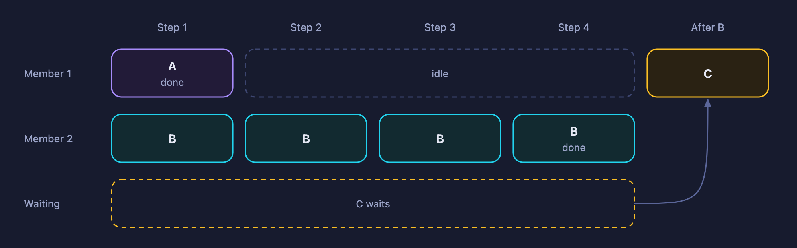
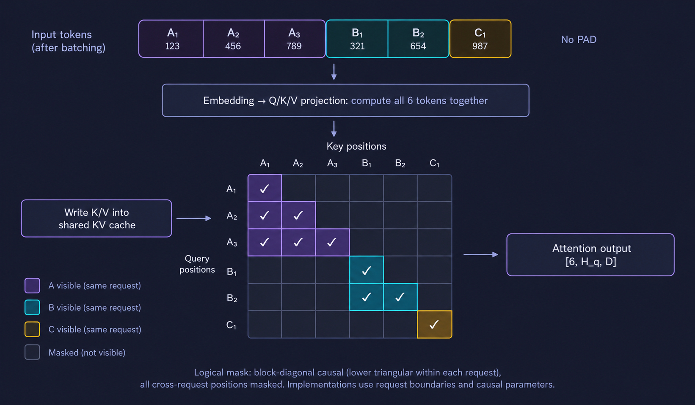
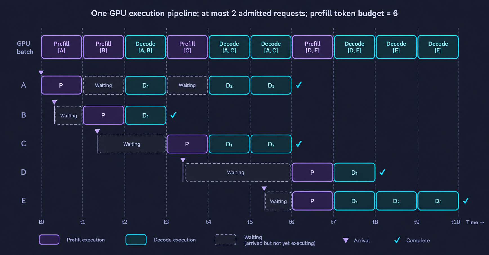
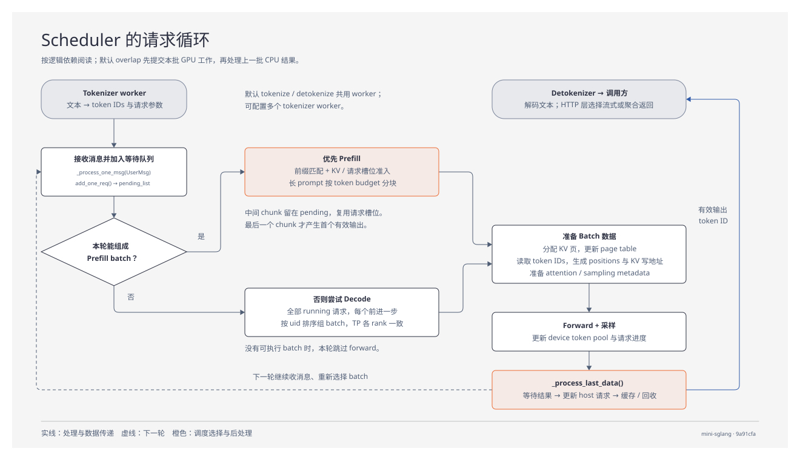
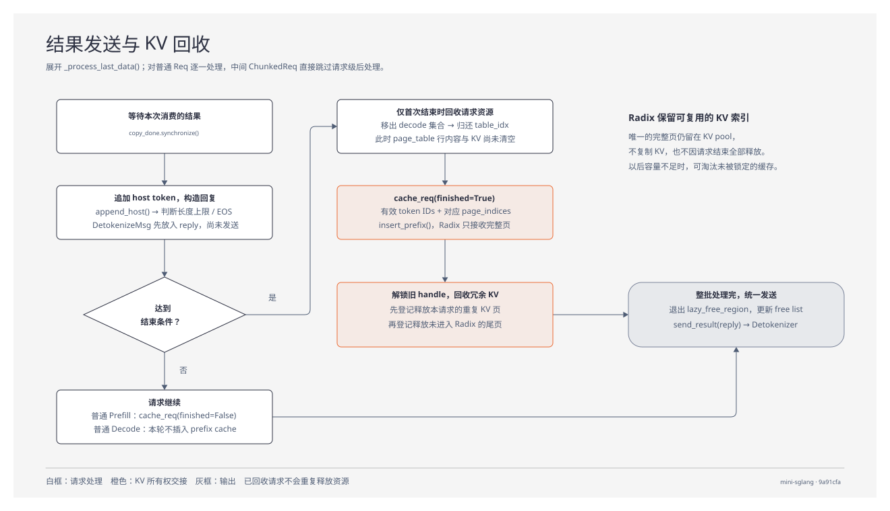

# Scheduler 把请求组织成可执行的 Batch

```{contents} 本页目录
---
depth: 2
local: true
---
```

模型执行层一次只认识一个 `Batch`。用户请求何时进入 GPU、本轮算多少个 token、完成后何时退出，都由调度器先决定。Mini-SGLang 的实现很短，却已经包含 continuous batching、chunked prefill、前缀缓存 admission 和 CPU-GPU overlap 的骨架。

<callout emoji="💡">
**阅读顺序：**先认清 `Req` 的长度，再追请求所在的容器，最后看 `_schedule_next_batch()` 如何把状态变成可执行批次。本章只讲调度与请求表，KV 页的内部结构留到下一章。
</callout>

## 连续批处理在轮次之间调整成员

上一章已经走通 HTTP 到模型再到 SSE 的请求链路。服务可以一边返回 A 的输出，一边接收 B、C；接下来要决定，这些请求何时共享一次模型执行。连续批处理允许调度器在每轮之间留下未完成请求、移除已完成请求，并在资源允许时接纳新请求。

以下原理与示例据 [Datawhale《Zero to SGLang》第 6 章](https://datawhalechina.github.io/zero-to-sglang/eng/part2/Chapter6_Continuous-Batching-and-the-Scheduler.html)整理，Mini-SGLang 行为限定于 [提交 9a91cfa](https://github.com/sgl-project/mini-sglang/tree/9a91cfafe754aa85daee49998176275667eb58f2)。示例采用每轮执行并处理结果的逻辑顺序；默认 overlap 路径中的在途状态，仍按本章后面的源码时序分析。

### 固定成员会错过补入新请求的机会

假设 A、B 已完成 Prefill，还分别需要 1 轮和 4 轮 Decode；C 已到达，且 A 结束后资源足够接纳 C。固定批处理锁定 A、B 这组成员，要等整组结束才接收下一组。A 在第一轮结束后，即使从执行张量中删掉，C 仍进不来，后面三轮只能让 B 继续生成。

图中的 idle 指 A 原先占据的批成员位置。B 仍在计算，GPU 未必空闲；损失的是把 C 和 B 一起推进的机会。输入长度各不相同，实际输出还可能提前遇到 EOS，仅设置固定 batch size 无法让一组请求同时完成。



连续批处理把重新选取成员的时点放到下一轮。它保留单条请求的自回归依赖，也不会向已经运行的 GPU 算子中途插入请求。新成员仍需通过准入检查、完成 Prefill，之后才能参加普通 Decode。是否混合两种阶段，由批次策略另行决定。

### 拼接有效 token 时仍保留请求边界

不同长度的请求可以共享线性层计算。假设三个请求没有历史缓存，输入 token ID 分别为 [123, 456, 789]、[321, 654] 和 [987]。Mini-SGLang 把有效 token 紧凑排列，无需先把这三个 Prompt 补到同一长度：

```text
input_ids = [123, 456, 789, 321, 654, 987]
embedding: [6, d_model]
Q:         [6, H_q, D]
K, V:      [6, H_kv, D]
```

H_q、H_kv 分别是 Query head 和 KV head 数，D 是 head dimension。每层的 K、V 写入共享物理缓存池，但逻辑历史仍属于各自请求。Attention 依靠请求边界、有效长度和缓存索引，只读取该请求可见的历史。图中的可见区域在逻辑上是分块对角的下三角结构，后端无需真的构造完整的 [6, 6] mask。



进入 Decode 后，每个请求贡献一个新位置，合起来的 embedding 为 [3, d_model]；Attention 输出为 [3, H_q, D]，合并各 head 并经过输出投影后回到 [3, d_model]。历史长度可以不同，KV 的归属也不会随着本轮 batch 顺序变化。具体地址与 metadata 的生成，分别在后面的 KV Cache 和 Attention Backend 章节展开。

### 错峰到达的请求怎样共享批次

下面重新设定五个请求 A～E，把到达、准入与完成放在同一条时间线上。最多容纳 2 个已准入请求，每轮 Prefill budget 为 6 个 token，KV 容量充足且没有前缀命中。沿用该提交的 Prefill 优先策略，每轮只执行一种阶段。

| 请求 | 到达位置 | 输入 token | 实际输出 token | 所需 forward |
|-|-|-|-|-|
| A | t0 | 3 | 4 | 1 次 Prefill＋3 次 Decode |
| B | t0＋0.4 | 2 | 2 | 1 次 Prefill＋1 次 Decode |
| C | t1＋0.4 | 3 | 3 | 1 次 Prefill＋2 次 Decode |
| D | t3＋0.4 | 4 | 2 | 1 次 Prefill＋1 次 Decode |
| E | t5＋0.4 | 2 | 4 | 1 次 Prefill＋3 次 Decode |

输出数包含最终 Prefill 采出的首个 token，并假设没有提前 EOS 或取消；调度器事先不知道真实输出长度。t0～t10 只是调度边界，＋0.4 表示请求在该轮中途到达。图格等宽不代表 forward 等时长，不能由此计算性能提升。



| 区间 | GPU 执行 | 为何这样选择 |
|-|-|-|
| t0～t2 | Prefill[A]，随后 Prefill[B] | A 到达后立即运行。B 中途到达，在下一轮占用第二个槽位；A 暂停 Decode。 |
| t2～t3 | Decode[A, B] | C 已到达，但两个槽位都被占用。B 在该轮结束，归还一个槽位。 |
| t3～t6 | Prefill[C]，随后两次 Decode[A, C] | C 接替 B 的槽位。D、E 到达后仍需等待，直到 A、C 在 t6 完成。 |
| t6～t8 | Prefill[D, E]，随后 Decode[D, E] | 两个槽位均可用，D、E 的输入合计 6 个 token，正好满足预算；D 随后结束。 |
| t8～t10 | 两次 Decode[E] | 只剩 E，批次未满也继续执行。 |

t6 的合批利用了当时已经到达的请求，调度器没有故意等待凑满一批。t1 和 t3 也说明，已经进入运行集合的 A 可以暂时缺席当前 Batch。要在源码里解释这些变化，就需要区分请求进度、持久容器和当轮输入。

## Req、Batch 与 ForwardInput 各管一层状态

### Req 用三个长度表达进度

`Req` 是已经取得运行资源的请求。源码锚点：`python/minisgl/core.py:28-68`。

| 字段 | 含义 | 用途 |
|-|-|-|
| `table_idx` | 请求表行号 | 索引 token pool 与 page table |
| `cached_len` | 已有可读 KV 的长度 | 本轮计算起点 |
| `device_len` | GPU 侧逻辑序列长度 | 本轮要把 KV 补到这里 |
| `max_device_len` | 输入长度加最大输出长度 | 控制生成上限 |

```python
extend_len = device_len - cached_len
remain_len = max_device_len - device_len
0 <= cached_len < device_len <= max_device_len

def complete_one(self):
    self.cached_len = self.device_len
    self.device_len += 1
```

forward 结束后，刚送入模型的区间已经拥有 KV，所以先令 `cached_len = device_len`。采样器同时给出 next token，于是 `device_len` 再加一。这个 token 已写入 GPU token pool，它自己的 KV 要到下一次 decode 才生成。

### Batch 描述阶段，ForwardInput 固化本轮输入

`Batch.phase` 只有 `prefill` 和 `decode`。scheduler 填入 `positions`、`input_ids`、`out_loc`，attention backend 再填 metadata。decode 使用 CUDA Graph 时，`padded_reqs` 会补 dummy request。

`ForwardInput` 保存 Batch、采样参数、读取映射和写回映射，供 overlap 模式延后一轮处理结果。读取映射是 `(table_idx, position)`；写回映射指定 next token 的位置。不能 decode 的中间 chunk 使用 `-1` 哨兵。源码锚点：`python/minisgl/scheduler/scheduler.py:34-42, 204-217, 252-267`。

## 状态机藏在容器和对象类型里

代码没有请求状态枚举。状态由“对象在哪个容器、是否已持有资源、对象类型是什么”共同表达。

这里还要区分“尚未完成”与“本轮执行”。PrefillManager.pending_list 保存等待或尚未完成 Prompt 处理的请求；DecodeManager.running_reqs 保存已完成 Prefill、还需继续生成的请求；Batch 只包含本轮提交给模型的成员。选择新请求的 Prefill 时，旧请求仍可保留在 running_reqs 中，等待后续轮次继续 Decode。

| 阶段 | 状态载体 | 转换 |
|-|-|-|
| 等待 admission | `pending_list` 中的 `PendingReq` | 有表槽和 KV 容量后入场 |
| 部分 prefill | `PendingReq.chunked_req` | 下一轮复用资源继续 prompt |
| 最终 prefill | prefill Batch 中的普通 `Req` | 采出首个输出 token |
| 持续 decode | `running_reqs` | 每轮生成一个 token |
| 完成 | 短期进入 `finished_reqs` | 移出 running 并回收资源 |

in-flight 是叠加状态。开启 overlap 后，一个请求可能已经提交下一批 GPU 工作，而 CPU 仍在处理上一批结果。消息入口会截短过大的 `max_tokens`；abort 先查 pending，再查 running。

## 主循环有同步版和一级流水版

### 请求循环总览

下图依据 Mini-SGLang [9a91cfa](https://github.com/sgl-project/mini-sglang/tree/9a91cfafe754aa85daee49998176275667eb58f2) 整理。箭头表示逻辑依赖；普通模式当轮执行、当轮收尾，默认 overlap 模式先提交本批 GPU 工作，再处理上一批 CPU 结果。相邻 forward 仍在同一 engine stream 上依次执行。



*图：Scheduler 请求循环与双流重叠依赖总览（普通同步循环当轮收尾，默认 overlap 循环提前提交下一批 GPU 前向）。*

`positions` 是当前 token 的逻辑位置，供模型层 RoPE 使用；`out_loc` 是这些 token 的 KV 写地址。采样出的 next token 通过 `write_tuple` 写回 `token_pool`，成为后续 forward 的输入后才产生自己的 KV。Overlap 可能已提前提交下一批，不能仅凭 CPU 当前收到哪个 token 判断 KV 进度。

源码：[主循环](https://github.com/sgl-project/mini-sglang/blob/9a91cfafe754aa85daee49998176275667eb58f2/python/minisgl/scheduler/scheduler.py#L83-L118)、[批次准备](https://github.com/sgl-project/mini-sglang/blob/9a91cfafe754aa85daee49998176275667eb58f2/python/minisgl/scheduler/scheduler.py#L204-L267)、[Decode 排序](https://github.com/sgl-project/mini-sglang/blob/9a91cfafe754aa85daee49998176275667eb58f2/python/minisgl/scheduler/decode.py#L32-L35)。

### 结果发送与 KV 回收



*图：请求前向完成后的结果回发、Radix 前缀交接与物理页延迟回收路径。*

未结束的普通 Prefill 也会插入前缀缓存、解锁旧 handle 并回收重复页，但会保留尾页，更新并锁定新 handle。中间 `ChunkedReq` 跳过请求级后处理，既不发送有效输出，也不在这里插入前缀缓存。

`TableManager.free()` 只归还行号，后面的 `cache_req()` 仍能读取该行。Radix 保存 token 序列到 KV slot 的索引，可复用的唯一完整页留在 KV pool；实际回收的是重复副本与完结请求的尾页。四段区间的定义见[下一章的 cache_req 说明](https://bytedance.larkoffice.com/wiki/EZcawGzFrirc8bkkvuqclJCpnXd#doxmyVE1SAnbyL6XQx84VhmFCzf)。

源码：[结果处理](https://github.com/sgl-project/mini-sglang/blob/9a91cfafe754aa85daee49998176275667eb58f2/python/minisgl/scheduler/scheduler.py#L138-L167)、[缓存交接与延迟回收](https://github.com/sgl-project/mini-sglang/blob/9a91cfafe754aa85daee49998176275667eb58f2/python/minisgl/scheduler/cache.py#L55-L104)。本次只核对源码流程，未运行 GPU 端到端测试；Overlap 的共享 Req 与结束判定边界见[后文的边界分析](https://bytedance.larkoffice.com/wiki/EZcawGzFrirc8bkkvuqclJCpnXd#doxmyunuXlpz5KjbrKMRDOlYDge)。

### normal loop 当轮算完当轮收尾

```text
收消息 → 形成批次 → 准备映射与 metadata
→ forward 和采样 → 等待 D2H copy
→ 追加 host token、判断完成、发送结果
```

设置 `MINISGL_DISABLE_OVERLAP_SCHEDULING=1` 后使用此路径。没有 pending prefill 和 running decode 时，接收会阻塞；阻塞前检查 cache 完整性。源码锚点：`python/minisgl/scheduler/scheduler.py:78-81, 108-131`。

### overlap loop 让下一批 GPU 计算与上一批 CPU 工作并行

```text
收消息 → 在 scheduler stream 准备 batch N
→ engine stream 等待准备完成并提交 batch N
→ CPU 同步并处理 batch N-1
→ batch N 留作下一轮的 last_data
```

scheduler stream 和 engine stream 分离后，GPU 执行本批时，CPU 可以处理上一批 token 与资源回收。共享 `Req` 不是快照，下一批的 `complete_one()` 可能先改变其长度。

## 可形成 prefill batch 时优先 prefill

```python
batch = (
    prefill_manager.schedule_next_batch(prefill_budget)
    or decode_manager.schedule_next_batch()
)
```

每个 token iteration 都按最新 pending 和 running 集合重建 batch，新请求无需等待旧请求全部结束，因此属于 continuous batching。单个 forward 仍是纯 prefill 或纯 decode，没有混装两类 token。只要队首能形成 prefill batch，本轮便不执行 decode。持续新流量可能抬高 running 请求的 inter-token latency。

### Admission 先为完整未来 KV 留位置

```text
extend_len = input_len - prefix_cached_len
estimated_len = extend_len + max_output_len

需要同时满足：
table_manager.available_size > 0
estimated_len + reserved_size <= cache_manager.available_size
```

`reserved_size` 初值是 running decode 的所有 `remain_len`，并按请求补最多 `page_size - 1` 个页尾空位。本批每接纳一个请求，再加入它的未缓存 prompt 和完整输出预算。prefix handle 加锁会把命中内容从 evictable 变成 protected，所以锁前、锁后各检查一次。源码锚点：`python/minisgl/scheduler/prefill.py:39-63, 126-151`、`python/minisgl/scheduler/decode.py:27-30`。

Radix match 只查 `input_ids[:-1]`。缓存中只有历史 KV，没有最后位置之后的 logits；至少重算 prompt 最后一个 token 才能采出首个生成 token。pending 按 FIFO 扫描，遇到第一个放不下的请求便停止，会产生 head-of-line blocking。源码锚点：`python/minisgl/scheduler/cache.py:27-30`。

| 约束 | 计数对象 | 限制什么 |
|-|-|-|
| Request slot | 请求表的空闲行 | 能再接纳多少请求。100 token 与 10000 token 的请求各占一行。 |
| KV 容量 | 可供分配的 token 位置 | 能否容纳未缓存输入，并为后续输出及其他在途请求留出空间。 |
| Prefill token budget | 本轮计算的未缓存输入 token | 一次 Prefill 的工作量。同批请求共享这份预算。 |

例如，新请求未缓存输入为 768 token，最大输出为 256 token，其他请求的预留估计为 1024 token，合计需计入 2048 个位置。若缓存管理器只报告 1800 个可用位置，即使有空闲请求槽位也不能准入。这里是在估算后续需求，物理 KV 页仍按计算进度分配；请求结束可能保留可复用前缀，也不能把归还一个槽位等同于腾出足够 KV。

### Chunked prefill 约束单轮 extend 峰值

```python
remain_len = pending_req.input_len - cached_len
chunk_size = min(token_budget, remain_len)
is_chunked = chunk_size < remain_len
```

中间块使用 `ChunkedReq`。它固定 `can_decode=False`，不会进入 decode manager，后处理也丢弃它的采样结果。下一轮复用同一 `table_idx` 和 cache handle，从更新后的 `cached_len` 续算；最后一块才转成普通 `Req` 并产出首个有效 token。源码：`python/minisgl/scheduler/prefill.py:23-29, 65-113`。

切块降低单次 prefill 的计算与激活峰值。首次 admission 仍按全部未缓存 prompt 加最大输出预留 KV，所以总 KV 需求超过容量的请求仍不能入场。说明锚点：`docs/features.md:29-31`。

### Chunked Prefill 不等于混合批次

Mini-SGLang 的 `Batch.phase` 只允许 Prefill 或 Decode；Chunked Prefill 把长 Prompt 拆成多轮 Prefill，并不把 running Decode 请求合入同一次 forward。Overlap Scheduling 重叠的是 CPU 后处理与下一批 GPU 执行，也不改变批次组成。

为 running 请求预留未来 KV 容量，不等于为它们预留 GPU 计算时间；持续到来的长 Prefill 仍可能抬高流式 ITL。单批次混跑（Mixed Chunk）与计算防饥饿见第 14 章〈[进阶调度与设备内流水线](https://bytedance.larkoffice.com/wiki/EZcawGzFrirc8bkkvuqclJCpnXd#doxmy1i7uIgUsg7fYqwxuOS6nqc)〉，跨卡请求分工（DP Attention）见第 15 章〈[大规模分布式并行](https://bytedance.larkoffice.com/wiki/EZcawGzFrirc8bkkvuqclJCpnXd#doxmygrq2hSdwxWnCa2p9gqiQ7c)〉。

### 本地扩展：Delayed Prefill Admission 平衡凑批与 Decode 节奏

上游主干 `9a91cfa` 只要等待队列存在可入场的新请求就立即中断 Decode；本地仓库提交 `467f2eb` 在此基础上实现了轻量级的延迟准入（Delayed Prefill Admission），通过三个可选参数在“保护在途 Decode 连续性”和“凑大新 Prefill 批次”之间建立可控折中：

| 启动参数 / 配置项 | 默认值 | 触发准入的条件与语义 |
|-|-|-|
| `--delay-prefill-wait-sec` | `0.0` | 最老的未启动新请求等待达到该秒数后放行；`0` 表示关闭时间阈值。 |
| `--delay-prefill-min-batch-size` | `0` | 等待队列中的新请求数达到该阈值后立即合批放行；`0` 表示关闭数量阈值。 |
| `--delay-prefill-max-passes` | `0` | 最多连续推迟 `max_passes - 1` 轮调度，到达上限必放行；`0` 关闭，`1` 等同于不推迟。 |

`Scheduler._admit_new_prefills()` 的实现守住了三条关键工程边界：第一，**只推迟全新请求，不阻塞在途分块**：已经启动的 `ChunkedReq` 继续推进，不受延迟门控拦截；若当前根本没有在途 Decode（`not decode_manager.runnable`），也立即放行新 Prefill 避免 GPU 空转。第二，**避免容量不足重置等待**：一旦某轮判定放行（`admit=True`）却因临时表槽或 KV 不足未能启动新请求，`_prefill_admission_open` 会保持打开，不会让队列重新陷入下一轮推迟计数。第三，**跨 TP Rank 严格同序**：队列长度、在途状态和轮数在所有 Rank 完全一致，无需通信即可独立算出相同布尔值；只有走到依赖本地单调时钟（`monotonic()`）的 `wait_sec` 分支时，才由 Rank 0 单独读取时钟并通过 `tp_cpu_group.broadcast` 把整数决策同步给全部 Rank，杜绝因多卡微小时间差排出不同 Batch 而导致 NCCL 死锁。

## Decode 顺序与请求表保证跨轮一致

### Decode 每轮收拢全部 running 请求

`filter_reqs()` 合并旧 running 和刚执行的请求，再保留 `can_decode` 为真的对象。decode batch 包含全部 running 请求，没有单独 token budget。构造 batch 时必须按 `uid` 排序；不同 TP 进程里的 set 顺序可能不同，不排序会让相同 batch row 对应不同用户。源码锚点：`python/minisgl/scheduler/decode.py:9-39`。

### TableManager 管请求行号

`TableManager` 管理请求槽位，调度优先级由其他组件决定。`token_pool[table_idx, logical_pos]` 保存 token ID，`page_table[table_idx, logical_pos]` 保存物理 KV 地址。真实请求占前 `max_running_req` 行，Engine 另留一行 dummy request 给 CUDA Graph padding。源码：`python/minisgl/scheduler/table.py:4-21`、`python/minisgl/engine/engine.py:65-109`。

`page_size > 1` 时，CacheManager 按页申请，再把页展开为 token 地址写进请求行。请求完成后归还 table row，可复用前缀进入 prefix cache，不能整页缓存的尾部释放。源码锚点：`python/minisgl/scheduler/cache.py:42-79, 106-146`。

## 手算一次带前缀命中的长请求

设 `page_size=1`。输入长度 20，前缀命中 3，`max_output_len=4`，`prefill_budget=8`。当前 decode reservation 为 5，KV 可用量为 30。

```text
extend_len = 20 - 3 = 17
estimated_len = 17 + 4 = 21
21 + 5 = 26 <= 30，可以 admission
```

| 轮次 | 进入前 cached_len | extend | 结果 |
|-|-|-|-|
| A | 3 | 8，位置 3..10 | `ChunkedReq`，随后 `cached_len=11` |
| B | 11 | 8，位置 11..18 | `ChunkedReq`，随后 `cached_len=19` |
| C | 19 | 1，位置 19 | 普通 `Req`，采出首 token |

三轮复用同一 `table_idx`。前两轮中间采样被丢弃；C 轮后 `cached_len=20, device_len=21`，请求进入 decode。admission 在 A 轮已经为 17 个输入和 4 个输出留足容量。

## 批处理收益要同时看吞吐与延迟

前面的例子展示了成员如何变化，性能收益还取决于每次 forward 完成了多少有效工作。以线性层为例，忽略 bias 和张量并行切分，单请求 Decode 的输入是 [1, d_in]，B 个请求合批后变为 [B, d_in]，两者都乘同一份权重 W[d_in, d_out]。批量 GEMM 可以在片上复用权重 tile，提高算术强度，并暴露更多并行工作。

合批还可分摊一部分提交和 kernel launch 开销，但一次 forward 内仍有多个 kernel，不能据此断言整份 W 只从显存读一次。各请求的历史 KV 也仍需分别访问。batch 增大可能提高总输出 token/s，同时拉长单轮执行和用户等待时间。硬件原理参见 [NVIDIA 矩阵乘性能指南](https://docs.nvidia.com/deeplearning/performance/dl-performance-matrix-multiplication/index.html)。

| 调度选择 | 可能改善 | 需要同时检查 |
|-|-|-|
| 优先执行新请求 Prefill | 新请求更早开始处理 Prompt | 已运行请求是否连续多轮无法 Decode，ITL 是否升高 |
| 优先执行已有请求 Decode | 输出中的停顿缩短 | 等待请求的 TTFT 是否被推高 |
| 增大 batch 或 Prefill chunk | 摊薄部分固定开销，提高有效吞吐 | 单轮耗时、KV 压力与尾延迟是否增加 |
| 减小 Prefill chunk | 限制单次 Prefill 的工作量 | 调度是否真的在块间安排 Decode，以及额外轮次的开销 |

Chunked Prefill 只提供重新调度的边界。将长 Prompt 分成 C1、C2、C3 后，C1 → C2 → C3 → Decode 仍会让已有请求等完整段输入；C1 → Decode → C2 → Decode → C3 才能在中途推进已有请求。9a91cfa 把未完成 chunk 放回队首并继续优先 Prefill，因此不能仅凭“已经切块”推断 ITL 改善。

**GPU-Util 相近不代表有效吞吐相同：**`nvidia-smi` 报告的 `utilization.gpu` 统计采样窗口内至少有一个 kernel 在 GPU 上执行的时间比例（见 [NVIDIA nvidia-smi 文档](https://docs.nvidia.com/deploy/nvidia-smi/index.html)），既不计启动次数，也不反映 SM 或 Tensor Core 饱满了多少。

假设一个 1 秒的窗口里有约 850 毫秒在执行 kernel，读数就约为 85%；实际采样窗口取决于设备和工具。这只是示意值。85% 不代表达到峰值算力的 85%，也不能推出性能最多还能提高 15%。少量 SM 执行的小 kernel，或受访存限制的 kernel，同样贡献活动时间。

小 batch 可以持续运行却每轮只推进少量请求；更大的 batch 可能保持相近的活动时间，同时利用更多并行计算并复用权重。因此，两组配置的 GPU-Util 接近，输出吞吐仍可相差很大。判断瓶颈还要结合 kernel 时间线、SM 活动、带宽和计算吞吐。

服务侧继续沿用前文 Benchmark 的口径，同时比较总输出吞吐、单请求输出速度、TTFT 与 ITL，并检查尾延迟和 SLO。客户端一个流式 chunk 可能含多个 token，ITL 也要注明观测边界。实验还应写清固定批处理或连续批处理、Prefill/Decode 选择策略及 batch 配置；只改 batch size 无法单独证明连续批处理的收益。

## 不变量是读调度代码的检查表

- 活跃请求恰好持有一个 table row，chunk 续接复用它。锚点：`prefill.py:56-63, 96-102`。
- 活跃 prefix handle 必须锁住，防止仍在使用的 KV 被 eviction。锚点：`cache.py:36-40, 69-79`。
- positions 精确覆盖每个请求的 `[cached_len, device_len)`。锚点：`scheduler.py:236-249`。
- 最终采样 token 尚无 KV，不得插入可复用前缀。锚点：`cache.py:67-79`。
- 所有 TP rank 的 decode 顺序应相同；table row 和 cache 资源只释放一次是必须验证的不变量，overlap、EOS 与 abort 边界见下文。

## 小结

长度推进、prefill-first、UID 排序、容量预留及延迟准入均已从源码确认。Overlap 模式下 CPU 读取共享 `Req` 的时序边界与最小验证实验集中在第 11 章〈[CUDA Graph 与双流流水线隐藏 Decode 开销](https://bytedance.larkoffice.com/wiki/EZcawGzFrirc8bkkvuqclJCpnXd#doxmyX1IsQtSwPsMTTOoye90aqg)〉。

<callout emoji="✅">
**最小验证：**手算一次 prefix hit 与 chunked prefill，确认中间块不进入 Decode；再覆盖 FIFO 阻塞、不同 TP rank 的 UID 顺序、`max_tokens=1/2/3` 和四个 abort 时点。
</callout>

Scheduler 已经决定“谁在这一轮运行”；下一章继续追踪这些请求如何获得、共享并归还物理 KV 页。
