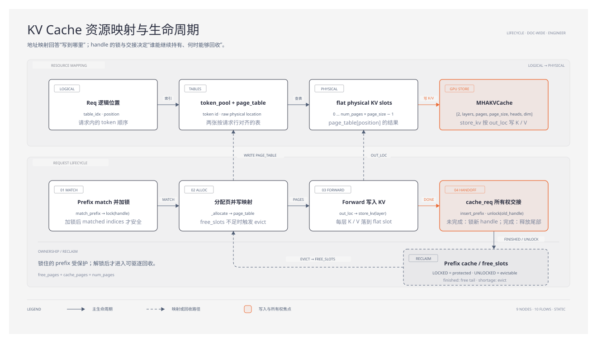
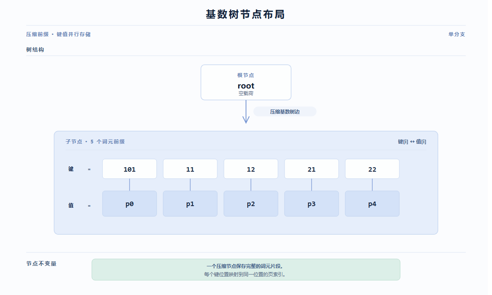
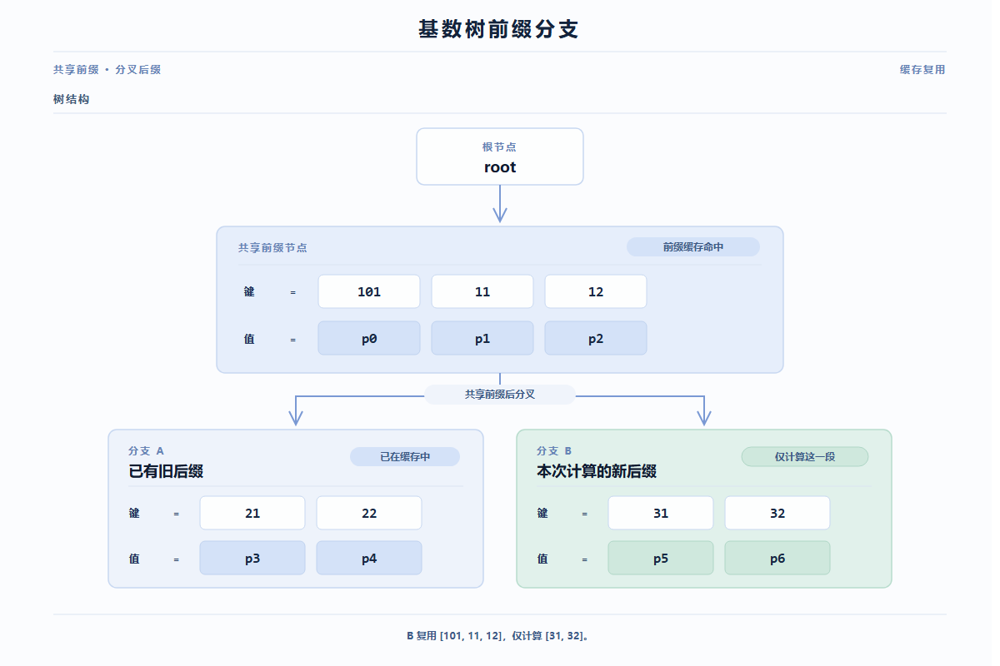
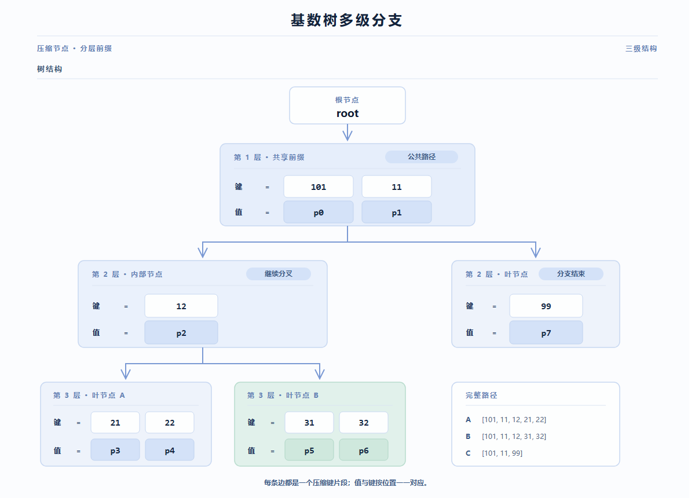

# KV Cache 管理请求历史与显存

```{contents} 本页目录
---
depth: 2
local: true
---
```

KV Cache 管理历史 token 的 K/V 地址、使用者与回收条件。Mini-SGLang 用物理池、请求页表和 Radix 前缀缓存共同记账。命中和插入都不复制 K/V：命中时复用物理索引，插入时交接完整页所有权。

## 三层结构共同管理一份显存

第一层是物理存储 MHAKVCache，以 page 和 token slot 为单位持有所有层的 K/V。第二层是请求映射，page_table 与 token_pool 在同一逻辑坐标中保存物理地址和 token id。第三层是 RadixPrefixCache，以整页 token 段为单位保存跨请求前缀及其物理 indices。CacheManager 管空闲页起点，TableManager 管可复用的请求行。

### 物理池按层、页和 KV head 排列

真正申请 KV Cache GPU 显存的入口是 `python/minisgl/kvcache/mha_pool.py` 中的 `MHAKVCache.__init__()`（调度器与 Radix 树只管理索引，不直接申请这块显存）。完整调用链从 `Scheduler` 创建 `Engine` 开始：

```text
Scheduler.__init__()
└─ Engine(config)
   ├─ _determine_num_pages(...)
   └─ create_kvcache_pool(...)
      └─ MHAKVCache.__init__()
         └─ torch.empty(..., device=cuda, dtype=...)
```

`Engine._determine_num_pages()` 只按剩余显存和单页成本算出可容纳的页数；随后的 `create_kvcache_pool()` 才进入具体缓存实现，并由 `torch.empty()` 完成实际分配：

```python
self._kv_buffer = torch.empty(
    (2, num_layers, num_pages, page_size, local_kv_heads, head_dim),
    device=device,
    dtype=dtype,
)
```

首维的 `2` 分别代表 K 和 V。Tensor Parallel 生效后，每个 rank 只保存 `local_kv_heads`。单层缓存会展平为 `[num_pages × page_size, local_kv_heads, head_dim]`，模型再按 `batch.out_loc` 给出的物理 token slot 写入。

这里容易混淆的是“GPU 存储”和“地址映射”。它们由四类对象共同管理，但只有第一项保存 K/V 本体：

- `MHAKVCache._kv_buffer`：真正承载所有层 K/V 数据的连续 GPU Tensor。
- `Engine.page_table`：GPU 上的 `int32` 映射表，把“请求内第几个 token”映射到 `_kv_buffer` 中的物理 token slot。
- `CacheManager.free_slots`：按页保存尚未分配的物理页起点，负责分配和回收，不保存 K/V 内容。
- Radix 节点的 `_value`：保存可复用前缀对应的物理 slot 索引，同样只指向 `_kv_buffer`，不会复制一份 K/V。

因此，底层显存的初始化边界可以概括为：`Engine` 决定容量，`MHAKVCache` 申请存储，`page_table`、`free_slots` 和 Radix 树负责解释并流转这块存储的地址。`Engine` 还会额外申请一页供 CUDA Graph 的 dummy request 使用；普通缓存账本只管理前 `num_pages` 页。

### 请求表与 Radix 分别保存短期和长期索引

TableManager 为运行请求分配一行。token_pool[row,pos] 保存 token id，page_table[row,pos] 保存同一逻辑位置的物理 KV 地址。TableManager 只回收行号，KV 页由 CacheManager 回收。Radix 节点的 key 是 CPU token ids，value 是同长度的物理 indices；命中时，新请求把 value 写入自己的 page_table。

#### 查询入口决定索引职责

Radix 与 page table 都保存物理 KV 槽位编号，命中的前缀还会在两处重复保存一份索引。两者使用不同的查询条件：Radix 按 token 序列查找可以复用的历史 KV，page table 按请求及其逻辑位置定位本次计算使用的槽位。

| 比较项 | Radix prefix cache | 请求 page table |
|-|-|-|
| 查询条件 | 从根开始的一段 token 前缀，如 [A, B, C] | 请求行号 row 与逻辑位置 pos |
| 返回信息 | 可复用前缀长度及其物理槽位 | page_table[row, pos] 对应的物理槽位 |
| 覆盖范围 | 已登记的、满足页对齐要求的可复用前缀 | 请求已分配的槽位，包括共享前缀和私有后续部分 |
| 主要使用阶段 | 调度时匹配前缀，以及缓存插入与淘汰 | 每轮 forward 准备地址，并供 Attention 读写 KV |
| 生命周期 | 可以跨越多个请求 | 表行随请求分配和回收 |

token ID 本身不能唯一确定可复用的 KV。相同的 C 出现在 [A, B, C] 与 [X, Y, C] 中时，由于前面的上下文不同，整套 KV 通常也不同。Radix 用从根到节点的整条前缀路径表达上下文，page table 则用请求身份和逻辑位置确定这次 token 的出现。这里讨论同一模型与兼容的位置、Attention 等配置；跨配置的复用条件见前文 RadixAttention 一节。

#### 两个请求共享同一份 KV

假设 page_size = 1，Radix 已缓存前缀 [A, B, C]，对应物理槽位 [10, 11, 12]。新请求 r1 = [A, B, C, D] 与 r2 = [A, B, C, X] 都命中这段前缀，CacheManager 再分别为 D 和 X 分配槽位 20 与 30。下面展示本轮 forward 开始前的状态，位置下标从 0 开始。

| 索引或请求 | token 内容 | 物理槽位 | 此时的含义 |
|-|-|-|-|
| Radix 已有前缀 | [A, B, C] | [10, 11, 12] | 前三个 token 的 KV 已计算并可复用 |
| page_table[r1] | [A, B, C, D] | [10, 11, 12, 20] | 共享前三个位置，D 使用新槽位 20 |
| page_table[r2] | [A, B, C, X] | [10, 11, 12, 30] | 共享前三个位置，X 使用新槽位 30 |

D 和 X 此时可以还没有算出 KV，也没有插入 Radix，但 forward 已经需要知道把结果写到哪里。page table 因此同时描述可读的历史位置和本轮新分配的写入位置；具体哪些位置已经有效，由请求长度与本轮 metadata 限定。

命中结果由 PrefillAdder 写入请求页表。源码先锁定 handle，保护共享前缀不被淘汰，再执行以下地址复制：

```python
page_entry = self.table_manager.page_table[table_idx][:cached_len]
page_entry.copy_(handle.get_matched_indices())
```

复制的是槽位编号。r1、r2 和 Radix 都指向 pool 中同一份 A、B、C 的 K/V，原有 KV 数据无需搬运。新分配的私有后续部分则由 CacheManager 填入各自的页表。

#### Attention 按请求位置读取 KV

Attention 已经知道本次处理哪个请求，以及需要读取哪些历史位置。它可以通过数组索引取得地址，不必再次按 token 内容搜索共享前缀。全局页表的逻辑查询可以写成：

```python
physical_slot = page_table[request_row, token_position]
```

当前 Radix 使用 Python 节点与字典组织树结构。即使已经持有命中 handle，get_matched_indices() 仍需要沿父链收集各段 value，再反转并拼接。把这次内容查询的结果写入页表后，GPU 上的 Attention 就能使用规则的索引 tensor。

以 FlashAttention 为例，prepare_metadata() 从各请求页表取出本批次所需的表项；当物理页大小大于 1 时，每隔 page_size 取一个槽位，再整除得到物理页编号：

```python
new_page_table = torch.stack(
    [page_table[req.table_idx, :max_seqlen_k:self.page_size] for req in reqs]
)
if self.page_size > 1:
    new_page_table.div_(self.page_size, rounding_mode="floor")
```

Attention kernel 接收转换后的页表与各请求的有效长度。共享前缀和请求私有部分通过同一套地址表示进入计算，kernel 无需理解 Radix 的分叉、引用计数或缓存淘汰规则。各 backend 的具体页解释继续在后面的 Attention Backend 章节展开。

#### 保留两类索引的代价

只保留请求页表时，新请求 [A, B, C, Y] 无法仅凭一组物理地址判断旧请求的 token 内容是否相同。即使结合 token_pool 扫描活跃请求，还需要额外处理已经结束的请求：TableManager 会回收它们的表行，而仍值得复用的 KV 可以继续留在 Radix 中。

只维护一棵树也可以重新设计运行时，但需要让它同时表达未登记的请求后续部分、尚未计算的写入位置和部分使用的尾页。若计算前仍把树上的路径展开成 GPU 索引数组，就仍然保留了请求地址表承担的功能。

因此，Radix 与 page table 是当前实现为两类访问方式选择的结构，可以替换成其他实现。当前方案重复保存的是部分槽位编号，同时还需要维护树节点、引用计数和页表；它换来了跨请求内容查找与计算阶段地址访问的分离，共享的 K/V tensor 本身只有一份。

源码锚点：`python/minisgl/scheduler/prefill.py`（匹配、锁定与页表复制）、`kvcache/radix_cache.py`（handle 与前缀回溯）、`scheduler/cache.py`（页分配与交接）、`attention/fa.py`（块表抽样转换）、`scheduler/table.py`（请求行回收）。

## 全局 page table 采用 token 粒度

全局 `page_table` 的表项采用 token 粒度，存储 flat physical token slot；这不表示物理分配页大小固定为 1。`page_size=4` 时，页起点 4、12 由 `_page_to_token()` 展开：

```text
pages  = [4, 12]
tokens = [4, 5, 6, 7, 12, 13, 14, 15]
```

scheduler 按 token 构造 input mapping 和 out_loc。FlashAttention 与 TensorRT-LLM 每隔 page_size 取表项并整除，得到 page id；FlashInfer 把缓存展平成 page_size=1，消费 flat indices。页表由此适配不同 attention backend。

## 请求经过匹配、分配、计算和回收



KV Cache 资源映射与生命周期

### 匹配与准入先锁住可复用前缀

新请求进入 pending_list。match_req() 只匹配 input_ids[:input_len-1]，保留最后一个 prompt token，确保 Req 进入 forward 前满足 cached_len<device_len，至少计算一个 token 才能取得下一 token 的 logits。

PrefillAdder 用 extend_len=input_len-cached_len 与 output_len 估算后续占用。它先检查 available_size，再锁住命中 handle，随后复查。锁操作会把路径从 evictable 转为 protected，第二次检查可防止继续把这些页算成可回收容量。

**为什么 `lock(handle)` 后必须按真实可用容量复查？**因为 `available_size` 的定义为：

```text
available_size = evictable_size + free_pages × page_size
```

第一次检查发生在 lock 之前。此时刚命中的前缀仍可能属于 `evictable_size`，因此这次检查按“这些缓存页必要时可以被淘汰”来估算容量。它能提前挡住连乐观条件都无法满足的请求。

随后，`lock(handle)` 沿 Radix 路径增加 `ref_count`。节点第一次从 `ref_count=0` 变成 `ref_count=1` 时，其长度会从 `evictable_size` 移到 `protected_size`。这些页仍可供当前请求读取，但不能再通过 eviction 腾给后续分配，所以 `available_size` 可能在 lock 返回时立即减少。

```python
self.cache_manager.lock(handle)
if estimated_len + self.reserved_size > self.cache_manager.available_size:
    return self.cache_manager.unlock(handle)
```

例如，lock 前共有 100 个 token slot 可用，其中 60 个来自本次命中的可淘汰前缀，请求预计还需要 80 个。第一次检查可以通过。锁住这 60 个 token slot 后，真实可分配容量只剩 40 个，第二次检查便会拒绝该请求。

两次检查之间没有等待并发变化。`lock()` 自己改变了容量记账，所以代码必须按 lock 后的状态重新做 admission。复查失败时，请求尚未获得 table row，也不会进入 prefill；`unlock(handle)` 会撤销刚才的保护，并让 `_try_allocate_one()` 返回 `None`。

源码锚点：`python/minisgl/scheduler/prefill.py:50-54`、`python/minisgl/scheduler/cache.py:32-40`、`python/minisgl/kvcache/radix_cache.py:113-130`。

### 分配按页进行，forward 按 token 写入

`allocate_paged()` 先计算 `first_page=ceil(cached_len/page_size)` 和 `last_page=ceil(device_len/page_size)`，只分配两者之间的新页。空闲页不足时，`_allocate()` 会把缺少的页数乘以 `page_size`，要求 Radix 淘汰对应数量的 token。这里之所以先乘、返回后再切片，是因为 Radix 和 allocator 使用了不同的数据粒度。

#### Radix 与 allocator 记录的是两种粒度

| 组件 | 保存的数据 | `page_size=4` 时的例子 | 用途 |
|-|-|-|-|
| Radix Cache | 每个 token 对应的物理 KV slot | `[4,5,6,7,12,13,14,15]` | 按 token 匹配、复用和淘汰前缀 |
| Page Allocator | 每个空闲页的起始 token slot | `[4,12]` | 按页分配，保证页不重叠 |

因此，假设 allocator 缺少 2 页，它会调用 `evict(2*4)`。Radix 返回 8 个逐 token 的物理地址：

```python
evicted = [4, 5, 6, 7, 12, 13, 14, 15]
page_starts = evicted[::4]  # [4, 12]
```

`[::page_size]` 表示每隔一页的 token 数取一个元素，也就是从每组页内地址中只保留第一个地址。这样，Radix 的 token 级结果就重新变回了 allocator 需要的页级空闲表。

#### 不切片会把同一页重复登记

如果直接把全部 `evicted` 追加到 `free_slots`，allocator 会把 `4`、`5` 等页内地址都误认为独立页起点。下一次申请两页时，它可能取到 `[4,5]`。而 `_page_to_token()` 会把每个“页起点”展开成连续的 4 个 token slot：

```text
4 -> [4, 5, 6, 7]
5 -> [5, 6, 7, 8]
```

两个逻辑页因此共享 `5、6、7` 三个物理位置，后写入的 KV 会覆盖先写入的 KV。问题不只是空闲页数量算多了，而是页起点不再对齐，最终破坏了“一个物理页只能分配一次”的基本不变量。

#### 步长切片依赖页对齐不变量

`evicted[::page_size]` 并不是对任意 token 列表都成立。它依赖 Radix 中可淘汰的物理 indices 始终由完整页组成：插入长度、前缀命中长度和节点分裂位置都按 `page_size` 对齐，每页内部的 slot 连续排列，淘汰结果的长度也是 `page_size` 的整数倍。满足这些条件后，每组的第一个元素才一定是合法页起点。`page_size=1` 时，页和 token 是同一粒度，切片自然退化为保留全部元素。

Scheduler 随后构造 positions=[cached_len,device_len)、input_mapping=(table_idx,positions) 与 out_loc=page_table[input_mapping]。模型按 out_loc 写入新 K/V。forward 结束后，Req.complete_one() 令 cached_len=device_len，再令 device_len+=1：刚计算的 token 已有 KV，新采样 token 只有 id，留待下一轮 decode。

### 完成与 abort 汇入同一条释放路径

prefill 后仍要 decode 时，cache_req(finished=False) 把完整页发布到 Radix并保留尾页。正常结束或 abort 时，_free_req_resources() 归还 table row，再调用 cache_req(finished=True)：完整页留在 Radix复用，非整页尾部回到 free_slots。Overlap scheduling 可能让 EOS 请求进入两批结果处理，finished_reqs 防止二次释放；lazy_free_region() 汇总同一批的 free，减少循环内反复 torch.cat。

## Radix 树按压缩路径管理共享前缀

RadixTreeNode 的 _key 是 token 段，_value 是等长、整页对齐的物理 indices；children 与 parent 组成 Radix-tree 和回溯链；ref_count 表示保护该节点的请求数；timestamp 记录最近路径访问时间。RadixCacheHandle 沿父链拼出完整 matched indices。

### 沿请求分叉推演节点分裂

`_key` 和 `_value` 都按片段保存，因此一段没有分叉的长前缀可以放进一个节点。逐 token 的 Trie 则为每个 token 建节点。路径压缩减少了对象、指针和节点间跳转，但仍需要比较片段内的 token；它不会把长度为 $m$ 的前缀匹配自动变成常数时间。

以下沿课程中的 A、B、C 三条请求观察树的变化。token ID 仅用于示意，设 `page_size=1`，缓存始终驻留，模型和位置等配置兼容。每张图展示对应输入 token 的 KV 已计算并登记后的状态；省略后续生成和淘汰，使用 `p0` 至 `p7` 表示物理槽位。

| 请求 | token 序列 | 到来时可复用的前缀 |
|-|-|-|
| A | `[101, 11, 12, 21, 22]` | 树为空，全部计算。 |
| B | `[101, 11, 12, 31, 32]` | `[101, 11, 12]`，长度为 3。 |
| C | `[101, 11, 99]` | `[101, 11]`，长度为 2。 |

#### 完整路径先作为一个节点登记

A 完成 Prefill 后，五个输入 token 的 K/V 位于 `[p0, p1, p2, p3, p4]`。树中尚无其他分支，可以在 root 下用一个节点保存完整的五个 token。节点内 `key[i]` 与 `value[i]` 对应；K/V 数据仍由物理池保存。图中的 root 空载荷表示不承载 token 片段，它仍维护子节点等管理信息。



#### 分叉处保留共同前缀

B 与 A 先匹配到 `[101, 11, 12]`，随后遇到 `31` 与 `21` 的分歧。这个位置落在原节点内部，`split_at(3)` 因而把原节点拆成共享父节点与 A 的后缀节点。共享父节点继续指向 `[p0, p1, p2]`；A 的 `[21, 22]` 仍指向 `[p3, p4]`。

B 只需为 `[31, 32]` 分配并计算新的 `[p5, p6]`。新 K/V 计算完成后，插入操作把这条后缀挂到共享父节点下，得到图中的两条分支。找到可复用前缀与登记新后缀发生在不同阶段，不能在匹配时把尚未计算的 KV 当成有效缓存。



#### 更短的前缀再拆出一层父节点

C 进入 `[101, 11, 12]` 节点，只匹配前两个 token，随后 `99` 与 `12` 不同。再次分裂后，新父节点保存 `[101, 11]` 和 `[p0, p1]`；原节点缩成 `[12]` 和 `[p2]`，并保留 A、B 两条已有子分支。C 的 `[99]` 计算后登记为另一个子节点，指向 `[p7]`。



从 root 沿 A 的路径拼接 key，仍得到 `[101, 11, 12, 21, 22]`；拼接同一路径的 value，仍得到 `[p0, p1, p2, p3, p4]`。B 和 C 的物理槽位分别为 `[p0, p1, p2, p5, p6]`、`[p0, p1, p7]`。树形改变了，共享 K/V 的位置没有改变。

| 已登记请求 | 逐 token Trie 的节点数 | 压缩 Radix Tree 的节点数 |
|-|-|-|
| A | 5 | 1 |
| A、B | 7 | 3 |
| A、B、C | 8 | 5 |

表中均不计 root，只比较索引节点数。在上述驻留和顺序条件下，三个输入合计 13 个逻辑 token 位置，共用 8 个物理 KV 槽位。路径压缩减少的是索引节点；公共前缀共享减少的是重复计算和重复 KV 存储，两项收益要分别计算。

#### 匹配也可能改变树结构

Mini-SGLang 的 `match_prefix()` 和 `insert_prefix()` 都调用 `_tree_walk()`。匹配停在压缩节点内部时，`_tree_walk()` 就会调用 `split_at()`，因此查找本身也可能重组树。分裂的关键语句如下，省略了位置检查：

```python
parent = self.parent
new_node = RadixTreeNode(self.key_fn, self.timestamp)
new_node.set_key_value(self._key[:pos], self._value[:pos])
new_node.set_parent(parent)
new_node.ref_count = self.ref_count

self.set_key_value(self._key[pos:], self._value[pos:])
self.set_parent(new_node)
```

这段代码切分 token 和物理索引，并重新连接父子节点，没有调用 KV 池分配或复制 K/V。新父节点继承引用计数后，原来受保护的请求仍能沿两段路径找到自己的历史。只有插入发现尚未登记的后缀时，才会新增对应索引节点；插入时的 `indices.clone()` 复制的同样是地址编号。

示例中的长度 3 和 2 依赖 `page_size=1`。大页模式下，匹配长度、节点分裂位置和缓存插入长度都要服从完整页边界，不能照图在任意 token 处拆分。具体向下对齐规则见[“匹配、分裂与插入都受页边界约束”](https://bytedance.larkoffice.com/wiki/EZcawGzFrirc8bkkvuqclJCpnXd#doxmyXSZ67kxt1TcI0S2PHJxyYb)。

树的局部变化明确后，接下来从 Scheduler 的构造和调用顺序看这些操作何时发生。

### Scheduler 创建并驱动 RadixPrefixCache

`Engine` 先完成 KV 池和 `page_table` 初始化，随后才由 `Scheduler` 通过 `CacheManager` 创建 `RadixPrefixCache`。默认配置 `SchedulerConfig.cache_type = "radix"` 决定注册表选择 Radix 实现：

```text
Scheduler.__init__()
└─ CacheManager(..., type=config.cache_type)
   └─ create_prefix_cache(device, "radix")
      └─ SUPPORTED_CACHE_MANAGER["radix"](device)
         └─ create_radix_cache(device)
            └─ RadixPrefixCache(device)
```

这个顺序还有一层依赖：`Engine` 会先把 `page_size` 写入全局 `Context`，随后 `RadixPrefixCache.__init__()` 才能通过 `get_global_ctx().page_size` 选择按单 token 还是整页生成树的 key。

运行时，`Scheduler` 通常不直接操作 Radix 树，而是由 `PrefillAdder` 和 `CacheManager` 分四个阶段调用：

1. **匹配。**`PrefillAdder._try_allocate_one()` 调用 `CacheManager.match_req()`，后者把待匹配 token 交给 `match_prefix()`。返回的 `RadixCacheHandle` 同时携带命中长度和末端节点。
2. **锁定并复用。**准入检查通过后，`lock_handle()` 沿父链增加 `ref_count`，避免在请求使用期间被淘汰；命中的物理 indices 随后复制到该请求的 `page_table` 行。
3. **插入并交接所有权。**Prefill 完成后会执行 `cache_req(finished=False)`；请求完成或 abort 时，`_free_req_resources()` 会执行 `cache_req(finished=True)`。两条路径最终都调用 `insert_prefix()`，解锁旧 handle，并释放重复页或不可缓存的尾页。
4. **按压力淘汰。**`CacheManager._allocate()` 发现空闲页不足时才调用 `evict()`。Radix 树只从 `ref_count=0` 的叶节点中按时间戳选择旧路径，返回物理 indices 给页分配器。

这条链路说明了两个对象的边界：`MHAKVCache` 是 K/V 的物理存储，`RadixPrefixCache` 是其上层的共享前缀索引。Radix 节点记录 token 路径和物理 slot，却不拥有另一块 KV 显存。

### 匹配、分裂与插入都受页边界约束

`page_size=1` 时，child key 是下一个 token；大页模式下，child key 是下一整页 token tuple。`_tree_walk()` 先定位 child，再由 `get_match_len()` 计算当前节点与剩余输入的公共前缀，随后执行向下对齐：

```python
match_len = node.get_match_len(input_ids[prefix_len:])
match_len = align_down(match_len, self.page_size)

def align_down(a, b):
    return (a // b) * b
```

<callout emoji="📐">
**页对齐规则：**`get_match_len()` 返回 token 粒度的公共前缀长度，`align_down()` 把它向下截断成可安全转移所有权的完整页长度；`page_size=4`、原始匹配长度为 `6` 时，可复用长度只能取 `4`。
</callout>

#### 公共前缀长度仍是 token 级结果

`get_match_len()` 最终调用 `fast_compare_key()`。C++ 实现通过 `std::mismatch` 找到首个不同位置，要求输入是一维、连续、位于 CPU 且 dtype 相同的 `int32` 或 `int64` 张量。返回值只说明前多少个 token id 相同，还没有回答这些 token 对应的物理 KV 地址能否独立转交给新请求。

#### 可复用长度只能落在完整页边界

CacheManager 按整页分配和回收显存。Radix 节点虽然逐 token 保存物理 slot，但节点长度、分裂位置和淘汰结果都必须由完整页组成。假设 `page_size=4`，前 6 个 token 相同：第一个 4-token 页已经完整命中，第二页只命中了前 2 个位置。当前实现没有子页分配，也没有写时复制，因此第二页不能把一半所有权交给新请求。

```text
token 位置       0 1 2 3 | 4 5 6 7
匹配状态         ✓ ✓ ✓ ✓ | ✓ ✓ × ×
页是否完整命中     是     |   否

raw_match_len = 6
reusable_len  = align_down(6, 4) = 4
```

向上取整到 8 会把两个尚未匹配的 token 当成命中；直接保留 6，则会让半页进入 Radix。向下取整得到的 4，是同时满足 token 语义一致和物理页所有权可转移的最长前缀。

#### 半页会把语义偏差传成物理地址错误

1. `cached_len` 和节点分裂位置不再按页对齐。
2. Radix 节点的 value 可能只包含半页，淘汰结果的长度也不再是 `page_size` 的整数倍。
3. Page Allocator 仍会用 `evicted[::page_size]` 把逐 token 地址还原为页起点。
4. 半页数据被当成整页解释后，空闲表可能登记错误的页起点，随后出现物理区间重叠、重复分配或 KV 覆盖。

因此，匹配和插入两条路径都要执行同样的向下对齐。`page_size=1` 时，token 与页是同一粒度，`align_down(x, 1)=x`，这条约束自然退化为无操作。

部分命中时，split_at() 新建公共前缀父节点，旧节点保留后缀。新父节点继承 timestamp 和 ref_count，旧节点也保留 ref_count，因为原请求在分裂后仍依赖两段。insert_prefix() 先向下对齐输入长度。InsertResult.cached_len 是插入前已有长度，用于归还重复页；new_handle.cached_len 是插入后的完整页长度。

### 锁保护路径，LRU 从叶子回收

lock_handle() 沿父链走到 root。ref_count 从 0 变为 1 时，节点长度由 evictable_size 移到 protected_size；最后一个请求解锁时再移回。更多引用只改变计数，不重复计算容量。root 的 ref_count 固定为 1，永不驱逐。

evict() 扫描整树，收集 ref_count=0 的叶节点，按 timestamp 建最小堆，从最老叶子开始删除。父节点若变成未保护叶子，也会入堆。只删叶子可避免子前缀失去祖先；压缩节点使实际回收量可以超过请求值。这是节点级近似 LRU，每次回收都要扫描并建堆。

## cache_req 用四段区间交接所有权

设 O=old_handle.cached_len，C=insert_prefix 返回的 cached_len，N=new_handle.cached_len，R=req.cached_len：

```text
[0, O)  [O, C)  [C, N)  [N, R)
 旧共享缀  重复副本  新入 Radix  非整页尾部
```

| 区间 | 处理 |
|-|-|
| [0,O) | 原有共享前缀由旧 handle 保护，插入后解锁 |
| [O,C) | 运行期间已被另一请求插入，释放本请求的重复物理页 |
| [C,N) | 本请求首次贡献的完整页转交 Radix |
| [N,R) | 非整页尾部；请求继续则保留，结束则释放 |

两个请求可以同时 miss 并各自分配页面。先完成者把页交给 Radix；后完成者再次插入时发现 [O,C) 已存在，便归还自己的副本，改为共享先到者的物理地址。

### 四段区间如何处理一次重复插入

设 O=4、C=8、N=12、R=14，page_size=4。本请求开始时共享前 4 个 token；运行期间，另一请求先把位置 4～7 插入 Radix，所以本请求这 4 个位置的副本可释放。位置 8～11 是本请求新贡献的完整页，交给 Radix。位置 12～13 只占尾页的一部分：继续生成时保留整页，结束时归还整页。释放时按页取回起点，尾页中尚未写入的槽位也属于同一分配单位。

### 对照 NaivePrefixCache：当缓存不复用时四段区间如何退化

传入 `--cache-type naive` 时，`CacheManager` 会把底层前缀索引替换成 `python/minisgl/kvcache/naive_cache.py` 中的 `NaivePrefixCache`，而上层调度与 `cache_req()` 代码一行不用改。把两套实现放进同一组四段区间公式里对照，最能看清抽象接口的设计意图：

| 接口动作 | `RadixPrefixCache` | `NaivePrefixCache` |
|-|-|-|
| `match_prefix` | 沿树匹配并按 `page_size` 向下取整，返回可复用槽位 | 固定返回 `NaiveCacheHandle(cached_len=0)`，从不命中 |
| `lock_handle` / `size_info` | 维护节点 `ref_count`，区分 `protected` 与 `evictable` | `lock_handle` 为空操作，`evictable_size` 与 `protected_size` 恒为 `0` |
| `insert_prefix` 与四段区间 | 切分出旧共享 `[0,O)`、重复页 `[O,C)`、新入树整页 `[C,N)` 与尾页 `[N,R)` | 固定返回 `(0, NaiveCacheHandle(0))`，令 `O=C=N=0`，前三个区间全部退化为空，整段 `[0,R)` 都落在尾段 `[N,R)` |
| 释放与驱逐（`evict`） | 请求结束时整页留树供后续复用，容量不足时按叶节点 LRU 驱逐 | `finished=False` 时整段保留，`finished=True` 时将 `[0,R)` 一次性归还 `free_slots`；若请求 `evict(size>0)` 直接抛 `NotImplementedError` |

这种退化关系也是做消融实验的理想基线：固定请求流切换 `radix` 与 `naive`，就能在不改动页分配器和 Attention 后端的前提下，单独剥离出前缀复用的真实收益。

## Cache-aware admission 只做容量感知

available_size 等于 free_pages×page_size 加 Radix evictable_size，不含 protected 页与请求私有页。prefix hit 越长，extend_len 越短，请求越容易准入；DecodeManager 还为每个在途请求增加 page_size-1 的页内碎片预算。pending_list 仍按 FIFO 扫描，首个请求放不下就停止，没有按命中长度、共享前缀或复用收益重排。调度器也固定先尝试 prefill，再尝试 decode。

至此，物理 KV 池、请求页表与 Radix 树的分工已经闭合：池保存数据，页表解释请求地址，树共享完整页并保护活跃路径。多卡执行还要求各 Rank 对这些请求保持一致顺序。下一章先建立 Tensor Parallel 的通信与切分规则，再进入模型执行的 rank-local shape。
