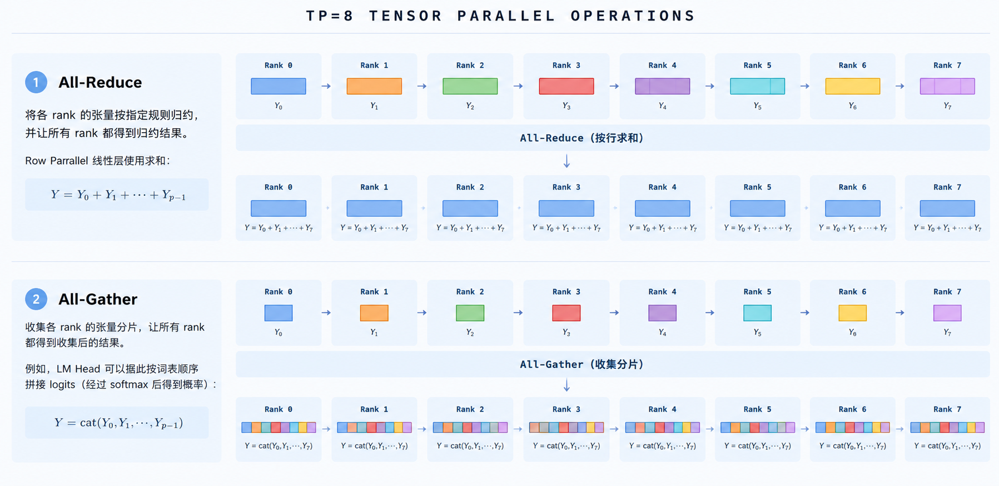
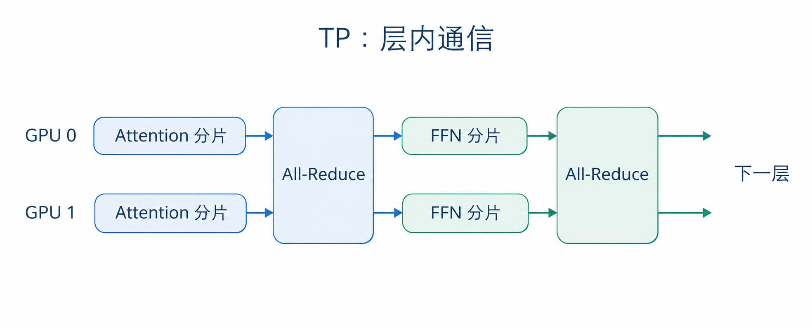

# Tensor Parallel 让多个 Rank 计算同一批请求

```{contents} 本页目录
---
depth: 2
local: true
---
```

上一章已经建立物理 KV 池、请求页表与共享前缀的分工。本章补齐单机多卡执行规则：Mini-SGLang 采用一进程一卡，每个 Rank 独立持有 Scheduler、Engine、模型分片和 KV Cache，接收同一串请求并排出同一 Batch，再由层内 collective 汇合局部结果。静态进程地图见第 5 章〈[Mini-SGLang 系统骨架与请求全链路](https://bytedance.larkoffice.com/wiki/EZcawGzFrirc8bkkvuqclJCpnXd#doxmyETjk7pB7MIDKit0CE5Xk2c)〉；本章重点追踪控制消息对齐与 GPU 张量通信。

<callout emoji="💡">
**这一节要抓住的不变量：**所有 Rank 必须以相同顺序、相同 shape 和相同 dtype 进入同一个 collective。只要某个 Rank 漏了一条请求、采样出了不同 token，或者走进了不同的调度分支，后续 NCCL 调用就可能互相等不到。
</callout>

## 单机多卡采用一卡一 Scheduler 进程

进程分工全貌见第 5 章。在多卡路径中，`start_subprocess()` 强制采用 `spawn` 方式启动 `tensor_parallel_size` 个 Scheduler 子进程：第 `i` 个进程持有 `DistributedInfo(i, world_size)` 并绑定 `cuda:i`（无跨机 `node_rank`，面向单机多卡）。所有 TP Scheduler 完成全 Rank barrier 后只由 Rank 0 向主进程回发一条就绪确认，主进程合计等待 `num_tokenizer + 2` 条 ACK 后正式对外服务。

## 控制面同步请求，数据面交换 GPU 张量

Mini-SGLang 把通信分成两层。控制面传请求对象和同步信号，使用 ZeroMQ、msgpack 与 Gloo；数据面传模型计算产生的 GPU tensor，使用 NCCL。这样，Tokenizer 不需要知道模型怎样切分，Scheduler 的请求协议也不需要承载大块激活值。

| 通信 | 载荷 | 实现 | 发生位置 |
|-|-|-|-|
| Tokenizer → Rank 0 | UserMsg、Abort、Exit 等控制消息 | ZMQ PUSH/PULL + msgpack | scheduler/io.py |
| Rank 0 → 其他 Rank | 同一份原始请求字节 | ZMQ PUB/SUB | scheduler/io.py |
| 全 Rank CPU 同步 | barrier、消息条数、NCCL unique ID | torch.distributed Gloo group | engine.py、pynccl.py、scheduler/io.py |
| 全 Rank GPU 汇合 | hidden state、embedding、logits | NCCL all-reduce / all-gather | layers 与 pynccl.cu |

多进程提供独立的地址空间和执行载体，TP 规定同一层怎样分工。Mini-SGLang 在每个 Scheduler 进程里创建 Engine 对象，不会再为 Engine 单独启动进程。各 rank 的 Batch 一致性依赖请求广播、顺序与状态推进协议，多开进程本身不保证一致。即使 `TP=1`，在线服务的 API、分词与 Scheduler 之间仍有控制消息；此时不需要跨 TP rank 的张量汇合。

**All-Reduce 求和与 All-Gather 拼接的语义分界：**All-Reduce 合并同一输出位置上的局部贡献，All-Gather 按序收集不同 rank 持有的分片。以两条一维向量 `Y0=[1, 2]`、`Y1=[10, 20]` 为例：

| 操作 | 每个 rank 最后得到什么 | 结果的含义 |
|-|-|-|
| All-Reduce，SUM | `[11, 22]` | 对应元素相加，结果形状与单个输入相同。 |
| All-Gather | `[1, 2, 10, 20]` | 按 rank 顺序收集分片，元素保留各自数值。 |

Row Parallel 线性层沿输入维切分，每个 rank 只算完整点积的一部分，因此需要求和。LM Head 沿词表切分，每个 rank 算不同候选 token 的 logits，因此需要收集分片。源图把同一差别展开到 8 个 rank；图中箭头只表示数据关系，不指定 NCCL 必须使用某种 ring 或 tree 算法。



图中“按行求和”应理解为跨 rank 对应元素的求和，不会把张量的行维压掉。LM Head 汇集的是尚未归一化的 logits；不能先在各词表分片内独立做 Softmax，再直接拼成全词表概率。在 Mini-SGLang 中，多请求 logits 还需把 All-Gather 的 rank 优先布局重排为 batch 优先，具体代码见[“两张卡怎样合成一次线性层”](https://bytedance.larkoffice.com/wiki/EZcawGzFrirc8bkkvuqclJCpnXd#doxmyn5kAaQKu70uEhLfTxsc7ab)。

这些张量交换依赖所有参与者加入同一个 communicator。接下来从进程组与 NCCL 初始化看各 rank 怎样建立通信关系。

## 通信初始化先建控制组，再建 GPU Communicator

### 默认路径让 Gloo 和自定义 NCCLWrapper 分工

**Engine.__init__** 在 CUDA 初始化前写入一次性的全局 TP 信息，然后选择 **cuda:{rank}**、创建 Engine stream，并调用 **_init_communication**。默认 **use_pynccl=True** 时，torch.distributed 的默认 process group 使用 Gloo。它负责 CPU barrier、内存信息规约和 NCCL ID 交换；GPU collective 则由 **DistributedCommunicator** 末尾注册的 **PyNCCLDistributedImpl** 执行。

```text
Engine._init_communication
  -> torch.distributed.init_process_group(backend="gloo")
  -> enable_pynccl_distributed
  -> kernel.init_pynccl
  -> Rank 0 创建 ncclUniqueId
  -> Gloo broadcast_object_list
  -> 每个 Rank 构造 NCCLWrapper
  -> ncclCommInitRank
```

如果指定 **--disable-pynccl** 且 TP 大于 1，默认 process group 改为 NCCL，GPU collective 退回 torch.distributed；代码随后额外创建一个 Gloo group 供 Scheduler 控制面使用。这个参数只关闭自定义包装，并不会关闭 NCCL。

### PyNCCL 仍然调用原生 NCCL

这里的 PyNCCL 容易被名字误导。Python 文件 **kernel/pynccl.py** 只负责按需编译、注册 TVM-FFI 对象、广播 unique ID，并把 Python Tensor 交给原生对象。真正的 **ncclCommInitRank**、**ncclAllReduce** 和 **ncclAllGather** 都在 **kernel/csrc/src/pynccl.cu** 中执行，动态编译时链接系统 **-lnccl**。

NCCLWrapper 会分配并注册一块 symmetric memory。all-reduce 张量不超过 **max_bytes** 时，数据先异步复制到内部缓冲区，原地规约后再复制回来；超过阈值时直接在输入 tensor 上规约。all-gather 不走这块缓冲区，直接写入 Python 侧预分配的输出。调用提交到 tensor 对应设备的当前 CUDA stream，Python 层不为每次 collective 做额外同步。

## Rank 0 广播输入消息，各 Rank 自己排出同一个 Batch

多 Rank 模式下，只有 Rank 0 连接 Tokenizer。空闲阻塞时，Rank 0 读到第一条原始消息后立刻 PUB；非零 Rank 阻塞在 SUB 上等待同一条消息。处理积压消息时，Rank 0 先通过 Gloo 广播“本轮还有多少条消息”，再按原顺序 PUB；其他 Rank 收到数量后读取同样条数。所有 Rank 随后都执行 **_process_one_msg → _schedule_next_batch → _prepare_batch → Engine.forward_batch**。

同步到这里就结束了。代码不会广播排好的 Batch、页表或采样结果。每个 Rank 都有自己的 PrefillManager、DecodeManager、TableManager 和 CacheManager；decode 请求通过 UID 排序，各 Rank 根据同样的请求序列独立更新这些结构。模型最终产生完整 logits 后，每个 Rank 还会自行采样，并把本地 next token 写回 token pool。只有回复路径不同：Rank 0 把结果送给 detokenizer，其他 Rank 的回复函数什么也不做。

<callout emoji="💡">
**同步边界：**固定随机种子 42 可以帮助随机采样保持一致，但源码没有 sampled-token 广播、Batch 摘要或 Rank 状态校验。贪心采样更容易维持不变量；随机采样还要求每个 Rank 的 RNG 消耗轨迹完全相同。
</callout>

## TP 层先做局部矩阵运算，再选择合适的 collective

| 层类型 | 每 Rank 权重形状 | 局部计算结果 | 跨卡汇合方式 |
|-|-|-|-|
| `LinearReplicated` | `[O, I]`，完整复制 | `[*, O]` | 无 collective |
| `LinearColParallelMerged` | $[\sum_i(O_i/\mathrm{TP}), I]$ | 输出维分片 | 留给下一层继续计算 |
| `LinearQKVMerged` | 本 Rank 的 Q/K/V heads | 本地 QKV 与 Attention 输出 | 经 O projection 后 all-reduce |
| `LinearOProj` / `LinearRowParallel` | `[O, I/TP]` | 完整形状的局部点积和 | all-reduce SUM |
| `VocabParallelEmbedding` | `[ceil(V/TP), H]` | 命中本地词表查表，否则清零 | all-reduce SUM |
| `ParallelLMHead` | `[ceil(V/TP), H]` | `[B, V_local]` logits | all-gather 后按 batch 重排并裁剪 |

Attention 的 QKV projection 沿输出维切分，每个 Rank 只计算本地 heads；Attention 输出进入按输入维切分的 O projection，各 Rank 得到同形状的局部和，再用 all-reduce 恢复完整 hidden state。MLP 同理：gate/up projection 沿中间维切分，激活保留分片，down projection 做 all-reduce。MoE 的专家中间维也按 TP 切分，最终 hidden state 做 SUM。



图：常见 Transformer TP 路径在 Attention 输出投影和 FFN 输出投影后分别合并局部结果。图中两次 All-Reduce 对应前文的 O projection 与 down projection；这是层内数据关系示意，具体通信算法和融合方式由实现决定。来源：[Datawhale《Zero to SGLang》横向扩展](https://datawhalechina.github.io/zero-to-sglang/ch/part3/第4章_横向扩展.html)。

### 两张卡怎样合成一次线性层

用行向量约定 $Y=XW$。当 $X\in\mathbb R^{B\times4}$、$W\in\mathbb R^{4\times6}$ 时，Column Parallel 沿输出维把 W 分成两个 4×3 分片，各 rank 得到 B×3。若后面接 Row Parallel，可把这两份输出直接当作输入分片，各算 B×H 的部分和，再 all-reduce。这样中间激活无须先 all-gather。若最终需要完整的 6 维输出，则在该边界汇合。具体代码权重存储常用 [out,in]，切分维度要按存储约定换算。

Embedding 使用定制 indexing kernel。它把不在本 Rank 词表区间内的输出清零，因此 all-reduce 后只留下拥有该 token 的 Rank 贡献。LM Head 的方向相反：每个 Rank 先算本地词表 logits，再 all-gather。NCCL 原始布局按 Rank 排列；batch 大于 1 时，代码 reshape、permute 成按 Batch 排列，最后裁掉 **ceil(V/TP)** 带来的尾部 padding。

运行时分片必须与权重加载严格配对：Q/K/V 与 gate/up 沿输出维切分，O 与 down 投影沿输入维切分，词表与 LM Head 按行切分；完整 Hugging Face 权重名到运行时张量的映射规则集中在下一章核对。

### TP 规模受复制与通信限制

线性层能按维度切分，不代表整个推理实例的显存都会随 TP 等比例缩小。课程以 Qwen2.5-32B 为例，按约 $3.2\times10^{10}$ 个参数、每个 BF16 参数 2 字节估算，仅权重就约为 $64\,\mathrm{GB}\approx59.6\,\mathrm{GiB}$。这只是参数量的近似换算，不是实测加载峰值。一张 A100 80GB 即使能放下这些权重，目标上下文和并发能否运行，仍取决于 KV Cache、临时激活及工作区占用。

| 显存组成 | 扩大 TP 后的变化 |
|-|-|
| 可切分的大权重 | 在均匀切分且维度可整除时，每卡这部分近似按 TP 缩小。 |
| 复制参数与激活 | RMSNorm 等小参数仍按 rank 复制；层间完整 hidden state 也可能在各卡各存一份。 |
| KV Cache | 随本地 KV head 数变化；触发 head 复制后，每卡至少保留一个 KV head。 |
| 运行缓冲 | Attention workspace、通信缓冲和 CUDA Graph buffer 各有尺寸规则，不能统一除以 TP。 |

#### KV 头数限制单卡缓存缩减

换一组便于手算的教学配置：全模型有 32 个 Q heads、8 个 KV heads，以下不代表前面 Qwen2.5-32B 的实际 head 配置。保持层数、head dimension、缓存精度和同一组请求不变，只比较每个 token 在单卡上的 KV payload：

| TP | 每卡 Q heads | 每卡 KV heads | 单卡 KV payload 相对 TP=1 |
|-|-|-|-|
| 1 | 32 | 8 | 1 |
| 2 | 16 | 4 | 1/2 |
| 4 | 8 | 2 | 1/4 |
| 8 | 4 | 1 | 1/8 |
| 16 | 2 | 1 | 1/8 |

TP 从 8 扩到 16，Q heads 继续减半，单卡 KV head 数却仍为 1。每个逻辑 KV head 此时对应两个 rank：rank 0、1 复制 head 0，rank 2、3 复制 head 1，依此类推。它们在各自 GPU 上保存独立副本，不是共同引用一块物理显存，也不是每个 rank 都保存全部 8 个 KV heads。权重加载器按下面的索引选择需要复制的 head：

```python
head_dim = value.shape[0] // num_kv_heads
head_idx = r * num_kv_heads // n
return value[head_idx * head_dim : (head_idx + 1) * head_dim].clone()
```

这里 `r` 是 rank，`n` 是 TP size。模型构造还要求 Q head 数可被 TP 整除；KV head 数不小于 TP 时，要求 `num_kv_heads % tp_size == 0`；KV head 数小于 TP 时，要求 `tp_size % num_kv_heads == 0`。KV pool 用同样的规则确定 `local_kv_heads`，从而与投影权重保持一致。

表中比较的是固定请求的有效 KV 数据量，不是启动后预分配池的实际大小。Mini-SGLang 会按剩余显存预算计算 `num_pages`；TP 释放的权重空间可能转而容纳更多 KV 页。不能仅凭进程显存读数没有下降，就判断权重切分无效。

#### 更小的矩阵未必抵消通信开销

TP 增大后，每卡矩阵变小，但 Row Parallel 的求和和词表输出的汇集仍需要跨卡执行。小矩阵可能难以充分利用计算单元，更多参与者也会改变通信与同步成本；跨越互联边界时还需重新测量。因此，TP 翻倍不能推出单次前向耗时减半。

评估时可以先固定请求分布与并发，比较 TP 变化对单请求延迟和每卡占用的影响，再测新增缓存容量能承载多少并发。两组实验回答不同问题。TTFT、TPOT、有效吞吐及测量窗口继续沿用前文 Benchmark 的定义，不能把更大 batch 的吞吐收益全部归因于单次计算加速。

维度约束也要在权重加载端成立。当前词表层按 `ceil(vocab_size / tp_size)` 分配局部行数，但 `_shard_tensor()` 只切出真实词表行，没有为最后一个分片补足权重。LM Head 对输出 logits 的裁剪不能修复加载时的 shape 不匹配，因此这里不能沿用源图“词表会自动 pad 后均分”的保证。后面的风险表继续列出这类需要验证的边界。

本章先建立单机 TP 的同序执行、模型张量切分与 collective 契约。单卡多 CTA 的任务拆分见第 10 章〈[卡内 split-KV](https://bytedance.larkoffice.com/wiki/EZcawGzFrirc8bkkvuqclJCpnXd#doxmy0wsMdUKlXpcxb8hA0lTp5R)〉，多卡沿同一序列位置分工见第 15 章〈[Context Parallel 专题](https://bytedance.larkoffice.com/wiki/EZcawGzFrirc8bkkvuqclJCpnXd#doxmyiBNzBkMFVIgMMryQwaZmbc)〉；二者均不改变这里的 TP 基础规则。

## 风险集中在 Rank 分歧与边界配置

| 风险 | 触发条件 | 表现与定位线索 |
|-|-|-|
| collective 顺序分歧 | 漏消息、不同 Batch、不同采样 token 或本地状态漂移 | 某个 NCCL/Gloo 调用永久等待；逐 Rank 对齐 UID、shape、dtype 和 collective 序号 |
| PUB/SUB 无确认 | 订阅连接未就绪或运行期消息丢失 | 代码没有序列号、ACK、重放和恢复；后续通常表现为 Rank 卡住 |
| PyNCCL dtype 边界 | TP + PyNCCL + float32 | 原生 dtype map 只登记 FP16/BF16，而 CLI 接受 FP32；应拒绝配置或补验证 |
| 词表不能整除 | 最后一个 Rank 的真实切片小于 ceil(V/TP) | 层分配 shape 与 loader 切片 shape 可能不一致，load_state_dict 会直接断言 |
| row-parallel bias 重复 | LinearRowParallel 或 LinearOProj 使用 bias | 每 Rank 先加 bias 再 SUM，结果变为 TP×bias；当前模型调用均为 has_bias=False |
| 显存容量按较大值规划 | 各卡空闲显存有差异但未超过 2 GiB 阈值 | 页数计算使用同步结果中的最大值，较小显存 Rank 可能先 OOM |
| 启动与退出等待 | 非零 Rank 在 barrier 前退出，或 collective 资源提前释放 | ACK get 无超时；销毁顺序必须先释放 CUDA Graph，再销毁 process group |
| NCCL 版本耦合 | 系统 libnccl 与源码头文件或 window API 不兼容 | 编译、链接或初始化失败；部署机需核对实际 NCCL 符号与版本 |

## 证据边界与验证重点

`tests/kernel/test_comm.py` 仅覆盖四进程 FP16 all-reduce、all-gather 与基本等待行为，尚未覆盖 symmetric buffer 阈值切换、BF16、CUDA Graph 捕获与跨 Rank 调度状态一致性。完整源码文件索引见〈[附录 A：Mini-SGLang 实战、排障与查阅手册](https://bytedance.larkoffice.com/wiki/EZcawGzFrirc8bkkvuqclJCpnXd#doxmyVjgMnxC8UnNtNPHuubayUe)〉。

<callout emoji="✅">
**本章最小验证：**在 TP=1/2/4 下逐轮对齐各 Rank 的 Batch UID、shape、dtype、采样 token 与 collective 序号，分别覆盖 PyNCCL 与 torch NCCL、CUDA Graph 开关、随机采样及单 Rank 异常退出；跨模块消融矩阵见第 12 章〈[自定义 Kernel 与系统收官实验](https://bytedance.larkoffice.com/wiki/EZcawGzFrirc8bkkvuqclJCpnXd#doxmyCrT9cfNBzyzOQfBHC0SB5U)〉。
</callout>

Tensor Parallel 的正确性依赖所有 Rank 同序执行。理解 Column、Row 与词表切分后，下一章就可以按 rank-local shape 追踪权重加载、模型 forward、LM Head 和采样；Attention Backend 与 CUDA Graph 随后继续落实这些契约。
