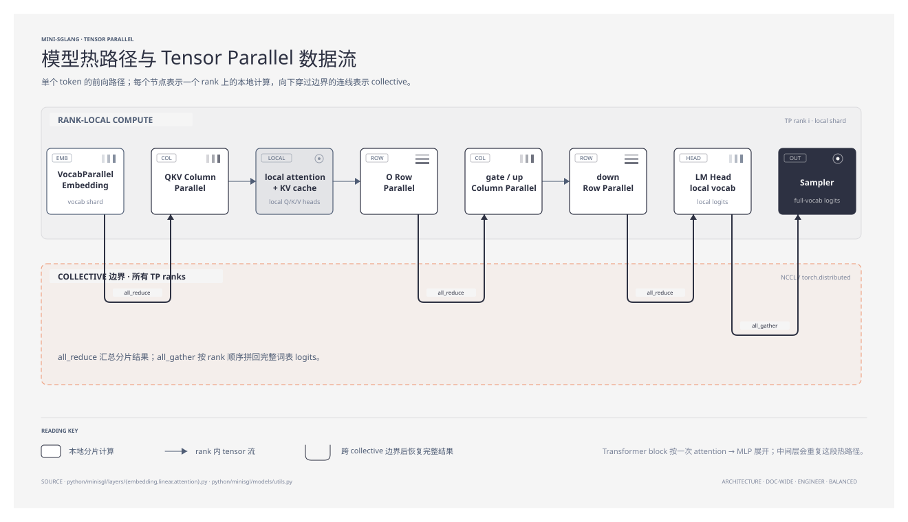

# 模型执行与采样：从 Batch 到 token

```{contents} 本页目录
---
depth: 2
local: true
---
```

Scheduler 选定本轮请求、逻辑位置和 KV 写入地址后，模型层接过打包的一维 token 序列，依次经过 Embedding、多层 DecoderLayer、Final RMSNorm 与 ParallelLMHead 产出词表 logits，最后交由 Sampler 选出下一个 token ID。本章沿着 rank-local 张量形状、权重装载协议与采样边界走完这段前向计算。

记 T 为本轮新 token 总数，B 为请求数，H 为 hidden size，Q／K 为全局 query／KV head 数，D 为 head dim，I 为 intermediate size，E 为 expert 数，R 为 top-k，V 为词表大小，P 为 TP size；q＝Q／P。当 P≤K 且 K % P＝0 时，k＝K／P；当 P＞K 且 P % K＝0 时，每个 rank 复制一个完整 KV head，k＝1。

## 先记住从 Batch 到采样的主路径

Scheduler._prepare_batch 生成 input_ids、positions、out_loc 和 attention metadata。Engine.forward_batch 将 Batch 放进全局 Context；各层用 get_global_ctx() 读取批次与 backend。decode 可走 CUDA Graph，图内仍是同一个 model.forward。



*图：单个 TP rank 内从 Batch 准备、全局 Context 挂载、多层 DecoderLayer 前向到 ParallelLMHead 与图外 Sampler 的执行主路径。*

```text
Scheduler._prepare_batch
  → Context.forward_batch(batch)
  → model.forward()
  → embedding → N × DecoderLayer → final RMSNorm
  → ParallelLMHead → logits[:B] → Sampler → token ids
```

prefill 的 T 等于各请求 extend_len 之和；decode 通常每个请求增加一个 token，因此 T 接近 B。CUDA Graph 会补齐到已捕获的 batch size，最终只采样前 B 行。

## 配置、注册与权重共同搭起模型

### ModelConfig 与静态注册表决定骨架

ModelConfig.from_hf 只保留层数、H、I、Q／K／D、词表、RoPE、激活、权重绑定与 MoE 参数。若有 text_config，则切到文本配置，并尝试从顶层补 architectures 与 RoPE 字段。create_model 只读取 architectures[0]；未知名称直接报错。

注册表覆盖 LlamaForCausalLM、Qwen2ForCausalLM、Qwen3ForCausalLM、Qwen3MoeForCausalLM、MistralForCausalLM；Mistral3ForConditionalGeneration 映射到纯文本 MistralForCausalLM。

### meta 构造先定局部 shape，再装真实权重

**结论：**在 meta device 上创建模型，是为了先得到模型对象树、参数名、当前 TP rank 的局部 shape 和目标 dtype，同时不为 checkpoint 参数分配任何存储。权重加载完成后，Mini-SGLang 会用真实 CUDA Tensor 直接替换这些占位 Tensor。

```python
set_rope_device(self.device)
with torch.device("meta"), torch_dtype(config.dtype):
    self.model = create_model(config.model_config)
self.model.load_state_dict(self._load_weight_state_dict(config))
```

#### meta 只建参数骨架

模型构造函数仍会执行，层级关系、参数路径和 TP 切分后的局部尺寸都会确定，但它没有 backing storage，不占用对应的 CPU 内存或 GPU 显存。

torch_dtype(config.dtype) 同样不可省略。BaseOP.load_state_dict 会同时校验 shape 与 dtype；如果占位 Tensor 沿用默认 float32，而实际权重是 bfloat16 或 float16，加载会在校验阶段失败。

| 阶段 | Tensor 状态 | 内存结果 |
|-|-|-|
| 构造模型 | meta Tensor，保存参数路径、shape 和 dtype | 没有参数 storage |
| 读取 checkpoint | 当前 rank 所需的 CUDA Tensor | 分配真实权重显存 |
| 装载权重 | 模型属性改为指向 CUDA Tensor | meta 占位对象被替换 |

#### 真实权重直接替换占位 Tensor

load_weight 在当前 rank 对应的 CUDA device 上读取 safetensors，随后按 TP rank 切片，并完成 Q／K／V、gate／up 和 MoE expert 的运行时布局转换。Engine 再按需把权重转换为目标 dtype。

```text
HF tensor → TP shard → q/k/v 或 gate/up merge
          → expert stack（仅 MoE）→ dtype convert
          → BaseOP.load_state_dict → 替换 meta tensor
```

这里没有调用 torch.nn.Module 默认的参数复制逻辑。Mini-SGLang 的 BaseOP 会递归找到同名属性，从 state_dict 中弹出真实权重，核对 shape 和 dtype，然后执行 setattr(self, name, item)。这个动作改变的是 Python 属性引用，不会尝试向没有 storage 的 meta Tensor 写入数据。

```python
item = state_dict.pop(key)
assert param.shape == item.shape
assert param.dtype == item.dtype
setattr(self, name, item)
```

#### meta 消除模型构造产生的重复存储

如果直接在 CUDA 上构造模型，torch.empty 会先分配一整份未初始化的本 rank 参数；加载 checkpoint 时又会产生一整份真实权重，启动峰值会额外多出接近一个模型分片。如果在 CPU 上构造，这份无用存储会转移到主存。两者都会创建一批马上被替换的 Tensor。

meta 只消除这份构造期占位存储，并不消除权重加载器自身的临时内存。当前实现会先通过字典推导式收集当前 rank 的全部目标权重，再进入 load_state_dict；读取和切分单个 checkpoint Tensor 时，也可能短暂保留未切分 Tensor 与局部分片。

#### RoPE Cache 初始化与 Llama 3 / YaRN 频率缩放

RoPE 的正余弦表 `_cos_sin_cache` 不存放在 checkpoint 中，不会被 `load_state_dict` 替换，因此绝不能留在 `meta` 设备上。`Engine` 先调用 `set_rope_device(self.device)`，`python/minisgl/layers/rotary.py` 中的 `get_rope()` 检测到当前处于 `meta` 上下文时，会临时切回目标 CUDA 设备预计算 `[max_position, rotary_dim]` 的 `(cos, sin)` 拼接表（当前断言 `rotary_dim == head_size` 且属于 `{64, 128, 256, 512}`），前向阶段直接调用 FlashInfer 的 `apply_rope_with_cos_sin_cache_inplace` 原地旋转 Q 和 K。

针对长上下文模型，`_get_rope()` 在构造逆频率 `inv_freq` 时支持三类 `rope_type` 后处理：

- **`default`（无缩放）：**直接使用标准几何级数 $\theta_i=\mathrm{base}^{-2i/d_h}$。
- **`llama3`（按波长分段平滑）：**计算每个频率分量的波长 $\lambda_i=2\pi/\theta_i$，与原始上下文窗口 $L_0$ 及高低频阈值 $(f_{\mathrm{low}},f_{\mathrm{high}})$ 比较——短波长高频分量保持原值以保住局部位置分辨率，长波长低频分量除以 `factor`，中间频段按平滑系数 $\mathrm{smooth}\in[0,1]$ 在 $1/\mathrm{factor}$ 与 $1$ 之间线性过渡。
- **`yarn`（按旋转圈数斜坡插值）：**由 `_find_correction_dim()` 根据高低旋转圈数阈值（默认 `beta_fast=32.0`、`beta_slow=1.0`）换算出维度边界 `[low, high]`，构造斜坡函数 `ramp` 将高频维度的原频率与低频维度的内插频率 `inv_freq / factor` 混合。

这套预计算依赖 `@functools.cache` 让同配置的全部层共享同一份 GPU 正余弦表，既节省显存，又避免在每层前向重复计算三角函数。

### BaseOP 为纯推理保留最小模型契约

<callout emoji="💡">
**结论：**`BaseOP` 是 Mini-SGLang 为固定结构、纯推理和定制权重加载裁剪出的最小模型容器。它只负责组织模型树、递归读写权重和声明 `forward`。自定义 CUDA／Triton kernel 与 `nn.Module` 并不冲突，选择 `BaseOP` 的关键原因是简化权重与对象生命周期。
</callout>

#### 模型构造与执行绕开了 nn.Module 管理面

`BaseOP` 在 `layers/base.py` 中只定义三项能力：抽象的 `forward`、递归生成 `state_dict`、递归安装 `state_dict`。模型层持有普通 `torch.Tensor`，没有注册 `nn.Parameter`。

```text
meta device 创建 BaseOP 模型树
→ 各层持有无 storage 的占位 Tensor
→ load_weight 完成 TP 分片、投影合并与 expert stack
→ BaseOP.load_state_dict 以 CUDA Tensor 替换占位属性
→ 各层显式调用 .forward()
→ CUDA Graph 捕获并重放 GPU 操作
```

`MoELayer` 展示了这套规则。`gate_up_proj` 和 `down_proj` 是公开 Tensor，会进入权重字典；`_comm` 以下划线开头，会被跳过；专家数、激活函数等普通 Python 属性也不会成为模型状态。

| 属性类型 | BaseOP 的处理 | MoELayer 示例 |
|-|-|-|
| 公开 `torch.Tensor` | 写入或加载 `state_dict` | `gate_up_proj`、`down_proj` |
| 公开 `BaseOP` | 递归遍历子树 | `MoEMLP.experts` |
| 以下划线开头的属性 | 跳过 | `_comm`、`_layer_id` |
| 普通 Python 值 | 保留在对象中，不进入权重字典 | `num_experts`、`activation` |

#### 两种设计的分界在框架能力

| 维度 | BaseOP | `nn.Module` |
|-|-|-|
| 权重表示 | 普通 Tensor，加载时直接替换属性 | `nn.Parameter` 与注册 buffer |
| 子层管理 | 只递归识别 `BaseOP`，列表需使用 `OPList` | 自动注册 Module，提供 `ModuleList` 与 `ModuleDict` |
| 调用路径 | 显式调用 `layer.forward(x)` | 通常调用 `layer(x)`，经过 `Module.__call__` |
| 运行模式 | 没有统一的训练／评估状态 | 提供 `train()`、`eval()` 和模块级状态传播 |
| 设备与 dtype | 由加载器和各组件显式管理 | 提供 `to()`、`cuda()`、`half()` 等标准入口 |
| 生态能力 | 项目自行维护所需能力 | 可直接接入 hooks、optimizer、DDP／FSDP、量化、FX 与导出工具 |

#### 简化的代价由项目约定承担

`BaseOP` 的代码很短，约束却更依赖团队自律。

- 普通 Python 列表中的子层不会被自动发现，模型必须使用 `OPList` 或自行实现递归逻辑。
- 公开 Tensor 一律被视为模型状态，以下划线开头的 Tensor 一律被跳过；它没有 Parameter 与 buffer 的语义区分。
- 加载器按 key 弹出权重并校验 shape、dtype，缺失 key 会直接失败，多余 key 只在顶层递归结束后统一报错。
- `BaseOP` 使用了 `@abstractmethod`，自身却没有继承 `ABC`，普通子类不会获得强制的抽象方法检查。`BaseLLMModel(ABC, BaseOP)` 才具备这一约束。

#### 性能收益不能脱离执行路径下结论

显式调用 `forward` 省去了 `nn.Module.__call__` 中的 hook 分发等 Python 逻辑，但当前仓库没有基准数据证明这会带来显著的端到端收益。进入 CUDA Graph replay 后，Python 也不会逐层重新执行。Mini-SGLang 的主要收益来自更简单、可控的模型装载协议，而非 `BaseOP` 这个继承关系本身。

`nn.Module` 同样可以在 `forward` 中调用 FlashInfer、Triton 和自定义 CUDA kernel，也可以配合 meta Parameter 与 `load_state_dict(assign=True)` 直接安装真实权重。框架基类的选择与 kernel 的选择是两件独立的事。

#### 选型先看是否需要 PyTorch 生态

| 项目条件 | 建议 | 原因 |
|-|-|-|
| 固定模型、严格纯推理、全链路自控 | 可使用 `BaseOP` | 模型树与权重协议足够小，加载路径直接 |
| 需要训练、微调、LoRA 或 optimizer | 使用 `nn.Module` | 参数、梯度和训练状态需要标准生命周期 |
| 需要量化、导出、调试 hooks 或第三方工具 | 优先使用 `nn.Module` | 避免为每项生态能力重复实现适配层 |
| 既要定制推理 kernel，又要长期扩展模型 | `nn.Module` 管对象树，自定义 loader 与 kernel 管执行 | 保留标准管理能力，同时不牺牲推理算子 |

<callout emoji="✅">
**取舍建议：**Mini-SGLang 作为小型、可读、全链路自控的推理引擎，继续使用 `BaseOP` 是自洽的。面向通用推理框架或 PyTorch 工具链时，更稳妥的组合是由 `nn.Module` 管理模型树和权重生命周期，继续保留定制 TP loader 与高性能 kernel。
</callout>

## Shape ledger 串起整个 forward

下表均为单个 TP rank 的形状。Q、K、I 按 P 整除时，局部 intermediate 为 I／P；当 P 大于 K，代码复制完整 KV head，不会沿 D 切开一个 head。

| 阶段 | 输入 | 输出 | 通信 |
|-|-|-|-|
| Embedding | [T] | [T,H] | all_reduce |
| QKV projection | [T,H] | [T,(q＋2k)D] | 无 |
| split／RoPE／attention | Q [T,q,D]；K／V [T,k,D] | [T,q,D] | 无 |
| O projection | [T,qD] | [T,H] | all_reduce |
| gate/up 与激活 | [T,H] | [T,I／P] | 无 |
| down projection | [T,I／P] | [T,H] | all_reduce |
| LM Head | prefill [B,H]；decode [T,H] | [B,V] 或 [T,V] | all_gather |
| Sampler | [B,V] | [B] | 无 |

### 用两段 forward 建立代码骨架

从源码建立心智模型时，可以先看 `models/qwen3.py` 的两个入口。以下代码摘自 Mini-SGLang commit `9a91cfa`；路径均相对 `python/minisgl/`，并省略模型构造、权重加载和 GPU 初始化。

```python
x = self.embed_tokens.forward(input_ids)
residual: torch.Tensor | None = None
for layer in self.layers.op_list:
    x, residual = layer.forward(x, residual)
return self.norm.forward(x, residual)[0]
```

`input_ids` 是本轮打包后的一维 token 序列，长度为 `T`。Embedding 之后，`x` 的形状是 `[T,H]`；它不同于原理讲解常用的 `[B,L,H]` 规则矩形。

```python
x, residual = self.input_layernorm.forward(x, residual)
x = self.self_attn.forward(x)
x, residual = self.post_attention_layernorm.forward(x, residual)
x = self.mlp.forward(x)
return x, residual
```

第二段代码给出了本节三条数据流的先后顺序：`RMSNormFused` 维护 `x` 与 `residual`；`self_attn` 串起 QKV 投影、Q／K Norm、RoPE、Attention Backend 和输出投影；`mlp` 完成 gate／up、激活与 down projection。最后一层 MLP 尚未合入的残差由模型末尾的 `self.norm` 收口。因此，代码里看不到单独的 residual add，数学上仍是标准的 pre-norm Transformer。

这两段代码只负责搭骨架。各算子的 rank-local shape、TP 通信和 KV Cache 写入位置，分别由后面三个小节和下一章展开。源码见 [models/qwen3.py](https://github.com/sgl-project/mini-sglang/blob/9a91cfafe754aa85daee49998176275667eb58f2/python/minisgl/models/qwen3.py)。

### Embedding 与 attention 形成第一段 TP 闭环

VocabParallelEmbedding 按 token id 范围切词表行。每个 rank 只为本地 token 产出 embedding，其他位置写零；all_reduce 后，各卡都得到完整 [T,H]。

RopeAttn 用 LinearQKVMerged 一次 GEMM 得到 [T,(q＋2k)D]，再切成 Q [T,q,D] 与 K／V [T,k,D]。Qwen3 系列先对每个 Q／K head 的 D 维做 RMSNorm。RotaryEmbedding 按 batch.positions 原地旋转 Q、K，V 不旋转。backend 将旋转后的 K 与 V 写入 paged KV cache，再处理 causal mask、变长边界和历史页表。缓存的 rank-local 物理形状为 [2,L,pages,page_size,k,D]。

attention 返回 [T,q,D]，展平为 [T,qD]。LinearOProj 按输入维切，每卡算 [T,H] 部分和，all_reduce 后恢复完整输出。GQA 让多个 Q head 共享 KV head，缓存大小由 K 决定。

### Dense MLP 与 LM Head 收束一轮计算

gate_proj 与 up_proj 各沿输出维切成 [I／P,H]，再拼为 gate_up_proj [2I／P,H]。forward 产生 [T,2I／P]，silu_and_mul 或 gelu_and_mul 收缩为 [T,I／P]。down_proj 权重为 [H,I／P]，各卡计算部分和并 all_reduce；中间激活不做 all_gather。

prefill 只需每个请求最后一个新 token 预测下一 token。ParallelLMHead 用 attn_metadata.get_last_indices(B) 把 [T,H] 选成 [B,H]；decode 已是一请求一行。各 rank 计算本地词表 logits，all_gather 后重排并裁到 V。tie_word_embeddings 为真时，LM Head 直接复用 embedding shard，加载时忽略独立 lm_head 权重。

### 融合残差把加法放进下一次 RMSNorm

DecoderLayer 表面上没有 residual add，因为 RMSNormFused 把它与下一次归一化合并。首次进入模型时，它返回 RMSNorm(x) 并保存原始 x；attention 输出在 post_attention_layernorm 中与 residual 相加；MLP 输出在下一层 input_layernorm 中相加。最后一层 MLP 的加法由 final norm 完成。数学上仍是标准 pre-norm Transformer，只是少了独立 add kernel。

```text
n1 = RMSNorm(h); a = Attention(n1); h1 = h + a
n2 = RMSNorm(h1); m = MLP(n2); out = h1 + m
```

## TP 切分与 checkpoint 映射遵循固定规则

QKV、gate/up 按输出维切，输入 [T,H] 在 rank 间复制；O、down 按输入维切，末端 all_reduce 部分和。norm、残差与 hidden state 都复制。MoE router 使用 LinearReplicated。词表单独按行切：embedding 用 all_reduce，LM Head 用 all_gather。

| HF 名称 | 切法 | 运行时布局 |
|-|-|-|
| q_proj／k_proj／v_proj | dim 0；KV 可复制 head | qkv_proj，按 q、k、v 拼接 |
| gate_proj／up_proj | dim 0 | gate_up_proj，按 gate、up 拼接 |
| o_proj／down_proj | dim 1 | 名称不变，保留局部输入维 |
| embed_tokens／lm_head | 词表 dim 0 | 本 rank 的 token id 范围 |
| norm／QK norm／router | 不切 | 各 rank 完整复制 |
| experts.{e}.* | 先按上述规则切 | 再沿 expert 维 stack |

约束是 Q % P＝0、I % P＝0。K 在 P≤K 时须被 P 整除；P＞K 时须被 K 整除，每 rank 保存一个完整 KV head。另有一个静态可见的边界：embedding 分配 ceil(V／P) 行，loader 对最后 rank 只切真实剩余行；V % P≠0 时会在 load_state_dict 的 shape assert 失败。

## 模型差异集中在 DecoderLayer 构造

| 模型 | QKV bias | Q／K norm | FFN |
|-|-|-|-|
| Llama | 无 | 无 | GatedMLP |
| Mistral | 无 | 无 | GatedMLP |
| Qwen2／2.5 | 有 | 无 | GatedMLP |
| Qwen3 dense | 无 | 有 | GatedMLP |
| Qwen3-MoE | 无 | 有 | MoEMLP |

五者的顶层 forward 相同。Qwen2 打开 QKV bias；Qwen3 在 RoPE 前增加 Q／K RMSNorm；Qwen3-MoE 再换用 MoEMLP。Mistral 与 Llama 的模型层同构。

## Qwen3-MoE 采用 Tensor Parallel MoE

### MoE 用稀疏激活扩大参数容量

在 Qwen3-MoE 中，Attention 之后的前馈层不再只有一套权重，而是包含 `E` 个 expert。每个 token 先经过 router，再只激活其中 `R` 个 expert。这样，模型可以拥有更多参数，而单个 token 的专家计算量主要随 `R` 增长，不必执行全部 `E` 个 expert。不过，所有 expert 权重仍需驻留显存，MoE 节省的是激活计算，不是权重容量。

为避免与全书表示打包 token 总数的 `T` 混淆，下文统一记本轮输入 token 数为 `M`，隐藏维度为 `H`，路由专家总数为 `E`，每个 token 选中的专家数为 `K_top`，有效路由任务总数为 `R = M × K_top`，单专家中间维度为 `I`，TP 规模为 `P`。

### Router 复制与 Expert TP 权重切分

`MoEMLP` 先用各 TP rank 完整复制的 `LinearReplicated(H, E)` 算出 `router_logits [M, E]`；由于输入与权重相同，各 rank 无需通信就能通过 `topk_softmax` 得到一致的选中专家 ID `[M, K_top]` 与路由权重。随后 `moe_align_block_size` 按专家重排并补齐分块，依次执行第一轮融合专家 GEMM 产出 `[M, K_top, 2I/P]`、门控激活收缩为 `[R, I/P]`、第二轮专家 GEMM 投回 `[M, K_top, H]` 并沿 `K_top` 求和，两次 Triton 调用的完整块寻址与 Shape 账本统一在第 12 章拆解。

在多卡切分上，Mini-SGLang 采用 **Expert TP**：加载权重时先将每个专家的 gate/up 沿输出维切分、down 沿输入维切分，再沿专家维堆叠成 `gate_up_proj [E, 2I/P, H]` 与 `down_proj [E, H, I/P]`。每个 rank 持有全部 `E` 个专家的局部分片，末尾只需一次 `all_reduce [M, H]` 即可还原完整结果；按专家 ID 跨卡放置并通过 `all_to_all` 分发 token 的专家并行（EP）放在第 15 章分布式并行专章对比。

### 当前实现复用 TP 主链路以缩小系统复杂度

Mini-SGLang 的直接证据是，MoE 权重先按普通 MLP 的规则切分，`MoELayer` 末尾只调用 `all_reduce`；分布式抽象也只暴露 `all_reduce` 和 `all_gather`。仓库中没有 `all_to_all`、EP rank、token dispatch、capacity limit 或跨 rank 逆重排。

源码没有写明选择 Expert TP 的设计说明。从现有结构可以确认，它复用了 dense MLP 的 TP 规则和现有 communicator，fused MoE kernel 也沿用这条数据流。这样缩小了运行时实现面。这一选择也适合小 batch、低延迟的推理路径，但不能据此推出 Expert TP 在所有 MoE 负载上都更快；当 expert 数量和并发规模继续增大时，EP 或 `EP×TP` 往往更有扩展空间。

### MoE 性能取决于路由分布、分块浪费和通信

MoE 的理论优势来自 `R≪E`，但实际性能不只由 FLOPs 决定。路由越不均匀，热点 expert 的任务越多；每个 expert 的任务数越少，按 `BLOCK_SIZE_M` 补齐造成的空算越明显。Decode 阶段的 `M` 通常较小，router、top-k、任务整理、kernel launch 和 padding 更容易盖过稀疏计算的收益。代码也会在 `M≤E` 时改用更小的 tile，以适应这种小 batch 场景。

TP 还能缩小每个 expert 的中间维和单卡权重，但最后的 `all_reduce [M,H]` 会引入同步与链路开销。TP 规模继续增大时，单卡 GEMM 变小，通信占比反而可能上升。因此，评测 MoE 不能只比较参数量或理论 FLOPs，还要观察每个 expert 的 token 数、padding 比例、kernel 时间和 TP collective 时间。

## Sampler 把 logits 变成 token

### Sampler.prepare 先把请求参数合成批张量

Greedy 的判定是：（temperature 不大于 0 或 top_k＝1）且 top_p＝1。整批 greedy 时直接 torch.argmax；只要有一个随机请求，整批就转入 FlashInfer：

- temperature 下限为 1e-6；混合批中的 greedy 请求也取该值。
- top_k 小于 1 时换成 vocab_size；top_p 限制在 1e-6 到 1.0。
- 整批不限制 top-k 或 top-p 时，对应 tensor 为 None。
- logits 转 float32 后，调用普通、top-k、top-p 或组合 sampling_from_probs。

Engine 用 torch.manual_seed(42) 固定全局 seed。Sampler 输出 [B] token，再转 int32。Sampling 在图外，随机结果不会被 capture 固化。

### Sampling 的边界要单独验

- **混合批 greedy 不是严格 argmax**：它用 1e-6 温度进入随机 kernel；最大 logits 并列时可能选出不同 token。
- **组合过滤由 FlashInfer 定义**：升级依赖后要重跑 top-k、top-p 统计测试。
- **没有 per-request seed**，也没有 repetition、frequency、presence penalty、min-p 或 logprobs。
- **TP rank 不广播 token**：各 rank 本地采样，依赖 logits 和随机状态一致。

## 证据边界与验证重点

本章由源码静态确认了模型注册、`meta` 构造、RoPE 频率扩展、融合投影、残差路径与 rank-local shape；各架构在不同 TP 规模下的数值一致性仍需在 Linux/CUDA 环境实测。完整文件索引见〈[附录 A：Mini-SGLang 实战、排障与查阅手册](https://bytedance.larkoffice.com/wiki/EZcawGzFrirc8bkkvuqclJCpnXd#doxmyVjgMnxC8UnNtNPHuubayUe)〉。

<callout emoji="✅">
**本章最小验证：**导出五类已注册模型的 `state_dict` 与局部 shape，覆盖 Q/K/V 合并、gate/up 合并、KV head 复制与词表切分，再用朴素 PyTorch 参考实现对齐融合残差与 MoE 输出；跨模块实验见第 12 章〈[自定义 Kernel 与系统收官实验](https://bytedance.larkoffice.com/wiki/EZcawGzFrirc8bkkvuqclJCpnXd#doxmyCrT9cfNBzyzOQfBHC0SB5U)〉。
</callout>

模型层确定 Q/K/V 与 hidden state 的语义后，下一章继续看 Attention Backend 如何把它们接到分页 KV Cache 和具体 kernel。
