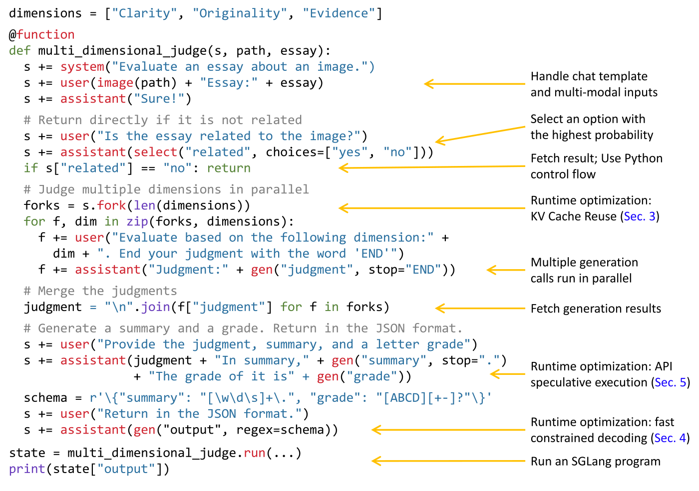
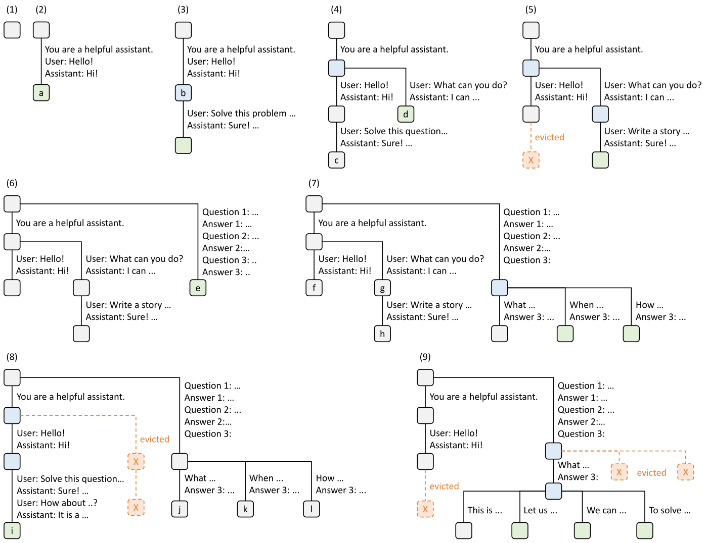
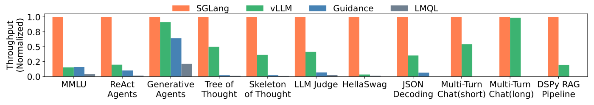
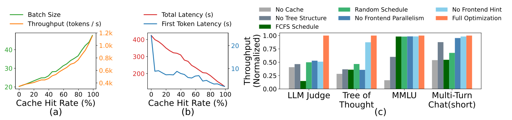

# 从 Mini-SGLang 到 SGLang：程序结构与模块映射

```{contents} 本页目录
---
depth: 2
local: true
---
```

第二篇已经走通了 Mini-SGLang 的单实例运行时主干：连续批处理、Radix 前缀树、单机 TP、Attention 后端与 CUDA Graph。走向生产版 SGLang 时，系统在两个方向上同时扩展：向上，前端语言原语把多轮、分支与结构约束显式暴露给运行时；向下，引擎补齐了多级缓存、多样化并行、低精度量化、投机解码与跨实例路由。

本章上半部分沿 SGLang 论文 v2 说明语言模型程序（Language Model Program）如何与运行时协同；下半部分对照固定源码提交，给出 Mini-SGLang 到生产版 SGLang 的能力矩阵、目录映射、基础启动参数、多实例网关路由与源码阅读路径。

## 单次请求优化解释不了多调用工作流

普通推理接口把一次调用看成一段 prompt 加一段 output。复杂应用的真实形状更像一张动态执行图：前一个生成结果决定下一条分支，多个分支可以并行，后续调用常常复用相同的系统提示、示例、对话历史或搜索路径，最后还要输出满足 JSON Schema 等约束的结果。

论文把这类程序称为 **Language Model Program**。它通常同时具备两个特征：多个模型调用与控制流交错；输入和输出具有明确结构，便于继续组合进软件系统。ReAct、few-shot learning、self-consistency、tree-of-thought、多轮对话和 RAG 都属于这个范围。

| 观察尺度 | 运行时能看见什么 | 容易错过的优化机会 |
|-|-|-|
| 单次生成请求 | 一条 token 序列、一次 Prefill、连续 Decode | 跨调用公共前缀、分支并行、后续调用依赖 |
| 语言模型程序 | 提示词状态、多个生成点、控制流与结构约束 | 需要前端把程序语义显式交给运行时 |

传统推理引擎不知道上层工作负载时，只能把每个调用当成独立请求。这样做通用而稳健，却会反复计算相同前缀，也无法识别某段受约束输出已经没有选择空间。SGLang 的核心判断由此成立：多调用结构本身就是优化信息。

## 前端把提示词状态变成可组合的执行对象

SGLang 是嵌入 Python 的领域专用语言。程序仍使用 Python 的条件、循环和函数，提示词状态则由一个名为 `s` 的对象承载。字符串与语言原语通过 `+=` 依次进入状态流，生成结果可以按变量名取回，分支可以复制当前状态后并行推进。

| 原语 | 作用 | 给运行时暴露的信息 |
|-|-|-|
| `extend` / `+=` | 向当前提示词追加内容 | 提示词状态按什么顺序增长 |
| `gen` | 生成并把结果保存为变量 | 生成边界、停止条件与正则约束 |
| `select` | 从候选项中选择概率最高的一项 | 候选集合与选择边界 |
| `fork` / `join` | 复制状态并行执行，再汇合结果 | 公共前缀、并行分支与同步点 |
| `image` / `video` | 加入多模态输入 | 可复用的图像或视频输入身份 |

SGLang 论文用多维作文评审展示这些原语怎样组合。程序先判断作文与图片是否相关，再把同一提示词状态分成三个分支，从不同维度并行生成评语，合并后继续生成摘要与等级，最后按正则约束返回 JSON。这里的语法便利只是表层，更关键的是 `fork` 暴露公共前缀与并行关系，`regex` 暴露确定的输出结构，连续 `gen` 暴露后续 API 调用可能复用的结果。

这张图把一段程序中的语言原语与运行时机会对齐。红色部分由 SGLang 提供；右侧依次标出多模态输入、选择、分支并行、KV Cache 复用、API 推测执行与快速约束解码。



### 异步解释器只在真正依赖结果时同步

解释器把每条提示词状态当成异步 stream。`extend`、`gen` 和 `select` 提交后可以继续运行，后台线程中的 stream executor 保证同一状态内的先后关系。程序只有在读取某个生成变量时才阻塞等待。这个模型很像异步提交 CUDA kernel：提交本身不要求立即完成，读取结果才形成同步点。

`fork` 会复制当前状态，多个分支因而可以同时推进。与手工创建线程、拼接字符串、维护每个请求的上下文相比，前端原语把并行边界和依赖关系留在程序结构里。运行时由此能够同时做程序内并行和请求间批处理。

### 编译模式把动态状态流还原成数据流图

一条更激进的路径是：通过 tracing 把程序构造成 IR。常量文本、参数、`Gen`、`Select`、变量、`Fork` 和 `Join` 都成为图节点；同一 stream 内的顺序形成流内依赖，跨 stream 读取变量形成流间依赖。Graph Executor 按拓扑顺序把节点分发到各个 stream。

论文还探索了静态图上的代码移动、调度和内存规划。把与具体输入无关的固定提示词前移，可以拉长公共前缀；15 个测试模板中有 12 个经人工确认保持语义，平均增加 60 个可共享 token。失败案例说明自然语言节点重排可能改变语义，tracing 也无法覆盖所有依赖数据的控制流，因此这类优化仍需语义检查。

### 多模态扩展：视觉编码器、动态切块膨胀与前缀缓存身份

当提示词状态加入 `image` 或 `video` 原语时，多模态大模型（VLM，如 LLaVA、Qwen2.5-VL）把推理链路拆成**模态编码**与**自回归语言模型**两段：

- **动态切块（Dynamic Resolution）带来的序列膨胀：**预处理按图像原始宽高比切成若干局部 patch 加一张全局缩略图，经 ViT（Vision Transformer）和投影层（Projector）变换成视觉特征序列，替换掉 Prompt 中的图像占位符。一张高分辨率截图往往展开为 1,000～4,000 个连续视觉 token；对语言主干而言，这与长文档 Prefill 一样会推高首包计算与 KV 容量。
- **ViT 与语言主干的异构瓶颈：**ViT 采用双向全注意力且无自回归 KV Cache，属于纯计算密集的独立前向。高并发场景若把大体量 ViT 与语言 Decode 混在同一事件循环，容易造成流式吐字停顿；生产架构（如第 23 章 DeepSeek V4.1 Flash）因此常把 Vision Encoder 拆成独立服务池按图像 patch 数均衡调度。
- **多模态 Radix 前缀缓存身份：**如果 Radix 树只记录文本占位符 ID（如 `<image_pad>`），两张不同图片在相同提示词下就会撞上同一个前缀节点并复用错误 KV。SGLang 的多模态缓存为此把**图像内容哈希 + 预处理尺寸配置**混入对应区间的 Radix 键中，并支持缓存 ViT 输出特征，使围绕同一张图或同一段视频的多轮追问无需重复跑 ViT 和视觉 Prefill。

## 运行时从程序结构里寻找可复用工作

SGLang 前端给出的信息最终落在三条运行时路径上。它们对应三种不同的浪费：重复计算相同前缀、在确定的约束路径上逐 token 前向，以及在黑盒 API 中重复支付上下文成本。

| 机制 | 利用的程序结构 | 减少的工作 |
|-|-|-|
| RadixAttention | 共享系统提示、few-shot 示例、对话历史和分支前缀 | 重复 Prefill 与重复占用的 KV Cache |
| Compressed FSM | 正则或 JSON 约束中的唯一合法路径 | 确定 token 上逐步执行的模型前向 |
| API speculative execution | 连续生成调用与可预测模板 | 后续 API 往返和重复输入 token 费用 |

Compressed FSM 跨过唯一合法的确定字符串；重新入队时，RadixAttention 复用已完成的前缀 KV，extend 只处理新增片段。这里保留两者的协作关系，词表索引、Jump Forward、重分词与 XGrammar 位掩码的完整讲解见[第 18 章约束解码专题](https://bytedance.larkoffice.com/wiki/EZcawGzFrirc8bkkvuqclJCpnXd#doxmy2966ClEqIyZ9QrTNsGNRy4)。黑盒 API 的返回结果复用则是另一条机制。

**黑盒 API 推测执行（API Speculative Execution）：**对于无法访问权重的外部商业 API，前端可以在一次调用中放宽停止条件多生成一段后续内容；若下一轮调用的提示词模板与已生成尾部匹配，便直接命中本地结果省去一次网络往返与重复输入计费，未命中时再安全退回真实 API 调用（它与第 19 章由草稿模型提议、目标模型并行验证的投机解码属于不同机制）。

## RadixAttention 把 KV Cache 管理成共享前缀树

第 7 章已经结合 Mini-SGLang 源码拆解了 Radix 树的节点分裂、页对齐与引用计数保护。在 SGLang 论文中，这棵树直接承接多轮对话、few-shot 示例与 `fork` 分支产生的树形共享工作负载：下图连续展示九个时刻，蓝色表示本轮命中的缓存，绿色表示新插入分支，红色虚线表示显存紧张时按 LRU 回收的叶节点。



缓存命中率定义为命中的 prompt token 数占全部 prompt token 数的比例：

$$\mathrm{hit_rate}=\frac{\mathrm{cached\ prompt\ tokens}}{\mathrm{prompt\ tokens}}$$

等待队列里有许多请求时，频繁切换无关前缀会造成 cache thrashing。SGLang 优先调度最长共享前缀更长的请求，让执行顺序尽量沿着 radix tree 的一棵子树向下走。选中请求后先提高前缀节点的引用计数，再根据空闲页和可淘汰页判断可用容量，必要时淘汰叶节点，最后把请求并入运行 batch。

离线场景还能给出更强的结论。设请求集合形成的 radix tree 为 $T$，边 $e$ 对应的缓存长度为 $|e|$。任何调度至少要把每条边计算一次，因此计算量下界为：

$$C\geq\sum_{e\in\mathrm{edges}(T)}|e|$$

当缓存容量不小于最长请求时，深度优先遍历会在处理完整棵子树期间持续命中祖先，每条边只计算一次，达到这个下界。最长共享前缀优先与一种深度优先顺序等价。在线请求会打断完整 DFS，算法只能近似保持这种局部性；贪心调度还可能导致饥饿，需要与公平调度结合。

## 实验验证了每条优化对应的瓶颈

论文实验覆盖 Llama-2 7B/70B、Mixtral-8x7B、LLaVA 图像与视频模型及 GPT-3.5 API。开放权重模型使用 float16，主要硬件为 24 GB A10G，部分实验使用 80 GB A100。对比版本包括 vLLM 0.2.5、Guidance 0.1.8 和 LMQL 0.7.3；吞吐按每秒完成的程序实例数计算，延迟按单个程序多次执行的平均值计算。

<callout emoji="📐">
**数据解读边界：**论文比较的是完整语言模型程序且基线版本较早；这组数字证明暴露程序结构能带来显著收益，不能直接折算为当前版本在任意单轮负载上的固定加速比。
</callout>

### 端到端收益随可复用结构而变化

在开放权重模型的多类任务上，SGLang 报告最高 6.4 倍吞吐提升和最高 3.7 倍延迟下降。收益来源随任务改变：MMLU 复用 few-shot 示例，HellaSwag 同时复用示例与多个选项的公共问题前缀，ReAct 与 generative agents 复用模板和历史调用，tree-of-thought 与 skeleton-of-thought 同时利用分支并行和前缀共享，JSON decoding 主要受益于 Compressed FSM。

论文图 5 把 SGLang 吞吐归一化为 1，显示不同基线在各种工作负载上的相对结果。差距最大的任务往往拥有长公共前缀、多级分支或严格结构约束；Generative Agents 与长输出多轮对话的差距较小。



| 结果 | 测量值 | 成立条件 |
|-|-|-|
| 主实验吞吐 | 最高 6.4 倍 | 任务存在可利用的共享、并行或约束结构 |
| 主实验延迟 | 最高降低 3.7 倍 | 单程序执行，收益随工作负载改变 |
| 开放权重任务缓存命中 | 50% 到 99% | cache-aware scheduling 平均达到最优命中率的 96% |
| LLaVA 图像吞吐 | 0.18 提升到 1.15 image/s | 同一图像有多个问题，可复用图像 token 的 K/V |
| LLaVA 视频吞吐 | 0.02 提升到 0.10 frame/s | 对比模型作者的 Transformers 实现 |

### 消融把缓存结构、调度和前端提示拆开验证

Tree-of-thought 消融显示，缓存命中率升高时，batch size 与吞吐随之上升，首 token 延迟和总延迟下降。原因有两层：命中前缀减少 Prefill 计算；共享 K/V 降低显存占用，从而允许更大的 batch。

完整消融进一步分别关闭树结构、改用 FCFS 或随机调度、关闭前端并行、关闭 fork hint。任何一项缺失都会让部分任务退化。前端 hint 的作用尤其直接：执行 `fork` 时，前端先把公共前缀发给运行时，确保它进入 radix tree，再提交各分支后缀。前端知道“这里将分叉”，运行时知道“这段前缀值得保留”，两边合起来才形成稳定复用。



没有任何缓存复用机会的 ShareGPT 测试中，100 个请求总耗时 74.3 秒，RadixAttention 数据结构管理耗时 0.2 秒，低于 0.3%。JSON decoding 中，Compressed FSM 把吞吐提高 1.6 倍；如果每个请求都重新预处理状态机，而不在一批请求之间复用，吞吐反而降低 2.4 倍。这说明“跳过确定路径”与“摊薄预处理成本”必须同时成立。

### 生产数据说明公共前缀确实长期存在

SGLang 曾用于 Chatbot Arena 的开放权重模型服务。论文记录的一个月数据中，LLaVA-NeXT-34B 的 RadixAttention 命中率为 52.4%，Vicuna-33B 为 74.1%。命中来自公共系统消息、重复使用的示例图片和多轮对话历史，Vicuna-33B 的平均首 token 延迟因此降低 1.7 倍。

这组线上记录证实了树形共享并非只存在于合成 benchmark（具体命中数值会随工作负载浮动）：公共系统提示词、多轮会话历史和重复示例图片在真实线上服务中长期存在。

## 前端与运行时必须共同保住结构

SGLang 的三项优化看起来分别作用于缓存、解码和 API，背后却是同一个设计原则：高层程序知道哪里共享、哪里分叉、哪里确定，底层运行时知道这些信息如何映射到显存、batch 和模型前向。只有结构跨过接口边界，优化才有落点。

| 前端语义 | 运行时动作 | 必须守住的约束 |
|-|-|-|
| 状态追加与 `fork` | 最长前缀匹配、共享 KV、并行分支 | token 前缀完全一致，使用中节点不可淘汰 |
| `regex` 约束 | 压缩唯一转换并 Jump Forward | 重新分词后保持模型 token 边界，注意概率失真 |
| 连续 `gen` 与 stop | 保存额外生成尾部，匹配后续调用 | 模板足够稳定，未命中时安全退回真实 API 调用 |
| 静态计算图 | 代码移动、调度与内存规划 | 重排不能改变自然语言语义 |

分布式 RadixAttention 也延续了这个原则。Tensor Parallel 下，每张 GPU 保存自己的 KV 分片，各 rank 做相同树操作，不需要额外同步树结构。Data Parallel 下，每个 worker 保存子树，router 保存弱一致的 meta-tree，并综合请求与 worker 的前缀亲和度和组内共享做路由。局部性与并行度之间仍有取舍，论文把更完善的调度留给后续研究。

## 论文边界决定了结论边界

- cache-aware scheduling 偏向最长共享前缀，可能让低亲和请求饥饿；在线场景只能近似离线 DFS 的最优顺序。
- Compressed FSM 解决格式路径上的冗余前向，没有彻底解决字符串约束与 token 概率之间的失真。
- API speculative execution 依赖模型按模板继续生成，收益和命中准确率随提示词与模型改变。
- 编译模式的 tracing 不能覆盖依赖数据的控制流；用模型重排自然语言节点仍可能破坏语义。
- 实验比较的是论文当时的版本。vLLM、Guidance、LMQL 与 SGLang 后续都在演进，历史结果不等于当前版本结论。
- 更高层内存介质、模糊语义匹配、更丰富输出模态、公平调度与更强静态优化仍是论文列出的后续方向。

前后端协同解释了 SGLang 为什么要围绕树形共享与结构化控制流设计运行时。我们在第二篇读完的 Mini-SGLang 恰好保留了这套运行时的核心骨架，省去了前端 DSL 与扩展特性；下面直接把两套代码放到一张表里对齐模块入口。

## 功能对比

功能和模块表固定于 SGLang 提交 `55cc90b533cdf4a956bd9e32460c1e1a5829c218`；目录相对 `python/sglang/srt/`。后面的插件示例另有提交。表中“有”表示该版本存在对应实现入口，能否用于某个模型、设备和部署组合，还取决于支持矩阵与配置。

| 能力 | mini-sglang | SGLang | SGLang 代码位置 |
|-|-|-|-|
| 连续批处理与调度策略 | 有，FCFS，prefill 优先 | 有，fcfs、lpm、dfs-weight、lof、priority 等多种策略 | `managers/scheduler.py`、`schedule_policy.py` |
| 前缀缓存 | radix cache，仅 GPU 一层 | radix cache，外加 HiCache 分层缓存（主机内存、外部存储） | `mem_cache/` |
| chunked prefill | 有，不与 decode 混合 | 有，`--enable-mixed-chunk` 可混合 | `schedule_policy.py` |
| overlap scheduling | 有 | 有，默认开启，`--disable-overlap-schedule` 关闭 | `scheduler.py` 的 `event_loop_overlap` |
| CUDA graph | 仅 decode | decode 与 prefill 都有对应的 runner | `model_executor/runner/` |
| 并行方式 | TP | TP、PP、DP、DP attention、EP | `layers/dp_attention.py`、`layers/moe/`、`managers/scheduler_pp_mixin.py` |
| MoE | Triton fused MoE，TP 切分 | Triton、CUTLASS、FlashInfer 等后端，DeepEP 分发，专家负载均衡 | `layers/moe/`、`eplb/` |
| 投机解码 | 无 | EAGLE、EAGLE3、NEXTN、STANDALONE、NGRAM 等 | `speculative/` |
| 结构化输出 | 无 | xgrammar、outlines、llguidance | `constrained/` |
| LoRA | 无 | 多 LoRA 同时服务 | `lora/` |
| 多模态 | 无（Mistral3 只跑文本部分） | 有 | `multimodal/` |
| PD 分离 | 无 | `--disaggregation-mode prefill/decode`，传输后端有 Mooncake、NIXL 等 | `disaggregation/` |
| 量化 | 没有专用量化路径；浮点 dtype 由配置决定，PyNCCL 的 dtype 支持另有边界。FP8 KV PR #132 不在本文基线中 | 多种权重与 KV 量化方案 | `layers/quantization/` |
| 采样与输出控制 | temperature、top-k、top-p、ignore_eos | 另有 min_p、各种 penalty、logprobs、stop、n 等 | `sampling/` |
| 接口 | chat completions、`/generate`、`/v1/models` | OpenAI 风格的聊天、补全等接口，另有离线 Engine API 与 gRPC；具体支持随版本变化 | `entrypoints/` |
| 模型 | Llama、Qwen2、Qwen3、Qwen3-MoE、Mistral | 上百种 | `models/` |

## 模块映射

| mini-sglang | SGLang（`python/sglang/srt/` 下） | 备注 |
|-|-|-|
| `server/api_server.py` | `entrypoints/http_server.py`、`entrypoints/openai/` | HTTP 与 OpenAI 协议 |
| `server/launch.py` | `entrypoints/engine.py` | 拉起各个子进程 |
| `tokenizer/tokenize.py` | `managers/tokenizer_manager.py` | SGLang 里它在主进程 |
| `tokenizer/detokenize.py` | `managers/detokenizer_manager.py` | 独立子进程 |
| `message/` | `managers/io_struct.py` | 进程间消息结构 |
| `scheduler/scheduler.py` | `managers/scheduler.py`、`managers/scheduler_components/` | 主循环、收请求、处理结果 |
| `scheduler/prefill.py` | `managers/schedule_policy.py` | SGLang 也叫 `PrefillAdder` |
| `core.py` 的 `Req`、`Batch` | `managers/schedule_batch.py`、`model_executor/forward_batch_info.py` | 调度侧与执行侧的 batch 分成两层 |
| `scheduler/table.py` | `mem_cache/memory_pool.py` 的 `ReqToTokenPool` | 请求行 → token 位置 |
| `scheduler/cache.py` | `mem_cache/allocator/` | token/page 级分配器 |
| `kvcache/radix_cache.py` | `mem_cache/radix_cache.py` | 对照读 `cache_unfinished_req` |
| `kvcache/mha_pool.py` | `mem_cache/memory_pool.py` 的 `MHATokenToKVPool` | 还有 MLA、FP8 等变体 |
| `engine/engine.py` | `managers/tp_worker.py`、`model_executor/model_runner.py` | 单卡执行 |
| `engine/graph.py` | `model_executor/runner/decode_cuda_graph_runner.py` 等 | CUDA graph |
| `engine/sample.py` | `layers/sampler.py` | 采样 |
| `attention/` | `layers/attention/`（`flashinfer_backend.py`、`flashattention_backend.py`、`trtllm_mha_backend.py` 等） | 后端种类多得多 |
| `layers/` | `layers/`（`linear.py`、`vocab_parallel_embedding.py`、`layernorm.py`、`rotary_embedding/`、`radix_attention.py`） | 基础层 |
| `models/`、`moe/`、`distributed/` | `models/`、`layers/moe/`、`distributed/` | 一一对应 |

## SGLang 部署参数与启动示例

生产部署先把模型加载、并行方式和显存预算配对，再用真实请求分布调整调度与执行后端。这里整理的是 `python3 -m sglang.launch_server` 的引擎启动参数；`temperature`、`top_p` 和输出 token 上限属于单次推理请求，不能与启动配置混用。

<callout emoji="💡">
**版本边界：**本节与下一节按 2026-11-06 查阅的 SGLang 官方部署文档整理，独立于本章功能对比表和后续源码章节的固定提交。参数名称、自动默认值、弃用状态及支持矩阵以目标环境的 `--help` 和启动日志为准；这些参数也不表示 Mini-SGLang 已实现对应能力。
</callout>

```bash
python3 -c 'import importlib.metadata; print(importlib.metadata.version("sglang"))'
python3 -m sglang.launch_server --help
```

### 模型加载与服务入口

| 参数 | 用途 | 配置说明 |
|-|-|-|
| `--model-path` | 指定模型权重 | 使用本地目录或 Hugging Face 仓库名。 |
| `--tokenizer-path` | 单独指定 tokenizer | 通常随模型加载；单独配置时要核对 tokenizer、chat template 与模型的兼容性。 |
| `--served-model-name` | 设置对外模型名称 | 供客户端和 `/v1/models` 使用，不改变实际加载的权重。 |
| `--trust-remote-code` | 允许自定义模型代码 | 仅对可信来源开启；会允许执行模型仓库提供的代码。 |
| `--dtype` | 设置权重和激活精度 | 常用 `auto`、`bfloat16`、`float16`。自动选择依赖模型配置，显式设置还要考虑 GPU 支持。 |
| `--quantization` | 选择权重量化方法 | 如 `fp8`、`awq`、`gptq`。预量化 checkpoint 通常先让引擎读取自身配置，不要叠加不匹配的覆盖值。 |
| `--context-length` | 限制单请求上下文长度 | 单位为 token，包含输入与生成部分；未设置时通常读取模型配置。不能靠增大该值自动获得可靠的超长上下文能力。 |
| `--host` / `--port` | 设置 HTTP 监听入口 | 文档默认值为 `127.0.0.1:30000`；容器部署常用 `0.0.0.0`，需配合网络访问控制。 |
| `--api-key` | 配置接口鉴权 | 向其他调用方开放服务时设置，并避免把真实密钥写进公开脚本或文档。 |

权重量化与 KV 量化的区别、scale 来源和验收要求见[在 SGLang 中加载与验收](https://bytedance.larkoffice.com/wiki/EZcawGzFrirc8bkkvuqclJCpnXd#doxmyJS6OEWLPLtA2D2YIp1fNAb)。

### 并行方式决定模型与请求的分布

| 参数 | 并行方式 | 适用边界 |
|-|-|-|
| `--tp-size` | Tensor Parallel | 多张卡共同计算一份模型。适合单卡放不下模型或需要分摊计算的情况，收益受 GPU 互联和模型结构影响。 |
| `--pp-size` | Pipeline Parallel | 按模型层划分 stage。常用于更大模型或跨节点部署，还要评估流水线空泡和通信。 |
| `--dp-size` | Data Parallel | 常规副本模式下，多份模型分别接收请求，提高整体吞吐；每份副本仍需容纳权重和自身请求的 KV。 |
| `--ep-size` | Expert Parallel | 分布 MoE 专家，需核对模型、分发后端和并行组合的支持条件。 |

在不启用 Attention DP 等特殊组合的常规副本模式下，`--tp-size 4` 表示一份模型使用 4 张卡；`--tp-size 2 --dp-size 2` 表示两份副本各使用 2 张卡，共 4 张卡。这是 GPU 数量示例，不是所有并行组合的通用乘法规则。显存允许多副本时，可通过压测比较 TP 扩大与副本扩容的收益；多实例路由也可交给 Model Gateway。

Attention DP 与完整模型副本不同。旧版常用 `--dp-size` 配合 `--enable-dp-attention`；查阅时的官方文档将这组用法标为弃用，改用 `--attn-dp-size`。本地请求状态、共享 MLP/MoE 与 collective 同步的机制见[DP Attention 各 Rank 维护本地批次](https://bytedance.larkoffice.com/wiki/EZcawGzFrirc8bkkvuqclJCpnXd#doxmynQYhFJh0nwI7hDjaDhxv5d)，该机制章节仍保留自己的固定版本边界。

### 多实例扩展：Model Gateway 的近似前缀树亲和路由

当服务横向扩容为多个独立副本（无论是启动多个实例还是设置常规 `--dp-size > 1`）时，每个 worker 各自维护私有的 GPU/Host Radix Cache。如果上层负载均衡只做随机或普通轮询（Round-Robin），同一多轮会话或共享长系统提示词的请求会被打散到不同副本，导致跨实例重复 Prefill 和显存冗余驻留。

生产部署通常在多个 SGLang worker 前前置 `sgl-model-gateway`（原 SGLang Router），执行**缓存感知与负载联合路由（Cache-Aware Load Balancing）**：

- **网关侧近似前缀树：**Router 在进程内为每个后端 worker 维护一棵轻量级的字符/token 近似 Radix 树，不保存真实张量，只记录近期转发到该 worker 的请求前缀轨迹与淘汰近似。
- **负载失衡阈值切换：**请求到达时，网关先检查最忙与最闲 worker 的队列差距。若负载失衡超过预设阈值，优先发往最空闲实例避免排队雪崩；若各实例负载处于均衡区间，则计算请求在各实例近似树上的最长前缀匹配率，命中率超过阈值时路由到亲和 worker，否则退回最短队列路由。
- **与 PD 分离协调：**进入第 22 章的 Prefill/Decode 分离架构后，同一网关还负责分别为单条请求配对 P worker 与 D worker，并管理请求超时、重试与健康摘除。

### 显存与调度参数需要一起配置

| 参数 | 控制对象 | 配置说明 |
|-|-|-|
| `--mem-fraction-static` | 权重与 KV 池的显存比例 | 提高可扩大 KV 池，但会减少激活、workspace 和 CUDA Graph 的余量；默认可能自动计算。 |
| `--max-running-requests` | 活跃请求数上限 | 限制引擎同时执行的请求，不等同于 HTTP 连接数、客户端并发或 QPS 上限。 |
| `--max-total-tokens` | KV token 池容量 | 通常让引擎按显存预算自动推导；显式覆盖主要用于调试或容量实验。 |
| `--chunked-prefill-size` | 每个 prefill chunk 的 token 预算 | 长输入 prefill OOM 时可减小；`-1` 表示关闭 chunked prefill。 |
| `--max-prefill-tokens` | Prefill batch 的 token 配置边界 | 查阅时文档说明有效边界取配置值与模型最大上下文长度的较大者；把它设小不一定能限制实际批次。长输入的切块优先看 chunk 参数。 |
| `--schedule-policy` | Waiting queue 排序策略 | 常见 `fcfs`、`lpm`。LPM 考虑前缀匹配；排序策略本身不保证 Prefill 与 Decode 的计算公平性。 |
| `--disable-radix-cache` | 关闭前缀缓存 | 通常不主动关闭。重复长前缀可以复用，但语义相近的文档不等于相同缓存身份。 |

`--context-length` 是单请求长度约束，`--max-total-tokens` 是整个 KV 池的容量；两者不能互相替代。

### 执行后端与 CUDA Graph 要核对版本

| 参数或配置项 | 用途 | 注意事项 |
|-|-|-|
| `--attention-backend` | 选择 Attention 实现 | 先使用自动选择；显式指定时核对 GPU、模型、KV dtype 和依赖库支持。 |
| `--sampling-backend` | 选择采样实现 | 如 `flashinfer`、`pytorch`，以安装版本为准。 |
| CUDA Graph 的捕获 batch 上限 | 扩大可 replay 的 batch 范围 | 扩大覆盖范围可能减少执行开销，同时增加显存占用，需与 KV 池预算一起压测。 |
| `--enable-metrics` | 开启 Prometheus 指标 | 部署和压测建议开启，结合日志记录实际 KV 容量、并发、延迟和 retraction。 |
| `--log-level` | 设置日志等级 | 常用 `info`；排查时再调整。 |

较早版本常见 `--cuda-graph-max-bs` 和 `--disable-cuda-graph`；查阅时文档提供 `--cuda-graph-max-bs-decode`、`--cuda-graph-max-bs-prefill` 等分阶段配置，并将旧关闭开关标为弃用，改用 `--cuda-graph-backend-decode disabled`、`--cuda-graph-backend-prefill disabled`。不要把不同版本的脚本混用。`--enable-torch-compile` 也需要单独检查维护状态和模型支持，不作为通用部署默认项。

### 双卡配置只作为压测起点

以下示例假设模型支持 32K 上下文，双卡显存足够，且安装版本支持所列参数。`0.85`、`4096` 和 `64` 都是实验起点，不是默认值或最优值；真实密钥通过目标环境提供，示例不包含开放服务所需的完整鉴权和网络配置。

```bash
python3 -m sglang.launch_server \
  --model-path /models/your-model \
  --served-model-name my-model \
  --host 0.0.0.0 \
  --port 30000 \
  --tp-size 2 \
  --dtype auto \
  --mem-fraction-static 0.85 \
  --context-length 32768 \
  --chunked-prefill-size 4096 \
  --max-running-requests 64 \
  --enable-metrics
```

模型权重放不下时，先评估并行规模和支持的量化方式；请求变长以后，则要重新测量 KV 容量、prefill 临时显存和活跃并发。下一节把这些参数用于长上下文负载。

参数来源：[SGLang 官方启动参数](https://docs.sglang.io/advanced_features/server_arguments.html)；显存和 OOM 调整依据：[SGLang Hyperparameter Tuning](https://docs.sglang.io/docs/advanced_features/hyperparameter_tuning.md)。本文没有运行这些部署示例或 GPU 性能测试。

## 读 SGLang 源码的建议路径

读 SGLang 时，先用上面的模块映射找到同一职责，再沿调用关系向下阅读。下面的顺序从入口与消息边界出发，经过调度、缓存和模型执行，最后进入扩展能力。文件拆分或改名时，可用 `git log -S 函数名` 追踪演化。

1. `entrypoints/engine.py`：看 `Engine` 的类注释和子进程的拉起方式，和 mini-sglang 的 `launch_server` 对照。
2. `managers/tokenizer_manager.py` 和 `detokenizer_manager.py`：请求进出的两端。
3. `managers/scheduler.py`：从 `event_loop_normal`、`event_loop_overlap` 读起，再看 `get_next_batch_to_run`、`get_new_batch_prefill`、`update_running_batch`、`run_batch`、`process_batch_result`。
4. `managers/schedule_policy.py`：`SchedulePolicy` 的排序策略和 `PrefillAdder` 的准入，重点对比 `new_token_ratio` 的估计方式。
5. `managers/schedule_batch.py`：`Req` 和 `ScheduleBatch`，看 extend 和 decode 前各自如何准备。
6. `mem_cache/radix_cache.py`、`mem_cache/memory_pool.py`、`mem_cache/allocator/`：前缀缓存、两级池子和分配器。
7. `managers/tp_worker.py` → `model_executor/model_runner.py` → `forward_batch_info.py`：从调度到执行的数据转换。
8. `model_executor/runner/decode_cuda_graph_runner.py`：对比 mini-sglang 的 `GraphRunner`。
9. `layers/attention/flashinfer_backend.py` 和一个模型文件（如 `models/qwen3.py`）。
10. 最后按兴趣进入特性目录：`speculative/`、`disaggregation/`、`lora/`、`constrained/`、`mem_cache/` 里的 HiCache 相关文件。

<callout emoji="✅">
**本章核心自查：**能对照说出 Mini-SGLang 各模块在生产版 `python/sglang/srt/` 中的落点，解释为什么离线最长共享前缀优先等价于 Radix 树 DFS 遍历，并说明多副本扩容时为何需要网关维护近似前缀树。
</callout>

模块映射与基础启动参数帮助我们在生产仓库里快速定位实现；长上下文调优与 Profiler 实战留在第 24 章，独立扩展包插件机制见〈[附录 B：SGLang 插件接入](https://bytedance.larkoffice.com/wiki/EZcawGzFrirc8bkkvuqclJCpnXd#doxmyQrCyLIdDinvMNaW8DLHHql)〉。下一章先沿着单机执行链路深化，从混合批次调度（Mixed Chunk）一路推到 GPU 设备内部的异构算子流水线（NanoFlow）。
