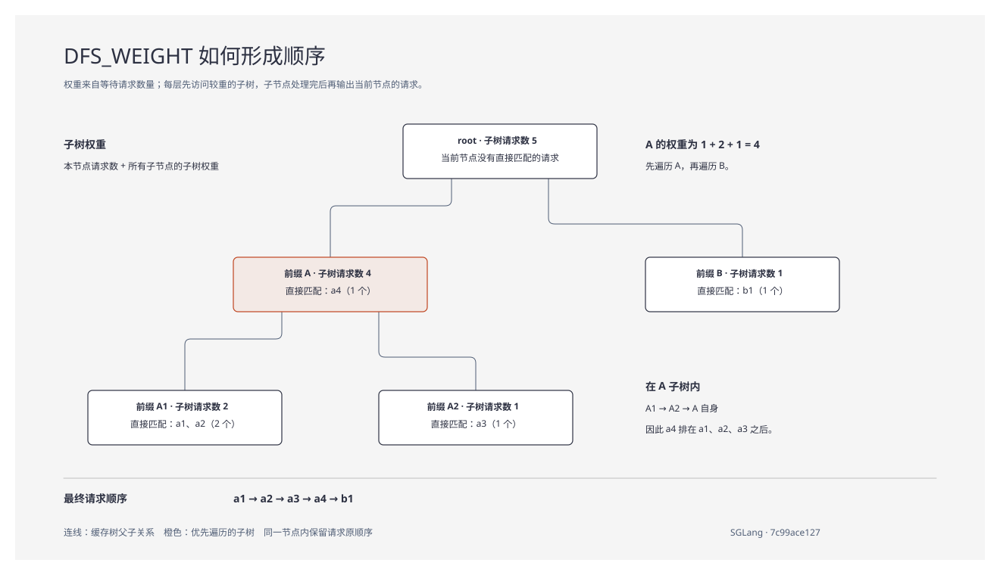
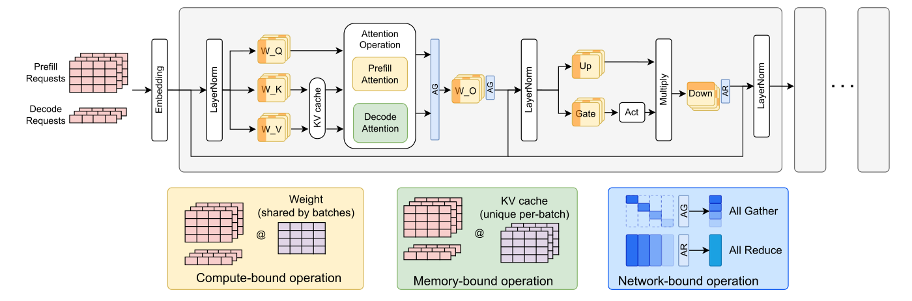
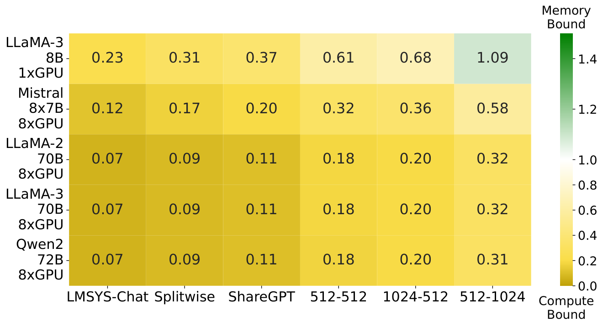
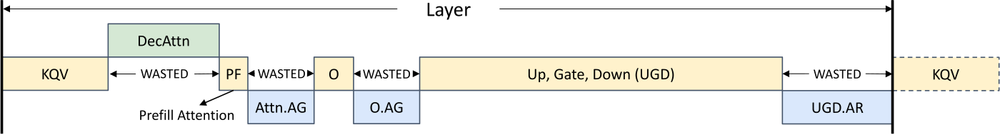
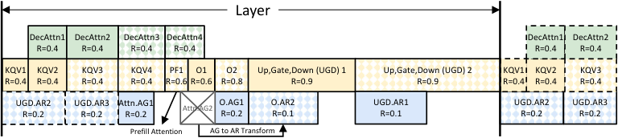
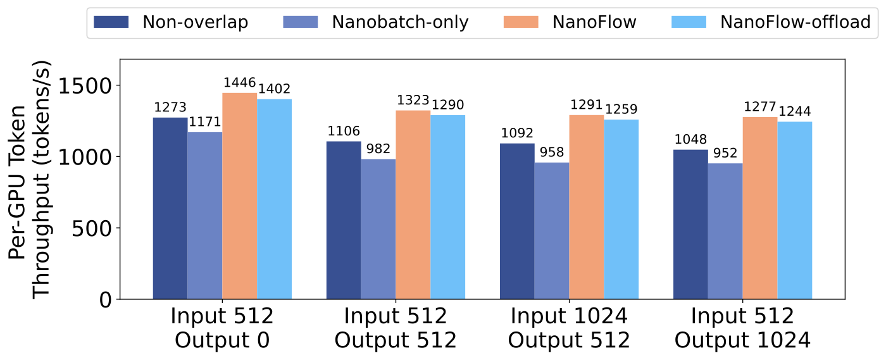

# 进阶调度与设备内流水线：Mixed Chunk 与 NanoFlow

```{contents} 本页目录
---
depth: 2
local: true
---
```

第 6 章与第 11 章展示了 Mini-SGLang 的两项基础选择：批次组成上每轮非 Prefill 即 Decode（即使启用延迟准入或分块 Prefill，单次 forward 仍不混装两类请求）；流水重叠上只把上一批 CPU 后处理藏在当前批 GPU 计算背后。本章沿这两个维度继续向深处推演：上半章分析生产版 SGLang（以 v0.5.16 为核对基线）如何用 `Mixed Chunk` 在同一次前向中混跑 Prefill 与 Decode 并缓解饥饿；下半章进入 NanoFlow 论文，把流水线推进到单张 GPU 内部，让计算、访存与通信三类异构算子并发填平硬件空洞。

## Mixed Chunk 决定单次 forward 的组成

理解混合批次前，先区分“同一 worker 是否兼管两阶段”与“同一次 `model.forward` 是否同时包含两类请求”：

| 调度方式 | Prefill 和 Decode 是否在同一 worker | 同一次 model forward 是否混合 |
|-|-|-|
| Mini-SGLang 当前实现 | 是 | 否 |
| SGLang v0.5.16，mixed chunk 关闭 | 是 | 通常否 |
| SGLang v0.5.16，mixed chunk 开启 | 是 | 是 |
| P/D disaggregation | 由不同角色承担 | 不以同一 forward 混合为目标 |

同一 worker 承担 Prefill 和 Decode，只表示这组 worker 会在不同轮次处理两种阶段。它并不要求两种 token 进入同一个 batch。P/D disaggregation 处理的是 worker 角色、设备部署和 KV 传输；mixed batching 决定一次 forward 包含哪些请求。这两个维度相互独立。

SGLang v0.5.16 支持真正的混合 forward，但需要同时启用 chunked prefill 和 `--enable-mixed-chunk`。后者默认关闭，`--chunked-prefill-size -1` 会关闭 chunked prefill。运行时只有在 chunked prefill 有效且 `enable_mixed_chunk` 为真时，才启用 mixed chunk。

混合路径调用 `ScheduleBatch.mix_with_running(running_batch)`：prefill/extend 请求贡献多个 query token，running decode 请求各贡献一个 query token，合并后的模式为 `ForwardMode.MIXED`。请求顺序是 extend/prefill 在前，running decode 在后。没有 running decode 请求时，batch 仍保持 `ForwardMode.EXTEND`。

```text
一次 MIXED forward

P0：512 个 prefill token
P1：300 个 prefill token
D0：1 个 decode token
D1：1 个 decode token
D2：1 个 decode token
```

Mixed chunk 依赖 chunked prefill，是为了限制单次 prefill 工作量。完整长 prompt 可能让一次 forward 持续很久，混入少量 decode token 也无法显著缩短等待。切成有上限的 chunk 后，running decode 请求可以随每个 chunk 前进一步。

| 模式 | 主要收益 | 主要代价 |
|-|-|-|
| Prefill 与 Decode 分开执行 | batch 形状整齐，kernel 路径更单纯 | prefill 期间 decode 会暂停，ITL/TPOT 可能抖动 |
| Mixed chunk | 高并发时减少 prefill 对 decode 的阻塞，并可能提高 output throughput | metadata 和 kernel 路径更复杂，低并发、延迟敏感场景未必受益 |

SGLang 的模型调优文档建议在高并发场景尝试 mixed chunk，低并发且延迟敏感时保持关闭。文档中的收益数据只适用于对应模型、硬件和配置，不能直接推广到其他部署。

源码锚点：Mini-SGLang `python/minisgl/scheduler/scheduler.py:219-225`、`python/minisgl/core.py:71-89`；SGLang v0.5.16 `python/sglang/srt/managers/scheduler.py`、`python/sglang/srt/managers/schedule_batch.py`、`python/sglang/srt/server_args.py`。

## 容量预留不保证 Decode 获得计算时间

第 6 章看到，`PrefillAdder.reserved_size` 为在途 Decode 预留的是未来 KV 显存，而非 GPU 计算时间；即使打开本地扩展的 `--delay-prefill-max-passes` 等门控限制新请求抢占频率，一旦长分块 Prefill 真正入场，纯阶段批次仍会暂停当轮 Decode。

在有限 workload 中，pending prefill 最终会处理完，调度器随后自然转入 decode。持续流量下，只要 `PrefillManager.schedule_next_batch()` 每轮都能返回 batch，Python `or` 就一直短路 decode scheduler。running 请求的 KV 仍在显存中，却可能长期拿不到计算，表现为 inter-token latency 上升。当前实现没有最大连续 prefill 次数、加权轮询、deadline 或 aging，因此不提供 starvation-free 保证。

SGLang v0.5.16 仍采用 prefill-first 决策，但容量约束更完整。每轮先尝试 `get_new_batch_prefill(running_batch)`；只有它返回空，才调用 `update_running_batch()` 执行 decode。完成 prefill 的请求会合入 `running_batch`，使其逐步接近 request slot 或 KV 容量上限。`running_batch.batch_is_full` 为真时，新的 prefill admission 会停止，下一轮转向 decode。

`new_token_ratio` 用于估算 running 请求未来还会写入多少 KV。ratio 较大时，admission 为 decode 留出更多显存；ratio 较小时，可以接纳更多 prefill。发生 decode retraction 后，tracker 会调高估计；稳定运行时再逐步衰减。它和 `batch_is_full` 都主要保护显存容量，不能单独给 decode 提供固定的计算时间片。

Mixed chunk 会在满足条件时调用 `ScheduleBatch.mix_with_running(running_batch)`，让 running decode 随每个 prefill chunk 前进一步。这是未做 P/D 分离时最直接的防饿死手段，但只覆盖能够进入 `ForwardMode.MIXED` 的路径。返回 logprob、使用部分特殊输入或未启用 chunked prefill 时，仍可能退回分开执行。

可选的 `--enable-prefill-delayer` 会在部分 DP attention 场景暂缓 prefill，使当前轮执行 running decode。该选项默认关闭，目标主要是减少零散 prefill 和 rank 间空转，不能视为通用公平调度保证。FCFS、LPM 等 `SchedulePolicy` 只排列 waiting queue 内部的请求，也不仲裁 prefill 与 running decode 的计算份额。

P/D disaggregation 提供更强的资源隔离：Prefill worker 不再和 Decode worker 争用同一组 GPU forward。Decode 仍可能因自身负载过高而排队，但不会再被新 prefill 抢占计算资源。

| 机制 | 保护内容 | 对 decode starvation 的保证 |
|-|-|-|
| Mini-SGLang `inflight_tokens` | KV 显存 | 不保证计算时间 |
| Mini-SGLang prefill budget | 单次 prefill 工作量 | 只限制单轮时长 |
| SGLang `new_token_ratio` | 未来 decode KV | 不保证计算时间 |
| SGLang `running_batch.batch_is_full` | 容量满后停止 admission | 普通 workload 下促使调度转向 decode，没有严格时间上界 |
| SGLang prefill delayer | 部分场景推迟 prefill | 启发式，默认关闭 |
| SGLang mixed chunk | prefill 时同步推进 decode | 满足 mixed 条件时有效 |
| P/D disaggregation | GPU 资源隔离 | 消除 prefill 对 decode 的计算抢占 |

Mini-SGLang 若要增加一个最小的公平性约束，可以限制连续 prefill 次数：

```python
if decode_manager.runnable and consecutive_prefills >= max_consecutive_prefills:
    batch = decode_manager.schedule_next_batch()
else:
    batch = (
        prefill_manager.schedule_next_batch(prefill_budget)
        or decode_manager.schedule_next_batch()
    )
```

这种做法能给 decode 等待轮数提供明确上界。更进一步可以实现 deficit round-robin、deadline-aware scheduling 或 mixed chunk。

源码锚点：Mini-SGLang `python/minisgl/scheduler/prefill.py:130-151`、`python/minisgl/scheduler/decode.py:27-35`、`python/minisgl/scheduler/scheduler.py:219-225`；SGLang v0.5.16 `get_next_batch_to_run()`、`_get_new_batch_prefill_raw()`、`update_running_batch()`、`PrefillDelayer` 与 `NewTokenRatioTracker`。

### SGLang 调度策略的排序与取舍

SGLang 的 SchedulePolicy 主要决定 waiting_queue 中先尝试哪些请求，PrefillAdder 再检查这些请求能否进入本轮 Prefill、执行到哪里。排序改变候选消耗预算的先后，因此会影响批次成员、缓存复用与排队延迟。shortest-prefill-first 还会限制已有长请求的续算 chunk，为等待中的短请求留出本轮配额。

<callout emoji="📌">
版本边界：本小节固定于 SGLang commit 7c99ace127526c2a7b21e5474a2981e4789b367c，与相邻 PrefillAdder 小节一致，独立于前文的 v0.5.16 和第 6 章 Mini-SGLang。策略收益按排序行为解释，不能视为性能保证；已阅读源码与既有测试，并用提取的纯排序方法核对合成请求顺序，未执行完整 Scheduler、模型或性能测试。
</callout>

#### 缓存感知决定排序依据

CacheAwarePolicy 使用真实缓存树的匹配结果或树结构排序，包含 LPM、DFS_WEIGHT、HRRN 和 SHORTEST_PREFILL_FIRST。CacheAgnosticPolicy 使用到达顺序、输出上限、随机顺序或 routing key，包含 FCFS、LOF、RANDOM 和 ROUTING_KEY。

**CacheAgnostic 描述排序依据，不表示关闭 prefix cache。**选择 FCFS 后，请求仍可复用已有 KV。该版本还会在部分 CacheAgnostic 路径中提前匹配前缀，用于负载信息；是否复用缓存与是否按缓存排序是两个独立问题。

`calc_priority()` 开头对非 CacheAwarePolicy 请求执行匹配，是为负载估算补齐数据。进入条件同时要求当前策略不属于 CacheAwarePolicy、缓存后端支持 `supports_fast_match_prefix()`，并且不处于 PD decode 角色。Cache-aware 策略随后会在 `_compute_prefix_matches()` 中匹配，前面的条件排除它们，避免在同一个排序阶段重复做这一步。

```python
if (
    not isinstance(policy, CacheAwarePolicy)
    and tree_cache.supports_fast_match_prefix()
    and disaggregation_mode != "decode"
):
    for req in waiting_queue:
        match_kv_cache(req, tree_cache)
```

`SchedulerLoadInquirer.get_num_waiting_uncached_tokens()` 在队列已匹配时，按 `max(0, req.seqlen - req.num_matched_prefix_tokens)` 累加待 Prefill 工作量；未做全队列匹配时，按近期 cache miss rate 估算。一个 1000-token 请求命中 900-token 前缀，即使采用 FCFS，也应该按约 100 个未缓存 token 估计其计算需求。该值用于负载快照，不等于包含未来输出、页对齐和专用池预留的 KV admission 预算。

这段 fast-match 分支只匹配真实缓存，没有构建等待队列临时树，也没有给重复前缀请求降优先级。普通 Python 基类的 fast-match 能力默认返回 `False`；UnifiedRadixCache 委托给 tree core 判断，不能仅凭策略名称假定这一分支必然执行。来源：[策略分派](https://github.com/sgl-project/sglang/blob/7c99ace127526c2a7b21e5474a2981e4789b367c/python/sglang/srt/managers/schedule_policy.py#L217-L235)、[未缓存工作量估算](https://github.com/sgl-project/sglang/blob/7c99ace127526c2a7b21e5474a2981e4789b367c/python/sglang/srt/managers/scheduler_components/load_inquirer.py#L79-L94)。

| 策略与优先对象 | 设计动机 | 代价与边界 |
|-|-|-|
| FCFS：保留当前等待队列顺序 | 按入队顺序尝试，行为简单、开销低 | 长请求可能造成 head-of-line blocking |
| LPM：匹配前缀最长 | 优先利用已有 KV，减少重复 Prefill | 命中最长不等于剩余计算最少 |
| DFS_WEIGHT：请求更多的缓存子树 | 集中处理共享前缀的一组请求 | 树遍历有开销，权重不包含等待时长 |
| HRRN：等待工作量／未缓存输入较大 | 用等待补偿缓解长请求被持续推后 | 采用工作量计龄，不是严格按秒计龄 |
| SHORTEST_PREFILL_FIRST：未缓存工作最少 | 让短 Prefill 更早完成，减少排队 | 持续短请求可能推迟长请求 |
| LOF：max_new_tokens 最大 | 提前启动预计长输出任务 | 配置上限不等于真实输出，可能增加 KV 占用时间 |
| RANDOM：随机打乱候选 | 提供随机顺序及实验对照基线 | 不利用缓存、长度或等待信息 |
| ROUTING_KEY：在 running batch 中更常见的 key | 优先延续已经活跃的请求分组 | 热门分组可能持续压过其他分组 |

入口：[策略枚举与 SchedulePolicy](https://github.com/sgl-project/sglang/blob/7c99ace127526c2a7b21e5474a2981e4789b367c/python/sglang/srt/managers/schedule_policy.py#L168)；[calc_priority() 的策略分派](https://github.com/sgl-project/sglang/blob/7c99ace127526c2a7b21e5474a2981e4789b367c/python/sglang/srt/managers/schedule_policy.py#L209)。

#### LPM 与短 Prefill 优先看不同长度

忽略临时降权时，LPM 使用 -req.num_matched_prefix_tokens 作为升序排序键。匹配数可能包含 device 和 host 命中，因此不代表所有匹配 KV 已在 GPU 上，也不表示恢复成本为零。

| 请求 | 完整输入 | 命中前缀 | 还需 Prefill |
|-|-|-|-|
| A | 10000 | 9000 | 1000 |
| B | 100 | 0 | 100 |

对于这两个全新请求，LPM 排成 A → B，优先兑现 A 的缓存复用收益；shortest-prefill-first 排成 B → A，优先完成剩余 Prefill 更少的请求。两者优化的依据不同，不能把 LPM 当成最快请求优先。

```python
work = max(
    1,
    len(req.origin_input_ids)
    + len(req.output_ids)
    - req.num_matched_prefix_tokens,
)

# shortest-prefill-first uses an ascending key.
key = (
    req.rid in temporary_deprioritized,
    work,
    req.time_stats.wait_queue_entry_time,
)
```

shortest-prefill-first 把 output_ids 纳入工作量，覆盖 retract 后恢复已生成 token 的需求。工作量相同时按等待队列入队时间排序。其成本代理仍是 token 数，没有完整建模长 prefix 的 Attention 代价或 host KV 传输时间。

已有长请求可能每轮先消耗全部 chunk 配额，使等待队列即使按短请求排序也无法推进。shortest_prefill_chunk_limit() 为较短且能在本轮完整处理的等待请求预留配额，再把剩余部分按页对齐给续算请求，并保留续算进展；若没有合适候选则不施加额外限制。具体的 4096-token 预算案例与 Adder 配合见 [切块同时改变执行长度与本轮预留](https://bytedance.larkoffice.com/wiki/EZcawGzFrirc8bkkvuqclJCpnXd#doxmyYHuLgbFQvMvsUWPIt7WVJe)。

源码：[shortest-prefill-first 工作量与排序](https://github.com/sgl-project/sglang/blob/7c99ace127526c2a7b21e5474a2981e4789b367c/python/sglang/srt/managers/schedule_policy.py#L394)；[续算 chunk 上限](https://github.com/sgl-project/sglang/blob/7c99ace127526c2a7b21e5474a2981e4789b367c/python/sglang/srt/managers/schedule_policy.py#L414)；[LPM 排序](https://github.com/sgl-project/sglang/blob/7c99ace127526c2a7b21e5474a2981e4789b367c/python/sglang/srt/managers/schedule_policy.py#L436)；[device 与 host 匹配数](https://github.com/sgl-project/sglang/blob/7c99ace127526c2a7b21e5474a2981e4789b367c/python/sglang/srt/mem_cache/common.py#L242)。

#### DFS_WEIGHT 按子树请求数集中处理

DFS_WEIGHT 把每个等待请求的 last_node 交给 tree_cache.dfs_weight_order()。底层先统计节点直接匹配到的请求数，再向父节点累加得到子树权重；遍历时，每层先访问权重大的子树，完成子节点后再输出直接匹配到当前节点的请求。

```text
weight(node) = requests_matched_at(node) + sum(weight(child))

# At each node:
# 1. Visit child subtrees in descending weight order.
# 2. Emit requests matched directly at this node.
```



图：前缀 A 的子树有 4 个等待请求，前缀 B 有 1 个，因此先处理 A。A1 的两个请求先于 A2 的一个请求，直接匹配到 A 的 a4 在其子节点之后输出，最终顺序为 a1 → a2 → a3 → a4 → b1。同一节点的请求保持原相对顺序。

**这里的 weight 是等待请求数量。**它不等于模型权重、prefix token 数或预计 FLOPs。LPM 比较单条请求的匹配长度，DFS_WEIGHT 利用请求在缓存树上的分布，将共享路径的工作集中处理，试图减少不同前缀分支来回切换及缓存淘汰后的重算。在线负载中的实际收益仍取决于缓存容量、到达分布和准入限制。

源码：[SchedulePolicy 对 DFS 排序的委托](https://github.com/sgl-project/sglang/blob/7c99ace127526c2a7b21e5474a2981e4789b367c/python/sglang/srt/managers/schedule_policy.py#L491)；[子树权重计算与深度优先遍历](https://github.com/sgl-project/sglang/blob/7c99ace127526c2a7b21e5474a2981e4789b367c/python/sglang/srt/mem_cache/base_prefix_cache.py#L340)；[子树排序测试](https://github.com/sgl-project/sglang/blob/7c99ace127526c2a7b21e5474a2981e4789b367c/test/registered/unit/managers/test_schedule_policy_dfs_weight.py#L15)。

##### 显式栈先计权，再输出请求

当前 match_kv_cache() 把 last_device_node 写入 req.last_node，DFS_WEIGHT 因而以 device 缓存匹配末端归组。策略入口把这些节点交给 dfs_weight_order()，拿回原队列索引，再通过 waiting_queue[:] 原地重排；它不创建模型 batch，也不直接分配 KV。

| 阶段 | 核心数据与操作 | 保证的顺序 |
|-|-|-|
| 按节点归组 | last_node_to_indices[node] 保存该节点对应的原队列索引 | 同一节点内，索引按扫描顺序追加 |
| 初始化直接权重 | node_to_weight[node] = len(indices) | 先只记录直接匹配到该节点的请求数 |
| 第一遍后序遍历 | 子节点处理完后，把子树权重累加到当前节点 | 父节点收尾时，子节点权重已经可用 |
| 第二遍后序遍历 | children 按权重降序排列，子树输出完后追加本节点请求 | 较重兄弟子树优先，当前节点请求最后输出 |

Python helper 用 (node, visited) 模拟递归返回。visited=False 表示首次到达；此时先把 (node, True) 压栈作为收尾标记，再压入子节点。栈后进先出，所以子节点先处理，父节点后收尾。第二遍的核心结构如下，保留了原实现的执行顺序：

```python
stack = [(root_node, False)]
while stack:
    node, visited = stack.pop()
    if visited:
        order.extend(last_node_to_indices.get(node, ()))
        continue
    children = list(node.children.values())
    children.sort(key=lambda child: -node_to_weight.get(child, 0))
    stack.append((node, True))
    for child in reversed(children):
        stack.append((child, False))
```

reversed(children) 用来抵消栈的后进先出：排序后较重的子树排在列表前面，把它最后压栈，才能最先弹出。收尾标记仍位于这些子节点下面，因此本节点的请求不会越过自己的子树。

##### 逐层选择子树，不做全局权重排序

沿用前图的树结构，把 B 节点的直接请求扩展为 b1、b2、b3。此时 A 子树权重仍为 4，B 子树权重变为 3，完整顺序是：

```text
a1 -> a2 -> a3 -> a4 -> b1 -> b2 -> b3
```

根节点先选 A 后，DFS 会完成整个 A 子树。即使 B 的权重 3 大于 A2 的权重 1，也不会在处理完 A1 后跳到 B。权重只在同一父节点的 children 之间比较；这种连续处理保持了前缀分支的局部性。

如果所有请求都匹配到根节点，它们落在同一个索引列表中，通常保留原队列顺序。DFS_WEIGHT 没有消费 temporary_deprioritized，因而不会直接利用等待队列临时树里尚未计算的公共前缀重新分组。临时树的作用范围见 [临时前缀树降低重复计算机会](https://bytedance.larkoffice.com/wiki/EZcawGzFrirc8bkkvuqclJCpnXd#doxmykN9H1zHfcxZWTroQsixrEe)。

##### Python 与 Rust 的计权路径不同

| 实现细节 | Python helper | Rust tree core |
|-|-|-|
| 累计子树权重 | 从根节点遍历缓存树，收尾时汇总子节点权重 | 从有等待请求的匹配节点沿祖先链累加直接请求数 |
| 生成请求顺序 | 再次遍历缓存树，各层按子树权重排序 | 只访问 node_to_weight 中有记录的子树 |
| 同权兄弟节点 | 稳定排序保留 children 原迭代顺序 | 额外使用节点 creation_counter 排序 |
| 同节点请求 | 保留输入索引顺序 | 保留输入索引顺序 |

两种实现都按子树权重组织 DFS，并在子节点之后输出当前节点请求，但访问范围和平局依据不同。不能把同权子树的顺序理解为请求 FCFS。Python helper 的开销还取决于整棵缓存树的规模；Rust 路径把工作集中在有等待需求的节点及其祖先上，实际 CPU 收益仍需测量。

源码：[device 匹配末端写回](https://github.com/sgl-project/sglang/blob/7c99ace127526c2a7b21e5474a2981e4789b367c/python/sglang/srt/mem_cache/common.py#L242)；[Python 两遍后序遍历](https://github.com/sgl-project/sglang/blob/7c99ace127526c2a7b21e5474a2981e4789b367c/python/sglang/srt/mem_cache/base_prefix_cache.py#L340)；[Rust 祖先累加与创建顺序平局](https://github.com/sgl-project/sglang/blob/7c99ace127526c2a7b21e5474a2981e4789b367c/rust/sglang-radix-tree/src/unified_tree_core.rs#L4075)；[Rust 子树顺序测试](https://github.com/sgl-project/sglang/blob/7c99ace127526c2a7b21e5474a2981e4789b367c/rust/sglang-radix-tree/src/tests/unified_tree_core.rs#L5454)。

验证范围：七请求变体及全部匹配根节点的情形，已通过提取当前纯 Python helper 并输入合成节点核对。Rust 路径只做源码和测试断言阅读，未执行 Rust 测试或服务性能实验。

#### HRRN 用等待工作量补偿长请求

经典 Highest Response Ratio Next 用等待量 W 与预计服务量 S 计算响应比：

$$R=\frac{W+S}{S}=1+\frac{W}{S}$$

常数 1 对所有请求相同，排序只需比较 W/S。当前实现以等待期间系统累计处理的 Prefill token 数作为 W，以未缓存输入 token 数作为 S：

```python
def key(req):
    if req.rid in temporary_deprioritized:
        return (float("inf"), req.rid)
    uncached = max(
        0,
        len(req.origin_input_ids) - req.num_matched_prefix_tokens,
    )
    if uncached == 0:
        return (-float("inf"), req.rid)
    waited = max(0, processed_tokens - req.arrival_processed_tokens)
    return (-waited / uncached, req.rid)

waiting_queue.sort(key=key)
```

下面重新设定三个请求，当前累计 Prefill 工作量 P=10000，且没有请求被临时降权。U 表示未缓存输入，W 为当前计数减去入队快照：

| 请求 | 输入长度 | 命中前缀 | 入队快照 | 未缓存 U | 等待 W | W/U |
|-|-|-|-|-|-|-|
| A：老长请求 | 2000 | 0 | 0 | 2000 | 10000 | 5 |
| B：新短请求 | 200 | 0 | 9800 | 200 | 200 | 1 |
| C：高命中请求 | 3000 | 2900 | 9800 | 100 | 200 | 2 |

顺序为 A → C → B。A 的输入较长，但等待补偿足够大；C 原始输入比 B 长，却因缓存命中多而剩余工作更少。若两个请求等待工作量相同且大于零，未缓存输入较少的请求更容易优先。

```python
# Unified serving: record the counter when entering waiting_queue.
req.arrival_processed_tokens = self.processed_tokens_counter

# On batch submission: advance the counter by extend work.
if batch.extend_num_tokens:
    self.processed_tokens_counter += batch.extend_num_tokens
```

##### 规则优先级决定边界情况

| 条件 | 排序或计龄行为 | 含义 |
|-|-|-|
| rid 在 temporary_deprioritized 中 | (+∞, rid) | 最先检查，优先于等待分数和零工作量规则；即使等待较久或 U=0，也排到未降权请求之后 |
| 未降权且 U=0 | (-∞, rid) | 优先处理，避免除零 |
| 普通请求 | (-W/U, rid) | 分数越大越靠前；分数相同按 rid 字典序 |
| 所有候选 W=0 | 普通请求的第一排序键都是 0 | 例如 a_long 可排在 z_short 前，不自动退化为短请求优先或 FCFS |
| 只有 Decode 或空闲时间流逝 | Prefill 工作量计数不会自然增长 | 这份年龄由工作推进，不能等同于按秒计龄 |

HRRN 的 _uncached_len() 只使用 origin_input_ids，shortest-prefill-first 则显式加上 output_ids。因此，重入请求的 U 未必等于完整实际重算量。num_matched_prefix_tokens 可以包含 host 命中，但分母没有单独建模加载这些 KV 的传输成本。

老长请求可以超过刚到达的短请求；在持续流量下，实际等待仍受容量、临时降权及准入条件影响，不能直接宣称严格无饥饿。该策略作用于等待进入 Prefill 的请求，也不直接给 running Decode 分配时间片。

当前等待队列超过 128 时，HRRN 本轮退回保留当前队列顺序的 FCFS 路径；DFS_WEIGHT 不受这个阈值控制。缓存关闭时两者都会调整为 FCFS，完整配置边界见 [配置与降级限定实际行为](https://bytedance.larkoffice.com/wiki/EZcawGzFrirc8bkkvuqclJCpnXd#doxmyaVYJM4KTKEY9ssxWRA8ocg)。

数值顺序 A → C → B、临时降权覆盖分数、零等待时按 rid 打破平局，已用当前纯 Python 排序方法和合成请求核对。这里没有运行完整 Scheduler 或 GPU 测试。

源码：[HRRN 工作量与排序键](https://github.com/sgl-project/sglang/blob/7c99ace127526c2a7b21e5474a2981e4789b367c/python/sglang/srt/managers/schedule_policy.py#L449)；[入队时记录工作量快照](https://github.com/sgl-project/sglang/blob/7c99ace127526c2a7b21e5474a2981e4789b367c/python/sglang/srt/managers/scheduler.py#L3392)；[提交 batch 时推进计数](https://github.com/sgl-project/sglang/blob/7c99ace127526c2a7b21e5474a2981e4789b367c/python/sglang/srt/managers/scheduler.py#L4548)。

#### FCFS 保留顺序，LOF 优先长输出

FCFS 在未启用显式 priority 时不重排 waiting_queue。正常追加到队尾的请求按入队顺序被尝试，策略开销低，也不需要长度预测。代价是 head-of-line blocking：前面的请求无法通过准入时，后面的短请求可能没有机会被尝试。

LOF 按 sampling_params.max_new_tokens 降序，既不读取真实输出长度，也不减去已经生成的 token。按策略行为推导，提前启动预计长输出任务，在有限任务集合中可能减少末尾只剩少数长请求运行的情况；但长输出也会更久占用 KV，而 max_new_tokens 可能只是宽松上限，因此不能认定它总能提高吞吐。

| 模式 | 升序排序键 | 行为 |
|-|-|-|
| FCFS，无 priority | 不排序 | 保留当前队列顺序 |
| FCFS，有 priority | (priority × priority_sign, wait_queue_entry_time) | 优先级优先，同优先级按入队时间 |
| LOF，无 priority | -max_new_tokens | 输出上限较大者优先 |
| LOF，有 priority | (priority × priority_sign, -max_new_tokens) | 优先级优先，其次输出上限降序 |

默认 priority_sign=-1，较大的 priority 整数先处理；设置 schedule_low_priority_values_first 后符号反转。RANDOM 则直接调用 random.shuffle(waiting_queue)，提供随机候选顺序，可用作对照基线，但不利用缓存、长度或等待信息，也没有确定的等待上界。

源码：[LOF、RANDOM 与 priority FCFS 排序](https://github.com/sgl-project/sglang/blob/7c99ace127526c2a7b21e5474a2981e4789b367c/python/sglang/srt/managers/schedule_policy.py#L499)。

#### ROUTING_KEY 延续活跃请求分组

上游网关（如 `sgl-model-gateway` 的粘性路由策略）和压测工具可通过请求头 `x-smg-routing-key` 标识同一会话或相同系统前缀的请求分组。若调度器直接按 `FCFS` 入批，不同分组的请求会交错进入 `running_batch`，单台实例就会同时驻留多组互不相关的 KV Cache，增加缓存淘汰频率并拉长同组后续请求的排队等待。`ROUTING_KEY` 策略在 `waiting_queue` 中优先放行与当前活跃分组一致的请求，让已占槽位的分组集中推进并收尾，从而收敛单节点并发工作集。

请求从 OpenAI HTTP 入口进入时，`ServingBase.extract_routing_key()` 读取请求头 `x-smg-routing-key`（Rust processor 与 gRPC 请求也支持透传），由 `TokenizerManager` 写入 `Req.routing_key`。每次进入 Prefill 组批前的 `calc_priority()` 阶段，调度器统计 `running_batch` 中各非空 `routing_key` 的出现频次，并按命中状态、频次降序和 key 字典序重排等待队列：

```python
# Running batch: x appears 3 times, y appears once.
# Waiting queue: B(y), C(z), A(x), D(x)
# Result:        A(x), D(x), B(y), C(z)

if key and key in routing_key_counts:
    sort_key = (0, -routing_key_counts[key], key)
else:
    sort_key = (1, 0, key or "")
```

排序本身只依赖请求头传递的分组标识，不查询 Radix 树，因此属于 `CacheAgnosticPolicy`，CPU 开销极低，也不会触发 `LPM` 和 `HRRN` 超过 128 条请求时的队列降级。若 `running_batch` 为空或没有任何有效 key，方法直接返回，维持原等待顺序；频次相同时按 key 字典序排列，同一 key 的多条请求则由 Python 稳定排序保留入队先后。

| 维度 | 机制与边界说明 |
|-|-|
| 前缀缓存关系 | 相同 `routing_key` 仅表达上游分组意图，不证明输入 token 前缀一致，也不保证真实 KV 命中；请求是否复用缓存仍由后续 `match_kv_cache()` 决定。 |
| 饥饿风险 | 该策略没有类似 `HRRN` 的老化补偿机制。只要热门分组持续在 `running_batch` 中有请求运行，冷门分组或不带 key 的请求就可能长期延后。 |
| 配置互斥 | `--enable-priority-scheduling` 只允许配合 `fcfs` 或 `lof`，不能与 `routing-key` 同时启用。 |
| 可观测与调试 | HTTP 层提供 `sglang:routing_keys_active`；Scheduler 在当前批次全部请求都带 key 时上报 `sglang:num_unique_running_routing_keys`、`sglang:routing_key_running_req_count` 与 `sglang:routing_key_all_req_count`。设置 `SGLANG_ROUTING_KEY_POLICY_DEBUG_LOG=1` 可打印排序前后的队列 key 分布。 |

源码：[routing-key 计数与排序](https://github.com/sgl-project/sglang/blob/7c99ace127526c2a7b21e5474a2981e4789b367c/python/sglang/srt/managers/schedule_policy.py#L533)；[HTTP header 提取](https://github.com/sgl-project/sglang/blob/7c99ace127526c2a7b21e5474a2981e4789b367c/python/sglang/srt/entrypoints/openai/serving_base.py#L259)；[Scheduler 指标定义](https://github.com/sgl-project/sglang/blob/7c99ace127526c2a7b21e5474a2981e4789b367c/python/sglang/srt/observability/metrics_collector.py#L783)；[端到端延迟测试](https://github.com/sgl-project/sglang/blob/7c99ace127526c2a7b21e5474a2981e4789b367c/test/registered/scheduler/test_routing_key_scheduling.py#L28)。

#### 临时前缀树降低重复计算机会

两个等待请求可能共享很长的 system prompt，但公共前缀尚未进入真实缓存。若同时 Prefill，就可能重复计算公共部分；先让一个请求推进，后续请求再利用建立好的缓存，可能提高复用收益。

| 检查阶段 | 该版本的默认条件 | 处理方式 |
|-|-|-|
| 匹配真实 cache | device prefix_len ≤ 32 | 继续匹配 waiting_queue_radix_tree |
| 匹配等待队列临时树 | 公共前缀匹配长度 ≥ 32 | 把 rid 放入 temporary_deprioritized |
| 临时树未发现足够长的匹配 | 未达到降权条件 | 插入 token 前缀和 dummy value，供后续候选比较 |

两个阈值分别来自 IN_BATCH_PREFIX_CACHING_CHECK_THRESHOLD 与 IN_BATCH_PREFIX_CACHING_DEPRIORITIZE_THRESHOLD，默认均为 32，条件分别是 ≤ 与 ≥。临时树每轮重置，保存的是 token 前缀关系，没有计算完成的真实 KV；匹配还带上 extra_key 和 cache_salt，维持缓存身份边界。

LPM、HRRN 与 shortest-prefill-first 使用临时降权集合，把这些候选往后排。降权不等于删除或禁止加入，预算足够时它们仍可能进入同一轮。DFS_WEIGHT 的排序路径没有消费这个集合。

源码：[默认阈值](https://github.com/sgl-project/sglang/blob/7c99ace127526c2a7b21e5474a2981e4789b367c/python/sglang/srt/managers/schedule_policy.py#L102)；[_compute_prefix_matches()](https://github.com/sgl-project/sglang/blob/7c99ace127526c2a7b21e5474a2981e4789b367c/python/sglang/srt/managers/schedule_policy.py#L342)。

`_compute_prefix_matches()` 每次先清空临时树，再按当前队列顺序扫描。查询序列是 `origin_input_ids + output_ids`，因此也包含 retract 后需要恢复的已生成 token。函数本身不排序，返回的是暂时降低优先级的请求 rid 集合；当前函数体没有使用传入的 `policy` 参数。

| 对象或结果 | 表达的信息 | 影响范围 |
|-|-|-|
| `self.tree_cache` | 已经存在的 device／host 缓存命中 | `match_kv_cache()` 更新请求的长度和匹配节点 |
| `prefix_len` 与 `num_matched_prefix_tokens` | 前者记录 device 命中；后者合计 device 与 host 命中，并按请求可复用范围限制 | 用于后续排序、负载估算及候选准备；两者不能混用 |
| `waiting_queue_radix_tree` | 已插入候选之间的 token 前缀关系 | 只判断未来可能复用的部分，不代表 KV 已经就绪 |
| `temporary_deprioritized` | 与临时树候选共享足够长前缀的请求 | 由具体排序函数消费，不直接控制 GPU 执行或禁止 admission |

第一次真实匹配直接更新 `r.prefix_len`、`r.last_node`、host 命中及统计字段。第二次对临时树的匹配只读取返回值，不会把模拟命中写回请求的真实 KV 状态。未达到临时降权条件的候选才插入临时树，值是 `torch.empty(..., dtype=torch.bool)` 占位张量；后续请求只依赖前缀关系和长度，不使用其中的数据作为 KV。设置 `SGLANG_RADIX_FORCE_MISS` 时，代码也会将相应匹配结果清零，不能沿用正常命中的算例。

##### 共享前缀尚未计算时，排序创造后续复用机会

多个独立请求同时进入一个 Prefill batch 时，它们查询缓存的时点早于本批 forward。把 A1 加入 batch 并不会立即生成其 KV，因此 A2 即使与 A1 共享完整前缀，也可能同样 miss。一次 forward 中各请求仍按自己的输入执行；重复前缀不会由这段调度代码自动合并计算。执行后再合并缓存副本，也无法追回已经消耗的计算。

in-batch prefix caching 在这里采用延后排序：先让不同前缀组各有候选推进，再让同组的其他请求有机会在后续 batch 复用缓存。普通未结束请求的 Prefill 结果处理会调用 `checkpoint_kv_cache()` 发布已计算的前缀，通常无需等待整个 Decode 完成。只有 KV 已实际发布、仍然有效且满足复用条件，后续请求才能命中。

下面采用 LPM，初始缓存为空。P、Q 是两段互不共享长前缀的 1024-token 上下文，每个请求另有 128-token 后缀。假设每批最多接纳两个请求、无 chunking、其他资源充足，且上一批的 Prefill 结果已在下一批组建前发布。

```text
A1 = P + a1
A2 = P + a2
B1 = Q + b1
B2 = Q + b2

Original queue: A1, A2, B1, B2
Deprioritized:  A2, B2
Reordered:     A1, B1, A2, B2
```

| 方式 | 第一个 batch | 第二个 batch |
|-|-|-|
| 关闭 in-batch 检查 | A1、A2 各计算一次 P | B1、B2 各计算一次 Q |
| 使用临时降权 | A1、B1 分别建立 P、Q 的缓存 | A2、B2 分别复用 P、Q，只处理各自后缀 |

```text
Without in-batch check: 4 * (1024 + 128)           = 4608
With reordering:       2 * (1024 + 128) + 2 * 128 = 2560
Saved:                 2048 tokens, about 44.4%
```

44.4% 表示这个理想算例减少的新增 Prefill token 数。后缀 Attention 仍需读取公共前缀 KV，实际耗时还受 kernel 形状、访存、调度和传输影响，不能把它换算成同等比例的端到端加速。缓存有效时也可能减少重复 KV 的临时分配压力；稳定占用仍取决于后端的共享和回收方式。

**当前只有排序偏好，没有“等代表请求完成”的强制依赖。**若所有请求仍能装进同一个 batch，P、Q 仍可能重复计算；若队列只有同一前缀的一组请求，稳定降权可能几乎不改变顺序。代表请求被其他条件阻塞、只完成部分前缀，或命中 KV 后来被淘汰，也会削弱收益。有效场景通常需要多个前缀组竞争有限 batch 容量，并让同组请求错开到缓存可用之后。

##### Cache-aware 分支沿用了最初的策略接入范围

这项优化加入之前，LPM 和 DFS 已经在排序前遍历整个 waiting_queue，读取真实 prefix cache。[PR #2442](https://github.com/sgl-project/sglang/pull/2442) 将临时树检查加进这个现有循环，并接入具体排序逻辑；该 PR 的[代码评论](https://github.com/sgl-project/sglang/pull/2442#discussion_r1879670261)还记录了向 DFS 扩展的 TODO。之后的[PR #2571](https://github.com/sgl-project/sglang/pull/2571) 引入 CacheAwarePolicy／CacheAgnosticPolicy 分类，把原来的匹配循环抽成 `_compute_prefix_matches()`。当前分支范围沿用了这条演化路径。

从结构上看，cache-aware 策略可以复用全队列遍历和真实命中信息，再把降权集合接到已有排序键中，接入更自然。新增临时树的匹配、插入仍有 CPU 成本。原始 PR 提到了额外开销，但没有给出 FCFS 不兼容或没有收益的明确结论；不能把“保持 FCFS 语义”或“开销更大”写成已证实的作者否决理由。

FCFS 技术上可以与这项检查组合：把未降权请求稳定地放在前面、重复前缀请求放在后面，各组内保持到达顺序。例如 `[A1, A2, B1, B2]` 变成 `[A1, B1, A2, B2]`。这样形成带缓存偏好的 FCFS 混合策略，允许较晚到达的 B1 超过 A2；这是可行的扩展思路，当前 FCFS 路径没有实现这种组合。仅为 FCFS 负载统计执行 fast match，也不会自动启用临时降权。

##### 并行任务容易产生尚未缓存的公共上下文

下表是可用于构造生产请求和评估负载的业务形态，不是特定公司的上线记录或性能保证。共同特征是一份长上下文被拆成多个独立请求，并且在首次计算完成前集中到达。

| 业务形态 | 请求的公共前缀与不同后缀 | 可能出现的时机 |
|-|-|-|
| 合同或文档并行审核 | [审核指令][同一份合同全文][付款／违约／保密检查任务] | 新文档上传后，同时启动多项检查；多份文档形成多个前缀组 |
| 代码专项审查 | [统一项目约定][同一份代码或 diff][资源泄漏／并发／错误处理检查] | 新提交同时触发多个检查器；检查器专属指令放在代码之后才保留该公共前缀 |
| Best-of-N、RL rollout、Agent 多分支 | [同一道题或同一 Agent 状态][已有上下文]，作为独立请求采样多条轨迹 | 多题并行、多候选同时生成；输入可以完全相同，独立采样仍能产生不同输出 |
| Agent 或客服配置冷启动 | [同一角色指令、业务规则、工具定义][不同用户问题] | 实例冷启动、新配置发布或对应 KV 被淘汰后，突发请求同时到达 |

前缀匹配要求从序列开头连续一致。相同文档放在不同问题后面、检查器在开头使用不同 system prompt、工具定义顺序变化，都会缩短可共享前缀；缓存命名空间也必须相容。普通采样参数变化通常不改变输入前缀，但不能混淆“独立请求采样”与已有专用分支共享机制的实现。

当前默认门槛很窄：device 命中长度超过 32 后，不再做这段队列内检查。例如已有 1000-token system prompt 命中，即使其后还有很长的重复未缓存文档，也会跳过这项启发式。门槛允许少量命中，是为了让已有 BOS 或短模板不至于排除候选；32 不是普适最优值。公共上下文已经预热时，主要收益来自普通 prefix caching。

评估时，在相同请求流、模型、硬件、策略和缓存初始状态下，对比默认检查与 `IN_BATCH_PREFIX_CACHING_CHECK_THRESHOLD=-1`。后者关闭这项队列内检查，同时保留普通 prefix caching。记录新增 Prefill token 数、缓存命中、调度 CPU 时间、吞吐，以及平均和尾部 TTFT；改变前缀组数量、每组请求数、前缀长度、到达节奏和 batch 容量。本文算例与业务形态用于解释机制，没有在该固定提交上新增模型或性能实测。

源码：[真实匹配与 checkpoint](https://github.com/sgl-project/sglang/blob/7c99ace127526c2a7b21e5474a2981e4789b367c/python/sglang/srt/mem_cache/common.py#L219-L279)、[Prefill 结果发布](https://github.com/sgl-project/sglang/blob/7c99ace127526c2a7b21e5474a2981e4789b367c/python/sglang/srt/managers/scheduler_components/batch_result_processor.py#L380-L395)、[候选 admission 循环](https://github.com/sgl-project/sglang/blob/7c99ace127526c2a7b21e5474a2981e4789b367c/python/sglang/srt/managers/scheduler.py#L4120-L4219)。

#### 排序通过准入循环影响批次

Scheduler 初始化时创建 SchedulePolicy。每次进入 Prefill batch 构建路径，先调用 calc_priority()，再让 PrefillAdder 按这个顺序尝试请求。以下省略专用模型、资源管理和清理细节：

```python
self.policy.calc_priority(
    self.waiting_queue,
    running_batch,
    processed_tokens=self.processed_tokens_counter,
)

adder = PrefillAdder(...)
if self.chunked_req is not None:
    adder.chunked_req_limit = self.policy.shortest_prefill_chunk_limit(...)
    self.chunked_req = adder.add_chunked_req(self.chunked_req)

for req in self.waiting_queue:
    # Request-slot, LoRA, pooling-mode and prefetch checks occur here.
    req.init_next_round_input(self.tree_cache)
    result = adder.add_one_req(...)
    if result != AddReqResult.CONTINUE:
        break

# Build ScheduleBatch from adder.can_run_list.
```

排在前面只表示先被尝试。候选仍可能因 KV、请求槽位或预取状态不能进入；前面的请求也会先消耗本轮预算。Adder 返回停止状态后，外层通常结束扫描，因此排序会影响最终接纳集合。部分 LoRA、pooling mode 或预取未就绪的候选会被 continue 跳过，实际入选集合未必是排好队列的连续前缀。

返回值与接纳状态仍需分别判断：add_one_req() 提交成功后，也可能因预算耗尽返回 OTHER 或 NO_TOKEN。具体的锁定、扣账、返回状态与跨轮续算，继续见后面的 [SGLang PrefillAdder 的准入与预算](https://bytedance.larkoffice.com/wiki/EZcawGzFrirc8bkkvuqclJCpnXd#doxmyOry3TyPe9SuU7aK7DgDhNj)。

这些顺序主要作用于等待进入 Prefill 的请求。HRRN 的等待补偿不直接保护 running Decode 的计算份额；Prefill/Decode 阶段选择、mixed chunk 和 prefill delayer 仍受各自路径控制。

源码：[SchedulePolicy 初始化](https://github.com/sgl-project/sglang/blob/7c99ace127526c2a7b21e5474a2981e4789b367c/python/sglang/srt/managers/scheduler.py#L1392)；[排序与续算 chunk](https://github.com/sgl-project/sglang/blob/7c99ace127526c2a7b21e5474a2981e4789b367c/python/sglang/srt/managers/scheduler.py#L4045)；[等待队列准入循环](https://github.com/sgl-project/sglang/blob/7c99ace127526c2a7b21e5474a2981e4789b367c/python/sglang/srt/managers/scheduler.py#L4120)。

##### 每轮排序与候选准入处理的范围不同

每次 Prefill 组批尝试通过前置检查并走到 `calc_priority()`，都会对当时的 waiting_queue 重新执行策略逻辑，没有直接沿用上轮排序结果的判断。新请求可能加入，缓存命中和 HRRN 工作量计数也可能改变。已经接纳的请求从等待队列移除；仍在等待的请求可能在多轮尝试中反复参与匹配和排序。

这不等于每个模型 forward 都执行全队列排序。batch 已满、没有等待请求且没有续算 chunk，或请求槽不足等条件可能让 Prefill 尝试提前返回。普通 FCFS 可以保持现有顺序；LPM、HRRN 的大队列降级及 fast-match 统计例外，按后面的配置表判断。这里讨论的是当前可调度的 waiting_queue，不包括所有 grammar、预取或 PD 阶段队列。

| 阶段 | 扫描范围 | 目的与停止条件 |
|-|-|-|
| Cache-aware 排序 | 当前 waiting_queue 中的全部 N 个请求 | 比较命中和队列内关系，确定候选顺序；此处假设未触发策略降级 |
| 候选匹配与 admission | 实际走到匹配位置的 K 个候选，通常少于 N，也可能等于 N | Scheduler 调用 init_next_round_input()，Adder 消费结果；配额或资源限制可使循环提前结束 |
| 本轮已接纳集合 | can_run_list | 只包含成功提交 admission 的请求；已匹配但随后失败的候选不一定在其中 |

因此，“请求最终尝试 Prefill 时需要匹配缓存”不能推出“每轮都需要提前匹配所有等待请求”。一个暂时走不到 admission 的请求，仍可能在排序阶段被多次匹配。LoRA、pooling mode 或预取检查还可能跳过候选，不能把 K 简单当作已接纳请求数或队列的固定前缀长度。

```text
Waiting requests N = 100
Candidates reaching admission matching K = 8

Ordinary FCFS:  8 real-cache queries
Cache-aware:   100 + 8 = 108 real-cache queries
In-batch tree: additional queries/inserts for eligible requests
```

这个调用次数示例假设普通 FCFS 没有进入 fast-match 负载统计路径，cache-aware 策略没有降级，只统计这两处真实缓存查询。一次查询的耗时还取决于前缀长度、树结构和后端；临时树工作另计。剩余请求下一轮继续等待时，还可能再次付出全队列检查成本。

##### 第二次匹配包含实际执行所需的约束

当前代码确实可能在同一轮对同一请求调用两次 `match_kv_cache()`：排序时一次，进入候选准备时再一次。重复的主要是 CPU 树查找；尚未运行模型，不是在重复生成 KV。但两次调用不完全等价。

| 比较项 | 排序阶段 | admission 前 |
|-|-|-|
| 输入序列 | origin_input_ids + output_ids | 刷新后的 full_untruncated_fill_ids；特殊请求还会调整输入 |
| 长度限制 | 没有显式传 max_prefix_len；公共 helper 仍可施加 SWA 尾部限制 | 传入 _compute_max_prefix_len() 的限制，并考虑 logprob、DLLM 等要求 |
| embedding override | 这处调用没有改为空 key | 存在 positional_embed_overrides 时使用空 key，避免相同 token 对应不同向量却共享 KV |
| Mamba COW | 默认 cow_mamba=False | 按后端能力启用；匹配后可分配请求状态槽并记录 COW 来源 |
| 后续用途 | 比较候选或估算负载 | 确定实际可复用范围、准备请求状态，再检查和锁定资源 |

例如普通 RadixCache、`page_size=1`，请求有 1000 个 token 且全部缓存。排序时 `prefix_len` 可以是 1000，而统计字段 `num_matched_prefix_tokens` 被限制为 999。admission 前查询 key 被限制到 999，重新得到对应长度和节点边界，保留一个 token 用于本次 forward 的输出相关计算。只复用第一次的长度，或只截断长度却沿用不对应的节点，都没有建立完整的正确性依据。

两次查询之间，缓存也可能变化。排序阶段没有统一锁定整个等待队列的命中前缀；前一个候选的 HiCache 回载、回收或 Mamba 状态分配可能触发淘汰。例如 B 在排序时命中 512 tokens，处理 A 时其部分 KV 被淘汰，轮到 B 时旧结果就不能直接使用。这种变化可以发生在同一个线程顺序处理候选的过程中。

##### 可复用的是仍然有效的查找结果

优化重复匹配是可行方向，但不能只增加一个“本轮已匹配”的布尔标记。需要区分树查找与候选执行准备，并明确查询 key、最大可复用长度、命名空间、节点和 KV 驻留状态的有效性。

| 拟议优化环节 | 必须满足的条件 |
|-|-|
| 保存查找结果 | 记录查询条件、命中节点及有效性依据；不能只保存一个长度。若统一两阶段查询范围，还需验证不会改变原有排序语义。 |
| admission 前验证 | 条件一致且缓存仍有效时复用，否则重新匹配。可考虑后端版本或节点校验，但必须覆盖会影响命中的变化，不能假定当前已有这样的通用机制。 |
| 执行候选准备 | 即使省掉树遍历，也保留请求字段更新、Mamba COW 准备以及后续 admission 的资源检查和锁定。 |

理想情况下，真实缓存树的查询次数可以从 `N + K` 降到约 N，节省 K 次重复遍历。上面的 N=100、K=8 算例只少 8 次查询；临时树检查和执行准备仍存在。收益需要和校验成本一起测量。以上属于优化分析，当前固定提交没有实现所描述的通用匹配结果复用机制。

##### 匹配、资源准入与 KV 发布分别发生

真实 prefix match 查找已经存在的 KV；PrefillAdder 基于匹配结果核算未缓存输入、未来输出、分页和专用资源，并在提交时保留所需状态。HiCache admission 还可能回载已有 KV。尚未执行的 token 没有新 KV，不能仅因通过预算检查就对其他请求宣称缓存已就绪。

排序阶段向临时树插入的是 token 前缀和占位值；新计算的真实 KV 则在 forward 后通过 checkpoint 等路径发布。树匹配本身也可能更新访问元数据或分裂已有节点，但这不等于产生了新的模型 KV。具体预算扣账、锁定和 Adder 返回值，继续沿用下一小节的解释。

源码：[Prefill 前置检查与每轮策略调用](https://github.com/sgl-project/sglang/blob/7c99ace127526c2a7b21e5474a2981e4789b367c/python/sglang/srt/managers/scheduler.py#L3996-L4050)、[候选输入与匹配限制](https://github.com/sgl-project/sglang/blob/7c99ace127526c2a7b21e5474a2981e4789b367c/python/sglang/srt/managers/schedule_batch.py#L1665-L1748)、[Mamba 匹配后处理](https://github.com/sgl-project/sglang/blob/7c99ace127526c2a7b21e5474a2981e4789b367c/python/sglang/srt/mem_cache/unified_cache/components/mamba.py#L192-L222)、[admission 中的回载与回收](https://github.com/sgl-project/sglang/blob/7c99ace127526c2a7b21e5474a2981e4789b367c/python/sglang/srt/managers/schedule_policy.py#L1409-L1461)。

#### 配置与降级限定实际行为

| 条件 | 该固定提交的行为 | 阅读时应注意 |
|-|-|-|
| 未指定 --schedule-policy | 默认 fcfs | 不要沿用其他版本的默认策略印象 |
| 缓存关闭，选择 LPM／DFS_WEIGHT／HRRN | 初始化时调整为 FCFS | 缓存相关排序失去前提 |
| 缓存关闭，选择 shortest-prefill-first | 拒绝该配置 | 本版本把它标为依赖 prefix caching 的实验策略 |
| LPM 或 HRRN，等待队列长度大于 128 | 本轮退回 FCFS 路径 | 保留当前队列顺序，不恢复此前已经改变的原始到达顺序 |
| enable_priority_scheduling 为真 | 只允许配合 FCFS 或 LOF | priority 不能直接叠加到所有策略 |

LPM／HRRN 的大队列降级避免继续执行昂贵的缓存感知排序；若缓存支持快速前缀匹配，CacheAgnostic 公共路径仍可能为了负载信息进行匹配，不能把降级理解为完全不访问缓存。128 阈值在这里不适用于 DFS_WEIGHT 或 shortest-prefill-first。

源码：[动态策略选择与缓存关闭时的调整](https://github.com/sgl-project/sglang/blob/7c99ace127526c2a7b21e5474a2981e4789b367c/python/sglang/srt/managers/schedule_policy.py#L300)；[策略默认值](https://github.com/sgl-project/sglang/blob/7c99ace127526c2a7b21e5474a2981e4789b367c/python/sglang/srt/arg_groups/fields/schedule.py#L82)；[priority 配置验证](https://github.com/sgl-project/sglang/blob/7c99ace127526c2a7b21e5474a2981e4789b367c/python/sglang/srt/arg_groups/validation_hook.py#L279)。

#### 策略选型与自适应调度设计

SGLang 在当前固定提交中已有两处局部动态调整：`SchedulePolicy._determine_active_policy()` 会在 `LPM` 或 `HRRN` 面对超过 128 条等待请求时退回 `FCFS`，`NewTokenRatioTracker` 则依据是否发生容量 `retract` 动态升降 Decode 预留比例。这两处只管局部兜底，尚未形成面向动态负载的策略自适应能力。下面先收窄现有八种策略的选型范围，再说明自适应调度的约束与设计方案。

##### 按负载特征收窄选型空间

现有配置把基准对照、实验特性与生产策略平铺在同一参数下。实际部署按队列深度、前缀复用与上游分组特征即可收窄选择范围：

| 业务与负载特征 | 建议优先尝试 | 前提与放弃的保证 |
|-|-|-|
| 队列通常很浅，或需要显式优先级 | `fcfs` | 几乎无排序开销；当前版本只有 `fcfs` 与 `lof` 支持开启 `--enable-priority-scheduling`。 |
| 多轮对话、RAG 或固定系统前缀 | `lpm` / `dfs-weight` | 前缀分散且关注单条最大命中时选 `lpm`；多组共享前缀易交替驱逐时选 `dfs-weight`，队列超 128 时 `lpm` 会退回 `fcfs`。 |
| 上游网关按会话或租户透传分组键 | `routing-key` | 不遍历 Radix 树，CPU 开销极低；无老化机制，持续高并发时冷门 key 可能饥饿。 |
| 输入长短混杂，短请求看重 TTFT | `shortest-prefill-first` / `hrrn` | 前者会收紧续算 chunk 配额以保短请求；后者用等待工作量做补偿，缓解长请求饿死。 |
| 离线批处理且输出上限差异大 | `lof` | 只依赖配置字段 `max_new_tokens`，不代表真实输出长度，长请求可能延长 KV 占用。 |
| 压测对照基线 | `random` | 不利用缓存、长度或等待状态，仅作实验对照。 |

##### 跨 Rank 确定性与缓存抖动限制直接切换

若简单按周期轮询指标并在离散策略间即时切换，容易在 SGLang 运行时触发多卡分歧或缓存倒退，设计前需先满足以下约束：

| 约束来源 | 直接切换的风险 | 工程约束与解法 |
|-|-|-|
| TP 多卡进程各自独立调度 | 若各 rank 依据本地时钟或延迟各自改策略，排出的 batch 一旦分歧，下一轮 NCCL collective 会直接卡死。 | 决策信号必须跨 rank 严格一致（如队列长度、token 计数窗口、`routing_key` 分布），或由 Rank 0 决策后随控制路径广播。`metrics_reporter.py` 中基于 `time.perf_counter()` 的 `_CacheHitRateWindow` 属于时间滑窗，不能直接作为跨 rank 独立判据。 |
| 前缀树建立依赖时间局部性 | 策略在 `lpm` 与短请求优先间频繁摆动，刚建立的热分支未及复用即被驱逐，造成缓存抖动。 | 切换需设置滞回区间（进入与退出用不同水位）和最小冷却步数，抑制临界振荡。 |
| 观测信号滞后与归因混淆 | 新扩容实例初始 `cache_hit_rate` 为 0，若据此判为无前缀复用并切走 `lpm`，实例会错失预热窗口。 | 区分冷启动阶段与稳态无复用负载，结合缓存淘汰率与上游 `routing_key` 密度联合判断。 |
| 吞吐与尾延迟目标冲突 | 缓存复用率与短请求 TTFT 往往互斥，缺乏目标声明会让调参方向漂移。 | 先由部署侧声明偏好（如保 P99 延迟、保吞吐或均衡模式），再在约束内调整。 |

##### 用滞回状态机或连续打分平滑调参

围绕上述约束，SGLang 内的自适应调度（尚属设计方案，当前代码尚未实现）可从状态机切换逐步演进到连续打分。入口层只需在 `Scheduler._add_request_to_queue()` 中持续为每条入队请求记录 `arrival_processed_tokens`，就能以极低开销支撑后续防饥饿与打分计算。

**滞回状态机方案：**每累计处理固定数量 Prefill token（按 `processed_tokens_counter` 同步推进），各 rank 用同一组确定性特征评估状态转移，并绑定冷却步数：

- **浅队列直通：**`len(waiting_queue) <= 2` 时保持原序（等价 `fcfs`），省去排序开销。
- **饥饿熔断：**当存在等待工作量 `processed_tokens - arrival_processed_tokens` 超过自身长度倍数的积压请求时，临时切入 `hrrn` 或置顶老化请求，排空积压后再恢复。
- **上游分组信号主导：**当队列中带 `routing_key` 的请求占比较高且长度分布集中时，切入 `routing-key`，以极低 CPU 开销维持缓存亲和。
- **大队列降本保护：**队列长度超过 128 时关闭全队列深树匹配；若输入长短离散度大，改用基于 `seqlen` 近似的短作业或老化排序快速泄洪，否则退回 `fcfs`。
- **常规稳态切换：**按确定性 token 窗口统计命中率，高于高水位时启用 `dfs-weight` 或 `lpm`，持续低于低水位且长短差异明显时切向 `hrrn`。

**连续参数化打分方案：**除 `random` 外，主流等待队列排序可视为同一打分函数的不同权重组合：

$$\text{Score}(r) = w_{\text{cache}} \cdot \text{MatchLen}(r) + w_{\text{short}} \cdot \frac{1}{\text{Uncached}(r)} + w_{\text{age}} \cdot \frac{W(r)}{\text{Uncached}(r)} + w_{\text{rk}} \cdot \text{RKCount}(r)$$

其中 $W(r) = \text{processed_tokens} - \text{arrival_processed_tokens}$ 表示请求入队后系统累计处理的 Prefill token 数。当只保留单一权重非零时，公式分别退化为 `lpm`、`shortest-prefill-first`、`hrrn` 与 `routing-key`。自适应控制器只需在窗口边界微调权重向量，消除离散切换的跳变：排队积压或最大等待工作量抬升时逐步调大 $w_{\text{age}}$ 与 $w_{\text{short}}$，缓存驱逐频繁且请求分组集中时逐步调大 $w_{\text{cache}}$ 或 $w_{\text{rk}}$；仅当 $w_{\text{cache}}$ 高于极小阈值且队列未超 128 时才执行真实 Radix 树匹配，控制 CPU 开销。

##### 扩缩容阶段需要网关与单机协同

节点扩缩容发生在推理实例之上，单靠单机调度器无法感知集群拓扑变化，需配合上层网关（如 `sgl-model-gateway`）协同应对瞬态负载波动：

- **扩容冷启动：**新节点 Radix Cache 为空，初期命中率接近 0。单机侧前期可优先承接网关通过 `x-smg-routing-key` 送来的分组请求，用 `routing-key` 策略聚拢工作集并预热前缀树，待缓存达到稳定水位后再交由命中率信号接管，避免因冷启动低命中率过早关闭缓存亲和。
- **缩容与单点过载：**实例摘除会把并发瞬间挤压到剩余节点。单机调度器检测到队列陡增时应立即关闭昂贵的全队列前缀树匹配并提高老化权重防饥饿，同时通过 `SchedulerLoadInquirer.get_loads()` 暴露的未缓存待处理 token 数反馈给网关，触发网关的负载失衡分流，避免单个 Worker 排队雪崩。

参考源码：[大队列动态降级](https://github.com/sgl-project/sglang/blob/7c99ace127526c2a7b21e5474a2981e4789b367c/python/sglang/srt/managers/schedule_policy.py#L300)；[NewTokenRatioTracker 动态预留](https://github.com/sgl-project/sglang/blob/7c99ace127526c2a7b21e5474a2981e4789b367c/python/sglang/srt/managers/scheduler_components/new_token_ratio_tracker.py#L14)；[入队工作量快照](https://github.com/sgl-project/sglang/blob/7c99ace127526c2a7b21e5474a2981e4789b367c/python/sglang/srt/managers/scheduler.py#L3407)；[时间滑窗命中率实现](https://github.com/sgl-project/sglang/blob/7c99ace127526c2a7b21e5474a2981e4789b367c/python/sglang/srt/managers/scheduler_components/metrics_reporter.py#L65)；[SchedulerLoadInquirer 负载估算](https://github.com/sgl-project/sglang/blob/7c99ace127526c2a7b21e5474a2981e4789b367c/python/sglang/srt/managers/scheduler_components/load_inquirer.py#L79)。

#### 源码阅读与验证入口

| 入口 | 重点核对 |
|-|-|
| [HRRN 测试](https://github.com/sgl-project/sglang/blob/7c99ace127526c2a7b21e5474a2981e4789b367c/test/registered/unit/managers/test_schedule_policy.py#L27) | 等待量与未缓存长度如何共同决定顺序，老长请求何时超过新短请求 |
| [shortest-prefill-first 测试](https://github.com/sgl-project/sglang/blob/7c99ace127526c2a7b21e5474a2981e4789b367c/test/registered/unit/managers/test_schedule_policy.py#L128) | 重入请求工作量、相同长度按入队时间排序、重复前缀降权和 chunk 预留 |
| [DFS_WEIGHT 测试](https://github.com/sgl-project/sglang/blob/7c99ace127526c2a7b21e5474a2981e4789b367c/test/registered/unit/managers/test_schedule_policy_dfs_weight.py#L15) | 子树权重优先，子节点请求先于直接挂在父节点的请求 |
| [routing-key 测试](https://github.com/sgl-project/sglang/blob/7c99ace127526c2a7b21e5474a2981e4789b367c/test/manual/test_schedule_policy.py#L222) | running 频次、key 字典序、无匹配与空 running batch 的行为 |

阅读顺序是 calc_priority() → 当前策略的排序键 → Scheduler 准入循环 → PrefillAdder。核对一个策略时，分别确认它使用哪些输入、如何打破平局、何时降级，以及排在前面是否真的进入了本轮 batch。缓存命中率、平均 TTFT、尾延迟和吞吐仍需在固定负载下分别测量，不能仅凭排序名称推断性能。

### SGLang PrefillAdder 的准入与预算

PrefillAdder 在构建一轮 Prefill batch 时，逐个判断请求能否加入、这一轮处理多少 token，并为已接纳请求记录资源预留。读懂它，需要同时追踪本轮计算配额、可分配的 KV 容量和后续 Decode 的空间需求。

<callout emoji="📌">
版本边界：本小节固定于 SGLang commit 7c99ace127526c2a7b21e5474a2981e4789b367c，独立于前文的 v0.5.16 基线及第 6 章 Mini-SGLang 实现。主线采用普通自回归模型、固定单一 KV pool；SWA、Mamba、HiCache 等分支单独注明。结论来自源码与既有测试用例的静态阅读，示例已核算，未运行模型、测试套件或 GPU 性能实验。
</callout>

#### 从等待队列到可执行批次

SchedulePolicy 排列 waiting_queue，Scheduler 每轮新建 PrefillAdder，先尝试续算已有 chunked_req，再遍历等待请求。每个候选先通过 init_next_round_input() 更新输入并匹配 prefix cache，然后交给 add_one_req() 做准入。扫描结束后，Scheduler 从 can_run_list 创建 ScheduleBatch。



图：普通 add_one_req() 的准入与提交边界。图中准入失败时当前请求尚未加入；提交成功后仍可能返回 OTHER 或 NO_TOKEN。额外的 delayer、host 恢复及专用池检查也发生在提交之前。

| 组件 | 决定什么 | 需要区分的边界 |
|-|-|-|
| SchedulePolicy | 先尝试哪个等待请求 | 排序策略不直接分配 Prefill 与 running Decode 的计算时间 |
| PrefillAdder | 能否接纳、执行到哪里、预留多少 | 普通路径先记账；HiCache 分支还可能启动缓存恢复 |
| Scheduler / ScheduleBatch | 更新队列并形成可执行 batch | prepare_for_extend() 组装本轮输入，并调用 alloc_for_extend() 分配 KV |

源码：[Scheduler 构建 Prefill batch](https://github.com/sgl-project/sglang/blob/7c99ace127526c2a7b21e5474a2981e4789b367c/python/sglang/srt/managers/scheduler.py#L4045)；[ScheduleBatch.prepare_for_extend()](https://github.com/sgl-project/sglang/blob/7c99ace127526c2a7b21e5474a2981e4789b367c/python/sglang/srt/managers/schedule_batch.py#L2766)。

#### 输入区间决定本轮计算量

普通请求的 full_untruncated_fill_ids 对应 origin_input_ids + output_ids。全新请求通常没有 output_ids；retract 后重新 Prefill 的请求可能需要恢复已生成 token。prefix_len 标出已有 KV 的前缀，extend_end 标出本轮结束位置，extend_len 是两者之差。

```python
full_untruncated_fill_ids = origin_input_ids + output_ids
extend_len = extend_end - prefix_len
forward_input = full_untruncated_fill_ids[prefix_len:extend_end]
```

| 完整输入长度 | 已有 KV 前缀 | 本轮可计算 token | extend_end | 本轮输入区间 |
|-|-|-|-|-|
| 1000 | 600 | 256 | 856 | [600:856] |

前缀命中减少本轮重新计算的 token，但 Attention 仍读取这段历史 KV，缓存也仍占用内存。该版本普通 prefix matching 通常最多匹配到 input_len - 1，为输出相关的 logits/logprob 计算保留位置；不能把相同 prompt 等同于零计算。

源码：[Req.extend_len 与完整输入维护](https://github.com/sgl-project/sglang/blob/7c99ace127526c2a7b21e5474a2981e4789b367c/python/sglang/srt/managers/schedule_batch.py#L1633)；[最大前缀匹配长度](https://github.com/sgl-project/sglang/blob/7c99ace127526c2a7b21e5474a2981e4789b367c/python/sglang/srt/managers/schedule_batch.py#L1732)。

#### 计算配额与 KV 预算分别扣账

| 字段 | 含义 | 来源或计算方式 |
|-|-|-|
| rem_input_tokens | 本轮剩余 Prefill 输入配额 | 由 max_prefill_tokens 初始化 |
| rem_chunk_tokens | 本轮剩余 chunk 配额 | 由 chunked_prefill_size 初始化；None 表示关闭 chunking |
| cur_rem_tokens | 扣除已接纳任务即时需求后的 KV 容量 | memory_budget.remaining_current |
| rem_total_tokens | 再考虑未来 Decode 预留后的 KV 容量 | memory_budget.remaining_total |

计算配额按 token 数近似限制本轮工作量。相同数量的 extend token 若对应不同 prefix 长度，Attention 工作量仍可能不同。普通固定 KV pool 的容量计算如下：

```python
available = allocator.available_size() + tree_cache.evictable_size()
cur_rem_tokens = available - memory_budget.current_offset
rem_total_tokens = available - memory_budget.total_offset
```

available 同时包含空闲空间和可淘汰缓存。offset 记录本轮已答应分配、但尚未实际分配的资源，防止多个请求重复使用同一份容量。remaining_current 和 remaining_total 动态查询容量，锁定前缀或释放请求会影响下一次检查。

启用 mixed chunk 时，构造 Adder 会先从 rem_input_tokens、rem_chunk_tokens 扣除 num_mixed_decode_tokens，并把同样数量计入 current_offset 和 total_offset。这部分对应本轮混入的 Decode 工作，running 请求未来输出的预留还要另计。

rem_input_tokens 不是所有路径统一执行的硬截断：关闭 chunking 时，代码允许空 batch 的首个请求超过该输入配额，以免长请求始终不能推进；已有请求后才拒绝达到或超过剩余配额的候选。启用 chunking 时，本轮截断主要由 rem_chunk_tokens 及专用内存池返回的上限决定。

源码：[Adder 预算初始化](https://github.com/sgl-project/sglang/blob/7c99ace127526c2a7b21e5474a2981e4789b367c/python/sglang/srt/managers/schedule_policy.py#L607)；[实时容量与 offset](https://github.com/sgl-project/sglang/blob/7c99ace127526c2a7b21e5474a2981e4789b367c/python/sglang/srt/mem_cache/prefill_budget.py#L91)；[首个请求的输入配额例外](https://github.com/sgl-project/sglang/blob/7c99ace127526c2a7b21e5474a2981e4789b367c/python/sglang/srt/managers/schedule_policy.py#L1546)。

#### 未来 Decode 预留按请求估计

如果把当前空闲 KV 全部给新 prompt，running 请求可能在下一步无处写入新 KV。Adder 初始化时，对每个 running 请求估计剩余输出，并把总和加入 total_offset：

```python
ratio = 1.0 if req.sampling_params.ignore_eos else new_token_ratio
remaining_output = min(
    req.sampling_params.max_new_tokens - len(req.output_ids),
    CLIP_MAX_NEW_TOKENS,
)
reserved_output = remaining_output * ratio
```

CLIP_MAX_NEW_TOKENS 默认是 4096，可由 SGLANG_CLIP_MAX_NEW_TOKENS_ESTIMATION 覆盖。它只裁剪调度估计，不改变请求真正的停止条件。ratio 较小会减少预留、扩大准入空间；后续若出现容量压力，Scheduler 仍可能 retract 请求，并更新估计。

普通新请求完成 Prefill 时，提交路径按 min(max_new_tokens, CLIP_MAX_NEW_TOKENS) 预留输出，没有统一乘 new_token_ratio。对于已经生成过 token 的重入请求，还需注意准入检查使用剩余输出，而普通非截断提交路径使用裁剪后的配置上限；读代码时应分别核对检查值与实际扣账值。

源码：[running request 输出估计](https://github.com/sgl-project/sglang/blob/7c99ace127526c2a7b21e5474a2981e4789b367c/python/sglang/srt/managers/schedule_policy.py#L754)；[候选请求的剩余输出检查](https://github.com/sgl-project/sglang/blob/7c99ace127526c2a7b21e5474a2981e4789b367c/python/sglang/srt/managers/schedule_policy.py#L1359)；[非截断提交的输出预留](https://github.com/sgl-project/sglang/blob/7c99ace127526c2a7b21e5474a2981e4789b367c/python/sglang/srt/managers/schedule_policy.py#L1554)。

#### 先锁定前缀，再提交准入

第 7 章已说明 prefix 锁会把可淘汰缓存变成受保护缓存。在本小节的 SGLang 实现中，add_one_req() 先临时锁定 req.last_node，再执行 _select_prefill_admission()，让内存检查读取锁定后的容量。

| 顺序 | 操作 | 提交边界 |
|-|-|-|
| 候选检查 | 检查 prefill_max_requests，计算完整未缓存输入、输出及分页需求 | 尚未加入 can_run_list |
| 临时锁定 | _lock_node(req.last_node) | 排除候选即将复用的可淘汰前缀 |
| 选择长度 | _select_prefill_admission() | 返回 prefix_len、extend_len、max_new_tokens、is_chunked |
| 额外检查 | PrefillDelayer、host load-back、专用池和 scratch 约束 | 拒绝时不应把候选当成已接纳 |
| 提交 | _commit_prefill_admission() | 设置 extend_end、持有锁、加入 can_run_list 并扣账 |
| 返回状态 | budget_state() | 控制是否继续尝试下一个候选 |

例如，100 个空闲位置加上 900 个可淘汰缓存，看起来有 1000 个可用位置；如果候选要复用其中 800 个，锁定后可用于新分配的容量只剩 200。把锁前的 1000 沿用到锁后，会把同一段前缀同时算成保留资源与可回收资源。成功提交后，请求自己的锁继续保护前缀；临时锁随后退出。

HiCache 还要区分预计 host 命中与实际恢复。若恢复量为零，原本无需重算的输入重新成为计算需求，代码会重新选择 admission；部分恢复等情况受该版本的专门检查约束，不能只按预计 host_hit_length 判断成功。

源码：[add_one_req() 主路径](https://github.com/sgl-project/sglang/blob/7c99ace127526c2a7b21e5474a2981e4789b367c/python/sglang/srt/managers/schedule_policy.py#L1347)；[_select_prefill_admission()](https://github.com/sgl-project/sglang/blob/7c99ace127526c2a7b21e5474a2981e4789b367c/python/sglang/srt/managers/schedule_policy.py#L1519)；[_commit_prefill_admission()](https://github.com/sgl-project/sglang/blob/7c99ace127526c2a7b21e5474a2981e4789b367c/python/sglang/srt/managers/schedule_policy.py#L1602)。

#### 切块同时改变执行长度与本轮预留

普通固定 KV pool 中，忽略 Mamba state、request slot 和 KV sharding 的附加预留，接纳后的扣账可以写成：

```python
paged_extend = ceil(extend_len / page_size) * page_size
current_offset += paged_extend + page_size
total_offset += paged_extend + page_size + reserved_output
```

额外的一页用于分页分配余量。默认路径的计算配额也按 paged_extend 扣减；受配置和硬件限制的 exact_chunk_fill 分支按实际 forward token 数扣计算配额，KV 预算仍按页计算。该分支在本提交中受 gfx95 条件约束，并对 DLLM、部分 Mamba 前缀共享路径关闭。

中间 chunk 尚未完成 prompt，本次 reserved_output 记为 0；最后一个 chunk 才计入后续输出预留。不过，新请求的前置内存准入仍检查完整未缓存输入加预计输出。**检查能否接纳完整请求，与接纳后为本轮 chunk 扣多少预算，是两个时点。**当前 chunk 放得下，不代表任意长请求都能通过准入。

后续轮次重新创建 Adder，Scheduler 保存未完成的 chunked_req，并优先调用 add_chunked_req()。仍未完成或暂时不能推进时返回原请求，接纳最后一个 chunk 时返回 None；是否本轮真正加入仍要看 can_run_list。

shortest-prefill-first 可以通过 chunked_req_limit 缩小续算块，为短请求留出本轮配额。既有测试用 4096 的预算安排长请求续算 2560，再完整接纳 512 和 1024 的两个短请求，同时防止出现第二个未完成 chunk。

源码：[计算配额与内存预算扣减](https://github.com/sgl-project/sglang/blob/7c99ace127526c2a7b21e5474a2981e4789b367c/python/sglang/srt/managers/schedule_policy.py#L852)；[固定池准入与 reserve()](https://github.com/sgl-project/sglang/blob/7c99ace127526c2a7b21e5474a2981e4789b367c/python/sglang/srt/mem_cache/prefill_budget.py#L114)；[add_chunked_req()](https://github.com/sgl-project/sglang/blob/7c99ace127526c2a7b21e5474a2981e4789b367c/python/sglang/srt/managers/schedule_policy.py#L1093)；[短请求与续算块共享配额的测试](https://github.com/sgl-project/sglang/blob/7c99ace127526c2a7b21e5474a2981e4789b367c/test/registered/unit/managers/test_prefill_adder.py#L221)。

#### 手算两个请求共享一轮预算

下面采用普通固定 KV pool，关闭 mixed chunk，不考虑附加池预留。page_size=16，初始 rem_input_tokens=256、rem_chunk_tokens=128。相关 prefix 被保护后的可用容量为 1024，示例中后续保持不变；running 请求未来输出已预留 200，因此初始 cur_rem_tokens=1024、rem_total_tokens=824。所有执行长度都已页对齐。

| 请求 | 完整输入长度 | prefix_len | 未缓存输入 | max_new_tokens |
|-|-|-|-|-|
| A | 160 | 96 | 64 | 32 |
| B | 192 | 0 | 192 | 64 |

| 时点 | 本次执行 / 输出预留 | cur_rem_tokens | rem_total_tokens | rem_input_tokens | rem_chunk_tokens |
|-|-|-|-|-|-|
| 初始 | 无 | 1024 | 824 | 256 | 128 |
| 接纳 A | 64 / 32 | 944 | 712 | 192 | 64 |
| 接纳 B 首块 | 64 / 0 | 864 | 632 | 128 | 0 |

A 需要新增计算 64 个 token，扣掉 64+16 的即时 KV 需求，再预留 32 个输出位置。B 的完整候选需求为 192+64+16=272，小于剩余总预算 712，通过准入；本轮 chunk 配额只剩 64，因此只执行它的前 64 个 token。

```python
can_run_list = [A, B]
new_chunked_req = B
A.extend_end = 160
B.extend_end = 64
# B still has 128 prompt tokens for later passes.
```

此时仍有 KV 空间，但 chunk 配额已经耗尽。B 已加入 batch，add_one_req(B) 最终返回 OTHER；不能把这个返回值解读为 B 被拒绝。表中 offset 属于本轮 Adder 的准入记账，不应在真正分配 KV 后重复扣一次。

#### 返回值控制后续扫描

| 返回值 | 含义 | 当前请求是否已加入 |
|-|-|-|
| CONTINUE | 可以继续尝试后续候选 | 普通主路径已经提交当前请求 |
| NO_TOKEN | 内存预算无法继续 | 可能在提交前拒绝，也可能提交后预算耗尽 |
| OTHER | 计算配额、请求数或 delayer 等原因停止 | 可能在提交前拒绝，也可能已成功加入 |

add_one_req() 成功提交后仍调用 budget_state()。因此应结合 can_run_list、extend_end 和 new_chunked_req 判断结果。Scheduler 本身也会检查候选是否已经加入，才执行拒绝后的 Mamba 状态清理。

既有 test_mixed_chunk_prefill_budgets 用 8 个 Decode token，把本轮 chunk 配额从 64 减到 56，再接纳一个 56-token Prefill。断言同时要求 can_run_list 长度为 1、rem_chunk_tokens 为 0、返回值为 OTHER，直接覆盖了“已接纳但停止扫描”的情形。

源码：[budget_state()](https://github.com/sgl-project/sglang/blob/7c99ace127526c2a7b21e5474a2981e4789b367c/python/sglang/srt/managers/schedule_policy.py#L831)；[Scheduler 对返回值与已接纳状态分别处理](https://github.com/sgl-project/sglang/blob/7c99ace127526c2a7b21e5474a2981e4789b367c/python/sglang/srt/managers/scheduler.py#L4196)；[mixed chunk 预算测试](https://github.com/sgl-project/sglang/blob/7c99ace127526c2a7b21e5474a2981e4789b367c/test/registered/unit/managers/test_prefill_adder.py#L750)。

#### 特殊分支与阅读检查点

| 分支 | 在主路径上增加的约束 |
|-|-|
| SWA | 核算 sliding-window KV 和 Prefill 临时峰值；专用预算可进一步限制 chunk 长度 |
| Mamba / Hybrid | 除 KV 外，检查 state slot 及共享池中可供状态使用的空间 |
| HiCache | 区分预计命中、实际 load-back 与重新计算需求 |
| ignore_eos 且缓存关闭 | 走专门路径，结合预计完成顺序检查生成过程中的可用容量 |
| Priority preemption | 达到优先级条件并满足容量检查时，撤回部分 running 请求并重新排队 |
| PrefillDelayer | 新请求在通过容量检查后才参与放行协商；已有续算块对 delayer 结果的处理不同 |

表格中几个关键分支与专用门控的执行边界如下：

- **优先级抢占：**当 `running_batch` 达到并发上限且开启优先级抢占时，`Scheduler` 会调用 `preempt_to_schedule()` 腾出空间。该方法先过滤掉已在 `preempt_list` 或已标记 `finished()`（KV 已释放但尚未移出批次）的请求，避免重复释放；再按优先级逆序及较晚入队优先排序在途请求。只有优先级差值严格大于 `priority_scheduling_preemption_threshold` 的请求才允许被抢占。累加释放量满足新请求需求后，方法立即调用 `running_batch.release_req()` 释放资源并回退 `memory_budget.total_offset`，同时把被抢占请求记入 `preempt_list`，交由 `Scheduler` 在本轮结束后重新入队。
- **关闭缓存时的 `ignore_eos` 准入：**当请求启用 `ignore_eos` 且前缀缓存关闭时，准入转入 `add_one_req_ignore_eos()`。该方法先通过 `can_allocate_prefill()` 检查即时容量，再把在途、本轮已接纳与当前候选请求按预计剩余生成步数 `tokens_left` 升序排列，逐段模拟请求结束时释放的 `tokens_occupied`，确认每一步的 `min_free_tokens` 都大于 `IGNORE_EOS_RESERVE_TOKENS * bs`。在混合 SWA 模式下会跳过这段递增释放模拟，因为 SWA 的内存管理方式不同，沿用全量累加会低估显存占用。
- **专用池与硬件门控：**在统一 Mamba 池中，`rem_total_tokens` 计入了 `full_evictable_size()`，但 Mamba 状态槽位只能回收 Mamba 可复用空间，因此 `PrefillAdder` 单独维护 `rem_mamba_slots` 防止状态槽位超卖。开启 KV 分片时，`_kv_shard_reserve_scratch()` 会校验分片拼装 scratch 空间；若空批次都放不下则直接抛出 `RuntimeError` 避免活锁，非空批次放不下则返回 `False` 延后准入。在 AMD HIP 后端且设置正数 `PREFILL_TILE_BUDGET` 时，`_check_prefill_tile_budget()` 会在已有请求入批后限制单轮 extend attention query tile 总量，超出即返回 `OTHER` 停止继续追加。

分支源码：[Mamba 槽位独立预算](https://github.com/sgl-project/sglang/blob/7c99ace127526c2a7b21e5474a2981e4789b367c/python/sglang/srt/managers/schedule_policy.py#L679)；[HIP tile 预算检查](https://github.com/sgl-project/sglang/blob/7c99ace127526c2a7b21e5474a2981e4789b367c/python/sglang/srt/managers/schedule_policy.py#L726)；[KV 分片 scratch 预留](https://github.com/sgl-project/sglang/blob/7c99ace127526c2a7b21e5474a2981e4789b367c/python/sglang/srt/managers/schedule_policy.py#L1010)；[ignore_eos 准入模拟](https://github.com/sgl-project/sglang/blob/7c99ace127526c2a7b21e5474a2981e4789b367c/python/sglang/srt/managers/schedule_policy.py#L1193)；[优先级抢占实现](https://github.com/sgl-project/sglang/blob/7c99ace127526c2a7b21e5474a2981e4789b367c/python/sglang/srt/managers/schedule_policy.py#L1625)。

本小节固定提交中的 mixed chunk 仍需满足 is_mixed_chunk、logprob、特殊输入、beam 等限制，并通过 running_batch.check_decode_mem()。提前为 Decode 记下容量，不保证这些请求本轮一定混入 forward；这与前文本节区分容量保护和计算时间的结论一致。源码见 [mixed batch 的最终构建条件](https://github.com/sgl-project/sglang/blob/7c99ace127526c2a7b21e5474a2981e4789b367c/python/sglang/srt/managers/scheduler.py#L4292)。

精读顺序：_get_new_batch_prefill_raw() → add_one_req() → _select_prefill_admission() → _commit_prefill_admission() → PrefillBudget.reserve() → add_chunked_req()。每遇到一个返回分支，都检查请求是否已进入 can_run_list、本轮 extend_end 是多少，以及哪项预算阻止继续。

验证线索：[锁定前缀后容量不足](https://github.com/sgl-project/sglang/blob/7c99ace127526c2a7b21e5474a2981e4789b367c/test/registered/unit/managers/test_prefill_adder.py#L1680)；[拒绝第二个未完成 chunk](https://github.com/sgl-project/sglang/blob/7c99ace127526c2a7b21e5474a2981e4789b367c/test/registered/unit/managers/test_prefill_adder.py#L249)；[running request 固定长度输出预留](https://github.com/sgl-project/sglang/blob/7c99ace127526c2a7b21e5474a2981e4789b367c/test/registered/unit/mem_cache/test_prefill_memory_budget.py#L232)。这些是阅读测试断言的入口，不表示本次已经执行测试。

### SGLang PrefillDelayer 的动机、决策与适用场景

**PrefillDelayer 在候选已经具备部分准入条件后，决定这一轮是否暂缓新 Prefill。**它通过汇总 Attention DP 分组的就绪状态、运行请求数和队列规模，争取更集中的 Prefill 执行，同时减少零散 Prefill 对在途 Decode 的干扰。等待本身会增加新请求的排队时间，所以必须结合延迟上限和实测收益使用。

<callout emoji="💡">
**源码与证据边界：**本节按 SGLang 提交 `7c99ace127526c2a7b21e5474a2981e4789b367c` 核对，与前面 SchedulePolicy／PrefillAdder 小节一致，独立于相邻的 v0.5.16 和 Mini-SGLang 基线。函数分支与合成状态算例可以静态或独立执行验证；GPU 等待、Graph 命中和端到端性能属于需要部署实测的收益推导。文中不提供该提交上的模型加速比例。
</callout>

#### Attention 分组独立，后续模型并行仍需协同

DP Attention 将请求及其历史 KV 分给不同 Attention group，各组有独立的 waiting_queue、running_batch、请求表和缓存。同组内的 Attention TP rank 仍共同处理同一份本地 batch。各组的请求到达、EOS、输入输出长度和缓存命中不同，因此同一轮可以分别选择 Prefill、Decode 或 Idle。

完整模型副本 DP 的各副本可以各自推进；DP Attention 的后续 FFN/MoE 仍可能使用跨组 TP／EP，交换激活、token 布局和专家结果。较轻的组不能像独立副本那样任意连续推进多个 Decode step，需要遵守共同的 collective 顺序。阶段不齐会影响这条协同路径的效率，系统仍可以正确支持这种执行组合。

| 同一轮的本地任务 | 潜在影响 | Delayer 希望改变的部分 |
|-|-|-|
| DP0 Prefill 1024 tokens；DP1 Decode 64 个请求，各推进 1 token | Attention 工作量和到达 collective 的时间可能差很多，Decode step 被长任务拉长 | 有条件时先继续 Decode，等更多组具备新 Prefill 条件再集中执行 |
| 部分组没有本地 token | 共享 TP／EP 路径仍可能要求参加通信；某些后端还需构造 idle 或 padding 行 | 减少反复出现的少数组 Prefill、其他组 Idle 组合；不能替空闲组创造请求 |
| 少量 Prefill 反复穿插在多组 Decode 中 | 影响全局 Graph 资格与后端模式选择，增加阶段切换和小批执行机会 | 在等待代价可接受时，减少零散 Prefill，形成较大的批次 |

当前 DP 同步代码对 Decode Graph 资格取各组投票的最小值，对 `is_extend_in_batch` 取最大值。某组执行普通 Extend 时，它不会投票支持 Decode Graph；在需要 MLP 同步的路径中，其他纯 Decode 组也不能单独沿用该 Decode Graph。是否改用其他 Graph 或 eager 路径，还取决于配置和后端。

```python
can_run_decode_cuda_graph = min(local_decode_graph_votes)
is_extend_in_batch = max(local_extend_flags)

# DeepEP AUTO selects a mode from the global extend flag.
mode = NORMAL if is_extend_in_batch else LOW_LATENCY
```

这里的 Graph 汇总和 DeepEP AUTO 是具体代码依据，不能推广成所有后端都采用同一种策略。Extend 的多组 token 不均衡通常可以走 SUM_LEN 减少 padding，部分后端或 Graph 路径会要求 MAX_LEN；Delayer 并不保证消除 padding。专家分发也可能让没有本地 Attention 工作的 GPU 处理其他组的 token，所以“轻组等待”不等于该 GPU 全程空闲。来源：[DP 状态汇总](https://github.com/sgl-project/sglang/blob/7c99ace127526c2a7b21e5474a2981e4789b367c/python/sglang/srt/managers/scheduler_components/dp_attn.py#L260-L270)、[DeepEP AUTO](https://github.com/sgl-project/sglang/blob/7c99ace127526c2a7b21e5474a2981e4789b367c/python/sglang/srt/layers/moe/utils.py#L264-L271)、[DP padding 选择](https://github.com/sgl-project/sglang/blob/7c99ace127526c2a7b21e5474a2981e4789b367c/python/sglang/srt/layers/dp_attention.py#L156-L193)。

#### 分组数量与 DP Attention 模式分别决定通信范围

`num_dp_ranks` 表示 DP 请求分组数量，当前由 `dp_size * attn_dp_size` 推导；`attn_dp_enabled` 表示是否走 DP Attention 模式。普通非弹性配置通常让完整副本 DP 与 Attention DP 中的一项为 1，不能用 `num_dp_ranks > 1` 代替模式判断。

| 常规配置 | num_dp_ranks | attn_dp_enabled | Delayer 本次汇总的请求组 |
|-|-|-|-|
| dp_size=1，attn_dp_size=1 | 1 | False | 当前模型并行组的一个请求组 |
| dp_size=4，attn_dp_size=1 | 4 | False | 当前副本内部；不汇总其他三个独立副本 |
| dp_size=1，attn_dp_size=4 | 4 | True | 同一 TP 通信组中的四个 Attention DP 分组 |

```python
dp_size_dim = num_dp_ranks if attn_dp_enabled else 1
shape = (dp_size_dim, attn_cp_size * attn_tp_size, 6)

# Gather over tp_group, then choose each request group's representative.
tp0_info = global_info_buffer[:, 0, :]
```

例如 `tp_size=8、attn_dp_size=4、attn_cp_size=1` 时，缓冲为 `[4, 2, 6]`。它覆盖四个请求组、每组两个 Attention TP rank，每个 rank 上报六个整数。默认 overlap 路径可使用 CPU group；配置选择 NCCL 时使用 device group。各组内代表提供队列和就绪信息，不能据此允许同组 TP rank 自行分岔调度。弹性扩展还存在单独的模式判断，本表不覆盖所有弹性组合。

#### Delayer 位于容量选择之后、准入提交之前

Scheduler 保存一个跨轮次的 `PrefillDelayer`，每次新 Prefill 组批尝试创建一个 `PrefillDelayerSinglePassExecutor`。普通候选先通过请求槽、预取等检查，刷新输入并匹配缓存；Adder 再锁定前缀、选择可执行的 admission。确认有候选后，才参与 Delayer 协商，避免资源不足的组错误上报“可 Prefill”。

```python
executor = PrefillDelayerSinglePassExecutor(delayer, token_usage=max_pool_usage)

req.init_next_round_input(tree_cache)
admission = select_admission_under_prefix_lock(req)
if admission_rejected:
    return NO_TOKEN_or_OTHER
if not executor.negotiate_should_allow_prefill(local_prefillable=True, ...):
    return OTHER

# Further host-load and resource checks can still fail.
commit_admission(req)
executor.finalize(actual_prefill_bs=actual_batch_size)
```

一轮可能尝试多个候选，executor 只在第一次调用时进行跨组协商并缓存结果，后续候选复用同一决定；若整轮没有任何候选走到协商位置，`finalize()` 会补报 `local_prefillable=False`。正常新请求被 Delayer 拒绝时尚未提交；已有 chunk 的续算会专门上报 True，并忽略延迟拒绝，继续走其资源检查。因此 Delayer 不能强制所有组停在同一阶段。

| 某组不能上报可 Prefill 的情况 | 本地原因 | 对全局就绪状态的影响 |
|-|-|-|
| 没有等待请求，也没有续算 chunk | 只有 Decode 或没有任务 | finalize 补报 False |
| 请求槽不足或 batch 已满 | Scheduler 提前返回或停止扫描 | 无候选到达协商时上报 False |
| KV／state 预算不足 | 候选在协商前被拒绝，包括锁定前缀后的容量不足 | 所有候选都未通过时上报 False |
| grammar、预取、staging 或 LoRA 未就绪 | 请求尚未进入可调度队列，或被跳过 | 有等待需求也不等于本轮有可 Prefill 候选 |

`local_prefillable=True` 是协商前的就绪信号；随后 HiCache 恢复、scratch 或其他专用约束仍可能失败。`output_allow=True` 也只解除延迟门控，不能代替最终 `can_run_list` 和实际 batch 的判断。入口见 [Adder 中的协商位置](https://github.com/sgl-project/sglang/blob/7c99ace127526c2a7b21e5474a2981e4789b367c/python/sglang/srt/managers/schedule_policy.py#L1383-L1410)和 [单轮 executor](https://github.com/sgl-project/sglang/blob/7c99ace127526c2a7b21e5474a2981e4789b367c/python/sglang/srt/managers/prefill_delayer.py#L384-L455)。

#### 阶段不同步先按性能问题处理

DP Attention 允许各请求组在同一轮选择不同的本地 forward mode。默认的 DP 同步会交换 token 数量、forward mode 和 Graph 资格，必要时为没有本地请求的 rank 构造 idle batch，因此混合执行本身不会让模型算错。把阶段不齐直接描述成通信错误，会高估 Delayer 的职责。

代价集中在执行效率。一个组做长 Prefill，其他组做短 Decode 时，短任务可能先到 collective，再等长任务完成；全局 Decode Graph 资格取各组投票的最小值，`is_extend_in_batch` 取最大值，DeepEP AUTO 也会跟随全局 extend 标志切换到 NORMAL。部分后端或 Graph 路径还会选择 MAX_LEN padding。结果可能是长尾等待、Graph 回退、通信模式折中和 ITL 抖动。

同模式能减少这些折中，但它只对齐执行计划，不保证 token 数相同。全部 Prefill 时仍可能有一个组处理 32K token、另一个组只处理 1K；全部 Decode 时各组请求数也可能不同。Delayer 的 `local_prefillable` 只是布尔信号，不能替代 token 级负载均衡。

#### 默认关闭把等待收益交给部署实测

当前 `--enable-prefill-delayer` 默认关闭，`--prefill-delayer-max-delay-passes` 默认 30，`--prefill-delayer-token-usage-low-watermark` 和 `--prefill-delayer-queue-min-ratio` 默认不设置。以下默认值与 PD 分离分支按本地提交 `0c44fbff44` 核对，原有机制段落仍保留其 `7c99ace` 证据边界。

Delayer 掌握的信息有限。它能知道各组是否有候选、running 请求数、近期 Prefill batch 高水位、等待队列长度、池使用率和已等待轮数。它不知道候选实际要算多少 token，不知道其他组还要多久腾出位置，也不知道下一批请求何时到达和请求的 TTFT 预算。它因此是一个启发式策略，等待不一定带来净收益。

| 场景 | 等待可能的结果 |
|-|-|
| 其他 rank 始终没有 Prefill 候选 | 最后仍要在不均衡状态放行，只增加排队 |
| 所有 rank 空闲，只有一个新请求 | 没有 Decode 可保护，等待只增加 TTFT |
| 请求稀疏且 TTFT 敏感 | 等待直接进入首 token 延迟 |
| 等待占用了 Decode 补充时机 | 后续 Decode 并发可能变小 |

`--prefill-delayer-max-delay-ms` 默认不设置，队列触发启用时内部回退 5000 ms；它只解除队列条件，不是整体 TTFT 硬上限。`max_delay_passes=30` 表示最多拒绝 29 轮，第 30 轮放行。

因此默认关闭是工程上的保守选择：先让新请求进入执行，把主动等待留给能够从 DP 对齐或合批中获益的部署。判断是否启用应同时看 TTFT、ITL/TPOT、吞吐和满足 SLO 的请求比例，只看某一项指标会误判。

| 负载特征 | 等待可能的结果 | 建议 |
|-|-|-|
| 高并发 Decode，Prefill 零散插入 | 可能改善 ITL 和合批效率 | 开启后按 TTFT、ITL、吞吐实测 |
| 请求稀疏、TTFT 敏感 | 等待主要进入首 token 延迟 | 保持关闭 |
| 纯 Prefill | DP 对齐收益有限 | 保持关闭或只做合批 |
| 混合执行已有 Graph 和通信优化 | 额外等待收益变小 | 实测后再决定 |

#### PD 分离只移除了 Decode 端的 Prefill 路径

PD 分离把 Prefill 和 Decode 放到不同引擎。D 端没有 Prefill 调度路径，当前 `Scheduler.init_schedule_policy()` 会对 D 端记录忽略 `--enable-prefill-delayer`，因此 D 端不需要这个开关。

P 端不同。分离式 Prefill 的选批路径仍调用 `get_new_batch_prefill()`，所以 P 端如果采用 attention DP，仍可能使用 Delayer 协调各 DP rank 的 Prefill 启动。此时它不再保护本地 Decode，而是协调 Prefill 与 idle，争取让更多 rank 同时处理有效请求，减少零散的 Prefill 步骤。

`mixed` 的准确含义是部分 rank 有可接纳的 Prefill，部分没有。后者可能在 Decode，也可能只是 idle。混部时拒绝新 Prefill 通常还能继续 Decode。分离式 P 端没有这条 fallback，若没有正在推进的 chunk 或其他在途工作，等待可能让 P 端暂时无事可做。等待是否值得，取决于其他 rank 是否很快也会就绪、输入长度是否接近，以及 TTFT 预算。

PD 分离消除了同一引擎内的 Prefill/Decode 干扰，但没有消除 P 引擎内部的 DP 调度不均衡。P 端是否启用应按 P 侧的请求到达、DP 就绪差异和 TTFT 实测决定。如果 P 端不是 attention DP，Delayer 的全局 DP 协调收益会弱很多，主要剩槽位和队列合批这一类作用，需要单独实测。

| 部署位置 | Prefill 调度路径 | Delayer 的作用 | 建议 |
|-|-|-|-|
| P/D 混部，开启 attention DP | 有 | 协调 Prefill 与 Decode，等待时可继续 Decode | 开启后实测 |
| PD 分离的 P 端，开启 attention DP | 有 | 协调 Prefill 与 idle，减少零散 Prefill | 按 P 侧 TTFT 实测 |
| PD 分离的 D 端 | 无 | 当前代码忽略开关 | 不需要设置 |
| PD 分离的 P 端，未开启 attention DP | 有 | 主要剩槽位和队列合批 | 收益较弱，单独实测 |

<callout emoji="💡">
**证据边界：**默认值和 D 端忽略逻辑由源码确定。P 端等待是否改善吞吐或延迟取决于请求分布、DP 就绪差异和后端，本文不给出统一加速比例。
</callout>

无论 Mixed Chunk 还是双流 Overlap，都还停留在“把整批请求顺序送进同一串层内算子”的粒度：CPU 开销藏住了，同一层内部的 GEMM、Decode Attention 与集合通信依然排成单列依次执行，分别卡在 Tensor Core、HBM 带宽与 NVLink 上，彼此留下硬件空洞。NanoFlow 进一步把大批次切成互不依赖的 nano-batch，将各算子拆成并发执行的 nano-operation，使计算、访存与跨卡通信在同一张 GPU 内形成细粒度流水线。

<callout emoji="💡">
**阅读边界：**本文基于 [NanoFlow: Towards Optimal Large Language Model Serving Throughput](https://arxiv.org/html/2408.12757v2) 的 v2 版本。论文面向请求充足、吞吐优先的服务场景，主要评估环境是单节点 8 张 NVIDIA A100 80 GB SXM。文中“最优吞吐”来自论文成本模型与实测 GEMM 峰值，不是所有部署都能达到的硬件标称上限。
</callout>

## 整机瓶颈不能由 Decode Attention 单独定义

在论文讨论的较大 Batch 服务场景中，Decode Attention 常受历史 KV 的读取带宽限制；完整 Transformer layer 还有 QKV、O、Up、Gate、Down 投影、Prefill Attention 及 TP collective。这些操作的瓶颈随形状和并发改变。NanoFlow 关注的是它们怎样交错占用不同资源，单个 Attention 的标签不能代表整机瓶颈。

| 算子类别 | 典型算子 | 主要瓶颈 |
|-|-|-|
| Dense | QKV、O、Up、Gate、Down 投影 | 大 batch 摊薄权重加载后趋向 compute-bound |
| Attention | Prefill Attention | 一次处理多 token，通常趋向 compute-bound |
| Attention | Decode Attention | 每个请求读取独立 KV Cache，memory-bound |
| Collective | AllGather、AllReduce | 受 NVLink 等互联带宽限制，network-bound |

Prefill token 与多个 Decode 请求可以在 Dense 算子上合并成较大的 batch。所有 token 共享同一份模型权重，权重加载成本被批量计算摊薄，GEMM 的计算单元利用率随之提高。Grouped Query Attention 又让多个 Query head 共享 KV head，降低单请求 KV Cache 容量，显存里能够容纳更多并发序列。模型越大，Dense GEMM 的总计算量也越容易压过 Attention 与通信。



## 成本模型先判断全局受哪种资源限制

论文分别估算显存、计算与网络需求，并在“最大 Batch 近乎占满设备显存、每轮大部分权重与 KV 被扫描”的假设下，用聚合设备容量除以聚合 HBM 带宽近似显存时间：

$$T_{mem}=MemSize/MemBW$$

Dense 算子的计算量约为 batch size、参数量与乘加次数的乘积：

$$T_{compute}\approx (2B_{dense}P_{model})/Compute$$

Tensor Parallel 的通信量由 GPU 数、Dense batch、隐藏维度、数据类型大小和层数共同决定：

$$T_{net}\approx 4N_{GPU}B_{dense}D_{model}S_{type}L/NetBW$$

这些时间在论文假设下用作理想化资源约束。若不同资源能够完全重叠，迭代至少受最慢一项限制；真实执行还会受到依赖、并发干扰和额外搬运影响。若没有每轮扫描整片已用显存，应把显存项改为本轮实际 HBM 字节量除以带宽，不能直接套设备标称容量。

$$T_{iteration}\geq\max(T_{compute},T_{mem},T_{net})$$

### 最大 batch 会把 Dense 部分推向计算瓶颈

吞吐优先系统通常把 batch 扩到模型权重和全部请求 KV Cache 能装入显存的上限。论文以 8 张 A100 服务 LLaMA-2 70B 为例，GQA 模型的 Dense batch 可以到 2048，而同规模非 GQA 模型约为 256。较大的 $B_{dense}$ 使权重加载被更多 token 共享，计算时间相对显存时间上升。

论文用下面的比例判断显存与计算谁更慢：

$$T_R=T_{mem}/T_{compute}\approx (Compute/MemBW)(MemSize/P_{model})(1/(2B_{dense}))$$

$T_R<1$ 表示计算时间更长，工作负载整体 compute-bound；$T_R>1$ 才表示显存时间占主导。论文覆盖的常见模型与 Splitwise、LMSYS-Chat、ShareGPT 请求分布大多落在计算侧。主要例外是单卡 LLaMA-3 8B 配合 512 到 1024 token 的长 Decode，$T_R$ 约为 1.09。



### 理论最优吞吐只保留计算能力与参数量

当整体 compute-bound，且主要工作量近似为 Dense 参数的前向乘加时，Dense token 数在工作量与吞吐分子中相消。若 Compute 表示全 GPU 组聚合算力，则组吞吐上限为 $Compute/(2P_{model})$；按 GPU 数归一化后，才是每 GPU 的 token/s。

$$Q_{group}\approx\frac{Compute_{group}}{2P_{model}},\qquad Q_{per\ GPU}=\frac{Q_{group}}{N_{GPU}}$$

论文采用 CUTLASS 实测 GEMM 能力估计上界，而非直接套宣传峰值。但 v2 第 3.5 节写出的数值存在算术不一致：280 TFLOP/s、70B 参数直接代入 $Compute/(2P)$ 得到约 2000 token/s/GPU；原文随后报告的是 1857 token/s/GPU。本文保留 1857 作为论文实验归一化的报告基准，同时注明它无法由上述两个取整数字直接推出，不擅自补造额外修正项。

<callout emoji="📐">
**理论上界前提：**该上界要求 batch 足够大、整机处于 compute-bound、主要计算可由 Dense GEMM 近似且瓶颈资源持续满载；低请求率、长上下文 Decode、小模型、kernel launch 与并发干扰都会让实测吞吐低于此值。
</callout>

## 顺序执行让局部高利用率变成整体低利用率

单个 GEMM、Decode Attention 或 collective 都可能把自己的瓶颈资源用到约 80%，整条服务链仍可能只有约 40% 的计算利用率。原因是传统执行顺序把不同资源需求的算子串在一起：Decode Attention 占用显存带宽时，计算单元形成空洞；AllGather 或 AllReduce 占用网络时，计算单元再次等待；等 GEMM 开始后，显存和网络又没有足够工作。

对 compute-bound 的整机负载而言，计算单元就是决定吞吐的关键资源。只提高某个 Attention kernel 的带宽利用率，无法填掉层内其它位置的计算空洞。需要把另一个 batch 的计算型算子搬进这些窗口。



## Nano-batch 为异构算子制造并行空间

NanoFlow 把原来的大 batch 切成互不重叠的数据区间。假设 Up projection 处理 2048 个 token，可以拆成 `UP1` 处理 0 到 767，`UP2` 处理 768 到 2047。两个 nano-operation 执行相同投影，却作用于不同输入，因此没有数据依赖。

当一个 nano-batch 正在执行 memory-bound 的 Decode Attention，另一个 nano-batch 可以执行 compute-bound 的 GEMM；Tensor Parallel collective 也可以与没有依赖的数据片段重叠。这样，同一设备上的计算单元、显存带宽和网络链路可以在同一时间服务不同 nano-batch。

切分并非没有代价。每个权重算子被复制为多个 nano-operation，权重会被重复加载，小 batch 也可能降低 GEMM 效率。NanoFlow 能成立的前提是整机仍有足够计算余量，让新增内存流量被流水线隐藏；若工作负载本来 memory-bound，继续切分可能只会放大带宽压力。

| 机制 | 重叠的工作 | 主要消除的空洞 |
|-|-|-|
| mini-sglang Overlap Scheduling | 当前 batch 的 GPU 前向，与上一批的 CPU 后处理和下一批准备 | CPU 调度、D2H 等待和结果处理导致的 GPU 空闲 |
| NanoFlow intra-device pipeline | 不同 nano-batch 的 GEMM、Attention 与 collective | 单层内部 compute、memory、network 顺序切换形成的资源空洞 |

两者可以同时存在。外层 overlap 保证 GPU 不等 CPU；内层 overlap 保证 GPU 内部的一类资源不必等另一类资源。NanoFlow 的调度粒度更细，也必须控制并发 kernel 的资源竞争。

## 两阶段搜索把流水线设计变成可求解问题

不同模型、batch 和 GPU 对切分方案的反应不同。NanoFlow 使用 mixed integer linear programming 自动决定 nano-operation 数量、batch 区间、顺序、collective 变换和资源分配。直接把所有 kernel 组合与并发干扰一起穷举会产生巨大的搜索空间，因此搜索被拆成两个阶段。

### 第一阶段先找没有计算空洞的结构

搜索输入包括最大 Dense batch、模型算子依赖图，以及各 kernel 独占 GPU 时的 profiling 结果。batch size 以 128 为步长，从 128 枚举到最大值，因为 128 对 GEMM tiling 友好。每个算子的实现还会改变 thread block 数、warp 数和 tile size，系统为每组形状保留最快实现。

初始时，每个算子先拆成两个 nano-operation。若候选流水线仍存在计算空洞，搜索器只增加空洞附近算子的切分数，直到继续增加无法改善结果。只有受不同资源限制的算子允许重叠；共享同一瓶颈资源的 kernel 并发不会提高利用率。AllGather 与 AllReduce 等价变换及对应权重分片也进入搜索空间。

### 第二阶段用真实干扰重新分配资源

GPU 不提供“给某个 kernel 30% 显存带宽、给另一个 kernel 70% 计算能力”这样的显式接口。NanoFlow 改用 GEMM 性能作为资源份额代理。若并发后 GEMM 只剩独占运行时的 80% 性能，就把 GEMM 的资源份额记为 0.8，另一个 kernel 的份额记为 0.2，再测量它实际得到多少带宽或网络性能。

系统只 profile compute-memory 和 compute-network 的成对干扰，并限制 GEMV 与网络 kernel 的 thread block 数，以压缩组合数量。论文在所测 GEMM 形状和 64 种 batch 组合上观察到资源份额到实际性能的映射标准差不超过均值的 5%。第二阶段固定第一阶段得到的切分数、batch size 与依赖顺序，只搜索资源份额和对应 kernel 实现，目标仍是最小化流水线总时长。

完整最优搜索可能耗时数小时甚至数天。两阶段方法优先寻找可行解，约 10 分钟得到实用流水线；只有模型结构或输入输出分布显著改变时才重新运行。

### 70B 流水线在层内交错三类资源

LLaMA-2 70B 的自动方案把 Dense batch 2048 切成 0 到 767 与 768 到 2047 两组。一个 layer 开头需要同时容纳 KQV、Decode Attention 和 collective，搜索器把这部分拆成四个 nano-operation 以减小空洞；Decode Attention 使用 0.4 的资源份额，达到自身峰值约 80% 的性能。后半段优先保证 GEMM，只保留两个 nano-operation。



8B 模型单卡可放下，不需要网络算子，搜索结果主要把 Decode Attention 与 Up、Gate、Down 投影重叠。MoE 模型则把 grouped GEMM 与 gate routing 纳入同一套 profiling 和搜索流程。自动搜索得到的流水线由模型、硬件与负载共同决定，不是一套固定模板。

## 运行时要稳定供给搜索得到的流水线

搜索结果只有在运行时持续提供相似形状时才有意义。NanoFlow 假设外部控制面负责 autoscaling、负载均衡和优先级路由，单个实例面向请求充足且同优先级的吞吐场景。流量不足时，应减少实例数以维持每个实例的大 batch。

### Decode 优先的混合 Batch 填满固定 Dense token 总量

NanoFlow 先保留尚未结束的 Decode 请求，再把 Prefill 按 token 粒度切块，填满预选的 Dense token batch size。固定量是 Dense GEMM 每轮看到的 token 总数；请求数以及 Prefill 与 Decode 的构成可以变化。开始阶段几乎全是 Prefill；Decode token 增多后，留给 Prefill 的容量随之减少；部分请求结束后，再用新的 Prefill 补满固定 token 总量。稳定的 token 总量让搜索得到的 kernel 形状与流水线能够反复复用。

内存准入会预测未来峰值。系统跟踪每条请求已经生成的 token，并用平均 Decode 长度估算完成时间；只有预计 KV Cache 不会越过显存上限，才接纳新的 Prefill。真的 OOM 时，请求被换出 CPU，待空间恢复后再加载，而不是重新计算全部 K/V。

### 异步调度允许终止请求多跑一个 token

CPU 在第 $i$ 轮 GPU 尚未结束时，已经为第 $i+1$ 轮准备 batch，因此暂时看不到第 $i$ 轮产生的 EOS。第 $i+1$ 轮启动后，CPU 才在准备 $i+2$ 时移除已完成请求。代价是终止请求可能额外执行一个 Decode token。

论文观察的典型平均输出长度超过 100 token，因此把这项额外计算估算为低于 1%，换来 CPU batch formation、完成检测和页表调整与 GPU 执行重叠。这个取舍适合吞吐场景；短输出或严格禁止冗余执行的负载需要重新评估。

### KV Cache 在生成过程中同步下沉到 CPU 与 SSD

多轮对话下一轮到来之前，GPU 上的历史 K/V 可能长期占用显存。NanoFlow 在每层 KQV 生成后就把新 K/V 异步复制到 host，而不是等请求结束后集中搬运。K/V 此时仍是连续输出，且稳定 Dense batch 让每轮传输量更均衡；D2H copy 被放进 FFN 等 compute-bound 区间，用少量 GPU 资源与计算重叠。

Host memory 与 SSD 构成 LRU 层级缓存。后续轮次到来时，历史 K/V 从 CPU 或 SSD 取回。PagedAttention 在 GPU 上的目标页是离散的，直接逐页 H2D 拷贝效率较低；运行时先复制到 GPU 连续缓冲区，再 scatter 到物理页，论文报告这种方式得到 7 到 10 倍更高的 H2D 带宽。

多级缓存何时建立副本、释放空间，以及命中后如何加载和控制等待，参见后文[“多级缓存按复用与容量触发搬运”](https://bytedance.larkoffice.com/wiki/EZcawGzFrirc8bkkvuqclJCpnXd#doxmy51omY1IQrPeJp0AJQcCkRb)。该节介绍通用策略和 HiCache 的配置行为，本小节保留 NanoFlow 的论文特定实现。

## 实验把收益、代价和适用范围拆开

主要实验在单节点 8 张 A100 80 GB SXM 上运行 LLaMA-2 70B，权重和激活均为 FP16。基线为 vLLM 0.5.3.post1、DeepSpeed-FastGen 0.2.3 和 TensorRT-LLM 0.8.0。负载包括约 20,000 个请求的 Splitwise 生产 trace，以及分别采样 50,000 个请求的 LMSYS-Chat-1M 和 ShareGPT。

| 数据集 | 平均输入 token | 平均输出 token |
|-|-|-|
| Splitwise | 1155，标准差 1109 | 211，标准差 163 |
| LMSYS-Chat-1M | 102，标准差 169 | 222，标准差 210 |
| ShareGPT | 246，标准差 547 | 322，标准差 244 |

### 吞吐提升来自重叠，切小本身会变慢

按真实数据集采样输入输出长度时，NanoFlow 相比 vLLM、DeepSpeed-FastGen 和 TensorRT-LLM 的平均吞吐分别提高 4.18 倍、3.45 倍和 1.91 倍。最佳设置达到理论最优吞吐的 68.5%。固定长度实验中，相对三者的平均提升分别为 2.62 倍、2.78 倍和 1.73 倍。

消融结果指出，单独切成 nano-batch、仍按顺序执行，会让吞吐下降 13.2%。只重叠 network-bound kernel 带来 1.07 倍提升，同时重叠 network-bound 与 memory-bound kernel 带来 1.17 倍提升。收益来自异构资源重叠，nano-batch 只是创造可重叠单元。



KV offload 因 kernel 干扰让流水线变慢 3.0%，却在多轮 LMSYS-Chat 工作负载上减少 3.02 倍计算。这个结果体现了另一类交换：牺牲少量当前轮吞吐，换取后续轮次不必重新 Prefill 历史。

### 低负载延迟略高，高负载容量更大

NanoFlow 的大而稳定 Dense batch 在低请求率下，延迟与最佳基线接近但略高。论文采用的 normalized latency 是先对每条请求计算 E2E／输出 token 数，再对请求取平均，SLO 为 200 ms/token；它包含首段等待，与首 token 后的 TPOT 定义不同。在 LMSYS-Chat-1M 上，NanoFlow 满足这项 SLO 时可承受比 TensorRT-LLM 高 1.64 倍的请求率。论文还报告接近最大吞吐时，P99 延迟约为平均延迟的 1.07 倍。

扩展到 LLaMA-3 70B、LLaMA-3 8B、Qwen2-72B、DeepSeek-67B 与 Mixtral 8×7B 后，自动生成的流水线达到各自理论最优吞吐的 50% 到 72%；论文图 11 的个别配置最高达到 78.5%。这些实验说明搜索流程可以迁移到 Dense、单卡和 MoE 模型，但仍以 A100 环境和指定长度分布为边界。

## NanoFlow 的收益依赖稳定负载与离线画像

这些条件来自 NanoFlow 论文的实现与 A100 实验，不代表 Mini-SGLang 已经具备同类流水线。阅读下面的适用边界时，应把论文原型的能力、运行前提与迁移到 Mini-SGLang 后仍待验证的部分分开。

- 系统面向请求充足、吞吐优先的场景，并把 autoscaling、负载均衡与优先级感知路由交给外部控制面。低流量实例难以维持搜索所需的足够大的单实例 Dense token batch。
- 流水线依赖离线 kernel profiling 与成对干扰模型。模型结构或 workload 显著变化时需要重跑搜索；新硬件或 kernel 通常需要重新 profiling，并据此重跑搜索。
- 干扰模型用 GEMM 性能做代理，并假设成对测得的映射可延伸到三类 kernel 同时重叠。这是可部署近似，并非对 GPU 资源的精确隔离。
- 固定 Dense token batch 在低请求率下可能增加延迟；异步 batch formation 会让 EOS 的处理延迟一轮，论文在典型平均输出长度超过 100 token 时估算冗余计算低于 1%；KV offload 使当前流水线慢 3.0%，但在论文的多轮 LMSYS-Chat 实验中减少了 3.02 倍计算。三者的代价和收益不能合并成同一个结论。
- 论文实现约有 10K 行 CUDA 与 6K 行 Python，并用 CUDA event 落实搜索得到的依赖。它不是只修改调度器即可复现的策略。

## 从调度循环继续走到设备内部

NanoFlow 把观察尺度从调度循环推进到设备内部：先用成本模型识别整机瓶颈，再从执行流定位 pipeline bubbles；仅让无依赖的数据片段重叠，并用实测干扰模型选择并发方案。论文在指定 A100、模型和负载下通过实验报告了收益；Mini-SGLang 是否能采用同类流水线，仍需单独实现和验证。

<callout emoji="✅">
**本章核心自查：**能区分 `Mixed Chunk`、Mini-SGLang 双流 CPU/GPU Overlap 与 NanoFlow 设备内 nano-batch 流水线各自重叠的资源层级，并解释为何单纯切小 batch 不做异构重叠反而会掉吞吐。
</callout>

从批次级 Mixed Chunk、双流 CPU/GPU 重叠到 NanoFlow 设备内异构流水线，单实例内的时间片与硬件单元已被充分挖掘。当模型权重、专家规模或单条长上下文超出单机单组 TP 的承载边界时，就必须在跨卡与跨节点维度重组计算和状态，下一章统一对比 PP、EP、DP Attention 与 Context Parallel 四种大规模并行范式。
