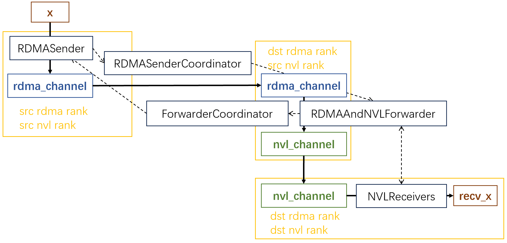
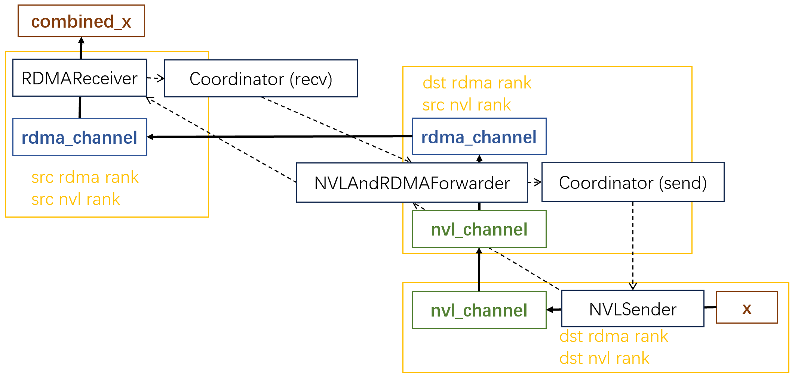
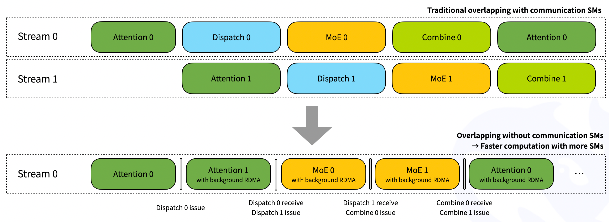
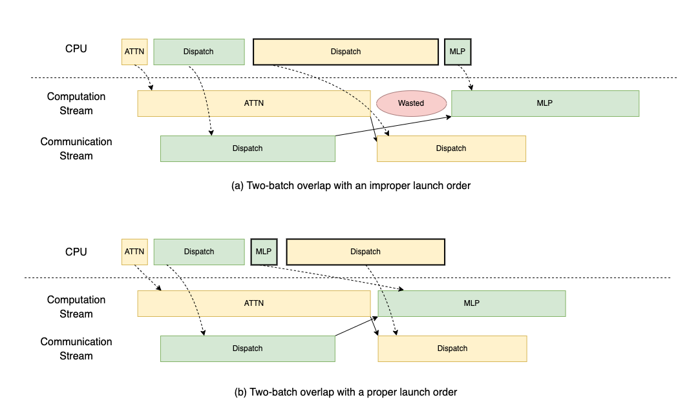
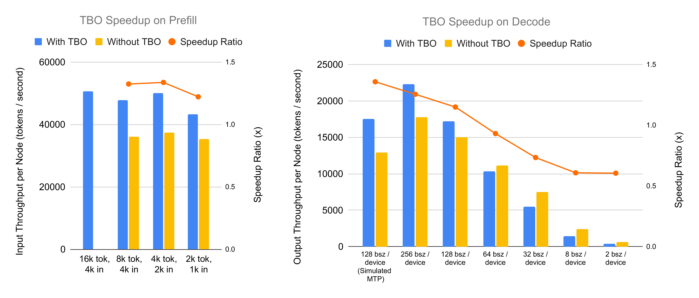
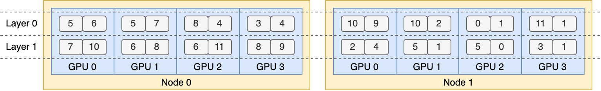
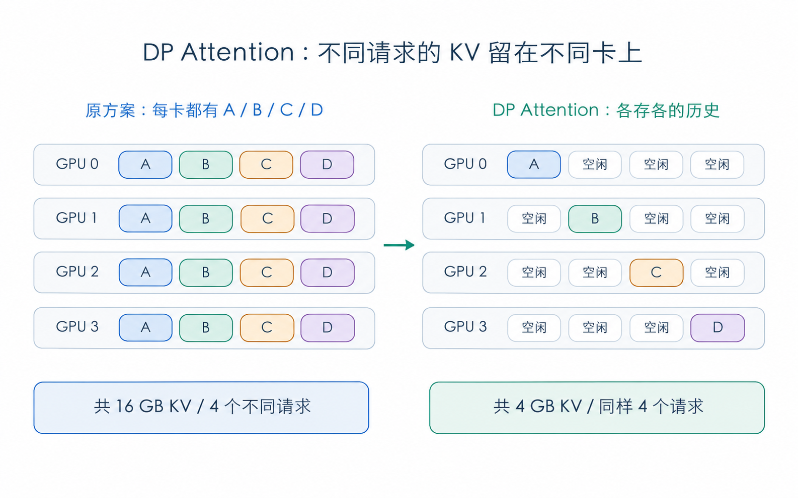

# 大规模分布式并行：PP、EP、DP Attention 与 Context Parallel

```{contents} 本页目录
---
depth: 2
local: true
---
```

第 8 章已经拆解了单机 Tensor Parallel（TP）：组内所有 GPU 同步处理同一批请求，沿层内矩阵维度切分权重，每层做两次 All-Reduce。当模型层数继续加深、MoE 路由专家扩展到上百个，或者 GQA/MLA 在高并行度下触发 KV 冗余复制、单条超长请求撑爆单卡显存时，单一 TP 会撞上跨机延迟与缓存复制墙。本章把生产推理引擎常用的另外四种并行维度放在同一坐标系下逐一拆解：按模型层切分的流水线并行（PP）、按专家 ID 切分的专家并行（EP）、按请求切分注意力状态的 DP Attention（DPA），以及按同一序列位置切分历史的上下文并行（CP）。

## Pipeline Parallel 用微批次填补跨层阶段等待

TP 切层内矩阵，EP 切专家集合，PP 则把连续的模型层划成 stage。以 24 层模型为例，三个 stage 分别负责第 1～8、9～16、17～24 层；每段保存本地层的权重和 KV，完成计算后把中间激活交给下一段。一个 stage 可以使用一张 GPU，也可以由一组 TP GPU 执行。阶段边界是主要的跨 stage 传输位置，因此 PP 可以将节点内的层内通信与节点间的阶段通信分开安排。

如果只让一批输入走完整条流水线，三个 stage 只能依次工作。前段算完后等待，后段尚未收到输入也等待，这些没有有效计算的空档就是 pipeline bubble。将一批请求拆成多个 micro-batch 后，Stage 1 把 A 交给 Stage 2，便可以继续处理 B，各段逐渐同时工作。


图：24 层分成三个 stage，A、B、C、D 来自不同请求。每个 stage 处理一份 micro-batch 都需要一个时间片，忽略通信与调度开销；灰色格表示填充和排空阶段的气泡。来源：Datawhale 原课程。

| 时间片 | Stage 1 | Stage 2 | Stage 3 |
|-|-|-|-|
| 1 | A | 等待 | 等待 |
| 2 | B | A | 等待 |
| 3 | C | B | A |
| 4 | D | C | B |
| 5 | 等待 | D | C |
| 6 | 等待 | 等待 | D |

四份数据逐份走完三个 stage 需要 12 个时间片，上表交错推进后需要 6 个。这是保持各 stage 计算量不变的理想排程比较。对于 P 个等时 stage、M 个可流水推进的 micro-batch，处理这一批数据需要 M＋P－1 个时间片，平均阶段利用率为 M／（M＋P－1）。P＝3、M＝4 时为 4／6；只有两份 micro-batch 时需要 4 个时间片，利用率降至 2／4。这里的利用率指理想阶段忙碌时间占比，与 nvidia-smi 的 GPU-Util 口径不同。

真实收益还受最慢 stage、激活传输和单次 GEMM 效率限制。micro-batch 过小会增加调度与通信次数，也可能让矩阵计算变得低效。同一请求的下一输出 token 仍依赖当前 token 的采样结果，不能拿尚未生成的未来 token 填充这张排程表。已有长输入可以采用另外的 chunked-prefill 流水线，但要满足上下文依赖；后文 Mooncake 的 CPP 专门讨论这条路径。

因此，PP 能扩大模型部署范围，多请求时也有机会提高阶段并行度；单请求逐 token Decode 仍要经过所有 stage。它与 Mini-SGLang 的 CPU/GPU overlap、NanoFlow 的设备内算子重叠发生在不同层级，不能混用它们的收益。

本算例与配图改编自 Datawhale 原课程，公式为对图中等时排程的推导。[SGLang PP 文档](https://docs.sglang.io/docs/advanced_features/pipeline_parallelism)还介绍 micro-batching event loop、异步 P2P 和动态 chunking；这些是截至 2026 年 11 月 9 日的实现说明，模型支持与参数仍需对照安装版本，本稿没有运行 PP 性能测试。

**复合并行必须按物理 GPU 组核算资源：**

组合时，先画清楚物理 GPU 的归属：PP 划分 stage，stage 内再安排 TP、Attention DP 和 EP。同一组 GPU 可以在 Attention 子层按请求分工，在 MoE 子层按专家分工，这两个并行度不一定是两组独立资源。把所有参数机械相乘，会重复计算共用的 GPU。

当前 [SGLang DPA 文档](https://docs.sglang.io/docs/advanced_features/dp_dpa_smg_guide)规定，`--attn-dp-size` 在 TP group 内划分 Attention DP groups，并要求 `tp_size % attn_dp_size == 0`。它也将普通模型副本的 `--dp-size` 与 DPA 分开定义；截至 2026 年 11 月 9 日，文档说明多副本与 DPA 的组合尚不支持。部署组合应按这一版本边界核对，不能沿用旧参数的含义。

选择并行组合时，先看占满显存的是整层权重、专家权重还是历史 KV，再从 timeline 区分层内 collective、专家 dispatch/combine 与跨 stage 等待：第 8 章的 TP 处理层内切分，紧接着的 EP 与 Attention DP 分别处理专家扩展与注意力请求分工。

## Expert Parallel 按专家分片并用双轮通信收发激活

第 9 章介绍的 Expert TP 让每张卡保留全部专家的中间维分片，末尾只需一次 `all_reduce`，但单卡能放下的专家总数与单专家矩阵宽度受限。面对百亿至千亿参数的稀疏 MoE 模型，生产系统普遍引入专家并行（EP）：

EP 会把 expert ID 分给不同 rank，每个 rank 只保存本地 expert。Router 选中远端 expert 后，运行时先按目标 rank 整理 token，再通过 `all_to_all` 发送 hidden states；本地 expert 算完后，还要通过第二轮 `all_to_all` 把结果送回原 token 所在 rank。通信量随路由任务数 `M×R` 增长，路由偏斜也会直接变成设备间负载不均。

| 比较项 | Expert TP | Expert Parallel |
|-|-|-|
| 权重切法 | 每个 expert 的矩阵按中间维切分 | expert 集合按 expert ID 切分 |
| 单卡看到的 expert | 全部 expert 的局部分片 | 少量完整 expert，或这些 expert 的 TP 分片 |
| 一个 token 由谁计算 | 所有 TP rank 共同计算 | 持有目标 expert 的 rank 计算 |
| token 搬运 | 不做 expert dispatch | dispatch 和 combine 各做一次 |
| 主要 collective | `all_reduce [M,H]` | 两轮 `all_to_all` |
| 通信与 top-k 的关系 | 最终通信张量不带 `R` 维 | 需要传输 `M×R` 条路由任务 |
| 路由偏斜 | 各 rank 执行相同路由，计算量一致 | 热点 expert 会让部分 rank 过载 |
| 扩展重点 | 让单个 expert 跨卡计算 | 让更多 expert 横向铺到更多卡 |

用一个具体路由看清 dispatch 与 combine。假设一层有 8 个路由专家，每个 token 选择 2 个，4 张 GPU 各保存两个完整专家；不计共享专家、专家副本和 Expert TP。

| GPU | 本地专家 | 本次 token 是否访问 |
|-|-|-|
| GPU 0 | E0、E1 | token 的原始位置，router 选择 E2、E7 |
| GPU 1 | E2、E3 | 执行 E2 |
| GPU 2 | E4、E5 | 不执行本次 token 的专家任务 |
| GPU 3 | E6、E7 | 执行 E7 |

GPU 0 将本次 token 的激活发送到 GPU 1 和 GPU 3；两张卡分别计算选中的专家，再把结果交回 GPU 0，按 router 给出的权重合并。这条教学路径中，传输的是当前激活、路由信息和专家结果，历史 KV 继续留在负责 Attention 的设备上。


图：E2、E7 分别位于 GPU 1、GPU 3，结果回到 GPU 0 恢复 token 输出。来源：Datawhale 原课程。

GPU 2 对这一个 token 没有专家计算，不代表它在整个 batch 中空闲；其他 token 仍可能选中 E4、E5。每卡保存两个专家也不能保证等量计算，实际负载要按专家收到的 token 数判断。典型 EP 用 All-to-All 类通信组织多对多分发与回收；具体 SGLang 后端也可以使用 All-Reduce 或 All-Gather 路径，不能只凭“启用了 EP”认定底层一定调用原生 all_to_all。

本算例与配图改编自 Datawhale 原课程；通信后端边界按 [SGLang Expert Parallelism 文档](https://docs.sglang.io/docs/advanced_features/expert_parallelism)于 2026 年 11 月 9 日核对。前文已经解释 Mini-SGLang 的 Expert TP 与 EP 的差别，这里只补路由过程，不表示教学引擎已经实现 EP。

### Expert TP 与 EP 的选型取决于通信路径与批次规模

| 约束或负载特征 | 优先考虑 | 原因 |
|-|-|-|
| 单个 expert 放不进一张卡，或单卡 GEMM 太慢 | Expert TP | 必须切分 expert 内部矩阵 |
| expert 数很多，总权重需要横跨大量 GPU | EP | 按 expert ID 扩展更自然 |
| Decode 为主，每轮 token 较少 | 较小规模的 Expert TP | 避免两轮小消息 `all_to_all` 和负载碎片 |
| Prefill 或高并发吞吐为主，每个 expert 能收到足够多 token | EP | 较大的本地 expert GEMM 能摊薄 dispatch 成本 |
| 路由偏斜明显，缺少容量控制和负载均衡 | Expert TP | 各 rank 执行相同任务，不会产生设备间热点 |
| 具备高速互联、成熟的 token dispatch 和负载均衡 | EP | 能够控制 `all_to_all` 与热点 expert 的代价 |

显存容量不能单独决定选型。理想均分下，两种方案都能把 expert 权重降到约 `1／P`；应继续判断单个 expert 是否需要跨卡、每轮有多少路由任务，以及 `all_reduce` 和两轮 `all_to_all` 哪条链路更容易被当前负载摊薄。

大规模系统通常组合两种方案：先用 EP 把 expert 集合分组，再在组内用 TP 切分单个 expert。实践中，可以先用最小的 TP 规模保证单个 expert 能放下，且 GEMM 仍然高效。随后用 EP 扩展 expert 数量，外层按吞吐需求增加 Data Parallel 副本。

### SGLang 分开选择通信与专家计算

前面的路由算例给出了 EP 的语义边界。落到 SGLang 实现，还要确定激活的布局、通信后端和专家计算后端。下面的实现说明以 2026 年 11 月 17 日核对的 SGLang 提交 `0c44fbff44` 为准；DeepEP 初版代码解读、2025 年性能实验和后续重构分别保留各自的版本背景。

```text
TopK 路由结果
  → Dispatcher.dispatch：把 token 交给持有目标专家的 rank
  → 专家计算：布局转换与 grouped GEMM
  → Dispatcher.combine：返回并合并 token 的专家贡献
```

| 层次 | 配置或实现 | 需要确认的条件 |
|-|-|-|
| 通信 | `--moe-a2a-backend`；例如 `none`、`deepep` | dispatch/combine 的通信组、接收布局、同步协议与容量 |
| 计算 | `--moe-runner-backend`；例如 `triton`、`deep_gemm`、`cutlass`、FlashInfer 系列 | GPU 架构、量化格式、权重布局及 dispatcher 输出是否兼容 |
| 编排 | TBO、SBO 与 dispatcher hooks | 哪些计算可以先提交，何时等待数据，计算与通信各占多少资源 |
| 均衡 | EPLB 与专家位置映射 | 热点专家的副本数、放置、分流和权重搬迁 |

`none` 表示不使用专用 All-to-All 后端，相关路径仍可借助 All-Reduce／All-Gather 完成跨 rank 的工作。通信与计算可以分别选择，但模型、量化和布局会限制组合；runner 的 `auto` 结果应从启动日志和调用路径确认。DeepEP 搬运 token，DeepGEMM 执行矩阵乘，二者处在不同的执行边界。

在未启用 MoE DP 等额外切分维度的条件下，专家内部 TP 宽度为 `tp_size / ep_size`。例如 `--tp-size 8 --ep-size 2` 将专家分成两组，每个专家仍由四个 rank 协作；`--tp-size 8 --ep-size 8` 的专家内部 TP 宽度为 1。当前官方页将 DeepEP 等专用后端的支持范围限定为 `ep_size == tp_size`，混合 EP/TP 使用 `none`；当前启动解析也会将这些专用后端的 `ep_size` 调整为 `tp_size`。这是实现支持范围，EP 的数学定义没有这个限制。

同一组设备在 Attention 子层还可以按请求分工。当前 `--attn-dp-size` 表示 TP 组内的 Attention DP 组数，`--dp-size` 表示完整模型副本数。2025 年博文里的旧版 DP Attention 命令应按当时语义阅读。前面选型表中“小 Decode batch 优先考虑较小 TP”的经验也有边界：足够大的跨卡 token 汇集、低延迟通信和专家均衡，可以使 Wide-EP 在 Decode 中获得收益，第 23 章将把这些条件放回完整生产案例。

### DeepEP 按拓扑分发并归约 token

DeepEP 将 MoE 路由、跨 GPU 通信和接收布局一起设计，减少 dispatch/combine 占用的时间。它利用专家位置在慢链路上去重并提前归并结果，用 chunk 流水线提高带宽利用率，再通过低精度传输与异步接口减少搬运和等待。V1 的 normal 主要面向训练和 Prefill 的较大载荷与高吞吐，low-latency 面向 Decode 的小批次和低延迟。当前 SGLang 的 auto 模式在 batch 含 extend 时选择 normal，否则选择 low-latency。本节保留 CQzhangyu 对 2025 年初版的解读与配图，并结合固定 V1 源码、SGLang 接入和 DeepEP V2.5 说明机制的演进；历史路径与新版接口分别标明。

| 比较项 | Normal | Low-latency |
|-|-|-|
| 接收布局 | 根据路由与计数建立接收规模，再转换为专家计算需要的布局 | 预分配专家维缓冲区，以有效计数或 mask 表示真实 rows |
| CPU 与 Graph | 计数元数据到达之前可能阻塞 CPU，动态 shape 对 Graph 不友好 | 静态容量便于 CUDA Graph；需满足容量上限 |
| 初版传输路径 | 跨节点 RDMA，目标节点内再经 NVLink 分发 | GPU 发起 RDMA，直接抵达目标 GPU；该初版机内也走 RDMA |
| 主要代价 | 计数同步、布局重排与通信 SM 占用 | 预留显存、静态容量以及 send/receive 的 kernel 开销 |

#### Normal 先跨节点，再在节点内分发

初版 normal 将 rank 拆成节点编号 `rdma_rank` 与机内 GPU 编号 `nvl_rank`。token 从 `(src_node, src_gpu)` 出发，先经 RDMA 到目标节点上编号相同的 `(dst_node, src_gpu)`，再经 NVLink 交给持有专家的 `(dst_node, dst_gpu)`。同一个 token 命中目标节点的多个 GPU 时，可以共用一份跨机传输，再在节点内展开。

假设源 GPU 上的同一个 token 在远端节点 B、C 各命中两张专家 GPU，四个目标 rank 都需要相同的 activation。按目标 GPU 分别跨机发送时需要四份；分层 dispatch 先向 B、C 各传一份，再在目标节点内展开。

| 发送方式 | 跨节点 activation 份数 | 节点内处理 |
|-|-|-|
| 按四个目标 GPU 分别发送 | 4 | 各 GPU 独立接收 |
| 先按目标节点去重 | 2 | 经 NVLink 分发到各专家 GPU |

这个算例只比较重复 activation 的份数，忽略量化 scale、路由元数据和控制消息，不能直接推导通信时间减半。收益取决于同一 token 的专家是否集中在少量通信域；group-limited routing 限制命中的域数，能与这种分层去重配合。



图：DeepEP 初版 normal dispatch 的 RDMA→NVLink 路径。图中实线表示数据流，虚线表示控制协调；节点编号与 GPU 编号沿原文记法保留。来源：CQzhangyu 的 2025 年代码解读。

| 参与者 | 推进的工作 |
|-|-|
| `get_dispatch_layout` | 从 `topk_idx` 统计目标 rank、节点与专家的 token 数，生成分发所需布局 |
| RDMA sender 与 coordinator | 将 token 分段送入跨机 channel，协调发送和接收进度 |
| NVLink forwarder 与 receiver | 把抵达目标节点的 token 转发到专家 GPU，并写入接收 buffer |
| Channel 的 head/tail | 用队列进度控制可写与可读范围，连接网络传输和机内转发 |

这些角色通过分块流水线协作。后续 chunk 仍在走 RDMA 时，先到的 chunk 已可经 NVLink 转发，无需等待整个 batch 跨机传完。不同 channel 并行推进，各 warp 分别处理发送、转发、接收与协调；head/tail 记录可读、可写的队列范围。具体路径还用 TMA 等搬运机制减少线程参与的数据复制。

通信 SM、channel 和 QP 数量需要一起考虑。资源太少会限制带宽，资源太多又会挤占 Expert GEMM 的 SM、HBM 带宽与缓存。当前 V1 接入按模式配置 QP：normal 使用通信 SM 配置，low-latency 使用本地专家数，auto 兼顾两种需求。调优应比较整层 MoE 时间，而不只看通信 kernel 的单项带宽。

Normal dispatch 返回的 `handle` 保存回程需要的路由布局。`async_finish=True` 可以让数据传输异步完成，但动态 tensor 的分配仍可能等待接收计数；API 返回、CPU 无等待和数据已可消费是三个不同条件。具体 warp 数量、channel 常数与模型的 group-limited routing 上限应按对应代码版本解释。

Normal combine 沿回程做分级归约：先汇集目标节点内不同专家 GPU 的贡献，再经 RDMA 返回原始节点，最后合并多个目标节点的结果。提前做节点内局部归约，可以减少跨机传输的重复贡献。路由专家贡献可写为 $y_t=\sum_{e\in\mathrm{TopK}(t)}p_{t,e}\,\mathrm{Expert}_e(x_t)$，完整输出还要按模型合入共享专家与缩放。其中路由权重的乘法位置由后端决定：当前 normal combine 调用没有再传 `topk_weights`，low-latency combine 则显式接收它；不能把所有加权都归到通信 kernel。



图：DeepEP 初版 normal combine 的分级回程。图中 src/dst 沿用 dispatch 的视角；机内先汇合贡献，再发送跨节点结果。来源：CQzhangyu 的 2025 年代码解读。

#### Low-latency 把发送与接收完成拆开

Low-latency 预先约定 `num_max_dispatch_tokens_per_rank`，为本地专家保留最坏接收容量。其逻辑 buffer 可写成 `[本地专家数, 每 rank token 上限 × rank 数, hidden_dim]`，真实参与计算的区域由有效计数或 mask 决定。这样可以绕开“收到计数后才向 CPU 请求动态分配”的步骤，但预留空间和容量上限必须计入部署预算。

初版使用 IBGDA，由 GPU 发起 RDMA 请求，直接抵达目标 GPU，机内也走 RDMA。后续 V1 已增加同域 P2P／NVLink 旁路：本节核查的固定提交 `814e508537c6` 会先尝试直接访问目标 GPU，无法取得 P2P 指针时才走 IBGDA。因此，上表保留的是初版路径，不能据此认定后续 low-latency 始终全部走 RDMA。GPU 发起请求减少了每次传输对 host 调度的依赖，但 normal 的动态输出分配仍可能让 CPU 等待计数。

`return_recv_hook=True` 将发送与接收完成拆开：发起 dispatch 后，可以先提交与接收结果无关的计算；在消费接收 buffer 前，再调用 `recv_hook()` 完成接收等待与整理。RDMA 在途期间可以让出原本用于忙等的 SM，send/receive kernel 本身仍消耗 GPU 资源。当前 SGLang 的 LL 路径在 `dispatch_a` 发起通信，在 `dispatch_b` 内调用 hook 或等待 event。Normal 路径的 `dispatch_a` 主要准备量化数据和 event，真正通信在 `dispatch_b` 内开始，不能对两种模式套用同一排程。



图：send／receive 拆阶段后，将另一微批的计算放进 RDMA 在途窗口。此图展示跨微批重叠，属于 TBO 的示意；“without communication SMs”针对在途等待阶段，不能理解为整个通信过程不使用 SM。来源：DeepEP 原图，经 CQzhangyu 文章引用。

#### FP8 与专家布局减少传输和整理

FP8 dispatch 将 activation 主体从 BF16 的每元素两字节降为一字节，同时传递量化 scale。整体消息还包含 scale 和路由元数据，不能将总传输量严格视为减半；精度回归也要覆盖量化带来的误差。专家输出的通信格式按具体 combine 路径确定，不能假定全程都用 FP8。

| 路径 | 减少开销的做法 | 适用边界 |
|-|-|-|
| V1 normal 接入 | 通信前可按每 token、128 元素一组量化为 FP8，并准备 GEMM 所需 scale 布局 | SGLang 的具体 JIT DeepGEMM／FP8 路径；量化仍可由独立 kernel 完成 |
| V1 low-latency kernel | 将 FP8 量化、打包与发送放在同一条 dispatch kernel 路径 | 减少中间步骤和搬运；发送、接收整理仍消耗 SM |
| 专家计算接收布局 | 按专家组织有效 rows，并满足 grouped／masked GEMM 的 alignment | 必须匹配 runner 和量化格式；具体路径仍可能需要 copy 或 permutation |

#### V2.5 延续优化并调整接口

截至 2026 年 11 月 17 日，上游固定提交 `f6aa38fe06cd` 的版本为 2.5.0。新版以 `EPBuffer` 统一训练、Prefill 与 Decode 的 dispatch/combine，通信后端改为 NCCL Gin，V2.5 已移除 V1 API 和 NVSHMEM 依赖。SGLang 固定提交中的 `deepep.py` 仍使用 V1 `Buffer/Config`，`deepep_v2.py` 使用较早 V2 的 `ElasticBuffer`；下面的新版机制源自上游 `EPBuffer`，不能直接当作旧接入的运行行为。

| 新版机制 | 做法 | 条件或代价 |
|-|-|-|
| Hybrid／direct | Hybrid 按 scale-out 域去重，再通过 scale-up 域内互联转发；direct 使用更直接的路径和较少 QP，减少 doorbell 开销 | 路径选择取决于拓扑和通信负载，不能固定等同于旧版 normal／low-latency |
| Expanded layout | `do_expand=True` 形成每个 token-expert 一行、按 expert 排列的输出，并支持 alignment 与 padding | 在 copy epilogue 中完成，便于 grouped GEMM 消费，仍有布局整理成本 |
| GPU 有效计数 | `do_cpu_sync=False` 按容量分配输出，避免 CPU 为精确接收大小等待计数 | GEMM 必须读取 GPU 上的有效计数，不能计算全部预留 rows |
| 提前归并 | `allow_multiple_reduction=True` 允许本地与 hybrid 转发阶段先归并贡献，减少传输 | 关闭后可将结果传回再统一归并，以提高数值精度，但传输量可能增加 |

`defer_epilogue=True` 必须配合 `async_with_compute_stream=True`。Dispatch 先启动通信，将接收计数的 CPU 等待（若启用）、输出分配与 copy epilogue 推迟到 `.wait()`；combine 将最终 reduce epilogue 推迟到 wait。这样可以先提交中间的独立计算，结果消费者仍需等待，不能把异步返回视为数据已就绪或通信已完全隐藏。

#### 验收要看整层时间与有效输出

比较 DeepEP 配置时，需要固定版本、GPU／NIC 拓扑、路由分布、token 数、量化格式与容量，并结合 timeline 检查 dispatch、Expert GEMM、combine 和等待的实际关键路径。去重减少字节数，流水线提高带宽利用率，固定容量减少 host 同步，hook 与 deferred epilogue 提供重叠窗口；它们也会改变显存需求、SM 竞争或数值归并顺序。

本节是源码机制分析，没有新增 GPU 性能测试或固定提升比例。FP8、提前归并和布局变化需要精度回归；通信时间下降后，还要按第 4、24 章的方法核对 TTFT、TPOT 与 Goodput。接收 hook 提供了可交错的边界，下一节继续说明 TBO 怎样安排两份微批的执行顺序。

### TBO 用双微批隐藏通信等待

TBO 从同一批输入中切出两个 micro-batch，在可交错的阶段轮换推进。当 A 执行 dispatch/combine 时，可以提交 B 的 Attention 或专家计算。它与第 6、11 章的 CPU/GPU 调度 overlap 处在不同层次，也与训练中的 DualPipe 有不同的生命周期；DeepEP 提供通信能力，SGLang 的 TBO 负责推理执行顺序。

2025 年 SGLang 用 operation 列表和 `YieldOperation()` 描述微批阶段，在 yield 点切换到另一微批，减少两份 forward 逻辑的重复。当前源码仍按 prefill／decode 选择 operation strategy；真正的先后依赖由 CUDA stream、event、接收完成和阶段状态共同保证。

原文用下面的示意代码表达可暂停的单微批路径。两份微批分别保存自己的执行状态，共用同一套算子逻辑；执行到 `YieldOperation()` 时，调度器获得切换到另一微批的机会。

```python
operations = [
    self._forward_attn,
    YieldOperation(),
    self._forward_dispatch,
    self._forward_mlp,
    YieldOperation(),
    self._forward_combine,
]

def _forward_attn(self, state):
    state.hidden_states = self.self_attn(state.hidden_states, ...)
```

这段代码来自 2025 年博文，只展示操作列表与让出点，没有包含完整排程和同步实现。切换微批以后，MLP 仍需等本微批 dispatch 的数据就绪，combine 仍需等本微批专家计算完成。下一段的 Prefill 提交顺序，需要在这些依赖成立的前提下安排。

Prefill 最容易遗漏的是 CPU 提交顺序。Normal dispatch 可能等计数元数据；如果先进入这段等待，再提交另一微批本来可以执行的 GEMM，GPU 计算流就会出现空档。先把独立计算提交给 GPU，再进入可能阻塞 CPU 的 dispatch，才能让设备在 host 等待期间继续工作。



图：TBO 的 Prefill 提交顺序。上图先进入会阻塞 CPU 的 dispatch，MLP 迟迟未提交；下图提前提交可执行的 MLP，缩短计算流空档。来源：LMSYS 2025 年 5 月 5 日大规模 EP 博文。

切成微批有机会降低单次算子的激活峰值，同时也会减小 GEMM 的有效 batch，并让计算与通信争用 SM、HBM 或缓存。权重、KV Cache 和通信缓冲不会随微批切分全部减半。当前 prefill strategy 会给计算保留 `total_num_sms - DeepEPConfig.num_sms`，直接反映了重叠的资源代价。

原文的容量实验把这种收益落到了具体 batch：无 TBO 时，每卡可运行 8,192 个输入 token，增至 16,384 个时 OOM；启用 TBO 后，每卡可运行 16,384 个。因而表中的约 40.5% 包含扩大 batch 后的收益，与相同 token 数下的 27%～35% 分开比较。这组上限属于原文的模型、硬件和配置，不能直接当作其他部署的容量参数。

| 实验场景 | 原文观测 | 解读条件 |
|-|-|-|
| Prefill，同 token 数 | TBO 吞吐提高约 27%～35% | 比较原文 vanilla 与 TBO；将更大的可运行 batch 也算入后，报告约 40.5%，两种口径需分开 |
| Decode，32 tokens/device | 约下降 27% | 小微批的 GEMM 效率损失可能超过隐藏的通信等待 |
| Decode，256 tokens/device | 提高约 25.5%，每节点约 22,310 tokens/s | 依赖原文的 Attention 时长、通信与并行配置 |
| Simulated MTP | 128 sequences/device、每步 256 tokens 时，约提高 35% | 通过 batch／KV 条件和 dummy Attention kernel 模拟，未建立真实 MTP 的端到端结论 |

这些结果来自 DeepSeek-V3、H100 与 InfiniBand 的 2025 年实验，P、D 分开测量并隔离另一阶段的供给限制。它们说明 batch 和关键路径会改变 TBO 的收益，不能作为当前版本打开开关后的固定提升。原文的大规模 EP、PD、DeepGEMM 和 EPLB 组合收益也不能全部归因于 TBO。



图：TBO 的吞吐消融。左图按 Prefill token 数比较，右图按 Decode batch 比较；右侧包含模拟 MTP 栏，较小 Decode batch 出现负收益。来源：LMSYS 2025 年 5 月 5 日博文。

吞吐曲线之外，还要比较相同算子 batch 下的执行时间。拆分既能隐藏通信，也会改变 GEMM 的输入规模；只比较单个 kernel，容易漏掉整层执行中的等待。

| 对照 | 控制的条件 | 原文观察与含义 |
|-|-|-|
| Prefill：TBO 8K 与无 TBO 8K | 每卡总 token 数相同，TBO 的单微批更小 | 重叠减少了计算与通信之间的空档，但拆分后的 kernel 批量效率也发生变化。 |
| Prefill：TBO 16K 与无 TBO 8K | 单次 kernel 的有效 batch 均为 8K | 无 TBO 的单 kernel 更快。作者将计算可用 SM 减少、重叠造成的资源干扰及 kernel 配合方式列为可能原因，尚未证明某一个因素是唯一原因。 |
| Decode：TBO 256 与无 TBO 256 | 每卡总 token 数相同 | 无 TBO 的 GEMM 受益于更大的单次 batch，但未被隐藏的通信延长了执行时间。 |
| Decode：TBO 256 与无 TBO 128 | 单次 kernel 的有效 batch 均为 128 | 图中缩放后的计算时间接近，主要差异落在未被重叠的通信上。它用于区分批量效率与通信重叠，不能直接比较为相同请求量的服务吞吐。 |


图：Prefill 的 batch 与 kernel 时间对照。横轴为原文的 “Scaled Mean Time (ms) per Layer”；TBO 16K 与无 TBO 8K 的单次 kernel 有效 batch 相同。来源：LMSYS，2025 年 5 月 5 日。


图：Decode 在总 batch 相同和单次 kernel 有效 batch 相同两种条件下的对照。横轴同样是 “Scaled Mean Time (ms) per Layer”。原文没有交代两图的缩放公式，各项时间又存在重叠，因此不能把图上值直接当作原始逐层延迟，或将所有条形相加当作整层延迟。来源：LMSYS，2025 年 5 月 5 日。

原文实验中，Decode 开始获得收益的 batch 门槛落在每卡 64～128 tokens 之间。这个交点由当时的 Attention 时长、GEMM 效率和通信路径共同决定。部署时应固定每卡总 batch、输入／KV 长度与并行配置，对照整层关键路径和服务指标；第 24 章给出的 Profiling 方法可用于检查实际重叠是否成立。TBO 利用两份微批之间的独立工作，下一节的 SBO 则继续考察同一 batch 内可与通信并行的计算。

### SBO 在同批次内安排独立计算

SBO 保持一个 batch，利用其中可以独立推进的工作填入通信窗口。例如，shared expert 不依赖 routed expert 的接收结果，可以与 dispatch/combine 交错；部分后端还把 down GEMM 已完成的分块交给 combine，重叠后续计算和发送。这种分块重叠需要 event 与 signal，读取必须落在已经完成的区域。

PR #13327 于 2025 年 11 月 21 日合并，重点是用 dispatcher hooks 收拢 SBO 编排。它把共享专家回调、替代 stream 和临时 overlap 参数从多种量化 method 的调用链移到模型侧注册，使通用 MoE 主路径保持清楚：

```python
dispatch_output = dispatcher.dispatch(hidden_states, topk_output)
combine_input = run_moe_core(dispatch_output)
hidden_states = dispatcher.combine(combine_input)
```

| Hook | 编排职责 |
|-|-|
| `pre_dispatch` | 进入 dispatch 前执行需要的准备回调 |
| `post_dispatch` | 接收布局确定后，生成计算侧与通信侧共同需要的 overlap 参数 |
| `pre_combine` | 在对应策略中提交 shared expert 等可重叠工作 |
| `post_combine` | 清理本次执行的临时参数与一次性回调 |

PR 中一次性 hook 执行后通过 `handle.remove()` 移除，避免后续 forward 再次使用这次闭包。Hook 提供编排入口，stream/event 和后端信号提供完成依赖；注册回调本身不会自动保证数据已就绪。当前 DeepEP dispatcher 另外有位于 `dispatch_a` 与 `dispatch_b` 之间的专用 hook，这是后续代码能力，应与 PR 当时的通用 hooks 区分。

SBO 的具体路径受模型、runner 和架构限制。当前固定提交在 CUDA capability major＝9（Hopper／SM90）上开启 `--enable-single-batch-overlap` 会报错，提示最新 `sgl-deep-gemm` wheel 不支持；H100 部署不能直接照抄历史 SBO 命令。PR 正文没有可引用的吞吐提升数字，本节据此说明工程重构和依赖组织。

### EPLB 用副本和放置缓解专家热点

Top-k 约束每个 token 选多少个专家，无法保证不同专家接收等量 token。EPLB 根据专家负载重新分配物理槽位：逻辑专家是 Router 输出的模型编号，物理专家是某张 GPU 上存放权重的槽位。同一个逻辑专家可以拥有多个权重副本，选中它的 token 被分流到其中一份；同一次逻辑专家调用仍只贡献一次结果。

DeepSeek 独立 EPLB 仓库提供“给定负载，计算副本和放置”的算法，负载预测不在该仓库范围内。它用 $w_e/r_e$ 估计专家 e 的每份副本负载：先为每个逻辑专家保留一份，每增加一个槽位，就给当前比值最大的专家加副本；随后按预计副本负载降序装箱，选择尚未放满且累计负载最小的 GPU。这是负载均衡启发式，不保证全局最优或最小搬迁代价。

| 策略 | 流程 | 实际分支条件 |
|-|-|-|
| Hierarchical | 先把专家组分配到节点，再在节点内复制和装箱，保留 group-limited routing 的局部性 | `num_groups % num_nodes == 0`，同时满足组、专家和 GPU 的整除约束 |
| Global | 把所有 GPU 当作一个逻辑大节点，进行全局复制和放置 | `num_groups % num_nodes != 0`；其他输入约束仍须满足 |

README 将 hierarchical 与较小规模 Prefill、global 与较大规模 Decode 联系起来，描述的是适用场景。算法入口按组数和节点数选择分支，没有检查请求处于 Prefill 还是 Decode。



图：DeepSeek EPLB 仓库的放置示例。两行对应两个 MoE 层，每层 12 个逻辑专家加 4 个冗余槽位，放在 2 个节点、共 8 张 GPU 上；方框数字是逻辑专家编号，重复编号表示权重副本。此图展示布局，不表示实测吞吐。

| 接口对象 | 含义 |
|-|-|
| `weight[L, E]` | 各 MoE 层、各逻辑专家的负载估计 |
| `num_replicas=P` | 每层物理槽位总数，包含原来的 E 份；冗余数为 P−E |
| `phy2log[L, P]` | 每个物理槽位对应的逻辑专家，按 GPU 顺序排列 |
| `log2phy[L, E, X]`、`logcnt[L, E]` | 反向副本列表和副本数；列表空位为 −1，X 是最大副本数 |

物理槽位总数须满足 `P ≥ E`，且 P 能被 GPU 数整除，保证每卡固定槽位数。冗余数为 0 时仍可重新放置已有专家；启用均衡与增加副本是两个独立配置。

例如一层负载为 `[80, 30, 20, 10]`，两张 GPU 共六个槽位，两个额外槽位都分给专家 0。运行独立库的 CPU 算法得到 `logcnt=[3,1,1,1]`，GPU 0 放 `[1,0,3]`，GPU 1 放 `[0,0,2]`；按均匀分流估计，两卡负载约为 66.67 和 73.33。同一专家的两份副本可以落在同一 GPU，算法限制的是每卡槽位数。这组数值核验复制与装箱，不能直接换算为 GPU 时间。

接入在线 SGLang 后，还要完成统计、规划、权重搬迁和路由映射。当前主模型 forward 结束后推进 `EPLBManager`；达到间隔后读取历史窗口，计算新位置，先复制或传输对应权重，再更新该层的映射。副本增加会占用权重显存，热点变化、窗口滞后、分流不均和搬迁耗时都会影响收益。

| 参数 | 当前声明默认值 | 含义 |
|-|-|-|
| `--enable-eplb` | false | 开启在线均衡 |
| `--ep-num-redundant-experts` | 0 | 每层增加的物理专家槽位数 |
| `--eplb-algorithm` | `auto` | 按组与节点条件选择放置策略 |
| `--eplb-rebalance-num-iterations` | 1000 | 重平衡间隔，单位为前向迭代次数 |
| `--eplb-rebalance-layers-per-chunk` | `None` | 缺省一轮处理所有相关层，可分 chunk 应用 |

官方 EP 页将 1000 的例子写成 requests，当前 manager 实际按 forward iterations 计数。一个用户请求经历多次 Decode，一次 forward 又能包含多个请求，因此两种单位不能互换。EPLB 的均衡比值约为 `mean(token_count_gpu) / max(token_count_gpu)`，应与实际专家计数一起观察；它衡量负载分布，与 `nvidia-smi` 的 GPU-Util 口径不同。

### Triton 调优先匹配本地专家形状

通信和放置明确后，才能确定本地 GEMM 的形状。`benchmark/kernels/fused_moe_triton/` 的 tuning 工具读取模型配置，按 EP 决定本地专家数，按专家内部 TP 决定矩阵宽度，再搜索 `BLOCK_M/N/K`、`GROUP_M`、warps 与 stages。Ray worker 分配的是独立 kernel 搜索任务，没有组成完整的 EP All-to-All 服务。

对常见 gated MLP，设原始专家中间维为 I、专家内部 TP 宽度为 T，则 `w1` 的中间维为 `2 × I / T`，配置文件中的 `N` 为 `I / T`。本地专家数通常按全局专家数除以 EP 计算，共享专家融合和模型特殊路径还会改变形状；复制 JSON 前必须核对这些条件。

#### 随机输入调优建立形状基线

```bash
python benchmark/kernels/fused_moe_triton/tuning_fused_moe_triton.py \
  --model Qwen/Qwen2-57B-A14B-Instruct \
  --tp-size 8 \
  --ep-size 4 \
  --dtype fp8_w8a8 \
  --tune
```

这里的 8／4 将专家内部 TP 宽度设为 2，表达的是目标矩阵形状。`--batch-size` 指本地 kernel 输入 token 数，`--batch-sizes` 可指定 token 数列表；它们与服务端请求并发数不能直接等同。该示例未在本次整理中执行 GPU 调优。

#### 真实 TopK 样本补足路由偏斜

`tuning_fused_moe_triton_sep.py` 分别调优两次 MoE GEMM，可使用保存的 `topk_ids`。路由偏斜决定每个专家的有效 rows 和 padding，只用随机路由得到的配置可能不适合真实流量。README 给出在 forward 中保存路由、用 `tuning_client.py` 采集的思路；插桩位置要对照当前模型，旧版 `forward_normal` 名称不能当作稳定接口。

```bash
python benchmark/kernels/fused_moe_triton/tuning_fused_moe_triton_sep.py \
  --model deepseek-ai/DeepSeek-V3-0324 \
  --tp-size 8 \
  --ep-size 4 \
  --dtype fp8_w8a8 \
  --topk-ids-dir /path/to/topk_ids \
  --tune
```

当前 sep 工具对保存的全局 expert ID 做自己的本地映射，这种重放仍没有复现真实 dispatcher 的跨 rank 分发。`--configs` 属于 sep 工具，顺序为 `BLOCK_M BLOCK_N BLOCK_K GROUP_M warps stages`；普通 tuning parser 不支持它。比较工具也要分别看参数，当前 `benchmark_torch_compile_fused_moe.py` 没有 `--ep-size`。

#### 加载路径必须匹配 Triton 版本

```text
python/sglang/srt/layers/moe/moe_runner/triton_utils/
  configs/triton_<版本号中的点替换为下划线>/<配置文件>.json
```

README 的 `configs/triton_version/` 是占位写法。实际文件名还包含本地专家数 E、down projection 输入维 N、设备名和量化格式；`SGLANG_MOE_CONFIG_DIR` 指定根目录时，下面仍要保留 `configs/triton_<版本>/` 层次。运行时选择邻近 token 数的配置，缺少当前 Triton 版本时可能回退并警告。GPU、Triton 或量化改变后，应重新验证配置。

验收先从日志确认 `Using MoE kernel config from ...` 的实际文件，再在相同并行布局和路由分布下比较 kernel 时间；最后按第 4、24 章的口径检验 TTFT、TPOT、Goodput 与关键路径。通信重叠、负载均衡和更快 GEMM 分别减少不同的开销，端到端验证才能判断它们在当前负载中的合成效果。至此，EP 的专家侧路径已明确，下一节继续讨论 Attention DP 如何保存本地请求并参与共享模型并行。

## DP Attention 各 Rank 维护本地批次

这里的 rank 指 attention DP rank。一个 attention-TP group 内的 TP ranks 仍处理同一批请求，不会出现同组 TP rank 分别执行 prefill 和 decode。

先算一笔只包含有效 KV 数据的教学账。假设有 4 张 GPU、请求 A～D，每个请求的完整 KV 为 1 GB，原 TP 路径会在每张卡保存这四份完整历史；改用 DPA 后，每张卡可以独立完成分配给自己的 Attention。这里比较的是复制缓存的路径，不能套到 KV 已被均匀分片的普通 TP 上。



图：相同四个请求的 KV 从每卡各存一份，变为 GPU 0～3 分别保存 A～D。总有效 KV 从 16 GB 变为 4 GB，原来三个重复副本占据的空间被释放。来源：Datawhale 原课程。

| 比较口径 | 原方案：四重完整复制 | DPA：各卡保存本地请求 |
|-|-|-|
| 相同四个请求的每卡 KV | 4 GB | 均衡分配时 1 GB |
| 相同四个请求的全组 KV | 16 GB | 4 GB |
| 每卡固定有 4 GB KV 预算时，可保存的不同请求数 | 全组共 4 个 | 每卡 4 个，全组共 16 个 |

四倍容量来自这个例子中的四重复制。实际预算还要扣除 Attention 权重副本、临时 workspace、通信缓冲和分页开销；请求长度不均，也可能先填满某一张卡。容量增加以后，新增请求仍要消耗 Attention 计算和后续 TP/EP 通信，因此吞吐与延迟应按前文 Benchmark 的口径重新测量。

普通 DP 为每组 GPU 部署完整模型副本，DPA 只把 Attention 与请求历史按组分配，后面的 FFN/MoE 仍可以共享 TP/EP。一次 token 离开本地 Attention 后，跨卡交换的是当前激活和结果，历史 KV 通常留在对应 Attention group。Attention group 本身也可以包含多张 TP GPU；每组只有一张卡只是这幅图的简化条件。

本算例与配图改编自 Datawhale 原课程，设计背景见 [SGLang v0.4 发布文章](https://www.lmsys.org/blog/2024-12-04-sglang-v0-4/)；概念与当前参数另按 [DPA 官方文档](https://docs.sglang.io/docs/advanced_features/dp_dpa_smg_guide)于 2026 年 11 月 9 日核对。下文继续沿原有 SGLang v0.5.16 基线解释请求状态与同步，新增算例不改变该版本边界。

启用 DP attention 后，各 attention DP rank 拥有独立的 scheduler、waiting queue、running batch、request table 和 KV Cache。新请求被路由到某个 DP rank 后，其 page table、Radix Cache handle、已生成 token 和 sampling 状态通常留在该 rank。请求到达时间、输入输出长度、EOS、prefix hit 和 abort 情况不同，各 rank 的本地队列会逐渐分化。

```text
DP rank 0：waiting=P0/P1，running=D0/D1  → prefill
DP rank 1：waiting=空，running=D2/D3/D4 → decode
DP rank 2：waiting=P2，running=空       → prefill
DP rank 3：waiting=空，running=空       → idle
```

本轮不能简单把 rank 0 的 P0 交给 rank 1，因为 P0 已绑定 rank 0 的 request slot、page table、KV pages 和缓存引用。跨 rank work stealing 需要迁移或重建这些状态，代价远高于普通 batch 调度。

Attention 只读取当前请求的 Q、历史 K/V、sequence length 和 page table，因此各 DP rank 可以独立执行本地 attention。差异会在后续共享模型并行路径暴露：常见结构让 Attention 按 DP 执行，而 MLP/MoE 使用 TP 或 EP。各 rank 完成本地 attention 后，需要交换 token 数量和 forward mode，把 hidden states 组织成全局布局，再执行 all-gather、all-reduce、expert dispatch 或 reduce-scatter。

例如，rank 0 的 prefill 产生 2048 个 token 的 hidden states，rank 1 的 decode 只有 64 个，rank 2 有 512 个，rank 3 没有本地 token。较轻的 rank 会先到达 collective，然后等待处理 2048 个 token 的 rank。MAX_LEN 路径还会把较短 rank pad 到全局最大长度；SUM_LEN 或 variable-length gather 能减少 padding，仍无法消除到达时间差。

本地没有请求的 rank 也不能退出这一轮。如果其他 DP rank 正在执行需要 MLP/TP/EP 同步的 batch，它必须参加相同的 collective。SGLang 的 `prepare_mlp_sync_batch_raw()` 会收集每个 rank 的 `num_tokens`、`local_forward_mode`、`is_extend_in_batch` 等信息，并在本地 batch 为空时创建 `idle_batch`。idle rank 不执行真实的本地 attention，但会携带全局同步信息进入后续模型并行路径。

PrefillDelayer 会 all-gather 各 DP rank 的 local_prefillable、running_batch、max_prefill_bs、waiting_queue_len 和 token usage。只有部分 rank 可以 prefill 时，全局状态为 mixed。立即放行会形成 prefill、decode 和 idle 并存的本地 batch，放大 token 数量和执行时间差。Delayer 因而先让可 prefill 的 rank 暂缓，让其他 rank 继续 decode 或进入 idle；等更多 rank 同时具备 prefill 条件后再放行。达到 max_delay_passes 或触发 token usage 低水位时仍会强制放行，避免 waiting prefill 被无限推迟。

更准确的描述是：各 attention DP rank 独立维护请求状态并执行本地 attention，因此同一轮可以选择不同的本地 forward mode；进入共享的 TP/EP MLP 路径时仍须交换 token 布局并同步。没有本地请求的 rank 会用 idle batch 参加 collective。

源码锚点（SGLang `v0.5.16`）：[`dp_attn.py`](https://github.com/sgl-project/sglang/blob/v0.5.16/python/sglang/srt/managers/scheduler_components/dp_attn.py)[（](https://github.com/sgl-project/sglang/blob/v0.5.16/python/sglang/srt/managers/scheduler_components/dp_attn.py)[`prepare_mlp_sync_batch_raw`](https://github.com/sgl-project/sglang/blob/v0.5.16/python/sglang/srt/managers/scheduler_components/dp_attn.py)[ 与 ](https://github.com/sgl-project/sglang/blob/v0.5.16/python/sglang/srt/managers/scheduler_components/dp_attn.py)[`get_idle_batch`](https://github.com/sgl-project/sglang/blob/v0.5.16/python/sglang/srt/managers/scheduler_components/dp_attn.py)[）](https://github.com/sgl-project/sglang/blob/v0.5.16/python/sglang/srt/managers/scheduler_components/dp_attn.py)、[`layers/dp_attention.py`](https://github.com/sgl-project/sglang/blob/v0.5.16/python/sglang/srt/layers/dp_attention.py)、[`prefill_delayer.py`](https://github.com/sgl-project/sglang/blob/v0.5.16/python/sglang/srt/managers/prefill_delayer.py)、[`new_token_ratio_tracker.py`](https://github.com/sgl-project/sglang/blob/v0.5.16/python/sglang/srt/managers/scheduler_components/new_token_ratio_tracker.py) 与 [`schedule_batch.py`](https://github.com/sgl-project/sglang/blob/v0.5.16/python/sglang/srt/managers/schedule_batch.py)。

## Context Parallel 按序列位置分摊上下文

前一节的 DPA 按请求分配 Attention 与历史 KV；Context Parallelism（CP，上下文并行）则沿同一请求的序列位置分工，让多张 GPU 协作处理一条长请求。它与前文 TP 的权重或 head 切分不同。Prefill 主要分摊长输入的计算和显存，Decode 主要分摊历史 KV Cache 的存储和读取；两阶段都必须正确处理跨卡 attention 依赖。

<callout emoji="💡">
**适用范围：**以下讨论标准自回归 Transformer 的 dense attention，按每请求每步生成一个 token 分析 Decode。内容是通用机制和教学算例，不代表 Mini-SGLang 已实现 CP，也不构成特定框架的性能承诺。工程实现可能分别提供 Prefill CP 和 Decode CP，并采用不同 KV 布局；有些 Prefill CP 会复制完整 KV，不能仅凭 CP 数量推断显存缩减。
</callout>

### CP 切上下文，TP 切模型张量

| 并行方式 | 主要切分对象 | 请求关系 |
|-|-|-|
| TP，Tensor Parallelism | 权重、attention heads 或隐藏维度 | 组内协作处理同一批请求 |
| PP，Pipeline Parallelism | 模型层 | 请求沿不同 stage 推进 |
| DP，Data Parallelism | 请求集合 | 不同副本承接不同请求 |
| CP，Context Parallelism | 同一请求的序列位置和历史 KV | 组内共同完成同一条请求的 attention |

CP 维度上的模型权重通常复制；与 TP 组合时，复制的是对应的 TP 权重分片。CP 因而不能单独解决权重放不下的问题。某些称为 Sequence Parallelism 的方案主要切分逐 token 算子的激活；是否同时分摊 attention 和持久 KV，需要检查具体实现。

例如，128K token 的请求采用 CP=4，均匀分片时每张卡负责约 32K token。但本地 Q 仍须关注 causal mask 允许访问的全部 K/V；只关注本卡那 32K，会改变模型语义。

### Prefill 保留本地 Q，获取远端 K/V

Prefill 一次处理长 prompt，Q、K、V 都有较长序列维。按 token 分工后，各卡可以对本地 token 执行投影和逐 token 的 FFN；attention 则需要补齐远端 K/V。

| 阶段 | 本地工作 | 跨卡依赖 |
|-|-|-|
| 生成 Q/K/V | 计算本卡 token 的投影 | 若同时使用 TP，仍遵守对应模型张量布局 |
| 计算 attention | 本地 Q 与允许访问的 K/V 做 attention | 收集或逐块传递其他卡的 K/V |
| 完成本层 | 合并分块 softmax 结果，继续处理本地 token | 必要时转换输出布局或汇集最终 token 表示 |

**All-gather K/V** 先收集其他卡的 K/V，再计算本地 Q 的 attention。实现较直接，但完整 K/V 的物化会增加临时显存。**Ring Attention** 让 K/V 按块在设备间传递，本地保留 Q，每收到一块就计算并用 online softmax 合并结果；这样不必同时驻留全部 K/V，也有机会重叠通信和计算。

另一类方案用 all-to-all 在序列分片与 head 分片之间转换，例如 Ulysses 类路径。它对 head 数和布局的约束与 ring 不同。CP 描述的是上下文分工维度，并不指定唯一通信算法。

设输入长度为 N，CP 数为 P，忽略 heads 和维度常数。Dense attention 的总工作量仍为 $O(N^2)$；负载均衡时，每张卡理想承担约 $O(N^2/P)$。长 prompt 因此有机会降低 TTFT。在持久激活和 KV 确实按序列分片、没有额外复制的条件下，每卡这部分有效数据量通常接近原来的 $1/P$；临时工作区需要另算。

避免物化完整的 $N\times N$ attention 矩阵主要来自 FlashAttention／分块计算，不能全部归因于 CP。CP 也保留 causal 工作量差异：连续分片时，前部 Q 只看较短前缀，后部 Q 要看更长历史。Zigzag 或其他均衡分片会让各卡同时处理不同位置，减轻负载不均衡。

#### SGLang Prefill CP 分开管理计算 token 与持久 KV

SGLang 的这条 Prefill CP 路径把一轮 extend 的 query rows 分给不同 rank，再通过通信补齐本地 Q 所需的 K/V。计算 token 的归属与持久 KV 页的归属分别管理；开启 CP 后是否减少 KV 副本，需要检查实际缓存布局。以下先以 GQA、CP=4、attention DP=1、attention TP=1、Zigzag 和 FlashAttention 为基线，再说明 MLA、DSA 与按页 KV 分片。

源码说明以 2026-11-16 核对的 SGLang 提交 `0c44fbff44da7d1a11f0e8b4299e4b8a702ac414` 为准。这是静态调用链与教学算例，未进行多卡运行或性能测试；对应入口统一列于全文末尾的〈参考〉。Mini-SGLang 的 TP 教学主链路不因此获得 CP 能力。

| 概念 | 分配对象 | 组内关系 |
|-|-|-|
| Attention TP | Attention heads 和对应权重分片 | 同组处理相同 query token、不同 head 分片；MLA latent KV 仍可复制 |
| Prefill CP | 本轮 extend token 的 Q 与输出 rows | 同组处理不同 token、相同 attention-TP 分片 |
| KV cache sharding | 长期保留的 KV 页 | 页的保存者可以不同于最初计算该 token 的 rank |

当前 attention-TP 宽度由 `derive_attn_tp_size` 计算：

```python
attn_tp_size = tp_size // attn_dp_size // attn_cp_size
```

例如总 TP group 有 4 个 rank、attention DP=1、CP=4 时，attention TP=1，每个 CP rank 计算本地 token 的完整 attention heads。总 group 有 8 个 rank、attention DP=1、CP=4 时，attention TP=2，token 和 head 维度同时切分。这里的 `tp_size` 是整体 group 宽度，不能直接当成 attention 子层的 head 切分数。

#### Zigzag 与 Interleave 分配本轮 extend token

`prepare_cp_forward` 根据 `extend_seq_lens_cpu`、序列总长和 CP 策略建立 metadata；常规 eager runner 在模型入口按 metadata 选取 embeddings、token IDs 与 positions。各 rank 在本地执行切片，不要求由 rank 0 对激活先做一次 scatter。已有 cached prefix 不重新执行 QKV projection，切分的主要对象是本轮新增的 extend rows。

| 策略 | 分配规则 | 当前主要路径 |
|-|-|-|
| Zigzag | 每条 extend 切成 `2 × cp_size` 个 block，各 rank 拿一个早期 block 和一个晚期 block | GQA / MLA 的 FlashAttention 等 CP attention 路径 |
| Interleave | 按展平后的本轮 token 索引对 `cp_size` 取模；多请求拼接时延续全局展平偏移 | DSA 后端；不走 Zigzag 的两段 dense attention 调用 |

单请求、16 个新 token、CP=4 的 Zigzag 算例中，每个 block 含两个 token：

| CP rank | 负责的 token 索引 | 分配理由 |
|-|-|-|
| 0 | `0, 1, 14, 15` | 最早的两个 Q 配最晚的两个 Q |
| 1 | `2, 3, 12, 13` | 次早与次晚的 block 配对 |
| 2 | `4, 5, 10, 11` | 继续按对称位置配对 |
| 3 | `6, 7, 8, 9` | 中间两个 block 配对 |

对没有 cached prefix 的教学算例，causal attention 中第 `t` 个 Q 需要看 `t+1` 个 K/V。上述每个 rank 的可见长度之和都是 34，解释了首尾配对为何能减轻连续分片的负载差异；真实 kernel 耗时仍受 tile、padding 和后端影响。Positions 保留原始位置，Q14 的位置不能因为移到本地数组而改成 2。

Interleave 的同一算例会把 `0, 4, 8, 12` 分给 rank 0，把 `1, 5, 9, 13` 分给 rank 1，其余 rank 类推。各 rank 的有效 token 数可能不同，metadata 记录实际长度，collective 输入补到一致的物理长度；汇总后去除 padding 并恢复 token 顺序。是否实际启用 CP 还受 `can_apply` 控制，短输入或不支持的 batch / backend 可能走普通路径。

#### 每层保留本地 Q，并汇总本轮 K/V

基线中，每个 rank 先对本地 hidden states 执行 Norm、QKV projection 和 RoPE，得到本地 Q、K、V。Q 留在原 rank；K/V 在 attention-CP group 内 all-gather。Zigzag 汇总得到的是 rank-major 的 block 顺序，`gather_kv_cache` 再用反向索引恢复原始序列顺序；Interleave 则把交错 rows 还原到全局顺序。

| 环节 | 每个 rank 的张量 | 通信或存储行为 |
|-|-|-|
| 本地投影 | 16-token 算例每 rank 有 4 个有效 rows；Q、K、V 都先只有这些 rows | CP 维度不要求汇总全部 Q；attention TP 的权重 / head 通信另算 |
| 汇总新增 K/V | 每 rank 获得本轮全部 16 个 token 的 K/V，head 范围由 attention TP 决定 | CP all-gather，去除 padding，并恢复 token 顺序 |
| 写入基线缓存 | 本轮新增 KV 与已有 prefix KV 组成后续读取范围 | 默认 replicated KV 布局在每个 CP rank 保留完整 token 范围 |
| 计算 attention | 只有本 rank 负责的 Q 和对应输出 rows | 读取 causal mask 允许的 prefix 与新增 K/V |

若 cached prefix 长度为 $P$，本轮第 $j$ 个 token 的 Q 最多访问 prefix 加本轮前 $j+1$ 个 token。以没有 prefix 的算例说明，rank 0 的 Q14 只能看 K0～K14，Q15 才能看 K0～K15；all-gather 不会取消 causal mask。

`ZigzagCPStrategy.run_attention` 为早、晚两段 Q 分别提供 query 长度、可见 KV 长度与 cumulative lengths。FlashAttention 路径分别调用两次 attention，使局部 Q 仍对应原始全局位置；其他后端使用各自适配的调用约定。每个本地 Q 已经读取完整的可见 K/V，因此这条 all-gather 路径无需在 CP 维度合并局部 softmax 输出。前述 Ring Attention 的 LSE 合并适用于逐块计算的另一条通信路径。

#### FFN 边界按权重布局转换激活，并汇总最终输出

Attention 输出保留本地 token rows。FFN 能否直接消费这些 rows，取决于 FFN 权重使用的 group，而不是只看算子是否逐 token。`layer_boundary` 依据输入 rows、输出 rows 和尚未完成的求和选择布局转换，避免把 CP、TP 和 EP 的 collective 混在一起解释。

| FFN 配置 | 输入与计算 | 返回下一层 |
|-|-|-|
| FFN 能在本 rank 的 rows 上完成 | 保持本地 token 布局，执行本地计算 | 输出已完整时，直接保留相应 rows |
| Dense FFN 权重切在更大的 TP group | 汇集需要的 hidden states，各 rank 执行自己的权重分片 | 完成 TP 求和后取回 CP-local rows；满足 group 与布局条件时可用 reduce-scatter |
| MoE | 是否先 gather 由 MoE-DP / CP 布局决定；EP dispatch / combine 由 MoE 计算模块负责 | 按输出求和和 row 布局返回本 rank 的 token，不能视为 K/V all-gather |

因此，模型每层可出现“本地 attention → FFN 所需激活汇集 → FFN 分片计算 → 本地 rows”的转换。Attention TP 大于 1 时，O projection 等还可能需要 head 分片对应的 TP 求和；这不等于 CP 维度上的 attention softmax 合并。

常规 eager runner 在最后一层之后调用 `cp_gather_after_forward`，汇总 hidden states 并恢复全局 token 顺序，再交给 logits processor。这样请求的最后一个 token 和 prompt logprobs 都能对应正确的 rows；拥有自定义紧凑输出的模型可以采用自己的出口处理。

#### MLA 与 DSA 改变 KV 载荷和局部 attention 工作

| 路径 | CP 之间交换的缓存载荷 | 本 rank 的主要工作 |
|-|-|-|
| GQA / MHA | 本轮新增的 K 和 V，保留 attention-TP 对应的 head 范围 | 本地 Q 对 causal 可见的 dense K/V 计算 attention |
| MLA | 压缩 latent KV 与 RoPE 部分 | 本地 Q 读取完整可见 latent KV；FlashAttention 的 Zigzag 路径仍按早、晚段适配 |
| DSA Interleave | Indexer K 和 latent KV；具体入口可在量化 / RoPE 后汇总 | 本地 Q 与 indexer 工作，按可见范围和 top-k 结果读取稀疏 KV |

普通 MLA attention-TP 的 latent KV projection 使用复制权重，多个 TP rank 可能保留相同 latent cache；CP 又会在 token 维度汇总新增载荷。〈MLA 在高并行度下的缓存复制与 DPA 分界〉一节讨论的是这种普通路径，不能据此把所有额外分片布局也认定为复制。DSA 同样保留原始 token 位置，不能把 Interleave 的本地数组下标直接当作全局 causal 位置。

#### 按页分片持久 KV，需要额外组装 prefix

`--enable-kv-cache-sharding` 对应 page-interleave 布局。它沿已经存在重复 KV 的轴分散保存缓存：有 attention CP 时优先用 CP group；没有 CP 时，MLA 可用 attention-TP group。GQA 没有 CP 时的普通 TP 主要按 head 分片，不能笼统当成可按页去重的相同副本。

| 缓存布局 | 长期保存 | 本轮 attention 读取 |
|-|-|-|
| 默认 Prefill CP | CP all-gather 后，每 rank 保存完整 token 范围的 KV | 本地 KV pool 中已有 prefix，加本轮新增 KV |
| Page-interleave KV sharding | 各 rank 只保存自己负责的 KV 页 | 远端 prefix 页 all-gather 到 scratch，本轮完整 chunk KV 本地写入 scratch |

请求的位置页 `P` 按 `(rotation_base + P) % shard_size` 选择保存者；新请求从较空闲的 class 开始轮转。这里的 `P` 是请求的位置页序号，与 CP 计算时的 token 分块分别管理。数据在写 cache 前已汇总，因此保存某页的 rank 不必是最初计算该页 token 的 rank。

Scratch 布局为“组装后的 prefix｜本轮 chunk｜trash 页”，使用两个单层 buffer 交替工作。Prefix gather 在独立 stream 上准备下一层；attention 在读取该层 scratch 前等待 ready event。若使用 HiCache，prefix gather 还要等待该层 H2D 完成，避免读到仍在写入的页。`PrefillAdder._kv_shard_reserve_scratch` 在准入阶段只记容量预算，确认 batch 的 padded prefix 和 chunk 都装得下，然后才允许排 H2D 和进入计算。

当前提交将该功能限制在 PD prefill worker，并要求合适的分页和 chunked prefill；它与 `--dcp-size` 及另一个 KV 布局入口 `--cp-kv-layout` 不能同时启用。普通 local decode 不能直接使用只有部分页的持久 pool。这里的分片条件与前述通用 Decode CP 的分片 KV / LSE 归约是不同的实现契约。

性能比较应分开记录本轮新 K/V all-gather、KV sharding 的 prefix gather、FFN 激活通信、最终 hidden-state 汇总及 padding；检查这些传输是否与计算重叠。普通 Prefill CP 可以分摊 query 计算，但不会自动按 CP 数量减少持久 KV 副本。额外 KV sharding 能减少重复存储，却占用 scratch 并增加 prefix 通信，收益需要在固定 chunk、prefix 命中和互联拓扑的条件下实测。

### Decode 保留分片 KV，合并局部 attention

普通自回归 Decode 中，每条序列的当前 Q 长度为 1，长历史 KV 才是可沿序列维分摊的主体。高效的 Decode CP 让历史 KV 留在各卡，每卡处理同一个 Q 对本地历史的 attention，再交换统计量和局部输出，避免每一步搬运完整历史 KV。

| 操作 | 数据和结果 |
|-|-|
| 准备当前 Q | 组内共享或复制所需 Q；可通过通信获得，也可复制相应投影计算 |
| 扫描本地 KV | 每卡只读取自己的历史分片，计算局部 score、softmax 统计量和输出 |
| 合并结果 | 按全局 softmax 权重归约；最终结果可复制或按后续 TP 布局分发 |
| 追加新 KV | 按位置、条带或块的归属规则写入对应 GPU，并更新页表 |

#### 局部 softmax 输出必须加权合并

每张卡独立计算的 Softmax 分母只覆盖本地历史分片，不能把局部归一化输出直接相加或取平均。沿用第 2 章 Online Softmax 的对数指数和（LSE）重缩放关系，设第 $i$ 张卡的局部归一化输出为 $o_i$、局部对数指数和为 $L_i$，跨卡全局合并满足：

$$L=\operatorname{logsumexp}(L_1,\ldots,L_P)$$

$$o=\sum_i e^{L_i-L}o_i$$

实现通常使用最大值、指数和及加权输出等统计量完成数值稳定的合并。数学上仍计算全局 attention；浮点归约顺序可能变化，数值验证不应默认要求逐 bit 一致。布局、mask、位置索引和统计量都必须对应同一条请求及同一组 query heads。

#### 容量和 HBM 带宽可以分摊

假设模型有 32 层、8 个 KV heads、head dimension 为 128，K/V 都使用 BF16，单条请求的上下文为 128K，即 131072 token。有效 KV 数据量为：

$$2\times32\times131072\times8\times128\times2=16\;\mathrm{GiB}$$

第一个 2 表示 K 和 V，最后一个 2 表示 BF16 的字节数。CP=4 且均匀分片、没有复制时，每卡约 4 GiB；这里未计权重、分页和通信缓冲，也未考虑 TP 的进一步切分或 KV head 复制。Decode dense attention 每步还要读取可见的历史 KV，各卡各读一部分，便能利用多张 GPU 的 HBM 带宽。上下文很长、KV 扫描占主要耗时时，有机会降低 TPOT。

### 通信和模型剩余工作限制加速

| 新增代价 | 影响 | 判断方式 |
|-|-|-|
| Attention 跨卡通信 | Prefill 传递大量 K/V；Decode 常在每层每步交换 Q、统计量和输出 | 区分通信字节量与固定延迟，检查能否与计算重叠 |
| 权重与 FFN 未同比缩减 | 部分方案重复当前 token 的投影和 FFN；集中计算则可能增加分发通信 | 确认剩余瓶颈是否仍是权重读取或 FFN |
| 更多卡协作同一请求 | 可能缩短单请求延迟，也可能减少可部署的独立 DP 副本 | 在相同 GPU 总数和延迟目标下比较集群有效吞吐 |
| KV 管理复杂化 | 新 KV 归属、分页、prefix cache 和不等长请求都需要适配 | 检查分片均衡、页表一致性及空闲 rank 的参与规则 |
| Prefill／Decode 布局转换 | 两阶段使用不同 CP 数或部署位置时，可能需要重分片和 KV 传输 | 把交接时间计入端到端 TTFT，不能只比较 Prefill kernel |

Prefill 的计算量大，更容易摊薄或隐藏通信。Decode 的通信载荷可以很小，但本地计算也少，固定同步延迟容易暴露。短上下文下，CP 可能变慢；长上下文下，节省的 KV 读取时间才更可能覆盖通信成本。继续扩大 CP 后，本地工作越来越少，而同步不会同比消失，加速会趋缓甚至倒退。跨节点需要重新测量。

CP=4 不意味着整个 Decode 快 4 倍，也不会消除后一个 token 对前一个 token 的生成依赖。一个实用判断是：**节省的本地计算／KV 读取时间，是否超过新增通信、同步和重复计算时间。**

### 评估先固定请求和资源口径

| 场景 | 主要收益 | 重点指标 |
|-|-|-|
| 长 prompt Prefill | 分摊计算；分片方案还可减少每卡激活和 KV | TTFT、峰值显存、K/V 通信和 causal 负载差异 |
| 长历史 Decode | 分摊 KV 容量和 HBM 读取 | TPOT、每层归约耗时、权重／FFN 占比 |
| 短上下文 Decode | 容量和读取收益通常较小 | 固定通信延迟是否超过节省时间 |
| 高并发在线服务 | 可能突破 KV 容量约束 | 固定 GPU 总数、请求分布和延迟目标下的有效吞吐 |

沿用前文 Benchmark 的 TTFT、TPOT、有效吞吐和测量窗口定义。数值对齐应覆盖 causal mask、跨分片边界、KV 追加、不同长度与分页布局；性能比较应明确 TP／CP 组合、KV 是否复制、互联拓扑和 P/D 交接开销。教学算例只说明容量换算和机制，不代替真实多卡测试。

实现边界参考：Ring Attention 与 Ulysses 等跨卡上下文分片论文已收录于文末〈参考〉；工程落地中（如 AMD ATOM 或 SGLang 不同后端）常区分 Prefill CP 与 Decode CP 的 KV 驻留策略，评估前务必先核对当前版本是否复制了 Prefill KV（另注：第 22 章 Mooncake 中的 CPP 指跨节点分块流水并行，勿与本章 CP 混用）。

<callout emoji="✅">
**本章核心自查：**给定一套多机多卡预算，能清晰区分 TP、PP、EP、DP Attention 与 Context Parallel 各自切分的对象（层内矩阵、层间阶段、专家集合、不同请求、同一序列位置）及核心通信算子，并说明双微批如何隐藏跨机 EP 的 All-to-All 延迟。
</callout>

并行策略决定了权重、激活和历史状态在多卡之间如何切分与交换。下一篇进入单次执行的数值精度与解码加速：第 16～17 章先拆解低精度量化与精度对齐验收，第 18～19 章再讨论结构化约束解码与投机解码，第 20 章随后展开 MLA、SWA 与 Gated DeltaNet 等新型注意力状态。
