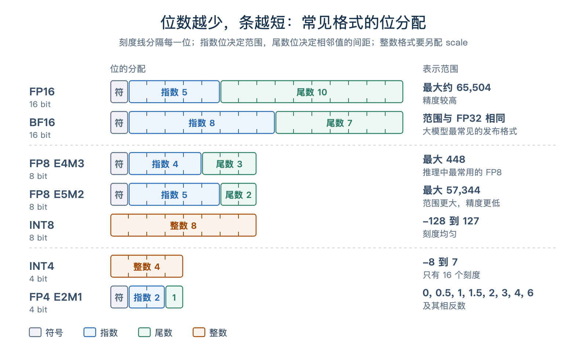
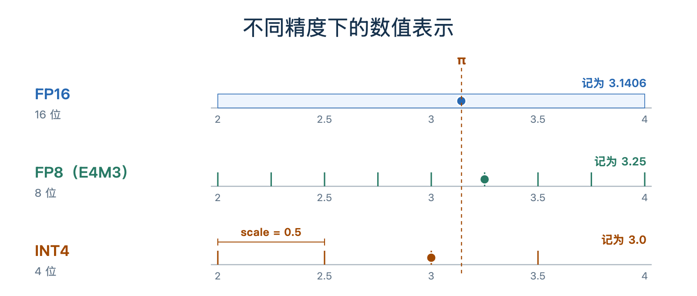
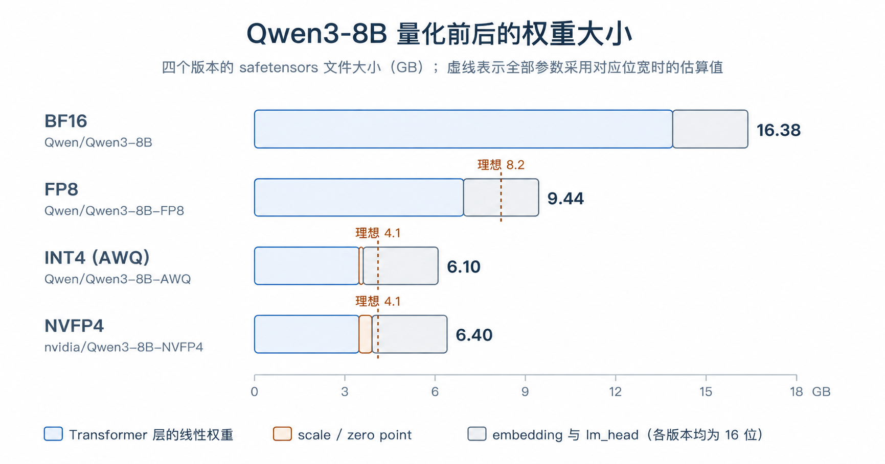
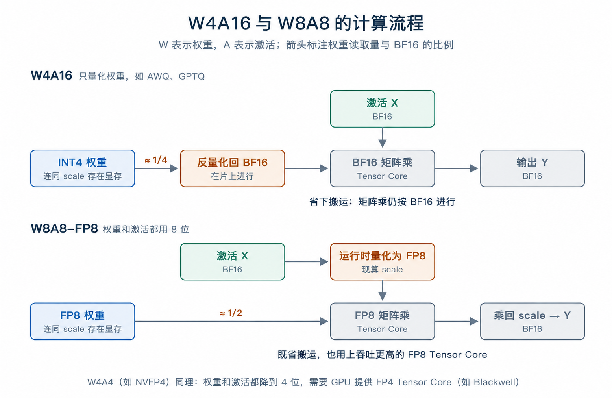
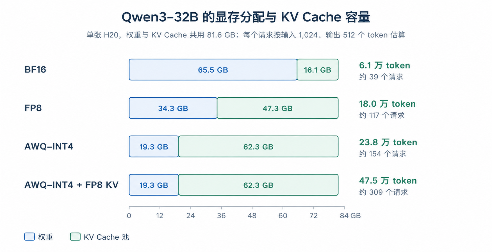
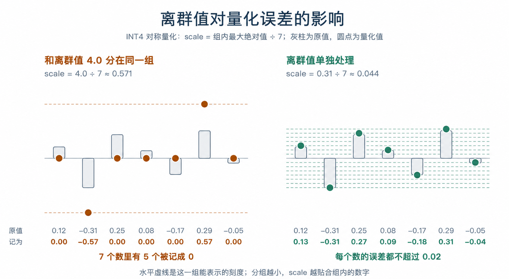

# 量化与低精度推理

```{contents} 本页目录
---
depth: 2
local: true
---
```

Attention Backend 已把 Q/K/V 的语义、KV Cache 地址和 GPU kernel 接起来。沿着这条计算链，还可以继续减少数据占用：把权重、激活或 KV Cache 换成更低精度的表示，降低存储与搬运成本；硬件和 kernel 支持时，也能提高矩阵乘吞吐。

本章从数值表示讲到计算路径，再用 Qwen 的公开数据讨论性能与质量。Prefill、Decode、Roofline 和 KV Cache 容量的基础定义沿用前文，Benchmark 的条件控制也不重复展开。这里要回答的是：量化改了哪些数据，省下了什么，又需要验证什么。

## 先确认量化了哪些数据

权重是固定的模型参数，激活是随输入变化的中间结果，KV Cache 保存各层跨生成步骤复用的 K/V。三者可以分别选择精度。量化通常保留模型结构，把数值映射到更少的可表示值，并保存重建数值所需的 scale 等信息。

方案名中的 W 指 weight，A 指 activation，数字表示位宽。W4A16 表示权重用 4 位、激活用 16 位；KV Cache 的精度需另看配置。这个记号描述所量化的计算路径，不能据此认定 embedding、Norm、router、LM Head 或所有中间结果都用了同样位宽。

| 方案 | 权重 / 激活 | 常见标签 | 计算路径与边界 |
|-|-|-|-|
| W4A16 | INT4 / BF16 或 FP16 | -AWQ、-GPTQ-Int4 | 只量化权重；典型 kernel 在片上反量化后用 16 位激活计算。精度仍取决于方法、校准、模型与任务。 |
| W8A8-FP8 | FP8 / FP8 | -FP8、-FP8-dynamic | 量化权重与激活；匹配 Ada、Hopper、Blackwell 等 GPU 的 FP8 Tensor Core 路径时，可加速矩阵乘。 |
| W8A8-INT8 | INT8 / INT8 | -W8A8 | 使用 INT8 矩阵乘与对应 scale，可用于部分不支持原生 FP8 的 GPU；仍需确认具体 kernel 支持。 |
| NVFP4 | FP4 / FP4，原生 W4A4 | -NVFP4 | Blackwell 支持原生路径；部分较早 GPU 可使用 W4A16 Marlin 路径，受版本、backend 与层形状约束。 |
| MXFP4 | FP4 / 视实现而定 | mxfp4 | 采用 microscaling。gpt-oss 的 MoE 专家权重使用它，不能由权重标签推断激活或 KV Cache 精度。 |
| FP8 KV Cache | 与 W/A 分开 | --kv-cache-dtype fp8_e4m3 | 降低缓存数据占用，需要 Attention Backend 支持相应布局、scale 与读写路径。 |

位宽越低，理论存储越小，但速度与质量没有统一排序。把 INT4 权重交给 W4A16 kernel，与直接执行 W8A8-FP8 矩阵乘，优化的环节并不相同。

## 低位宽会改变可表示值

浮点格式用符号、指数和尾数表示数值。指数位影响范围，尾数位影响相邻可表示值的间距；同一格式越远离 0，间距通常越大。BF16 与 FP16 都占 2 字节，但 BF16 保留更多指数位，FP16 保留更多尾数位。

图 1 对照了常见格式的位分配与范围。图中的 FP8 E4M3 最大值 448 对应常用有限值格式；具体 API 中的 E4M3 变体仍应核对。BF16 与 FP32 的指数范围相近，最大有限值并不完全相同。



整数格式的间距均匀。INT8 通常覆盖 −128 到 127，INT4 通常覆盖 −8 到 7；整数自身不能直接保存 0.3，需要用 scale 把整数范围映射到实际数值范围。下面保留原课程的 π 舍入示例，按不额外缩放、就近舍入理解。

| 格式 | 每个数占用 | 位模式数 | π 被记成 | 绝对误差 |
|-|-|-|-|-|
| FP32 | 32 位，4 字节 | 约 43 亿，即 2³² | 3.1415927 | 小于 0.0000001 |
| FP16 | 16 位，2 字节 | 65,536，即 2¹⁶ | 3.140625 | 约 0.001 |
| FP8 E4M3 | 8 位，1 字节 | 256，即 2⁸ | 3.25 | 约 0.11 |
| FP4 E2M1 | 4 位，半字节 | 16，即 2⁴ | 3 | 约 0.14 |

表中的位模式数只由位宽决定。正负零、NaN、无穷大等编码会影响“不同有限实数”的数量，因此不能把 256 个位模式直接称为 256 个不同有限值。E2M1 的非负数值为 0、0.5、1、1.5、2、3、4、6，并有对应负值。

## Scale 与分组决定舍入误差

不带 zero point 的整数量化，可将量化与反量化写成：

$$q=\operatorname{clip}\!\left(\operatorname{round}(x/s),q_{\min},q_{\max}\right),\qquad \hat{x}=qs$$

其中 s 是 scale，q 是保存的整数，clip 将结果限制在格式范围内。若 INT4 的 s=0.5，−8 到 7 对应 −4.0 到 3.5，相邻数值间隔 0.5。有 zero point 时，重建关系变为 $\hat{x}=(q-z)s$，不能忽略配置中的零点。

FP8、FP4 也常配 scale。实现先缩放数值，再转换到低精度浮点格式，计算时利用 scale 还原量级。Scale 通常由一组数共享，保存格式也可能分层；不能把 FP4、INT4 或不同 FP4 方案视作可直接互换的数据布局。

图 2 展示了 2 到 4 附近的可表示值：FP16 的间距为 1/512，FP8 E4M3 为 0.25，s=0.5 的 INT4 为 0.5。原课程按半开区间 [2,4) 计数，分别有 1,024、8、4 个刻度；图中还画出了右端点 4。π 在这些刻度上分别接近 3.1406、3.25 和 3.0。



分组缩小后，scale 能更贴近局部数值，但会多存元数据。Per-tensor、per-channel、per-token 描述共享范围；dynamic 表示运行时按当前数据计算，static 表示使用预先确定的 scale。这些维度需要分别确认，dynamic 并不自动等于某一种分组方式。

## Checkpoint 大小要算混合精度

如果一个 8B 模型的所有参数都使用同一位宽，BF16/FP16、FP8、INT4 的数据量分别约为 16 GB、8 GB、4 GB。这里 GB 为十进制字节；实际 checkpoint 常保留部分高精度参数，还要保存 scale、zero point 等信息。

Qwen3-8B 约有 8.19B 参数。下面是原课程记录的四个版本 safetensors 大小；2026 年 11 月 5 日读取的模型索引 metadata.total_size 与这些两位小数一致。该字段统计张量数据字节，文件头、配置文件等可能再带来少量开销。

| 版本 | Hugging Face 仓库 | 全部参数按位宽估算 | 实际大小 |
|-|-|-|-|
| BF16 | [Qwen/Qwen3-8B](https://huggingface.co/Qwen/Qwen3-8B) | 16.4 GB | 16.38 GB |
| FP8 | [Qwen/Qwen3-8B-FP8](https://huggingface.co/Qwen/Qwen3-8B-FP8) | 8.2 GB | 9.44 GB |
| INT4 AWQ | [Qwen/Qwen3-8B-AWQ](https://huggingface.co/Qwen/Qwen3-8B-AWQ) | 4.1 GB | 6.10 GB |
| NVFP4 | [nvidia/Qwen3-8B-NVFP4](https://huggingface.co/nvidia/Qwen3-8B-NVFP4) | 4.1 GB | 6.40 GB |

这些版本的 embedding 与 lm_head 保留 16 位，合计约 12.4 亿参数，占约 2.49 GB。Qwen3-8B 的配置未共享输入 embedding 与 LM Head，所以容量账要计入两份参数。AWQ 每 128 个权重共享 scale 与 zero point，附加约 0.14 GB；NVFP4 每 16 个权重配置一个 FP8 block scale，附加约 0.43 GB，此外还有高层级 scale 等信息。

图 3 拆分了线性层权重、高精度 embedding/LM Head 与量化元数据。INT4 checkpoint 达到 6.10 GB，并不意味着打包失败：保留高精度的层与分组元数据本来就不满足“所有参数半字节”的假设。



## 低精度收益取决于计算路径

前文的 Roofline 说明，小 batch Decode 中，一次权重读取只服务少量 token，容易受带宽限制。量化能降低这部分数据量，但反量化、激活量化、scale 处理以及其他算子仍会占用时间。总延迟是否下降，要看它们与省下的搬运成本如何抵消。

只为理解量级，可用 $t_{\mathrm{weight,estimate}}\approx B_{\mathrm{weight}}/\mathrm{BW}_{\mathrm{HBM}}$ 做估算。若把 checkpoint 大小近似为一次权重读取量，H20 的 HBM 带宽约取 4 TB/s，16.4 GB、9.4 GB、6.1 GB 分别对应约 4.1 ms、2.4 ms、1.5 ms。它们不是具体 Decode step 的严格下界：实际数据路径还受缓存、融合、重用、布局、带宽利用率与 KV 读取影响。

图 4 对比两条典型路径。W4A16 从显存读取打包 INT4 权重与 scale，在片上反量化，再与 BF16 激活做矩阵乘；高效融合 kernel 通常不会把完整 BF16 权重写回 HBM。W8A8-FP8 在匹配的硬件上直接使用 FP8 操作数，激活量化和 scale 处理可以与周围计算融合，输出及累加精度由具体 kernel 决定。



图中的约 1/4、1/2 指已量化权重元素相对 BF16 的数据量，不包含未量化层与元数据。INT4 即使文件更小，也可能慢于 FP8；W4A16 在 Prefill 中仍走 16 位矩阵乘，单靠权重压缩通常难以获得同等幅度的计算吞吐提升。

**Qwen3-8B 在 H20 上的公开测速解读：**[Qwen Speed Benchmark](https://qwen.readthedocs.io/en/latest/getting_started/speed_benchmark.html) 报告了单卡 H20 上不同量化格式的实测数据（保留相对 BF16 的加速倍数，仅代表该历史版本与测试条件）：

| 项目 | 条件 |
|-|-|
| 硬件 | 1 张 NVIDIA H20，96 GB |
| 软件 | SGLang 0.4.6.post1；PyTorch 2.6.0+cu124；Transformers 4.51.3；SGL-kernel 0.1.0；AWQ 使用 awq_marlin |
| 负载 | batch size=1，每次生成 2,048 个 token，输入长度从 1 到约 12.9 万 |
| 其他设置 | mem_fraction_static=0.85，context_length=140000，enable_mixed_chunk=True，skip_tokenizer_init=True；直接使用 input_ids |
| 指标 | 速度=（输入 token 数+生成 token 数）÷总耗时，单位 token/s；包含 Prefill 与生成阶段，不能直接当成纯 Decode 吞吐 |

| 输入长度 | BF16 | FP8 | AWQ-INT4 |
|-|-|-|-|
| 1 | 81.73 | 150.25（1.84×） | 144.11（1.76×） |
| 6,144 | 296.25 | 516.64（1.74×） | 477.89（1.61×） |
| 30,720 | 832.67 | 1,242.24（1.49×） | 1,075.91（1.29×） |
| 约 12.9 万 | 1,173.32 | 1,393.21（1.19×） | 1,198.06（1.02×） |

输入只有 1 个 token、输出 2,048 个 token 时，耗时主要来自逐步生成。BF16 的 81.73 token/s 可粗略折成平均每输出 token 约 12.2 ms，但这个倒数仍包含该测试的总耗时，不能当作隔离测出的单个 kernel 时间。FP8 与 AWQ-INT4 分别约快 1.84 倍、1.76 倍，说明在这组条件下，更小的 INT4 checkpoint 没有胜过 FP8。

输入变长后，FP8 的相对加速降到 1.19 倍，AWQ-INT4 降到 1.02 倍。长输入会增加 Prefill 与 Attention 的占比，长历史也会增加 KV 读取。这个趋势与权重读取收益被其他工作摊薄相符；只凭汇总表，还不能精确拆出各 kernel 的贡献，需要按前文 Benchmark 方法继续做阶段测量和 profiling。

## 省下权重空间可以扩大 KV 池

容量收益与单请求速度是两件事。多请求服务中，缩小权重可以把更多预算分给 KV Cache；有足够请求且 Scheduler、计算与延迟目标允许时，这才有机会形成更大的 batch，让一次权重读取服务更多 token。

直接代入第 3 章的原始 KV 容量公式，Qwen3-32B（64 层、8 个 KV heads、`head_dim=128`、BF16）每写入一个 token 占 $2\times64\times8\times128\times2=256\ \mathrm{KiB}$；一条输入 1,024、输出 512 的请求按 1,536 个缓存 token 上界预留，约占 384 MiB。

图 5 使用原课程的简化预算：H20 96 GB×0.85≈81.6 GB，先扣除权重，剩余全部分给 KV。它没有完整扣除运行时激活、workspace、CUDA Graph、对齐和其他保留空间，也不是 SGLang 的分配器模型；实际容量应读取启动日志中的 max_total_num_tokens。



| Qwen3-32B 方案 | 权重 | 简化 KV 预算 | 约容纳 token / 请求 |
|-|-|-|-|
| BF16 权重，BF16 KV | 65.5 GB | 16.1 GB | 6.1 万 / 39 |
| FP8 权重，BF16 KV | 34.3 GB | 47.3 GB | 18.0 万 / 117 |
| AWQ-INT4 权重，BF16 KV | 19.3 GB | 62.3 GB | 23.8 万 / 154 |
| AWQ-INT4 权重，FP8 KV | 19.3 GB | 62.3 GB | 47.5 万 / 309 |

请求数按每条占满 1,536 个 token 估算。图中的万 token 数为四舍五入，请求数向下取整，不能直接用舍入后的 token 数重新求整。FP8 KV 的元素数据占用是 BF16 的一半，scale 与辅助 buffer 仍要计入实际容量。

权重越接近显存预算上限，容量收益越明显。在同样的简化假设下，Qwen3-8B 从 BF16 换到 INT4，KV 可用空间由约 65.2 GB 变为 75.5 GB，只增加约 16%；Qwen3-32B 则从 16.1 GB 增到 62.3 GB。但更大的池只说明可以存下更多历史，不保证满足原来的 TTFT、ITL 或端到端延迟目标。

## 质量回归要覆盖困难任务

量化会带来舍入与截断误差。共享 scale 还可能受离群值影响：按组内最大绝对值确定 s 时，一个特别大的数会拉大间距，让许多较小数值被舍入到同一个位置。

图 6 使用 INT4 对称量化的示例，s=组内最大绝对值÷7。七个小数与 4.0 共组时，s≈0.571，五个被记为 0；把离群值单独处理后，小数组的 s≈0.044，图中各值误差不超过 0.02。这说明局部分组能够保留更多细节，不能据此认定所有量化算法都会单独存储离群值。



NVFP4 的 16 元素分组、FP8 的 128×128 block-wise 权重量化，以及 per-channel 或 per-token scale，都可以缩小不同数值共用范围，但元数据与 kernel 成本也不同。权重可以离线校准；激活随输入变化，更低位宽需要处理动态范围。量化后的 KV 又会被后续生成步骤读取，所以长上下文和长输出需要单独测试。

### 权重量化的公开评测

下面保留 [Qwen3-8B-AWQ](https://huggingface.co/Qwen/Qwen3-8B-AWQ) 与 [Qwen3-32B-AWQ](https://huggingface.co/Qwen/Qwen3-32B-AWQ) 模型页的部分结果。LiveBench 为 2024-11-25 版本；箭头表示 BF16→AWQ-INT4，括号表示分数差，不能混同于百分比变化。

| 模型与模式 | LiveBench | GPQA | MMLU-Redux | AIME24 |
|-|-|-|-|-|
| Qwen3-8B，思考 | 67.1→65.5（−1.6） | 62.0→59.0（−3.0） | 87.5→86.4（−1.1） | 76.0→71.3（−4.7） |
| Qwen3-8B，非思考 | 53.5→48.9（−4.6） | 39.3→35.9（−3.4） | 79.5→79.1（−0.4） | 未报告 |
| Qwen3-32B，思考 | 74.9→73.1（−1.8） | 68.4→69.0（+0.6） | 90.9→90.8（−0.1） | 81.4→79.4（−2.0） |
| Qwen3-32B，非思考 | 59.8→59.8（0） | 54.6→53.1（−1.5） | 85.7→85.6（−0.1） | 未报告 |

Qwen3-8B 的 MMLU-Redux 最多下降 1.1 分，思考模式 AIME24 却下降 4.7 分。不同任务的敏感度明显不同。这组结果里，8B 的降幅普遍大于 32B，但它只支持这些模型、方法与评测条件下的比较，不能推成所有小模型都更难量化。

Qwen3-32B 思考模式的 GPQA 增加了 0.6 分。题量、采样与生成过程会造成波动，应重复运行基线和量化版本，比较均值与波动范围；这一个升分结果不能证明量化提高了能力。

### KV 量化也会改变任务得分

[SGLang KV Cache 量化文档](https://docs.sglang.io/docs/advanced_features/quantized_kv_cache) 引用了 PR #10078（MLA）和 #12612（MHA）的初步评测。下面是其中 GPT-OSS-120B 的结果；只改 KV 精度的比较，仍需看各实验记录的完整设置。

| 评测集 | KV BF16 | KV FP8 E4M3 | KV FP4 E2M1 |
|-|-|-|-|
| GSM8K | 0.9161 | 0.9163 | 0.9152 |
| AIME25 | 0.7533 | 0.7667 | 0.3533 |
| GPQA Diamond | 0.5081 | 0.5434 | 0.3202 |

GSM8K 上 FP4 KV 与 BF16 相近，AIME25 却从 0.7533 降到 0.3533。相同文档中的 Qwen3-235B-A22B 与 DeepSeek-R1-0528，AIME25 分别从 0.7733 降到 0.6000、从 0.5067 降到 0.4000，相对降幅约两成。只测简单任务，容易漏掉困难推理任务上的明显回归。

部署评测应固定数据集版本、few-shot、prompt 模板、思考模式与采样参数，覆盖业务任务、困难任务、长上下文和长输出。报告量化收益时，把 TTFT、ITL、输出吞吐、显存容量与任务质量放在同一组条件下；均值、波动范围和失败样例都应保留。性能改善不能替代质量验收。

## 配置比模型名更可靠

模型名可以帮助定位 AWQ、FP8、NVFP4 等标签，真正的输入契约在 config.json 的 quantization_config、hf_quant_config.json 等配置中。除了位宽，还要看 group size、scale 格式、dynamic/static、排除模块，以及与 kernel 匹配的布局。

| 模型 | 配置要点 | 可以确认什么 |
|-|-|-|
| Qwen/Qwen3-8B-AWQ | bits: 4；group_size: 128；zero_point: true；quant_method: awq | AWQ INT4 权重，有零点；典型执行为 W4A16 |
| Qwen/Qwen3-8B-FP8 | fmt: e4m3；weight_block_size: [128,128]；activation_scheme: dynamic | Block-wise FP8 权重；激活在运行时量化 |
| nvidia/Qwen3-8B-NVFP4 | hf_quant_config.json：quant_algo: NVFP4；group_size: 16；kv_cache_quant_algo: FP8 | NVFP4 权重与 FP8 KV 量化信息；实际 KV 存储精度仍需核对启动参数、scale 加载和 backend |
| [openai/gpt-oss-120b](https://huggingface.co/openai/gpt-oss-120b) | quant_method: mxfp4；modules_to_not_convert 排除 self_attn、mlp.router、embed_tokens 与 lm_head | 主要量化 MoE 专家权重；没有模型名后缀也不代表 BF16 全精度 |

这里的模型配置在 2026 年 11 月 5 日核对。配置声明了格式和排除范围，能否按预期运行，还需确认引擎版本、GPU、backend、层形状及依赖版本。尤其不要把 checkpoint 中记录的 KV 量化信息直接当作运行时已启用对应缓存的证明。

## 在 SGLang 中加载与验收

预量化 checkpoint 通常直接指定路径，让 SGLang 读取配置选择方法；不要随手叠加一个不匹配的 --quantization 覆盖它。在课程所引用的 SGLang 提交中，AWQMarlinConfig.override_quantization_method 会先检查模型与 Marlin 兼容性，再决定是否选择 awq_marlin；显式指定 awq 还可能阻止这项自动切换。

下面保留原课程的三条命令。在线 --quantization fp8 用于从高精度模型进入 FP8 路径；--kv-cache-dtype 单独控制 KV Cache。它们是 SGLang 使用示例，不是 Mini-SGLang 的启动参数，也不保证任意 GPU 与任意 Attention Backend 都兼容。

```bash
# 预量化模型
python3 -m sglang.launch_server --model-path Qwen/Qwen3-8B-AWQ
# 在线量化为 FP8
python3 -m sglang.launch_server --model-path Qwen/Qwen3-8B --quantization fp8
# 权重不变，只把 KV Cache 设为 FP8
python3 -m sglang.launch_server --model-path Qwen/Qwen3-8B --kv-cache-dtype fp8_e4m3
```

加载成功后还要检查实际方法、kernel/backend、权重与 KV dtype、scale 来源，以及 max_total_num_tokens。FP8 KV 若未加载适合模型的 scale，部分路径会默认使用 1.0，可能影响质量；不能只看服务启动成功就完成验收。兼容条件以所安装版本的官方文档与启动日志为准。

NVFP4 尤其需要区分原生与回退路径。在 SGLang 提交 75878f27c88c2ffd296425d94226d0dc9bd42518 中，ModelOptFp4LinearMethod 的原生 dense backend 要求 Blackwell；源码为 SM80–SM90 提示 Marlin 选项，MoE 的 auto backend 也有特定 Marlin 分支。原文“较早 GPU 上退回 W4A16”据此应理解为有条件支持，不能扩展成所有旧卡自动兼容。

**与 Mini-SGLang 基线的实现分界：**在主干基线 `9a91cfa` 中，`python/minisgl/engine/engine.py` 将加载后的权重统一转为 `self.dtype` 并以相同浮点类型分配 KV 池，`layers/linear.py` 直接调用 `F.linear`，尚未包含 SGLang（核对提交 `75878f27c88c`，见 `layers/quantization/`）中的打包权重加载、Marlin/FP4 反量化算子分派或独立 FP8 KV scale 管理。把张量简单 `cast` 成低精度浮点，不等同于完成了量化推理接入（本章引用的 AWQ、GPTQ、MX 格式论文与课程来源均收录于文末〈参考〉）。

<callout emoji="✅">
**本章核心自查：**能解释为何 INT4 AWQ（W4A16）文件比 FP8（W8A8）更小，但在 H20 实测中吞吐未必高于原生 FP8 Tensor Core 路径；并能结合困难推理集（如 AIME）说明为何不能只靠 GSM8K 或服务成功启动来验收 KV Cache 量化。
</callout>

量化压缩了单次执行的存储、带宽或算力成本，但也引入了不可忽视的数值近似。下一章将“为何相同请求输出不同”与“引擎迁移及量化如何逐层对齐验收”合在一起建立完整校验方法。
