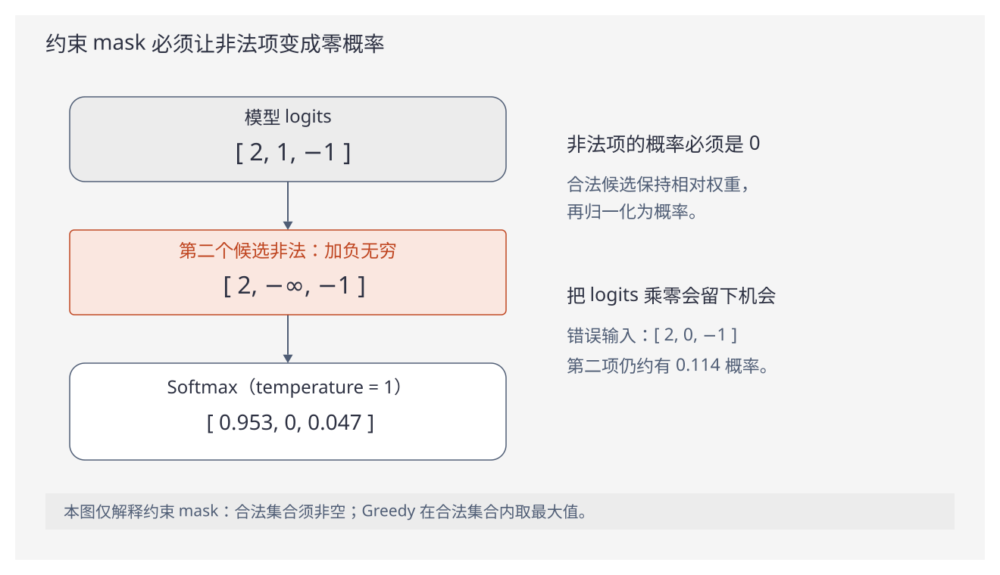
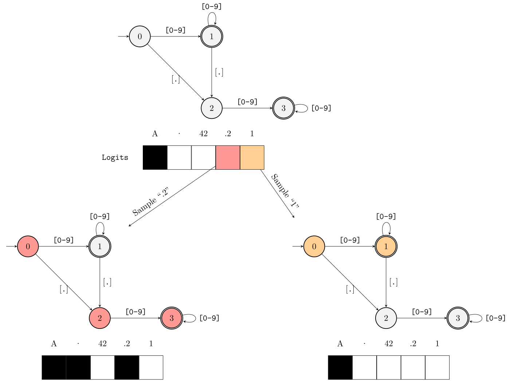
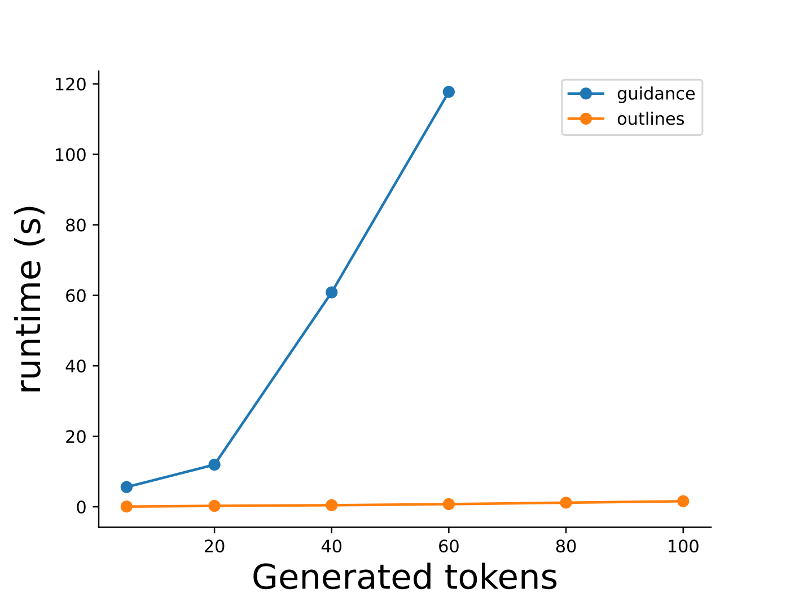
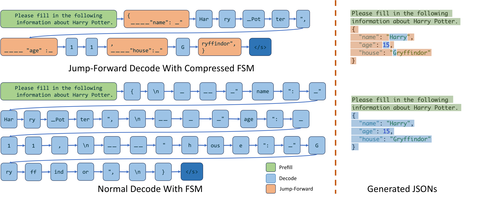
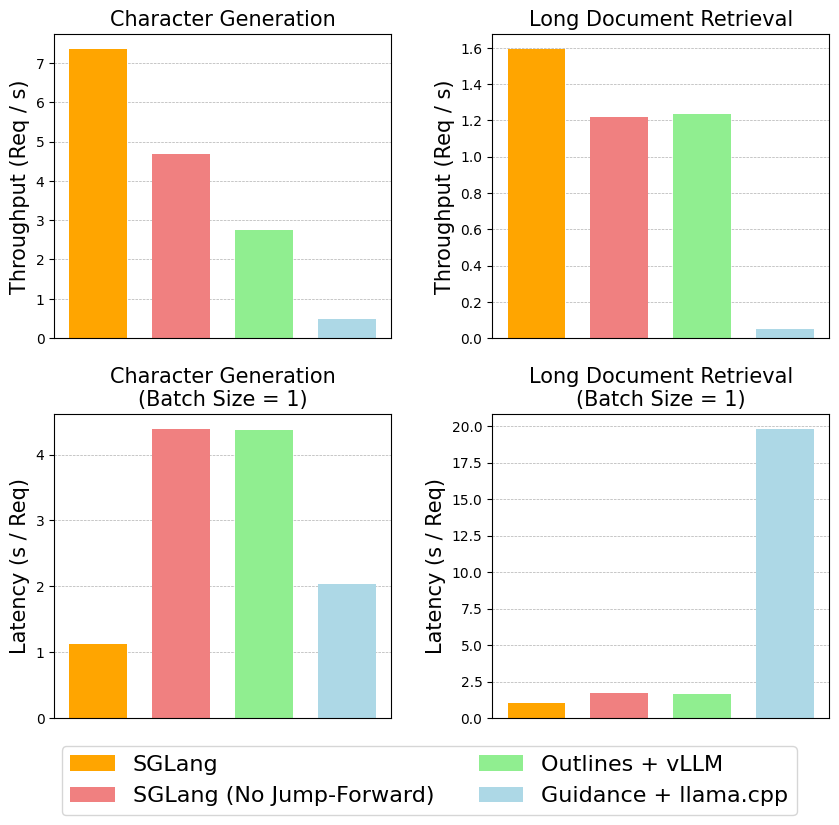

# 约束解码：从 FSM 索引、Jump Forward 到 XGrammar

```{contents} 本页目录
---
depth: 2
local: true
---
```

自回归推理走到采样时，模型给出 logits，采样器据此选择下一个 token。真实应用还常常多一道要求：输出必须是合法的 JSON、SQL、Python 代码、IP 地址，或满足某个正则表达式。模型回答的是“下一个 token 更可能是什么”，约束系统还要回答“哪些 token 在当前语法位置合法”。

最直接的实现会在每个 Decode step 遍历整个词表，把每个 token 拼到已生成文本后，再判断新字符串是否仍可能满足约束。词表有数万个 token，这次扫描会跟着每个输出 token 重复。Outlines 论文给出的关键改造，是把正则匹配重写成可暂停、可继续的状态机遍历，再提前建立“状态到合法 token 集合”的索引。热路径由逐步扫描词表变成按状态查表。

## 结构约束最终会变成采样分布上的掩码

设当前 token 序列为 $S_t=(s_1,\ldots,s_t)$，词表为 $\mathcal{V}$，大小为 $N$。模型根据当前序列产生下一 token 的分数向量：

$$z=\operatorname{LLM}(S_t,\theta),\qquad z\in\mathbb R^{N}$$

约束解码在 logits 与采样之间加入布尔掩码 $m_i\in\{0,1\}$。对非法候选加负无穷，再对合法候选做 softmax；以下假设 temperature $\tau>0$，且合法集合非空。

$$\tilde z_i=\begin{cases}z_i,&m_i=1\\-\infty,&m_i=0\end{cases},\qquad p_i=\frac{\exp(\tilde z_i/\tau)}{\sum_j\exp(\tilde z_j/\tau)},\qquad s_{t+1}\sim\operatorname{Categorical}(p)$$

若输入已经是概率，也可以把非法项乘成零，再重新归一化。对 logits 直接乘零会把非法项变成 0 分，softmax 后仍可能被选中，尤其当合法项都是负数时。Greedy 则直接在合法集合内取最大 logit。合法集合为空属于约束无法继续的终态，需要显式报错或按策略回退；只在可结束状态允许 EOS，才能避免生成到接受前缀就过早结束。

| 层次 | 负责回答 | 不能保证 |
|-|-|-|
| 语言模型 | 在当前上下文下，哪个 token 更可能 | 输出一定满足外部格式 |
| 约束状态机 | 在当前语法状态下，哪些 token 合法 | 合法内容一定真实或语义正确 |
| 受约束采样 | 在合法集合内按模型分数选择 | 模型知识错误、提示词歧义和语义遗漏 |



图：三项 logits 为 [2,1,−1]，中间项非法。把该项设为 −∞ 后，softmax 得到约 [0.953,0,0.047]；若误乘零，非法项仍约有 0.114 的概率。图只画约束 mask 的数学语义，未包含 Top-k、Top-p 与具体采样 Kernel。

## 朴素实现把词表扫描留在最热的循环里

约束依赖已经生成的前缀，因此合法 token 集合会随每一步变化。朴素做法对词表中的每个 token 执行一次局部匹配：把 token 对应的字符串接到当前前缀后，判断它是否还能延伸成合法结果。若词表大小为 $N$，仅构造掩码就有 $\mathcal{O}(N)$ 成本。

更慢的实现还会从生成文本开头重新执行部分正则匹配或语法解析。这样一来，单步成本既包含全词表扫描，也包含随输出长度增长的重复解析。模型前向已经算出了 $N$ 个 logits，约束层又在 CPU 上逐项回答合法性，容易把本来很快的小模型 Decode 拖进解释器开销。

优化目标由此变得具体：保留上一轮匹配到的位置，让约束状态能够从当前 token 继续；再把词表与状态机之间不会随请求改变的关系移到离线预处理。

## FSM 让正则匹配可以暂停后继续

正则表达式可以转成有限自动机：

$$M=(Q,\Sigma,\delta,q_0,F)$$

$Q$ 是有限状态集合，$\Sigma$ 是字符表，$\delta:Q\times\Sigma\rightarrow Q$ 是状态转移，$q_0$ 是初始状态，$F$ 是接受状态集合。模型词表中的每个 token 对应一个字符串，这个字符串可能跨过自动机中的多条字符边。

运行时不必反复把整个输出送回正则引擎。它只需保存上一 token 结束时到达的 FSM 状态。新 token 到来后，从这个状态继续沿 token 字符串前进，再把终点保存给下一轮。

**浮点数正则的状态推进示例：**论文以简化正则 `([0-9]*)?\.?[0-9]*` 与候选词表 `{A, ., 42, .2, 1}` 演示状态转移——字母 `A` 无法沿任何合法边前进，应直接屏蔽（注：该正则仅用于教学演示，允许空串与单独小数点，不可直接用作生产浮点数校验器）。

若采样 `".2"`，状态机直接走到状态 3，下一轮只允许继续数字的 token。若先采样 `"1"`，状态停在整数部分，下一轮既可以继续数字，也可以进入小数点分支。一个 token 可能包含多个字符，状态更新必须沿它的完整字符串走完。



*图：浮点数正则的 FSM，以及采样不同 token 后的状态与 logits mask。来源：论文图 1。*

## 词表索引把合法性判断移到请求之前

只保存 FSM 状态还不够。如果每一轮仍遍历全部词表，$\mathcal{O}(N)$ 的瓶颈依旧存在。Outlines 在生成前遍历一次模型词表，并从每个可行 FSM 状态尝试消费每个 token 字符串。成功路径会记录起点、经过的状态和终点。

预处理最终构造一个映射：

$$\sigma:Q\rightarrow\mathcal{P}(\mathcal{V})$$

$\sigma(q)$ 保存从状态 q 出发，消费完整 token 后仍可延伸到合法完整字符串的候选集合。结束状态不必已经接受整串；还要排除无法再到达接受态的死状态。运行时查询当前候选集合，并记录选中 token 对应的终点，下一轮从那里继续。

### 索引必须覆盖 token 的所有可行起点

token 字符串不一定从正则的初始状态开始匹配。生成已经走到表达式中间时，同一个 token 可能从另一个状态进入并跨过多条边。建索引时不能只从 $q_0$ 模拟词表，而要从所有能够读取 token 首字符的状态出发，记录每条完整可接受路径。

运行时还需要知道采样 token 后落在哪个状态，因此实际索引不只是“允许或禁止”的布尔表，也要保留状态转移结果。一次查询同时回答两个问题：哪些 token 可以采样；选中某个 token 后，下一轮从哪个状态继续。

上面的字符模型是教学抽象。真实 tokenizer 的 token 可能对应字节片段、空白标记或不完整 UTF-8 序列；约束实现必须使用与 tokenizer 一致的解码表示，并保留必要的增量状态。不能把每个 token 都当成一个能独立解码的 Unicode 字符。嵌套结构转成 CFG 后，还需要解析栈，有限状态索引本身不足以处理任意递归。

### 平均常数时间描述的是索引查询

用哈希表保存 $\sigma$ 后，论文把运行时查找合法 token 集合的平均成本记为 $\mathcal{O}(1)$。这项结论针对从当前 FSM 状态取得预计算候选集合，不能理解成整次约束解码没有其他成本。模型前向、logit mask 应用、采样、状态更新，以及把候选集合放到设备上的操作仍然存在。

| 阶段 | 主要工作 | 成本落点 |
|-|-|-|
| 约束编译与索引 | 遍历状态和词表，记录可接受 token 与终点状态 | 请求前一次性付出，可缓存复用 |
| 每个 Decode step | 按当前状态查询候选集合并更新状态 | 哈希查询平均为常数时间 |
| 模型与采样 | 计算 logits、应用 mask、归一化并抽样 | 仍受词表表示和设备实现影响 |

## 格式约束不会替模型补知识

论文用 GPT-2 Medium 展示了三类正则约束：限定回答为 yes、no、never 或 always；限定年份为 `19[0-9]{2}`；限定输出为 IPv4 地址。约束后的文本都满足指定形式，但示例把 Noam Chomsky 的出生年份生成成 1952，也把 Google DNS 地址生成成 `2.2.6.1`。两者格式合法，事实错误。

这组例子恰好划清 guided generation 的能力边界。约束可以保证可解析性、字段结构和局部语法，也能把候选空间限制在业务允许范围内；它不会校验事实，也不会保证满足正则的值具有业务语义。若字段必须来自数据库主键、有效枚举或交叉字段关系，还需要检索、语义校验或程序逻辑接管。

## CFG 扩展需要同时跟踪词法状态与解析栈

正则适合有限状态约束，嵌套括号、递归结构和编程语言语法通常需要上下文无关文法。论文把同一思路扩展到由 pushdown automaton 驱动的 LALR(1) 解析器：

$$M=(Q,\Sigma,\Gamma,\delta,q_0,F)$$

相比 FSM，这里多了栈字母表 $\Gamma$。当前合法 token 不再只由一个状态决定，还取决于解析栈、可能的终结符，以及当前终结符内部尚未完成的字符匹配。

**跨词法单元边界的切分挑战：**设词表 token 依次为 `"d"`、`"ef"`、`" f"`、`"oo("`、`"):"`、`" "` 和 `"pass"`，拼起来恰好是合法 Python 代码 `def foo(): pass`。读到 `def f` 时，传统词法分析器容易过早把 `f` 归约为完整标识符 `NAME`，而后续 token 既可能把它继续扩成 `foo(`，也可能直接跟运算符结束标识符。

因此扫描器要保留多个可能的终结符和各自的 FSM 状态，解析器还要保留 PDA 状态与栈。对 LALR(1) 的 REDUCE 操作，只看栈顶不够，索引需要按有效栈前缀查询。论文建议用 trie 保存这类解析器配置，使运行时仍能沿当前配置直接取得合法词表 token。

## 索引用内存换掉热路径中的重复计算

这套设计把大量匹配工作提前到约束编译阶段，代价是索引内存与构建时间。论文对一个稍作扩展的 Python grammar 做测试，即使索引没有去掉未使用和重复的 parser/FSM 配置，大小仍约为 50 MB。所用 DFA 也没有最小化，意味着还有进一步压缩空间；若状态表示成为瓶颈，也可以考虑 NFA 等形式。

性能对比使用 GPT-2，Guidance 在每一步从已生成文本开头做部分正则匹配，并扫描大小为 50,257 的词表；Outlines 复用预计算索引。随着最大生成 token 数增长，Guidance 的耗时快速上升，Outlines 曲线增长缓慢。



*图：随着最大生成 token 数增加，Guidance 与 Outlines 的运行时间变化。来源：论文第 3.2 节。*

<callout emoji="📐">
**证据边界：**论文中每个 `max_tokens` 点仅跑了一次 `timeit` 循环，足以直观展示 $\mathcal O(1)$ 查表与每步全词表重扫的渐近复杂度分叉，但不宜当作生产引擎的稳态端到端排名。
</callout>

## Compressed FSM 让确定路径一次跨过多个 token

本章前面的 FSM 索引已经说明普通约束解码的边界：索引可以快速给出合法 token 集合，却不会减少确定路径上的模型调用。若 JSON 模板已经决定下一段只能是 `{"summary": "`，模型在这些字符之间没有真正的选择，逐 token 前向只是在反复确认语法已经决定的结果。

Compressed FSM 直接处理这段剩余开销：有分支时继续逐 token 约束解码，只有唯一合法后继时，把连续确定文本合并成一次 extend，直接前进到下一个分支点。接下来只需回答两个实现问题：怎样压缩这条路径，以及怎样让跳转后的 token 与已有上下文重新对齐。

### Jump Forward 把连续唯一边压成一次前向

Compressed FSM 从字符级状态机出发。若一个状态只有一个后继，并且边上只有一个可接受字符串，这条边就是 singular transition edge。连续的唯一边会并入前一条边，形成 compressed edge。运行时遇到这条边时，可以把整段确定文本一次加入，而不必让模型逐 token 选择。

论文把这个过程称为 Jump Forward。下图上半部分沿压缩边跨过 JSON 中的固定字段，只在姓名、年龄和学院等真正需要模型决定的位置 Decode；下半部分的普通 FSM 对固定标点和字段名也逐 token 执行。



在 SGLang 的执行链里，Jump Forward 可以结束当前请求，再把追加了确定字符串的新请求送回队列。这个动作不会重算前面的全部 token：RadixAttention 会命中原请求已有的前缀 K/V，efficient extend 只处理新加入的确定片段，执行到下一个分支点后再恢复受约束 Decode。Compressed FSM 负责证明“接下来只有这一条路”，RadixAttention 负责让重新入队后的请求延续已有计算。

### 字符串路径必须重新对齐 tokenizer

FSM 操作字符或字符串，模型消费 token，两者并非一一对应。把压缩边随意切成 token 可能产生训练中从未出现的分词方式。SGLang 会用模型原本的 tokenizer，把已有文本与新跳过的文本一起重新分词，让后续 Decode 回到模型熟悉的 token 边界。

一个典型故障发生在 JSON 字符串结尾。模型输出 `"Hello"` 时，tokenizer 可能更偏好把结尾引号与后续逗号合成一个 `",` token，而不是先生成单独的 `"`。如果正则只写成 `"[\w\d\s]*"`，没有包含后面的逗号，那么模型偏好的 `",` 会被禁止，生成过程可能无法在预期边界结束。

Jump Forward 也不能把压缩字符串随意切成 token 后接到旧序列上。不同切分会改变后续 logit 分布。实现因此先追加字符串，再用原 tokenizer 对完整文本重新分词。专门测试中，这项重分词带来的计算开销约为 4%。

Schema 也应尽量编译成一个覆盖完整输出的正则，少用多段正则拼接。完整约束让 FSM 与模型同时看见后续标点和字段边界，能减少 Decode 与 Prefill 交界处的歧义。

这种加速也有概率语义上的边界。若不同候选字符串对应多条 token 路径，直接跳过某些固定片段可能扭曲候选项概率。准确计算需要汇总通向同一选择的全部 token 序列概率，成本更高。论文给出的实用缓解方式是把候选项或正则写入 Prefill prompt，但明确把严格解决概率失真留作后续工作。

### 专门测试隔离了 JSON 解码的收益

这组测试只观察结构化解码，包含两个任务：根据短提示生成角色 JSON，以及从长文档中抽取城市信息并输出 JSON。模型为 Llama-7B，硬件为 24 GB NVIDIA A10；对比版本包括 vLLM 0.2.7、Guidance 0.1.0、Outlines 0.2.5 和 llama.cpp 0.2.38 的 Python binding。吞吐使用各系统可支持的最大 batch size，延迟使用 batch size 1。

在这两个任务和这组旧版本基线上，Jump Forward 最多把延迟降低到原来的二分之一，并把吞吐提高到 2.5 倍。角色生成任务中，关闭 Jump Forward 的 SGLang 仍比 Outlines 加 vLLM 有更高吞吐，页面将其归因于 Outlines 可能存在的额外开销，因而不宜把全部差距都算到 Compressed FSM 上。

两组数字的分母不同：前文 SGLang 总览中论文消融的 1.6 倍，对比同一 SGLang 路径启用与关闭 Compressed FSM；这里最高 2.5 倍吞吐和 2 倍延迟收益，来自专门 JSON 任务与其他系统的比较。它们验证不同问题，不能互相替代。



*图：角色生成与长文档抽取任务中的吞吐和延迟。来源：LMSYS Compressed FSM 技术博客。*

发布时，这项能力已经与 Boson.ai 连续测试两周并准备进入生产用例；另有用户把它与 LLaVA 结合，从图像中抽取结构化信息。这些案例说明约束解码不只服务纯文本 JSON，也能接在多模态输入之后。它们属于早期用例记录，不等同于大规模生产统计。

## 现代生产演进：XGrammar 上下文拆分缓存与 GPU Bitmask

Outlines 与早期正则 Jump Forward 奠定了状态机索引与确定边跳转的基础，但在生产环境服务复杂 JSON Schema、函数调用（Tool Call）或完整编程语言 CFG 时，传统下推自动机（PDA）遇到两个硬瓶颈：一是合法 token 同时依赖当前状态与运行期解析栈，若把全部栈配置离线穷举建表会导致内存爆炸，若退回运行时全词表检查又会卡住 CPU；二是十余万词表的布尔掩码如果在每步生成大张量拷贝到 GPU，PCIe 与内核开销不可忽视。

当前 SGLang 默认集成的 **XGrammar**（以及同类高性能引擎 `llguidance`）通过三项协同设计把单步约束开销压到微秒级：

| 核心机制 | 解决的问题与运行方式 |
|-|-|
| 上下文无关 / 相关 token 拆分 | 对任意 PDA 状态，绝大多数词表 token（例如字符串字面量内部的普通字符、数字片段）是否合法只取决于当前局部自动机状态，与外层括号嵌套栈无关；XGrammar 在编译期为这部分 **Context-Independent Tokens** 预生成紧凑的自适应位集合缓存，运行时仅对极少数跨越语法归约边界的 **Context-Dependent Tokens** 动态查验解析栈，把单步 CPU 掩码生成缩减百倍。 |
| 字节级 BPE 自动机与确定性内联 | 直接把词表按原始字节序列组织成前缀树并与字符/字节状态机求交，天然兼容多字节 UTF-8 跨 token 切分；同时内联单分支语法片段，减少运行期冗余栈操作。 |
| 紧凑 `int32` Bitmask 与异步重叠 | 将长度为 $V$ 的合法掩码按每 32 个词表位打包成一个 `int32` 整数（例如 $V=128{,}256$ 时每条请求仅需约 16 KiB），在上一轮 GPU forward 执行期间由后台 CPU 线程提前算好下一轮位掩码，异步 H2D 拷入固定缓冲后，由专用 GPU kernel 按位展开并原地把非法 logits 置为 $-\infty$。 |

<callout emoji="✅">
**本章核心自查：**能说清为何对非法候选不能把 logits 乘零而必须置为 $-\infty$，解释 Jump Forward 后为何必须用原 tokenizer 重新分词，并说明 XGrammar 拆分上下文无关/相关 token 解决了 PDA 缓存的什么瓶颈。
</callout>

离线词表索引、确定路径 Jump Forward 与 XGrammar 位掩码把语法约束开销移出了热路径。但在存在多个合法分支的开放文本段，模型仍需逐 token 采样；下一章转向投机解码，看如何对尚未确定的候选树批量并行验证。
