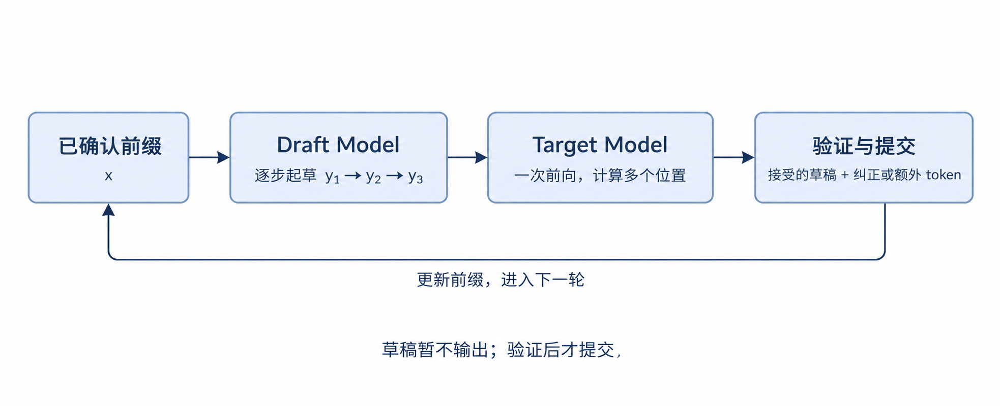
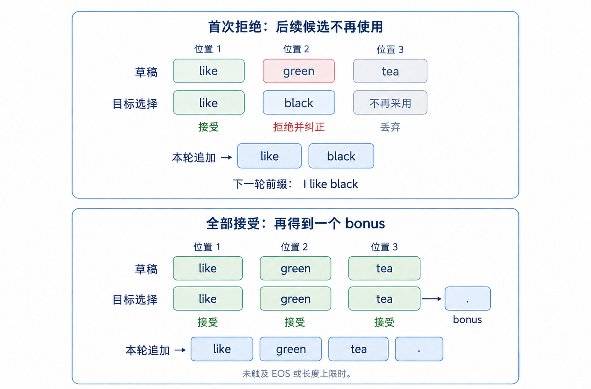

# 投机解码：从独立草稿、EAGLE/MTP 到树形验证

```{contents} 本页目录
---
depth: 2
local: true
---
```

约束解码只能在语法唯一确定的片段跳过前向；遇到真正需要模型做语义选择的开放文本时，自回归生成依然受制于逐 token 串行与小 batch 权重带宽瓶颈。投机解码（Speculative Decoding）利用目标模型单次前向多算几个候选位置几乎不增加权重读取耗时的特性，遵循“低成本起草 → 批量并行验证 → 无损分布提交”三步推进多 token 生成。

本章先以独立小模型和单条线性候选链推导精确恢复目标分布的接受与残差校正公式，再展开现代推理引擎主流采用的轻量化起草架构（EAGLE / EAGLE-3 与原生多 token 预测头 MTP）及树形注意力掩码（Tree Attention）批量验证机制。

## 草稿先给出可验证的输入

设已确认前缀为 $x$，本轮起草长度为 $k$。草稿模型先从 $x$ 生成 $y_1$，再从 $x,y_1$ 生成 $y_2$，直到得到 $y_1,\ldots,y_k$。基础版本的草稿自身仍按顺序生成，只是每步通常更便宜。候选暂存于验证输入中，尚不能作为正式输出发送。

候选已经给定后，目标模型可以像 Prefill 一样，在一次因果前向中计算多个位置。低并发 Decode 常有权重搬运和小矩阵利用率的限制，多位置验证有机会分摊这些成本。目标仍要处理候选，草稿也增加计算和显存占用，因此总计算量可能上升；加速依赖整轮成本足够低、连续接受的候选足够多。

| 阶段 | 工作 | 产物 |
|-|-|-|
| 起草 | 沿已确认前缀逐步提出候选。 | 候选 token；随机路径还需要实际草稿分布。 |
| 目标验证 | 批量计算对应位置的预测，判断连续接受长度。 | 接受前缀，以及纠正 token 或 bonus token。 |
| 提交 | 检查停止条件，更新正式输出和两侧状态。 | 下一轮使用的已确认前缀。 |

整轮始终围绕“先起草、再验证、最后提交”推进。草稿和目标共同使用确认后的前缀，不能让未验证内容直接进入客户端输出。



## 预测行对应候选之前的前缀

三个候选需要检查三行预测；全部接受后，还能利用完整草稿之后的预测行选择一个额外 token。各行的条件前缀如下：

| 目标分布 | 条件前缀 | 用途 |
|-|-|-|
| $p_1=p(\cdot\mid x)$ | 已确认的 $x$ | 验证 $y_1$ |
| $p_2=p(\cdot\mid x,y_1)$ | $x$ 加第一个候选 | 验证 $y_2$ |
| $p_3=p(\cdot\mid x,y_1,y_2)$ | $x$ 加前两个候选 | 验证 $y_3$ |
| $p_4=p(\cdot\mid x,y_1,y_2,y_3)$ | $x$ 加全部候选 | 全部接受后选择 bonus token |

因果掩码保证每行只依赖它之前的候选。第二行能否用于正式输出，仍取决于 $y_1$ 是否被接受；若 $y_2$ 被拒绝，第三行虽然已经计算出来，也不能再用于确认旧草稿。

用不带持久 KV Cache 的教学接口说明下标：假设 `prefix` 非空，候选数 `k` 至少为 1；`target(sequence)` 返回每个输入位置之后的 logits，形状为 `[sequence_length, vocab_size]`。已确认前缀长度为 `L`，则从第 `L-1` 行开始取 `k+1` 行：

```python
L = len(prefix)
k = len(proposals)
logits = target(prefix + proposals)
verify_logits = logits[L - 1 : L + k]
```

这段参考代码重新计算完整前缀，只用于说明位置关系。复用缓存时，一种常见安排是让目标 KV 暂时少最后一个已确认 token，再把这个 token 与 `k` 个候选一起送入验证，得到 `k+1` 行。如果 KV 已覆盖整个前缀且第一行预测已保存，也可以只处理后续候选。无论采用哪种安排，验证 $y_i$ 都要读取“消费 $y_i$ 之前”的预测。

## 贪心验证只保留连续一致的部分

目标采用贪心解码时，候选等于目标在对应前缀上的 argmax 就接受。首次不一致时，提交目标选择的纠正 token，并结束本轮。比较不能越过被拒绝的位置。

例如已确认前缀为 `I`，草稿提出 `like → green → tea`。以下用单词代指 token，不代表真实 tokenizer 的切分。目标在 `I` 后选择 `like`，接受第一个候选；在 `I like` 后选择 `black`，则拒绝 `green`。本轮只追加 `like black`，下一轮从 `I like black` 继续。

旧草稿 `tea` 的预测以 `I like green` 为条件，这个前缀已经失效。即使它碰巧与新前缀下的某个结果相同，也不能跳过首次拒绝继续计入接受长度。若整段草稿都接受且尚未停止，最后一行则提供一个 bonus token。



在目标数值计算和并列最大值处理规则一致的条件下，每次提交的都是目标逐步贪心解码本来会选择的 token。不同 kernel 或批次形状带来的数值差异仍需测试，尤其要检查分数接近或并列的情况。

## 随机验证用正残差恢复目标分布

随机采样要保持目标分布。设同一条件前缀下，目标分布为 $p$，草稿分布为 $q$，二者定义在含义一致的 token ID 上。词表大小相同还不够，ID 对应的 token 含义也必须兼容。从 $q$ 抽到候选 $y$ 后，按以下概率接受：

$$\alpha(y)=\min\left(1,\frac{p(y)}{q(y)}\right)$$

候选确实从 $q$ 抽出，因此被检查的 $y$ 满足 $q(y)>0$。首次拒绝后，丢弃余下候选，从归一化的正残差中抽取纠正 token：

$$r(v)=\frac{[p(v)-q(v)]_+}{\sum_u[p(u)-q(u)]_+},\qquad[z]_+=\max(z,0)$$

### 接受与纠正各补一部分概率

候选 $v$ 直接通过接受分支的概率为 $q(v)\alpha(v)=\min(p(v),q(v))$。总拒绝概率则为：

$$Z=1-\sum_u\min(p(u),q(u))=\sum_u[p(u)-q(u)]_+$$

拒绝分支给 $v$ 增加 $Zr(v)=[p(v)-q(v)]_+$，因此最终概率为：

$$\Pr(\mathrm{output}=v)=\min(p(v),q(v))+[p(v)-q(v)]_+=p(v)$$

当 $p=q$ 时，所有候选都接受，拒绝分支不可达，不需要归一化全零残差。实际实现还要检查有限精度下的概率有效性。多步验证在每个有效条件前缀上重复这一规则，才能保持整个目标序列分布；首次拒绝后的旧预测行不再参与提交。

### 用两候选算例检查概率校正

设 $p=[0.4,0.6]$、$q=[0.8,0.2]$，两个候选分别为 A、B。草稿以 0.8 的概率提出 A，接受概率为 0.5，直接贡献 0.4；以 0.2 的概率提出 B 时全部接受，直接贡献 0.2。剩余 0.4 进入拒绝分支，正残差为 `[0, 0.4]`，因此纠正只能选择 B，最终回到 `[0.4, 0.6]`。

![p=[0.4,0.6]、q=[0.8,0.2]：接受分支和正残差校正共同恢复目标分布。来源：Datawhale《Zero to SGLang》第 10 章图 3，CC BY-NC-SA 4.0。](https://feishu.cn/file/P4rObmt2YoXRfixZo02mP1BuyZg)

如果拒绝后直接从 $p$ 重抽，A 会额外得到 $0.4\times0.4=0.16$ 的概率，最终变成 `[0.56, 0.44]`，已经偏离目标。正残差校正负责补齐草稿不足的部分，不能随意换成普通目标采样。

温度、Top-k、Top-p 用来形成实际采样分布。接受比率和正残差必须使用处理后、已归一化的 $p$ 与 $q$；Top-k 的参数与草稿长度 $k$ 是不同概念。只保存草稿选中 token 的概率足以算它的接受率，却不足以构造拒绝位置上的完整残差分布，还需要保留或重建相应 $q(v)$。

贪心路径保持条件一致时的贪心序列；随机路径保持目标采样分布。两种路径都在首次拒绝处停止。随机验证改变了随机数的使用过程，因此相同 seed 不保证逐 token 输出与普通采样完全相同。

## 正式输出与缓存提交必须对齐

设本轮起草 $k$ 个候选，连续接受 $a$ 个。未触及停止条件时，本轮提交 $a+1$ 个 token：发生拒绝时加一个纠正 token；全部接受时加一个 bonus token，最多提交 $k+1$ 个。随机路径的 bonus 从最后一行目标分布采样，贪心路径取该行 argmax。

停止条件只看正式提交结果。草稿 EOS 被拒绝不会使请求结束；被接受的 EOS、纠正或 bonus 产生的 EOS，以及输出长度上限，都应立即终止提交，不能把后续候选继续发给用户。

| 对象 | 一轮结束后需要保持的状态 |
|-|-|
| 正式 token 序列 | 只追加连续接受前缀与允许提交的纠正或 bonus，受 EOS 和额度约束。 |
| 目标 KV | 保留已确认且实际计算过的前缀，撤销被拒绝位置及后续候选的有效性。 |
| 草稿 KV | 按草稿自身进度恢复到确认路径，并补算所缺内容；不能直接复制目标模型的 K/V。 |
| 物理页 | 只回收不再使用的页；同一尾页仍可能包含有效 token。读取范围必须跟随有效长度。 |

在 `I like black` 的例子里，目标可保留 `I like` 的 KV，旧 `green tea` 的 KV 已无效。刚选出的 `black` 尚未经过自己的前向，不能拿 `green` 的 KV 顶替。全接受后的 bonus 同样通常还没有自己的 KV，与前文“输出 token 数和已写 KV 数不同”的计数规则一致。

两侧模型的缓存推进速度可能不同。草稿逐步提出最后一个候选时，未必已经消费过它；目标批量验证则可能已写入全部候选。提交逻辑应分别记录两侧的有效长度与待计算后缀，不能只把两个长度变量改成同一个值就认为恢复完成。

## 收益按每个有效输出的成本计算

起草更长不一定更快。整轮耗时应包含起草、目标验证、接受判定和状态整理，而有效进展只计算正式提交的 token。跨多轮统计时，应使用总耗时除以总提交数：

$$T_{\mathrm{token,spec}}\approx\frac{\sum_r T_r}{\sum_r m_r}\approx\frac{\mathbb E[T_{\mathrm{round}}]}{\mathbb E[m]}$$

| 普通 Decode 每 token | 投机整轮耗时 | 平均提交数 | 投机平均每 token |
|-|-|-|-|
| 10 ms | 16 ms | 3.2 | 5 ms，约 2 倍 Decode 加速。 |
| 10 ms | 16 ms | 1.2 | 约 13.3 ms，反而更慢。 |

这些是假设数字。后续候选只有在前面全部接受时才有价值；经常在第二个位置拒绝时，起草到第八个位置会增加无效工作。更强的草稿可能提高连续接受长度，也可能增加起草耗时和显存占用，选择时需要一起比较。

低并发场景可能更容易利用目标模型空余的计算能力；高并发下，验证可能与已饱满的 batch 竞争资源。长上下文还会增加历史 KV 读取，草稿权重和额外缓存也会影响可支持的并发。评测需固定目标模型、硬件、请求分布、采样规则和输出额度，同时记录每轮提交数、整轮耗时、Decode 延迟与服务吞吐。

单请求 Decode 的加速不能直接当作端到端或服务吞吐的提升。Prefill、排队和网络仍在总时延里；缓存容量变化也会改变准入与并发。完整指标口径继续沿用 Benchmark 章节。

## 现代生产演进：从独立草稿走向 EAGLE / MTP 与树形验证

独立小模型（Standalone Draft）虽然概念直观，但在工程落地中有三项痛点：需要寻找同词表同分词器的小模型、两套完整权重与双份多头 KV Cache 挤压高并发显存、且层数较多的小模型串行自回归起草延迟偏高。现代生产引擎（如 SGLang 的 `speculative/` 模块）普遍转向**特征层自回归头**与**候选树并行验证**：

| 投机路线 | 起草结构与输入特征 | 系统收益与工程边界 |
|-|-|-|
| Standalone Draft | 独立小号因果语言模型，只消费已确认与刚起草的 token ID | 目标模型无需特训；但双模型权重、双 KV 池和多层串行起草成本较高。 |
| EAGLE / EAGLE-3 | 仅由单层（或极浅层）Transformer 构成的轻量草稿头，拼接目标模型高层特征（EAGLE-3 融合多层特征）与上一步 token embedding 自回归起草，复用目标 LM Head | 直接继承目标模型的深层上下文表征，单步起草极快且接受率显著高于同参数独立小模型；需单独训练配套的 EAGLE 权重。 |
| 原生 MTP（Multi-Token Prediction） | 如 DeepSeek-V3 / Qwen3-Next 等模型在预训练阶段内置的额外预测模块，由主干表示直接顺序预测后续位置 | 与主模型同源训练、分布天然对齐，引擎只需加载 checkpoint 自带的 MTP 层即可按步起草。 |
| N-gram / 检索无模型起草 | 从当前 Prompt 或历史输出中匹配重复片段直接充当候选 | 零额外显存权重，适合代码编辑、原文引用与 RAG 改写；开放创作命中率较低。 |

## Tree Attention 在一次前向中验证整棵候选树

线性候选链一旦在第一个位置猜错，后面 $k-1$ 个候选的计算就全部作废。EAGLE-2 等方案让草稿头在每步保留 Top-m 分支并按累计置信度裁剪出 $K$ 个高价值节点，组成一棵**候选树（Draft Tree）**，再将树节点展平成一维序列送入目标模型一次前向验证：

- **位置编码按树深度赋值：**同一深度上的兄弟分支共享相同的逻辑 `position_id`（例如在长度 $L$ 的前缀后同时验证两个首位置候选 $y_1^{(a)},y_1^{(b)}$，二者的 RoPE 位置均为 $L$），保证任何一条存活分支看到的相对位置与单步解码完全一致。
- **非标准下三角的 Tree Mask：**树展平后，兄弟分支之间不能互相看见，每个节点只能关注已确认前缀及自身在树上的祖先链。Attention 后端（如 FlashInfer 的自定义 mask 验证算子）读取布尔树掩码矩阵，在一次前向内并行算出所有节点的条件目标分布。
- **沿接受路径回写紧凑 KV：**验证循环从树根开始逐层执行贪心或多分支拒绝采样，选出一条最终接受路径（长 $a+1$），随后将这条路径对应的目标 KV 紧凑保留到正式槽位、丢弃其余落选树枝的临时 KV，并同步推进草稿头状态。第 23 章 DeepSeek V4.1 Flash 中的 DSpark 动态验证预算，正是建立在这套预期接受率排序与并行验证框架之上。

## 接入 Mini-SGLang 还需补齐运行时契约

Mini-SGLang 主干基线 `9a91cfa` 尚未内置投机解码路径；把起草候选简单拼进普通 Prefill 并不能自动得到上述验证与回退语义，核心运行时契约差异如下：

| 当前实现 | 投机路径需要明确的契约 |
|-|-|
| `Batch.phase` 只有 prefill、decode。 | 验证输入需携带候选位置、可见关系及接受所需的信息。 |
| Prefill 的 `ParallelLMHead` 只保留每请求最后一个 query 的 logits。 | 验证要取得各候选及 bonus 对应的预测行，不能只保留最后一行。 |
| `Engine.forward_batch()` 调用 `complete_one()` 并为每请求采样一个 token。 | 正式进度应按接受结果提交，并逐 token 检查停止条件。 |
| 请求页表和 CacheManager 按已有生成流程分配、共享和回收。 | 临时候选 KV、拒绝后的有效长度、尾页保留和两侧模型状态要分别管理。 |
| 普通 Decode 的 CUDA Graph 针对每请求一个 query 捕获。 | 多候选验证需单独处理形状与 metadata，不能直接套用普通 Decode 图。 |

对照入口：生产版 SGLang 的独立草稿与 EAGLE/MTP 状态管理位于 `python/sglang/srt/speculative/`（课程固定走读提交为 `1291f3175d3b`）；Mini-SGLang 对应源码位置见官方仓库 `9a91cfa` 的 [`core.py`](https://github.com/sgl-project/mini-sglang/blob/9a91cfafe754aa85daee49998176275667eb58f2/python/minisgl/core.py#L52)[ 请求推进](https://github.com/sgl-project/mini-sglang/blob/9a91cfafe754aa85daee49998176275667eb58f2/python/minisgl/core.py#L52)、[`ParallelLMHead`](https://github.com/sgl-project/mini-sglang/blob/9a91cfafe754aa85daee49998176275667eb58f2/python/minisgl/layers/embedding.py#L87)[ 末位置选取](https://github.com/sgl-project/mini-sglang/blob/9a91cfafe754aa85daee49998176275667eb58f2/python/minisgl/layers/embedding.py#L87)、[`Engine.forward_batch`](https://github.com/sgl-project/mini-sglang/blob/9a91cfafe754aa85daee49998176275667eb58f2/python/minisgl/engine/engine.py#L191) 与 [`GraphRunner`](https://github.com/sgl-project/mini-sglang/blob/9a91cfafe754aa85daee49998176275667eb58f2/python/minisgl/engine/graph.py#L115)。

<callout emoji="✅">
**本章核心自查：**能手算两候选 $p=[0.4,0.6],q=[0.8,0.2]$ 下拒绝采样加正残差校正为何严格恢复目标分布 $p$，并说明 Tree Attention 验证时同层兄弟分支为何共享相同 `position_id`。
</callout>

投机解码把“已投机前向”与“已确认提交”解耦，要求底层缓存能干净回滚未接受后缀。对标准全注意力只需裁剪有效长度与页表；下一篇第五篇首先进入注意力与状态架构演进，依次看 MLA 低秩潜向量、SWA 环形窗口与 Gated DeltaNet 固定递推状态如何改写长上下文缓存与回退边界。
