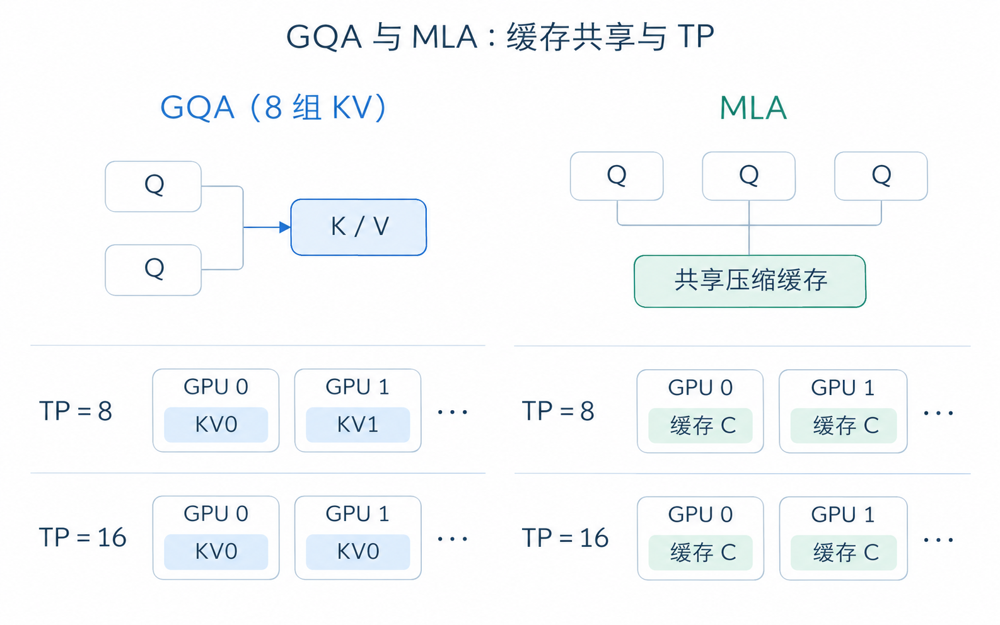
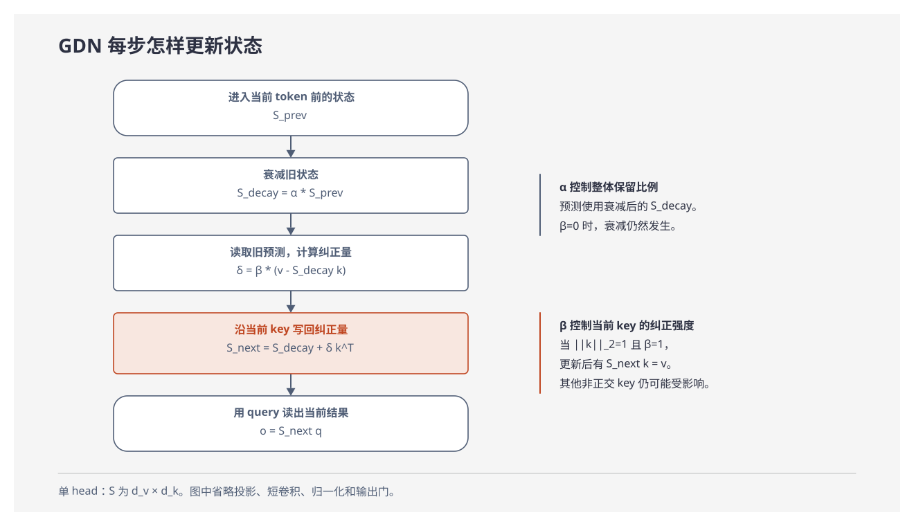
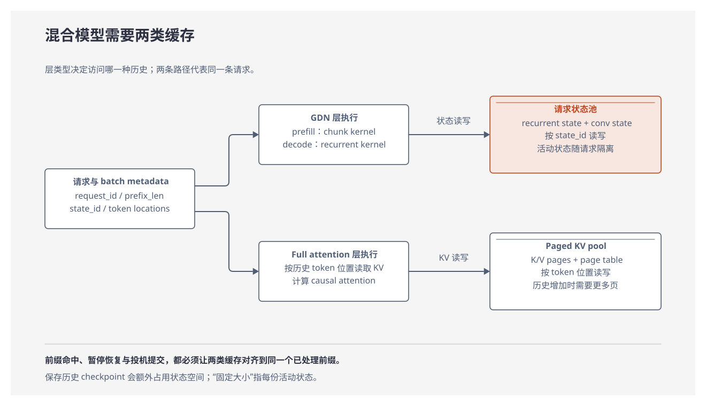

# 注意力与状态架构演进：MLA、SWA 与 Gated DeltaNet

```{contents} 本页目录
---
depth: 2
local: true
---
```

第 3 章的容量公式表明，标准因果全注意力（Full Attention）的 KV Cache 随序列长度 $T$ 线性增长。进入十万至百万 token 长上下文时代后，GQA 缩减 KV head 的潜力逐渐见顶（每层至少保留 1～8 个完整 KV head），模型架构开始沿三条路径继续改写历史状态：**MLA（Multi-head Latent Attention）**把多头 K/V 压进共享的低秩潜向量，**SWA（Sliding Window Attention）**把缓存限制在固定滑窗内，而 **GDN（Gated DeltaNet）**直接将历史折叠成固定大小的递推状态矩阵。本章依次推导这三类机制的数学结构、算子形态与混合缓存契约。

## MLA 用低秩潜向量与矩阵吸收压缩每 token 缓存

DeepSeek-V2/V3 引入的 MLA 不再分别存储多个 KV head，而是把第 $t$ 个位置的隐藏状态 $h_t\in\mathbb R^d$ 先降维投影成极窄的联合潜向量 $c_t^{KV}\in\mathbb R^{d_c}$（其中 $d_c \ll n_h d_h$，例如 DeepSeek-V3 取 $d_c=512$）：

$$c_t^{KV}=W^{DKV}h_t,\qquad k_{t,i}^C=W_i^{UK}c_t^{KV},\qquad v_{t,i}^C=W_i^{UV}c_t^{KV}$$

如果直接对 $k_{t,i}^C$ 施加与位置 $t$ 绑定的旋转矩阵 $R_t$，中间夹着 $R_{t-s}$ 会阻断后续的权重合并。MLA 为此采用**解耦 RoPE（Decoupled RoPE）**：额外生成一条所有 head 共享的小维度位置键 $k_t^R=\operatorname{RoPE}(W^{KR}h_t)\in\mathbb R^{d_R}$（如 $d_R=64$），与各 head 的位置查询 $q_{t,i}^R=\operatorname{RoPE}(W_i^{QR}c_t^Q)$ 单独点积。这样，缓存池只需为每个历史 token 存放 $(c_t^{KV}, k_t^R)$ 两个紧凑向量（以 DeepSeek-V3 的 $512+64=576$ 元素计，单层体积甚至小于 $2\times128=256$ 维的双头 GQA）。

### 矩阵吸收（Matrix Absorption）决定 Prefill 与 Decode 走两条算子路径

若 Decode 时先把 $c_s^{KV}$ 乘 $W_i^{UK},W_i^{UV}$ 还原出全部 $n_h$ 个多头 K/V，片上中间结果会随历史长度膨胀。利用线性结合律，可以把上投影矩阵直接“吸收”进当前侧投影：

$$(q_{t,i}^C)^{\mathsf T}(W_i^{UK}c_s^{KV})=\big((W_i^{UK})^{\mathsf T}q_{t,i}^C\big)^{\mathsf T}c_s^{KV},\qquad W_i^O\sum_{s\le t}\alpha_{t,s,i}(W_i^{UV}c_s^{KV})=(W_i^O W_i^{UV})\sum_{s\le t}\alpha_{t,s,i}c_s^{KV}$$

- **Prefill 阶段（非吸收路径）：**序列长度 $N_q$ 很大，显式上投影还原多头 $K,V$ 后直接调用标准高吞吐 FlashAttention，计算密度更高。
- **Decode 阶段（矩阵吸收路径）：**每请求只有 1 个（或少量投机）Query，先把 $q_{t,i}^C$ 变换到 $d_c$ 维潜空间，让所有 Query head 共享同一份 $c_s^{KV}$ 做 MQA 式扫描，最后再通过融合了 $W_i^{UV}$ 的输出投影回到 $d$，彻底省去历史多头张量的物化与搬运。

### MLA 在高并行度下的缓存复制与 DPA 分界

GQA 只有在 TP 超过 KV head 总数后才触发 head 复制；而 MLA 的 $(c_t^{KV},k_t^R)$ 本身就是全 head 共享的单一潜向量，无法按 head 维继续切分。在普通 TP 路径中，组内每张 GPU 都会保存同一请求完整的一份压缩潜向量：



图：左侧采用 8 个 KV head 的 GQA，从 TP8 增至 TP16 后相邻 rank 复制同一个 head；右侧采用复制 latent cache 的 MLA，增加 TP 后每卡仍保存同一请求的压缩状态。图中“共享”描述模型中多个 Query 对同一缓存的使用关系；跨 GPU 的方框仍是各自显存里的副本。来源：Datawhale 原课程，结构背景见 [GQA 论文](https://arxiv.org/abs/2305.13245)与 [DeepSeek-V2 技术报告](https://arxiv.org/html/2405.04434v5#S2.SS1)。

正因为普通 TP 会复制整份 latent cache，大规模部署 MLA 模型（如第 15 章讨论的 SGLang DPA 与第 23 章的 DeepSeek V4.1 Flash）普遍在注意力子层改用 **DP Attention**，让不同 GPU 承接不同请求的潜向量缓存，把重复副本转换成有效并发容量。

## SWA 用环形窗口截断单层历史，多层堆叠决定精确恢复成本

另一条裁剪 KV 容量的路径是**滑动窗口注意力（Sliding Window Attention，SWA）**：规定第 $\ell$ 层的位置 $t$ 只读取最近 $W$ 个位置的历史键值，即 $j\in[\max(1,t-W+1),t]$。物理实现上，单层 SWA 不再随序列无限申请新页，只需维护一个容量约为 $W$（若开启投机解码则再加上最大起草回退余量）的**环形缓冲区（Ring Buffer）**，新 token 按模写入覆盖滑出窗口的旧槽位，单请求显存占用成为常数。

对推理引擎的缓存恢复而言，SWA 最容易被忽略的性质是**跨层感受野扩张**：第 1 层的 $h_t^{(1)}$ 只依赖 $[t-W+1,t]$ 的输入，但第 2 层的 $h_t^{(2)}$ 读取第 1 层窗口内各位置表示时，间接汇聚了 $[t-2(W-1),t]$ 的信息；堆叠 $L_s$ 层 SWA 后，理论信息感受野可扩至约 $L_s W$。因此，一旦前缀缓存没有落盘保存边界处的 SWA 环形状态，想要逐 bit 精确重建末尾窗口，朴素做法需要向上回溯重算约 $L_s\times W$ 个历史 token；第 23 章将看到 DeepSeek V4.1 Flash 如何用固定重算末尾 $W$ 个 token 的 **SWA Bounded Replay** 把这笔精确重算代价压回单窗口近似。

## 从 KV 历史走向 Gated DeltaNet 的固定状态矩阵

MLA 压缩了每个 token 的向量宽度，历史总体积仍随 $T$ 线性增长；SWA 把缓存截断在固定窗口 $W$ 内，窗口外的远距信息必须依赖混排的全注意力层兜底。**Gated DeltaNet（GDN，门控 Delta 网络）**代表第三条路线：把整段已读上下文直接压进固定形状的状态矩阵，每来一个新 token 先衰减旧记忆、再按预测误差定向纠正、最后用 Query 读出。下文以 Qwen3-Next 混合模型为实例（源码核对至本地仓库 `467f2eb` 与公开固定提交），完整推演 GDN 的数学方程、分块并行、缓存预算与引擎接入契约。

标准 causal softmax attention 保留此前每个 token 的 K/V。当前 query 与历史 keys 逐一计算相关度，再加权汇总 values。GQA 可以减少 KV heads，FlashAttention 可以减少中间结果的读写，但它们仍执行对应的 attention 运算。

$$o_t=\sum_{i\le t}\operatorname{softmax}_i(q_t^\top k_i/\sqrt{d_k})v_i$$

先看最简单的线性 attention。省略特征映射和归一化后，可以先累加外积，再用 query 读取：

$$S_t=S_{t-1}+v_tk_t^\top,\qquad o_t=S_tq_t$$

$$S_t=\sum_{i\le t}v_ik_i^\top\quad\Longrightarrow\quad o_t=\sum_{i\le t}v_i(k_i^\top q_t)$$

这个改写说明状态矩阵能汇总历史，但单纯累加会让不同 key 的信息互相干扰。DeltaNet 引入“按误差纠正”的更新；GDN 再加入遗忘门，让模型同时控制旧记忆的衰减和新信息的写入。GDN 是需要按自身结构训练的 token mixer，不能把已有 softmax 模型的 KV cache 直接压成一个矩阵，就声称得到了等价的 GDN 模型。

| 机制 | 记忆更新递推式 | 对历史信息的处理 |
|-|-|-|
| 普通线性 Attention | $S \leftarrow S + v k^{\mathsf T}$ | 持续累加 key/value 外积关联 |
| 带标量衰减的线性递推 | $S \leftarrow \alpha S + v k^{\mathsf T}$ | 整体指数衰减后写入（对应 Mamba-2 简化视角） |
| DeltaNet | $S \leftarrow S + \beta(v - Sk)k^{\mathsf T}$ | 定向纠正当前 key 方向上的预测误差 |
| Gated DeltaNet（GDN） | $S \leftarrow \alpha S + \beta(v - \alpha Sk)k^{\mathsf T}$ | 先整体遗忘衰减，再按当前 key 定向纠正 |

上述比较只描述核心递推。完整 Mamba2、DeltaNet 和 GDN block 的投影、卷积、归一化及门控还需各自展开。来源：[原论文第 2 节](https://arxiv.org/html/2412.06464v1#S2)。

## GDN 如何纠正旧记忆

### 先统一矩阵方向

| 符号 | 单 head 形状 | 数学与物理含义 |
|-|-|-|
| $q_t,\ k_t$ | $d_k$ | 当前步读出方向、写入方向向量 |
| $v_t,\ o_t$ | $d_v$ | 当前步写入目标值、读出输出向量 |
| $S_t$ | $d_v \times d_k$ | 处理完第 $t$ 个 token 后的递推状态矩阵 |
| $\alpha_t$ | 标量 | 保留旧状态的比例（通常每个 token、每个状态 head 各一个） |
| $\beta_t$ | 标量 | 沿当前 key 纠正预测误差的步长强度 |

本章采用原论文的 $S\in\mathbb R^{d_v\times d_k}$ 约定；FLA 与 Hugging Face Transformers 参考实现常以 `[B, H_v, d_k, d_v]` 保存其转置，核对算子源码时需先对齐转置次序。

### 衰减、预测、纠正和读出

$$\widetilde S_t=\alpha_tS_{t-1}$$

$$\widehat v_t=\widetilde S_tk_t,\qquad\delta_t=\beta_t(v_t-\widehat v_t)$$

$$S_t=\widetilde S_t+\delta_tk_t^\top,\qquad o_t=S_tq_t$$

$\alpha_t$ 决定旧状态整体保留多少，$\beta_t$ 决定当前 key 上的预测误差要纠正多少。这里的“预测值” $\widehat v_t$ 是衰减后状态对当前 key 的线性读出，$\delta_t$ 来自目标值与预测值的残差；读出使用更新后的 $S_t$，因此当前 token 的写入直接参与本次输出。



*图：Gated DeltaNet 单步状态更新数据流（旧状态经* $\alpha_t$ *衰减后对* $k_t$ *做出线性预测，按残差* $\delta_t$ *外积写回* $S_t$*，再由* $q_t$ *读出* $o_t$*）。*

把上面的步骤合并，得到论文中的 gated delta rule：

$$S_t=\alpha_t S_{t-1}(I-\beta_tk_tk_t^\top)+\beta_tv_tk_t^\top$$

**残差中的预测值必须来自衰减后的状态。**如果误写成 $\alpha_t S_{t-1} + \beta_t(v_t - S_{t-1}k_t)k_t^{\mathsf T}$，遗忘门就只作用在未纠正的那部分旧记忆上，数学语义已经改变。

### 为什么能叫“定向纠正”

当 key 已完成 L2 归一化（$\|k_t\|_2=1$）时，将更新后的状态再次右乘同一个 $k_t$：

$$S_tk_t=(1-\beta_t)\widetilde S_tk_t+\beta_tv_t$$

$\beta_t=1$ 时，当前 key 方向的读出被精确替换为 $v_t$；$\beta_t=0$ 时，本步只发生整体衰减。对于与 $k_t$ 正交的任意方向 $u$，外积项满足 $\delta_t k_t^{\mathsf T}u=0$，因此只受 $\alpha_t$ 衰减而不被新值污染；与 $k_t$ 非正交的历史方向仍会受到连带更新，所谓“定向纠正”并不等于哈希槽完全隔离。

从测试时在线学习（Test-Time Training）视角看，令单步回归损失为 $\mathcal L(S)=\frac{1}{2}\|Sk_t-v_t\|_2^2$，在衰减点 $\widetilde S_t=\alpha_t S_{t-1}$ 处对状态矩阵做一次步长为 $\beta_t$ 的梯度下降，恰好得到上述更新律。注意这里每步演化的是请求私有的激活状态 $S_t$，模型的线性投影权重在推理期始终固定。

### 手算一个更新

用一个 value 维度、两个 key 维度。旧状态 S=[2,7]，当前 key=[1,0]，value=5。

| 设置 | 计算过程 | 新状态 |
|-|-|-|
| α=1，β=1 | 预测为 2；差额为 3；只修正第一维 | [5, 7] |
| α=1，β=0.5 | 把差额 3 写入一半 | [3.5, 7] |
| α=0.8，β=0.5 | 先变为 [1.6,5.6]；再写入 0.5×(5−1.6)=1.7 | [3.3, 5.6] |

这些边界值用于解释数学含义；sigmoid 等实际门函数通常给出开区间内的数值。来源：[原论文第 3 节、式（8）](https://arxiv.org/html/2412.06464v1#S3)；[Transformers recurrent 参考实现](https://github.com/huggingface/transformers/blob/5f6629d89508568afaadf5d60cace11ec0edebbc/src/transformers/models/qwen3_next/modeling_qwen3_next.py#L507-L566)。

## 实际模型还需要哪些计算

Qwen3-Next 的 GDN block 除状态更新外，还包含输入投影、因果深度卷积、Q/K 的 L2 normalization、输出门控及输出投影。GDN 方程只覆盖其中的递推核心。

| 计算阶段 | 算子作用 | 对推理引擎的要求 |
|-|-|-|
| 输入线性投影 | 从 hidden states 生成 Q/K/V、输出门 $z$ 与门控原始值 $a,b$ | 对齐 checkpoint 合并顺序、Q/K 到 V 的 head 分组比及 TP 分片 |
| 短因果深度卷积 + SiLU | 在进入递推前为 Q/K/V 注入局部邻域上下文 | 每个请求、每个 GDN 层还须额外维护固定宽度的 `conv_state` |
| Q/K 归一化与缩放 | 对 Q/K 做 L2 归一化，Query 另乘 $1/\sqrt{d_k}$ | 参考实现与融合 kernel 须保持完全一致的缩放系数与累加精度 |
| 门参数非线性变换 | $\beta=\operatorname{sigmoid}(b)$，$g=-\exp(A_{\log})\operatorname{softplus}(a+\mathrm{dt_bias})$，$\alpha=\exp(g)$ | $g$ 是对数衰减率（log-decay），切勿直接当作乘法因子 $\alpha$ 使用 |
| GDN 核心算子 | Decode 走单步 recurrent，Prefill 走分块 chunkwise | 按请求槽位读取 `initial_state` 并原地或异地写回 `final_state` |
| 门控归一化与输出投影 | 按 head 执行 RMSNorm 并乘 $\operatorname{SiLU}(z)$，再投回隐藏维度 | 输出门 $z$ 调节读出幅度，职责独立于状态门 $\alpha,\beta$ |

所读实现的 GDN 路径没有对 Q/K 使用 RoPE；full attention 路径有自己的 RoPE 处理。不能复用现有 attention 前处理后，只替换最后一个 kernel。源码还将较少的 Q/K heads 分组映射到较多的 value heads，因此状态矩阵数量应按实际 state/value heads 计算。来源：[Qwen3NextGatedDeltaNet](https://github.com/huggingface/transformers/blob/5f6629d89508568afaadf5d60cace11ec0edebbc/src/transformers/models/qwen3_next/modeling_qwen3_next.py#L572-L762)。

## Decode 用递推，Prefill 用分块

### Decode 的工作量不随历史长度增长

decode 时，每个请求通常只增加一个 token。读取本层的 state 和 conv state，完成一次更新，再写回同一请求对应的槽位即可。以下伪代码只表达核心方程，省略 batch/head、投影、卷积和归一化：

```python
# S: [d_v, d_k]; q, k: [d_k]; v: [d_v]
def gdn_step(S, q, k, v, alpha, beta):
    S_decay = alpha * S
    prediction = S_decay @ k
    delta = beta * (v - prediction)
    S_next = S_decay + delta[:, None] * k[None, :]
    output = S_next @ q
    return output, S_next
```

单状态 head 的递推核心每步只需 $\mathcal O(d_k d_v)$ 乘加与同量级状态读写，复杂度中不再出现历史长度 $t$；相比之下，标准全注意力单步历史读取仍随 $t$ 线性增长。GDN 因而非常适合超长上下文持续 Decode，但小 batch 下仍可能受状态矩阵 HBM 读写带宽、投影或 MoE 通信制约，固定状态不代表单步零成本。

融合 kernel 的目标是让状态 tile 尽量在寄存器或片上存储中完成衰减、矩阵向量积、外积更新和读出，再写回。实际能融合到什么程度，取决于 head 维度、寄存器压力和硬件。CUDA Graph 减少 CPU launch 开销；是否把多段计算合成一个 kernel，仍由具体内核实现决定。

### Prefill 为什么能按块并行

如果长 prompt 逐 token 启动同一个递推 kernel，会产生长串小计算。论文和 FLA 使用 chunkwise 形式：每块含 C 个 token，先并行计算块内的 key 相关性和门的累计衰减，再用结构化的三角系统与矩阵乘法完成块内输出。块间传递固定大小的状态。

下面给出单个分块的等价代数展开。设进入当前块的状态为 $S_{\mathrm{in}}$，块内 token 从 $1$ 编号到 $C$，定义块首到位置 $i$ 的累计衰减 $A_i$ 与位置 $j$ 到 $i$ 的相对衰减 $\rho_{ij}$：

$$A_i=\prod_{r=1}^{i}\alpha_r,\qquad \rho_{ij}=\prod_{r=j+1}^{i}\alpha_r\quad(j\le i),\qquad\rho_{ii}=1$$

$$S_i=A_iS_{\mathrm{in}}+\sum_{j\le i}\rho_{ij}\delta_jk_j^\top$$

将状态展开代回 delta 的定义，可得到一个单位下三角线性系统：

$$\delta_i+\sum_{j<i}\beta_i\rho_{ij}(k_j^\top k_i)\delta_j=\beta_i(v_i-A_iS_{\mathrm{in}}k_i)$$

系统的系数只依赖本块的 K、α 和 β。实际 WY/UT 实现把右端再拆成与 V 和 S_in 对应的部分，预计算块内表示，再推进块间状态。求出各 δ 后，读出与最终状态分别为：

$$o_i=A_iS_{\mathrm{in}}q_i+\sum_{j\le i}\rho_{ij}(k_j^\top q_i)\delta_j$$

$$S_{\mathrm{out}}=A_CS_{\mathrm{in}}+\sum_{j\le C}\rho_{Cj}\delta_jk_j^\top$$

这样，大量块内工作可以用 GPU 擅长的矩阵运算完成，保留的因果依赖由三角结构和块间状态承担。普通 chunkwise 实现仍需推进相邻 chunk 的状态，不能把所有 chunk 都从零状态开始。数学上的“线性时间”以 head 维度和 chunk size 固定为前提；块内仍有 C×C 的计算与临时数据。

实现通常累加 g=log α，再通过 exp 得到相对衰减，以避免直接计算很长的乘积和两个接近零的数相除。本文公式展示等价关系，不建议按公式显式求逆或构造整个 prompt 的大三角矩阵。FLA 的所读路径依次调用块内表示生成、块间状态推进和块输出 kernel。来源：[chunk_gated_delta_rule_fwd](https://github.com/fla-org/flash-linear-attention/blob/1f29540bc8398ef370fc291d00f2757a9a15e935/fla/ops/gated_delta_rule/chunk.py#L33-L123)。

### 两种 chunk 需要分清

| 概念 | 谁决定 | 解决什么问题 |
|-|-|-|
| GDN kernel chunk | 内核实现，例如本次所读 FLA 默认 C=64 | 把局部递推改写为高效 GPU 计算 |
| 调度器的 chunked prefill | 服务调度器的 token 预算 | 控制单轮 prefill 占用，兼顾 TTFT 与 decode 延迟 |

调度器一次给请求 1024 个 token，内部可以处理成多个 GDN kernel chunks。下一轮继续该请求时，必须接上上一轮的 final recurrent state 和 conv state。packed batch 还要用 cu_seqlens 等边界信息隔离各请求，防止卷积和递推跨过请求边界。

## 缓存大小如何计算

令 B 为活跃请求数，L_g 为 GDN 层数，H_s 为每层状态 head 数，b_s 为每个状态元素的字节数。暂不计快照、临时空间和 TP 复制：

$$M_{\mathrm{state}}=B L_g H_s d_k d_v b_s$$

短卷积还需缓存历史输入。若卷积通道数为 D_conv、核宽为 w，最小历史为 w−1 个位置；某些 kernel 使用 w 个位置的环形或滚动 buffer。实现时按实际 layout 分配，而不是只计算 S 的大小。

$$M_{\mathrm{conv}}\approx B L_g D_{\mathrm{conv}}(w-1)b_c$$

对保留 full attention 的混合模型，还要加上随 token 数增长的 KV：

$$M_{\mathrm{KV}}=L_a H_{\mathrm{kv}}(d_k^{\mathrm{attn}}+d_v^{\mathrm{attn}})b_{\mathrm{kv}}\sum_{r=1}^{B}T_r$$

公式按逻辑有效数据计数。分页碎片、共享前缀、不同层维度、KV 量化、TP 中的 head 复制以及 checkpoint 数量，都会改变实际分配。纯 GDN 的每个活跃请求状态随序列长度保持固定；若引擎保存更多历史快照，总缓存也会增加。

**以 Qwen3-Next-80B-A3B-Instruct 配置实算：**全模型共 48 层，`full_attention_interval=4`（每 3 层 GDN 后接 1 层全注意力，即 36 层 GDN + 12 层全注意力）。GDN 含 16 个 key heads、32 个 value/state heads，$d_k=d_v=128$；全注意力层含 2 个 KV heads，`head_dim=256`。

下面按**单请求、未按 TP 切分、recurrent state 用 FP32、attention KV 用 BF16**计算。FP32 是这张表的明确假设，不代表所有部署都使用同一种 state dtype。

| 上下文长度 | 36 层 recurrent state | 12 层 attention KV |
|-|-|-|
| 4096 tokens | 72 MiB | 96 MiB |
| 32768 tokens | 72 MiB | 768 MiB |
| 131072 tokens | 72 MiB | 3072 MiB（3 GiB） |

计算依据：单个 GDN 层为 32×128×128×4=2 MiB；全部 attention 层每个 token 为 12×2×2×256×2=24 KiB。Q/K/V 卷积共 8192 个通道、核宽 4，若 conv state 用 BF16，36 层额外约需 1.69～2.25 MiB，取决于保存 3 还是 4 个位置。

表中不含模型权重、输出激活、prefill workspace、CUDA Graph buffer、前缀快照和投机状态。同一请求若额外完整保存一份 recurrent checkpoint，仅这部分就再增加 72 MiB。长上下文收益明显，但高并发和大量 checkpoint 仍需单独做容量预算。来源：[官方模型配置](https://huggingface.co/Qwen/Qwen3-Next-80B-A3B-Instruct/blob/main/config.json)；[默认层类型生成规则](https://github.com/huggingface/transformers/blob/5f6629d89508568afaadf5d60cace11ec0edebbc/src/transformers/models/qwen3_next/configuration_qwen3_next.py#L126-L136)。

## 推理引擎要管理两种历史

混合模型的 full attention 层按 token 位置访问 KV pages；GDN 层按 request/state slot 访问 recurrent state 与 conv state。调度器必须让这两条路径表示同一个已提交的前缀长度。SGLang 的所读源码也明确区分 full 与 linear attention pools，并将 conv 和 temporal state 放入同一状态对象。来源：[MambaPool 与 HybridLinearKVPool](https://github.com/sgl-project/sglang/blob/b45a36531c3673048aeaf35322c3df7f18edd038/python/sglang/srt/mem_cache/memory_pool.py#L516-L580)；[请求到状态槽的映射](https://github.com/sgl-project/sglang/blob/b45a36531c3673048aeaf35322c3df7f18edd038/python/sglang/srt/layers/attention/hybrid_linear_attn_backend.py#L203-L220)。



*图：混合架构推理引擎同时维护的两类历史池——全注意力层按 token 页表索引分页 KV，GDN 层按请求状态槽索引固定大小的递推状态与短卷积状态。*

### Continuous batching 按请求绑定状态

batch 中的行号会随请求加入、完成和调度而改变。状态槽必须跟随 request identity，不能把“今天的 batch 第 3 行”当成固定请求。GPU metadata 至少要能提供每个请求的 state index、当前有效长度、packed sequence 边界，以及是否提交更新。

新请求分配并初始化状态槽；暂停请求保留槽位或将状态卸载；完成或取消请求在 GPU 使用结束后回收。不能一边让上一轮 kernel 写状态，一边把相同槽位分给新请求。所有 GDN 层、卷积状态和混合模型的 KV 长度必须在同一逻辑前缀上推进。

### 前缀缓存复用的是边界状态

普通全注意力 KV Cache 可以通过裁剪页表回退到任意历史位置；而 GDN 的 $S_t$ 已把此前所有写入原地折叠进同一个矩阵，手里只有 $S_{1000}$ 时无法像切片数组那样直接取出 $S_{800}$。

因此，缓存一个长度为 p 的可复用前缀，需要保存该边界处所有 GDN 层的 recurrent state 和 conv state，以及 attention 层对应的 KV 引用。命中后，将不可变 checkpoint 复制或 copy-on-write 到请求私有的活动状态，再从 p 继续运行。两个共享前缀的请求不能原地更新同一份 S。

例如公共前缀长 1000，但最近的完整状态 checkpoint 在 768。只有当 768 是所有相关层都能恢复的一致边界时，才能恢复它并重算 769～1000；不能只把 cached_len 标成 1000 就开始 decode。checkpoint 越密，前缀命中后的重算越少，但复制量和驻留内存越大。

工程上可以继续用 radix tree 索引 token 前缀，在选定边界附加 state checkpoint；缓存 value 的含义和淘汰成本要随之扩展。混合模型的可复用长度取决于完整可恢复状态，不能只看 attention KV 的最长匹配。

### 投机解码必须提交被接受的状态

假设目标模型一次验证 8 个候选 draft token，最终只接受前 3 个：活动状态必须精确回到 $S_3$ 及其配套的 `conv_state`，全注意力层的有效 KV 长度也同步截回同一前缀；仅把序列长度减 5 不会抹掉已经写进 $S_8$ 的后 5 步更新。

| 方法 | 优点 | 代价或条件 |
|-|-|-|
| 保存候选位置的状态 | 接受长度确定后可直接选择对应状态 | 完整矩阵快照可能很大；还要覆盖 conv state |
| 验证前保存 checkpoint，按接受前缀重放 | 快照数量少，语义容易核对 | 需要额外计算和状态恢复 |
| 由专用 kernel 保存可重放更新或压缩中间状态 | 可能减少完整矩阵复制 | 依赖具体算法、数值与提交协议，不能直接套用 KV 截断 |

切勿把代数逆运算当作默认回滚手段：当 $\beta_t=1$ 且 $\|k_t\|_2=1$ 时，投影矩阵 $I-\beta_t k_t k_t^{\mathsf T}$ 在 $k_t$ 方向严格奇异；即便门控落在开区间内，连续除法的舍入放大也会迅速破坏数值稳定性。工程接入初期可先用验证前快照加接受前缀重放兜底。

### CUDA Graph 要隔离原地写状态

状态 pool 可以长期保持固定地址，replay 前原地更新 state_indices 等 metadata，这很适合 CUDA Graph。但 capture 和 warmup 本身也会执行递推，应使用独立 dummy state。padding 行需要无副作用的掩码或安全的专用槽，不能写入真实请求，也不能让多个原地写入的 padding 行产生数据竞争。

Graph capture buffer 除 token、position、out_loc 外，还需稳定的 state index 和有效性信息。replay 后要核对状态实际推进了几步，避免 warmup、graph replay 或重试造成重复更新。

### 并行和调度仍要看整模

GDN 的 heads 可以按模型布局切给不同 TP rank，使每个 rank 更新本地状态；输出投影通常仍有通信。Q/K heads 与 value heads 数量不同时，要一起核对分组映射和权重分片。若沿时间维切分上下文，还需传递边界状态或使用专门的并行算法，不能让各段独立从零开始。

prefill/decode 分离部署时，要传输匹配的 recurrent state、conv state 和 attention KV。GDN 状态部分的体积对固定模型不随 prompt 长度变化，但混合模型的 attention KV 部分仍会增长。

调度不能只估算待分配的 KV tokens，还要同时考虑可用 state slots、checkpoint 空间和 prefill workspace。delay-prefill、chunked-prefill 的时间预算需要重新测量：GDN decode 更轻或更稳定，并不自动保证当前调度阈值仍合适。

## 对应到 mini-sglang 的接入位置

当前本地源码中的 Qwen3DecoderLayer 使用 RopeAttn，create_kvcache_pool 创建 MHAKVCache，显存估算按全部层的 K/V 计算。Req、Batch 和 Context 尚未表达 GDN 的双状态。下面是接入建议，**本次没有实现这些改动**。

| 现有位置 | 当前机制 | 支持 GDN 时需要补充 |
|-|-|-|
| python/minisgl/models/config.py | 通用 attention heads、head_dim、RoPE 配置 | layer_types、linear head 维度、卷积核宽和 state dtype 等模型事实 |
| python/minisgl/models/qwen3.py；models/register.py | Qwen3 层使用 RopeAttn | 注册目标模型，按层选择 GDN 或 full attention；保持 checkpoint 结构一致 |
| python/minisgl/layers/attention.py | QKV 拆分、可选 norm、RoPE、attention backend | 独立 GDN block，补输入门、短卷积、L2 norm、recurrent/chunk 路径和输出门 |
| python/minisgl/kvcache/__init__.py；engine/engine.py | 创建 MHAKVCache，按所有层估算 KV pages | 仅为 full attention 层分配 KV，单独预留 state/conv pools 与快照预算 |
| python/minisgl/core.py | Req/Batch/Context 使用页表和 out_loc | 请求到 state slot 的映射、递推有效长度及各执行模式的状态 metadata |
| python/minisgl/scheduler/cache.py；kvcache/radix_cache.py | 前缀 value 为 KV 页索引 | 一致边界处的双状态 checkpoint、复制和淘汰规则 |
| python/minisgl/scheduler/scheduler.py | 按 prefill/decode 准备 batch，完成或取消时释放请求 | state slot admission、批间隔离、异步释放和状态提交 |
| python/minisgl/engine/graph.py | decode graph；捕获 token、out_loc、position 等 buffer | 固定 state index buffer、安全 dummy state、padding 写入保护 |

一个可控的实现顺序是：先为单个 GDN 层建立 eager reference 和状态接口；再验证一次 prefill 接连续 decode；随后加入 chunk kernel、continuous batching 和混合层；最后做前缀 checkpoint、CUDA Graph 与投机解码。每个阶段都比较输出和最终状态，避免只看生成文本。完整 Qwen3-Next 还包含 MoE 和其专有 attention 结构，单独接上 GDN kernel 并不足以宣称整模支持。

## 怎样验证正确性和性能

| 验证层次 | 要对比什么 | 最容易暴露的问题 |
|-|-|-|
| 方程 | 逐 token 递推 vs chunk 输出与 final state | α 位置错误、矩阵转置、因果 mask |
| 单层 | 参考实现 vs 优化 kernel，含非零 initial state | Q/K 缩放、门函数、head 映射与 dtype |
| 分段执行 | 整段 prefill vs 多轮 chunked prefill，再接 decode | 漏传 conv state、状态重复推进 |
| 批处理 | 单请求独立执行 vs packed batch、重排和请求插拔 | 请求串状态、padding 写入与槽位复用 |
| 缓存与回滚 | 前缀命中、分叉、evict/reload、接受长度从 0 到 K | checkpoint 边界不一致，回滚只改 KV 长度 |
| CUDA Graph | eager vs capture/replay 后的输出与全部状态 | warmup 污染、索引没更新、重复写入 |
| 整模 | 同权重下的 logits、长序列误差与生成行为 | 局部正确但权重加载、层结构或 MoE 不一致 |

性能测试要固定硬件、权重、精度和服务目标，分别测 prefill 吞吐/TTFT 与 decode 吞吐/TPOT，再扫描输入长度、输出长度和并发量。记录 state/KV/checkpoint/workspace 内存、状态复制字节数、kernel 耗时与通信占比。若两组使用不同模型或质量水平，结果只能作为系统取舍，不能归因成某个 kernel 的纯加速。

数值上建议先以高精度状态作为正确性基线，再评估较低精度。权重或 KV 的量化收益，不能直接推断递推状态量化也同样安全；S 会被反复更新，需要长序列误差和任务效果验证。

**本次已验证：**NumPy FP64 下，6 种序列长度、2 组 head 维度、4 种 chunk size 共 48 组递推/分块等价性检查，覆盖非零 initial state 和不足一个 chunk 的尾段。最大输出绝对误差为 2.22×10⁻¹⁵，最大 final-state 误差为 4.44×10⁻¹⁶；边界 checkpoint 后继续递推与连续执行一致，手算例子和显存算式也已核对。

**尚未验证：**真实模型 logits、GPU/NPU 内核、BF16/FP16/低精度递推、TP 通信和在线服务性能。本文没有给出实测加速倍数，也不将 CPU 方程验证视为引擎接入完成。

## 读完后可以自查

| 核心自查问题 | 核对结论与机制原因 |
|-|-|
| MLA 为什么在 Decode 阶段要把 $W^{UK},W^{UV}$ 吸收到两侧投影中？ | 避免把紧凑潜向量 $c_s^{KV}$ 重新展开成多头张量，让所有 Query head 直接共享扫描同一份潜缓存。 |
| $\alpha=0.8,\ \beta=0$ 时，GDN 状态会保持原样不变吗？ | 不会，状态会变为 $0.8S$；$\beta=0$ 只关闭误差写入，遗忘门 $\alpha$ 的整体衰减照常发生。 |
| 前缀命中 1,000 tokens，但树上只存了 $S_{768}$ 快照，能直接从 1,001 开始吗？ | 不能；必须先恢复 768 处的一致边界快照（含 `conv_state`），补算 769～1,000 后再继续。 |
| 投机验证 8 个候选只接受 3 个，仅裁掉全注意力 KV 尾部够不够？ | 不够；还必须把 GDN 层状态恢复到接受边界 $S_3$ 与对应 `conv_state`，保证全模型逻辑前缀严格一致。 |

源码固定核对锚点：Transformers Qwen3-Next 参考实现（`5f6629d89508`）、FLA 分块算子 `chunk_gated_delta_rule_fwd`（`1f29540bc839`）及 SGLang `MambaPool / HybridLinearKVPool`（`b45a36531c36`）；相关论文链接统一收录于文末〈参考〉。单卡 HBM 容量装不下全部多轮状态时，如何在 GPU、Host 与外部存储之间安全备份并恢复这些混合状态？下一章进入分层 KV 缓存（HiCache）。
