# 分层 KV 缓存与完整前缀恢复

```{contents} 本页目录
---
depth: 2
local: true
---
```

第 7 章建立了单卡 GPU 内的 Radix 前缀复用，前一章又明确了全注意力、SWA 与 GDN 混合模型的前缀边界条件。本章把存储层级扩展到 **GPU 显存（L1）— Host 内存（L2）— 外部共享存储（L3）**：先梳理副本建立、写回、准入与逐出的生命周期，再结合生产版 SGLang HiCache 源码与实测基准，拆解跨层连续前缀匹配、Host 页优先布局、逐层异步恢复、预取等待取舍以及混合模型边界快照补存。

## 多级缓存按复用与容量触发搬运

KV Cache 的容量账还涉及保存位置。GPU 显存承担当前计算，CPU 主机内存和 SSD 则扩大可保留的历史范围。在线推理需要分别决定：哪些 KV 值得保留，什么时候建立下层副本，什么时候释放上层空间，以及新请求到来后要不要加载。这里以独立 GPU 服务器上的标准因果 full attention 为例，讨论跨请求的前缀复用；活跃 KV offload 的搬运时机在本节末尾单独说明。

### 副本与使用者决定释放条件

多级缓存中的“下沉”通常先建立副本，释放空间是后续动作。同一段 KV 可以同时存在于 GPU、CPU 和 SSD。GPU 空间不足时，如果 CPU 已有有效副本，就可以直接释放 GPU 副本，避免在准入新请求时临时搬运。

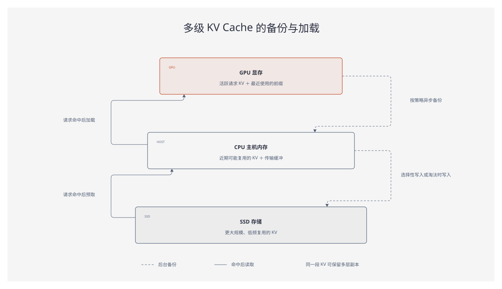

图：HiCache 的三级软件缓存结构（与 GPU 硬件内的 L1/L2 SRAM 无关）——`L1`（GPU HBM）服务当前计算与近期热前缀，`L2`（本实例私有 Host DRAM）暂存被驱逐副本并充当传输缓冲，`L3`（3FS、Mooncake 等可选外部存储）保存大规模跨实例共享历史。向下箭头为备份，向上箭头为命中恢复；备份完成不意味着必须立即删除上层副本。

缓存通常按 page 或 chunk 管理，例如每块对应 64 个 token，具体粒度由实现和配置决定。完整、内容不再变化的块适合后台备份；正在追加 token 的尾块，需要在合适的边界保存。已有前缀索引可以继续管理 token 路径，再为每段 KV 记录 GPU、CPU 或外部存储中的位置。

跨请求复用要求缓存身份兼容，包括模型权重、适配器、输入表示、位置与 Attention 配置。缓存键还要包含前文信息：同一段文字出现在不同上下文中，KV 通常不同。普通前缀缓存依赖相同 token 前缀，文本相似或语义相近不足以复用。

### 请求生命周期决定搬运时机

| 事件 | 缓存和搬运动作 | 判断依据 |
|-|-|-|
| 新请求到来 | 先查 GPU 和 CPU 的前缀索引，未命中的后续前缀再查询 SSD。 | 找到可复用的最长连续前缀。 |
| Prefill 产生新 KV | 放入 GPU，按写入策略决定是否后台备份到 CPU。 | 当前请求必须使用，长期备份取决于复用价值。 |
| 正在 Decode | 保护本轮需要的 GPU KV，新增的完整块可以后台备份。 | 每一步 Attention 都需要可见历史 KV。 |
| 请求结束 | 释放引用或锁，KV 进入可淘汰集合，也可以继续留在 GPU。 | 结束只表示不再被当前请求占用。 |
| 下一批需要更多显存 | 淘汰空闲 GPU 缓存。已有 CPU 副本则直接释放，否则决定备份或丢弃。 | 可用页不足以容纳下一批计算及后续生成。 |
| CPU 接近容量上限 | 回收低价值缓存。已有 SSD 副本则释放 CPU 副本，否则决定写盘或丢弃。 | 容量压力，同时要保留加载和备份的缓冲空间。 |
| 新请求命中 CPU | 将需要的 KV 加载到 GPU，之后保持在 GPU 参与本轮推理。 | 请求已经需要这段数据。 |
| 新请求命中 SSD | 先预取到 CPU，再加载到 GPU。等待过长时可以改为重新计算。 | 加载收益、请求延迟预算和可用缓冲空间。 |

**请求结束不要求立即把全部 KV 搬到 SSD。** GPU 尚有空闲空间时，最近结束的请求可以继续留在 GPU，下一轮问答就能直接复用。GPU 紧张时，再按缓存策略回收空闲页。仍被活跃请求引用的数据不能参与普通缓存淘汰。

### 下层备份可立即或延迟执行

| 写入策略 | 传到下一层的时机 | 适用情况 | 代价 |
|-|-|-|-|
| write_through，直写 | 新 KV 进入缓存后就安排备份。 | 公共前缀多、复用率高、传输带宽充足。 | 只用一次的数据也可能被备份。 |
| write_through_selective，选择性直写 | 命中次数或复用价值达到门槛后再备份。 | 请求差异大，希望减少无效传输。 | 首次被淘汰前可能尚无下层副本。 |
| write_back，淘汰时写回 | 上层需要释放空间时才备份。 | 希望推迟传输和下层容量占用。 | 淘汰发生时可能需要等待传输。 |

“直写”可以通过异步任务完成，也可以合并多个块一起传输。Attention 每读一次 KV，并不会因此重新写一遍 CPU 或 SSD；已经存在的有效副本可以继续使用。

SGLang HiCache 提供上述三种写策略，其中选择性直写按访问命中情况决定备份。通用系统设计还可以给不同层采用不同规则，例如 GPU 到 CPU 较积极地备份，而 CPU 到 SSD 只保存复用价值较高的数据。各层能否独立配置，取决于框架和存储后端。

### 缓存准入按复用收益筛选

LRU 优先淘汰最久没用的数据，容易实现，但一次很长、只出现一次的请求可能挤走很多有用缓存。缓存准入决定哪些数据进入更低层，与容量不足后的淘汰顺序需要分别考虑。

| 准入或保留策略 | 具体做法 |
|-|-|
| 热点准入 | 首次出现先留在 GPU，再次命中后才进入 CPU 或 SSD，减少一次性请求带来的传输。 |
| 公共前缀优先 | 固定 system prompt、反复问答的长文档，可以提前建立下层副本。 |
| 按收益与大小排序 | 结合预期复用次数、能省下的 Prefill 时间和占用字节数排序，避免仅按长度决定缓存价值。 |
| TTL 辅助清理 | 会话长期没有活动后降低保留优先级，或清除缓存。仍在使用的数据需要受到保护。 |

很长但几乎不再使用的前缀，可能带来大量写盘和容量占用；较短却被大量请求共享的前缀，反而应该优先保留。热点门槛、TTL 和收益排序属于可选工程策略，不应视为所有框架的默认实现。

### 命中后按需加载并限制等待

命中后先确认可复用的连续前缀，再把当前计算需要的 KV 从 CPU 或外部存储恢复到 GPU；数据就绪前不能开始对应层计算。预取尚未完成时，是否等待要结合新增搬运开销和重算成本判断，具体策略与教学对照见[“预取要比较等待与重算”](https://bytedance.larkoffice.com/wiki/EZcawGzFrirc8bkkvuqclJCpnXd#doxmyIfNaKaDq6BuvBWVSFadulg)。

### 长文档问答展示完整流转

假设采用“GPU 到 CPU 积极备份、SSD 选择性保存”的策略，用户对一份 8,000 token 的文档持续提问。以下数值为解释策略的示例，不是框架默认配置或实测结果。

1. **首次提交文档。** GPU 完成 Prefill。因为预计用户还会继续提问，后台向 CPU 备份完整 KV 块。
2. **正在回答第一道问题。** 本轮需要的 KV 保留在 GPU，已经计算出的新增 KV 可以按块备份。最后采出的 token 若未再次送入模型，仍没有自己的 KV，与本章前面的计数规则一致。
3. **回答结束。** 释放当前请求的引用，暂时保留 GPU 副本，此时可以没有任何立即发生的搬运。
4. **其他请求使 GPU 空间不足。** 回收本次问答的空闲 GPU 副本。CPU 备份已经完成，因此可以直接回收。
5. **用户继续提问。** 若保留相同 token 前缀，从 CPU 加载历史 KV，只计算新增部分。随着前缀持续被复用，系统决定把它写入 SSD。
6. **会话长时间没有活动，CPU 也出现容量压力。** 释放 CPU 副本，保留 SSD 副本。
7. **用户之后恢复会话。** 查询 SSD 并启动预取。加载预计需要 200 ms、重新 Prefill 需要 2 秒时，读取有明显收益。若存储拥堵使加载预计需要 1 秒，而重新计算只需 300 ms，则可以选择重新计算。

这条路径中的搬运由请求命中、备份策略和容量压力触发。闲置时间可以作为辅助信号，但没有通用的“闲置几秒就必须搬到下一层”的规则。

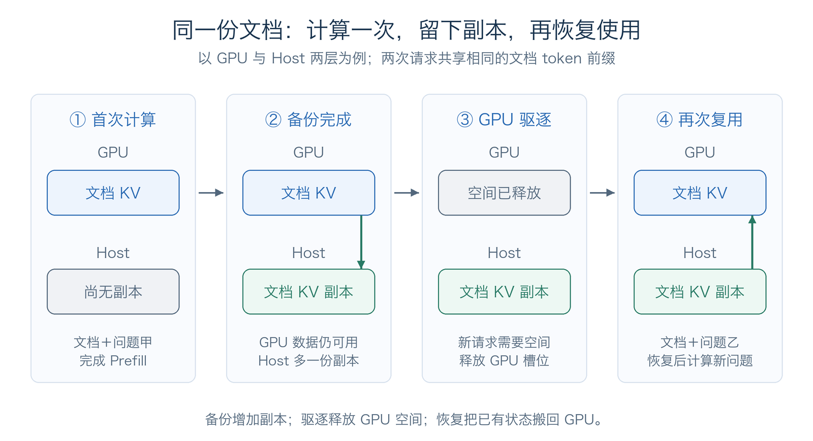

### 活跃 KV 卸载按层计算触发

前缀缓存主要扩大跨请求可复用历史的保留范围。活跃 KV offload 则处理另一种容量压力：显存连当前活跃请求的 KV 都装不下。

按层卸载时，在计算某层之前把该层 KV 从 CPU 加载到 GPU，计算之后再卸载，每个 Decode 步骤重复这一过程。Hugging Face cache offloading 采用类似机制，只保留当前层的 KV，并异步预取下一层。它用 CPU 到 GPU 的传输开销换取可用容量，需要按实际带宽、上下文长度和生成速度评估。

如果所有 KV 都属于活跃请求，普通空闲缓存淘汰不能解决容量不足。调度器需要减少准入或批次规模、暂停请求，或采用活跃 KV offload。让 SSD 参与逐步生成还需要专门的调度和预取，通常更适合能够接受较高延迟的场景。

### 传输缓冲与副本有效性必须保留

CPU 同时承担缓存和 SSD 到 GPU 的中转，需要留出传输缓冲。旧缓存若占满主机缓存池，即使 SSD 命中也可能无法加载。HiCache 的容量配置指南明确要求为 L3 预取留出 host pool 空间；它的池大小约束属于实现要求，不能只按机器的总内存容量推断。

异步备份或恢复期间，源槽位和目标槽位都需要受到保护，避免传输尚未结束就被释放或复用。缓存索引可以先登记已分配的目标位置，数据是否可读则由完成事件保证；例如内置 HiCache 会先发布 H2D 的目标索引，再让计算流在读取对应层前等待 load event。请求引用、传输中的临时锁与可淘汰副本需要分别管理。

NanoFlow 如何在生成过程中安排 D2H copy，以及通过连续缓冲和 scatter 改善 H2D 带宽，参见前文[“KV Cache 在生成过程中同步下沉到 CPU 与 SSD”](https://bytedance.larkoffice.com/wiki/EZcawGzFrirc8bkkvuqclJCpnXd#doxmyZ0UihqaDi0hC2dGmNIwixe)。该小节保留论文特定实现，本节描述通用策略与 HiCache 的配置行为。

## 跨层连续前缀匹配与三段拼接恢复

收到新请求后，HiCache 必须从输入起点拼出一段**无缺口的连续可复用前缀**，即使这段前缀分段散落在 L1、L2 与 L3 三个层级。跨层查找按三步推进：

1. **先匹配本地 L1 和 L2：**系统沿本地缓存树（如 `HiRadixTree` 或混合状态树 [`Unified Radix Cache`](https://github.com/sgl-project/sglang/blob/1d019ce1c85e11ff2f425344e66f446b106f6074/python/sglang/srt/mem_cache/unified_radix_cache.py)）从请求开头逐段比较 token。树节点同时记录该段 token 及其在 GPU 或 Host 中的副本位置；此阶段只查索引，尚未把 Host 的 KV 搬回 GPU。
2. **再按需查询 L3：**若启用了 L3，对于本地未匹配到的后续部分，系统按缓存页生成查找 key 向存储后端查询是否存在对应 KV。该 key 相当于“前缀指纹”，结合当前页的 token 与此前前缀生成，避免把文字相同但上下文（如前置 system prompt 或模板）不同的状态混用。系统按需逐页查询，无需在本地维护整个 L3 的全局位置表。
3. **确定连续可复用前缀并触发数据流转：**各层命中的片段必须从请求开头连续衔接，中间缺失一段时不能跳过缺口直接复用后面的缓存。查到副本后，由 [`HiCacheController`](https://github.com/sgl-project/sglang/blob/1d019ce1c85e11ff2f425344e66f446b106f6074/python/sglang/srt/managers/cache_controller.py) 组织 Host 与 GPU 之间的备份、恢复和存储访问；读源码时可重点对照其 `write`（下层备份）、`load`（Host 到 GPU 恢复）与 `prefetch`（存储到 Host 预取）三类动作。

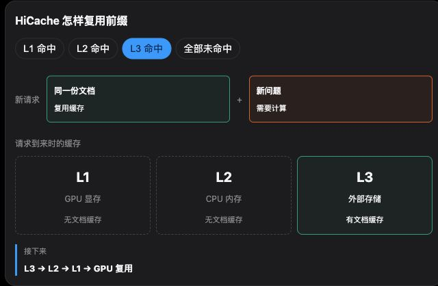

以缓存页大小 256 tokens、共 1,024 tokens 的文档前缀为例，跨层连续拼接的条件如下：

| 文档前缀中的位置 | 可用副本在哪里 | 参与 GPU 计算前需要做什么 |
|-|-|-|
| 第 1–512 个 token | `L1` | 直接使用 |
| 第 513–768 个 token | `L2` | 从 Host 恢复到 GPU |
| 第 769–1,024 个 token | `L3` | 先读到 Host，再恢复到 GPU |

只有三段副本全部就绪，才能复用完整的 1,024 tokens；若最后一段无可用副本，则只能复用前 768 tokens，剩余文档与新问题仍需执行 Prefill。恢复节省的是可复用前缀的重复前向计算，新问题 token 的 Attention 仍需读取恢复后的文档 KV。

### 从单一 KV 索引到统一缓存

Mini-SGLang 的 `RadixPrefixCache` 与 SGLang 的 `UnifiedRadixCache` 都按 token 前缀组织压缩树，支持前缀匹配、节点分裂、引用保护和缓存淘汰。两者的主要差别是管理范围：Mini-SGLang 在 GPU KV pool 上维护一套前缀索引；Unified 按组件管理不同类型的 KV 或递归状态，并可接入多级存储。

| 对比项 | Mini-SGLang RadixPrefixCache | SGLang UnifiedRadixCache |
|-|-|-|
| 节点载荷 | 一段 token 对应一组物理 KV 索引。 | 同一 token 路径关联各组件的数据记录，KV／state 本体仍在相应内存池。 |
| 缓存类型 | 普通 Attention KV。 | 由模型配置选择 Full Attention、SWA 窗口和 Mamba／SSM 状态等组件。 |
| 保护与淘汰 | 沿父链维护 ref_count，按访问时间回收无引用叶子。 | 按组件维护资源与引用；启用 HiCache 后分别保护 device 和 Host 副本，并处理组件间依赖。 |
| GPU 淘汰之后 | 这条实现没有下一级恢复路径，被淘汰部分需要重新计算。 | 若启用 HiCache 且下层仍有有效副本，可以从 Host 或 L3 恢复。 |

**Unified 统一的是缓存组件，HiCache 扩展的是存储层级。**使用 Unified 不要求一定配置 Host 或 L3；一棵树上匹配到了 token 路径，也不等于模型所需的所有组件都已在 GPU 上就绪。完整恢复需要共同满足组件可用性与传输完成条件。

本次对照核对至 Mini-SGLang `467f2eb3698593b3fbf1b8325092ab8235c2702c` 与 SGLang `0c44fbff44da7d1a11f0e8b4299e4b8a702ac414`，对应的前缀树基础操作见前文〈Radix 树按压缩路径管理共享前缀〉，下面继续说明 Unified 的组件记录。

### Host 与 device 的位置按组件记录

下面把跨层匹配对应到 SGLang 内置 HiCache 的源码。新增实现细节核对于 2026 年 11 月 16 日，源码提交为 `0c44fbff44da7d1a11f0e8b4299e4b8a702ac414`；原课程与基准报告继续沿用各自注明的版本。本节用 Python tree-core 展示数据结构，具体运行时也可能采用实现相同接口的 Rust tree-core。

`UnifiedTreeNode` 为 FULL KV、SWA 窗口和 Mamba state 分别保存 `ComponentData`。树负责维护前缀到池索引的关系，KV tensor 本体由相应 memory pool 保存。

| 字段 | 记录的内容 | 读取时的含义 |
|-|-|-|
| `value` | 该组件在 device pool 中的 slot indices。 | 已登记设备目标；异步恢复中的数据仍要等待完成事件。 |
| `host_value` | 该组件在 host pool 中的 slot indices。 | Host 侧有相应槽位，传输完成性另有状态管理。 |
| `lock_ref`、`host_lock_ref` | 设备侧和 Host 侧的保护引用。 | 防止请求或传输仍在使用的槽位被驱逐。 |

同一组件的 `value` 与 `host_value` 可以同时存在。GPU 驱逐可以释放设备副本并保留 Host 副本；H2D 恢复后，Host 副本也可以继续保留。树节点的 `evicted` 和 `backuped` 主要描述 FULL 组件，SWA 与 Mamba 的可用性还要分别检查。

### 匹配结果决定需要恢复哪些组件

调度器在尝试接纳请求前调用 `req.init_next_round_input(tree_cache)`，经 `match_kv_cache()` 取得匹配结果。HiCache 同时寻找仅依赖 device 的可复用边界，以及结合 Host 的可复用边界；边界要通过模型所需各组件的 validator。匹配结果随后写入 `Req`，供 `add_one_req()` 使用。

| 请求字段 | 单位 | 用途 |
|-|-|-|
| `prefix_len`、`last_node` | token／节点 | 记录当前 device 前缀及其树节点，用于准入、锁定和确定 extend 起点。 |
| `best_match_node` | 节点 | 各组件共同认可的匹配终点，作为 Host 恢复的锚点。 |
| `host_hit_length` | token | 记录 Host 匹配对应的 FULL 前缀长度；实际新增设备槽和搬运量由 transfer spec 决定。 |
| `mamba_host_hit_length` | slot | 需要从 Host 恢复的 Mamba checkpoint 数量，通常为 0 或 1。 |
| `window_host_hit_lengths` | 各池 token 数 | 记录各个窗口子池需要从 Host 恢复的部分。 |

`schedule_policy.py` 中的 `req.needs_host_load_back()` 使用下面的条件。任意一类 host hit 非零，就需要尝试恢复。

```python
return (
    self.host_hit_length > 0
    or self.mamba_host_hit_length > 0
    or any(self.window_host_hit_lengths.values())
)
```

FULL KV 已经在 GPU 上时，所需的 Mamba checkpoint 或 SWA 窗口仍可能只有 Host 副本，因此不能只检查 `host_hit_length`。辅助状态恢复还可能让原本受限的 GPU FULL 前缀变得可复用，`full_load_back_tokens()` 会据此区分匹配扩展长度和实际要搬运的 FULL 行数。

沿用本节的三段示例：在 L3 那段尚未合入可用前缀时，前 512 tokens 对应 `prefix_len=512`，其后的 256 个 Host tokens 对应 `host_hit_length=256`。恢复接纳成功后，前缀可推进到 768；L3 那段能否继续扩展前缀，还取决于预取结果和完整性检查。在 buffer-only 模式中，这些字段还可能由 `staged_prefetch_plan` 填写；`window_host_hit_lengths` 会优先读取该计划，不能把所有 host hit 都理解成树上长期驻留的 L2 副本。

### 匹配位置与数据来源分别计数

`host_hit_length` 描述本次匹配中 Host 可恢复的 FULL 前缀部分；`storage_hit_length` 记录本请求从 L3 预取带回的数据来源。后者确实存在，只是保存在 `Req` 上，不属于本地树查询返回的 `MatchResult`。

| 字段 | 所在对象 | 含义 |
|-|-|-|
| `device_prefix_len` | MatchResult | 本次匹配返回的 device 可复用前缀长度；写入 Req 时对应 prefix_len。已登记的异步加载仍需完成事件保证可读。 |
| `host_hit_length` | MatchResult／Req | 本次匹配中 Host 可恢复的 FULL 前缀扩展。普通纯 KV 路径下，不重复计算 device 已命中的部分。 |
| `storage_hit_length` | Req | 本请求的 L3 预取加载结果。普通 cache 模式会扣除 Host 插入时发现的重复部分；不是 L3 中可能存在的数据总量。 |
| `storage_hit_start` | Req | L3 加载区间在请求中的绝对起点，用来计算实际覆盖的前缀及来源重叠。 |
| `host_loaded_length` | Req | 准入时登记的 FULL 前缀扩展。与 host_hit_length 配合区分被采用的恢复和被放弃后重算的部分；该字段本身不证明 H2D 已完成。 |

在 Host 作为 L2 缓存的模式中，只在 storage、尚未读入 Host 的数据不会计入本次 `host_hit_length`。预取完成并通过完整性检查后，`insert_host()` 把结果接入缓存树；调度器取出 L3 加载区间，再调用 `init_next_round_input()` 重新匹配。此时，刚从 L3 搬来的数据可以成为 Host 命中。

另取一个便于核对字段的纯 FULL-KV 示例。设输入长度至少为 8192，页大小为 256，模型与缓存身份兼容，期间没有并发淘汰或重复插入。前缀区间 `[0, 1024)` 已在 GPU，`[1024, 3072)` 只有 Host 副本，`[3072, 7168)` 只有 L3 副本。下面两个快照都取在 L2 回迁提交之前：

| 时刻 | device_prefix_len | host_hit_length | Req.storage_hit_length |
|-|-|-|-|
| L3 预取之前 | 1024 | 2048 | 0 |
| 4096 个 token 预取成功，接入 Host 并重新匹配 | 1024 | 6144 | 4096 |

第二行的 `storage_hit_start=3072`。4096 已包含在 6144 中：这些 KV 当前位于 Host，来源是本次 L3 预取。后续 H2D 恢复成功后，可复用前缀为 `1024 + 6144 = 7168`，不能再加一次 `storage_hit_length`。按本请求的来源拆分，则是 device 1024、原有 L2 2048、L3 4096。

`split_cached_prefix_by_tier()` 会结合实际采用的前缀、Host 恢复长度和 L3 加载区间扣除重叠。L3 已经读回但最终未被请求采用的部分，不能直接算成成功复用。某段数据若由之前的请求预取并常驻 L2，本请求直接命中它时，也不会因为它历史上来自 L3 就重新记成本请求的 L3 读取。

上述数值关系限定于普通 FULL-KV 与常驻 L2 模式。混合模型的 FULL 匹配扩展不一定等于实际 FULL 传输行数；Mamba 和各 SWA 子池仍有各自的恢复字段。`buffer_only` 中 Host 是临时 staging，`host_hit_is_storage` 会帮助统计区分暂存与常驻 L2 命中。

## Host 布局要同时照顾计算与存储

GPU 按模型层计算，通常把同一层的 KV 放在一起。外部存储则适合按页读写：一个页对象包含一段 token 在多个模型层上的状态。

若 Host 沿用按层布局，同一页的数据分散在多个区域，存储读写需要处理多个片段。把同一页的数据聚在一起后，存储客户端可以更直接地访问连续的大块数据。

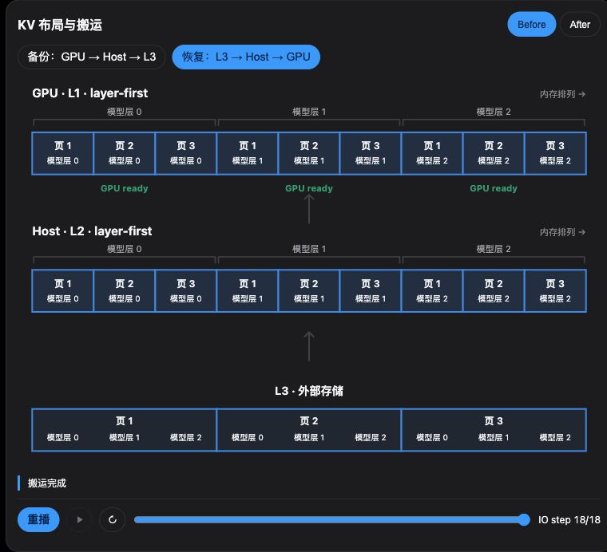

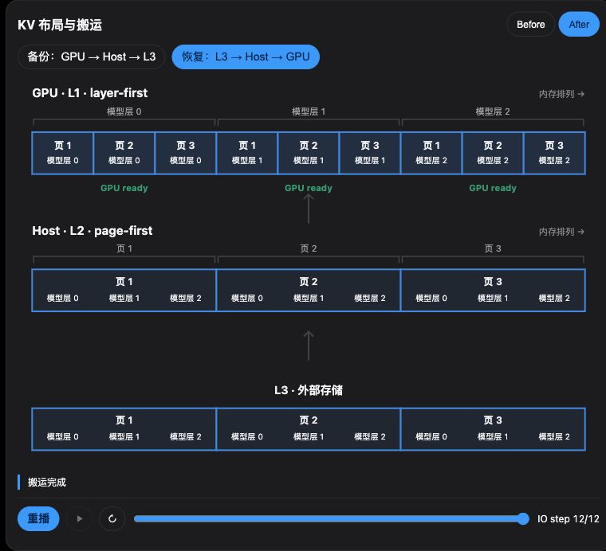

HiCache 支持不同 Host 布局，按页排列是可选路径，并非所有配置都必须改成它。

| 布局 | 数据组织 | 核对到的路径边界 |
|-|-|-|
| `layer_first` | 同一模型层的数据聚在一起 | 仍受支持，便于按层取数 |
| `page_first` | 同一页的跨层数据集中排列 | 与 `kernel` I/O 路径配合 |
| `page_first_direct` | 页内再聚合同一层的 token | 支持按页存储及 page-layer 粒度搬运，与 `direct` 路径配合 |

按页布局改善了存储对象组织；zero-copy 让存储客户端直接访问 Host 池中的数据，减少额外复制。数据仍需通过传输链路移动，Host → GPU 的恢复也没有消失。

2025 年 LMSYS 文章报告，GPU 辅助 I/O kernel 的 CPU–GPU 搬运吞吐最高达到标准 `cudaMemcpyAsync` 路径的 3 倍，按页布局与 zero-copy 配合时，Host–存储吞吐最高约为 2 倍。这些是作者报告的特定 I/O 上界，不能相乘得到服务加速，也不能保证每台机器都达到同样结果。

## 本层状态就绪后，开始本层计算

HiCache 用逐层完成事件衔接传输与计算：第 0 层所需的历史状态到达 GPU 后，可以计算新增 token 的第 0 层，同时继续搬运后续层。

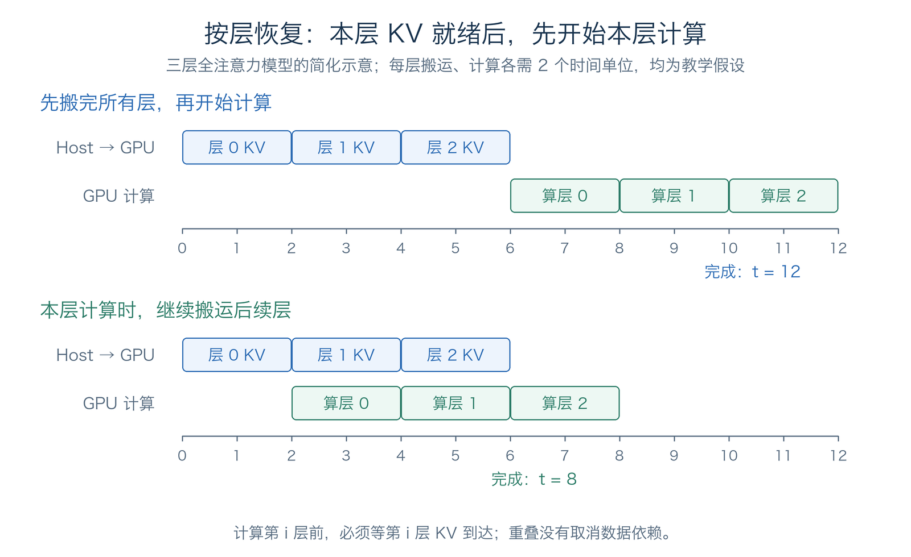

固定版本实现通过 `LayerLoadingEvent` 记录每层完成事件，计算流等待相应事件；`start_loading` 将按层完成通知交给搬运引擎。执行到下一层时，该层需要的数据仍必须就绪，不能把任意一小段 KV 的到达当作本层已经可执行。

这里重叠的是层状态传输与前向计算，与前文 Scheduler 的 CPU 调度重叠、CUDA Graph 的 capture／replay 分工不同。

截图展示的 L3 路径先按页读取到 Host，再按模型层恢复 GPU。这个顺序描述的是图中的接口与数据组织，不代表硬件上所有存储后端都只能按页读取，也不证明所有 L3 请求都必须读完整份数据后才能做任何后续工作。

### L3 在入队时预取到 Host

内置 HiCache 的普通非 PD 路径将两次搬运放在不同阶段：**L3 预取在请求入队时尝试发起；L2 回迁在请求通过本轮资源检查后准备，batch 确定后统一提交。**L3 读取完成后，请求仍可能等待 GPU 容量，不会因此立即开始 H2D。

| 时刻 | 调用与动作 | 数据和资源状态 |
|-|-|-|
| 请求入队 | _add_request_to_queue() 先调用 _prefetch_kvcache()，再加入 waiting_queue。先匹配 GPU／Host，再对未命中的后续前缀尝试 L3 预取。 | 预取查询和读取可与前序请求执行重叠，结果先放入 Host；长度门槛、限流和 Host 容量仍可能阻止本次尝试。 |
| 遍历等待队列 | check_prefetch_progress() 按策略判断能否收取结果；需要继续等待时，本轮跳过该请求。收取结果后重新匹配。 | L3 可恢复区间与 Host 命中得到更新，请求还没有因此获得 GPU 执行资格。 |
| 候选通过资源检查 | add_one_req() 准备恢复和后续计算的容量，再调用 init_load_back()。 | 开始分配 GPU 目标并排队；具体预算、源数据保护和回退规则见下一小节。 |
| 本轮 batch 确定 | ready_to_load_host_cache() 调用 start_loading() 合并提交 H2D。 | 新 batch 按完成事件消费恢复结果；返回索引与数据真正可读属于不同阶段。 |

这个时序把不同成本放在合适的位置。L3 查询与读取可能较慢且有波动，提前启动能利用请求本来就要经历的排队时间。GPU 显存更紧张，L2 回迁接近执行时才分配目标，可以避免尚未被接纳的请求长期占槽或反复搬入、淘汰。最后按 batch 合并提交，让传输有明确的消费批次，并为逐层计算重叠提供条件。

这些是由资源分配和依赖顺序解释的设计取舍，实际能隐藏多少延迟取决于队列、存储带宽、H2D 带宽和执行路径。预取尚未完成时的等待、提前终止和重算选择，统一放在后文〈预取要比较等待与重算〉讨论；恢复本身不要求必须先发生一次 L3 读取，原有 L2 命中可以直接进入回迁准备。

### 准入后排队，成批提交 H2D

逐层完成事件衔接的是已经提交的传输。继续往前追调度器，会发现内置 HiCache 将加载拆成两个时刻：`init_load_back()` 为单个已选请求分配目标并排队；本轮 batch 确定后，`start_loading()` 再合并提交。以下时序对应源码提交 `0c44fbff44da7d1a11f0e8b4299e4b8a702ac414`。

| 阶段 | 入口 | 本阶段完成的动作 |
|-|-|-|
| 匹配与选择 | `init_next_round_input()`、`_select_prefill_admission()` | 确定可复用前缀、extend 长度和 chunk limit，检查计算、KV 和 state 预算。 |
| 准备容量 | `add_one_req()`、`prepare_load_back()` | 通过 delayer 与 sharded scratch 检查，锁住匹配路径，并为恢复和后续执行准备容量。 |
| 分配与排队 | `init_load_back()` → `HybridCacheController.load()` | 分配 device 目标，加入 `load_queue`，把目标索引绑定到树，登记在途加载的锁；此时尚未提交该队列的 H2D。 |
| 提交本轮传输 | `ScheduleBatch.init_new()` → `ready_to_load_host_cache()` | `start_loading()` 合并队列，提交按层拷贝，返回事件组编号。随后调度器才执行 `prepare_for_extend()`。 |
| 消费本层数据 | `TpModelWorker`、`router.read()` | 设置本 batch 的 `hicache_consumer_index`，计算流在读取各层缓存前等待相应 load event。 |
| 完成清理 | `loading_check()`、`finish_load_back()` | 消费完成 ack，释放传输期间的 Host/device 锁和 pin。请求自己的引用继续按其生命周期管理。 |

**索引绑定、拷贝提交和数据就绪是三个不同的时刻。** `req.host_loaded_length` 在 `init_load_back()` 返回后赋值，表示本次恢复已接纳并登记的 FULL 前缀扩展，不能据此判定 DMA 已完成。树也可以提前暴露新 device indices；相应 batch 的完成事件负责保证计算读取到有效内容。

### 加载顺序保护容量和异步读写

| 顺序约束 | 为什么这样安排 |
|-|-|
| 先准入，再排 H2D | 匹配阶段会检查等待队列里的多个候选。先选好 chunk，并通过 delayer 和 scratch 检查，才能确认本轮有计算会消费恢复结果，避免未接纳请求提前占用设备槽和传输带宽。 |
| 先保护匹配路径，再 reclaim | 回收 device 容量可能触发旧 KV 写回；写回又可能需要淘汰 Host 缓存。`_lock_node(req.best_match_node, lock_host=True)` 保护已经选中的恢复源，防止准备容量时将它淘汰。 |
| 先准备完整需求，再固定传输目标 | 共享内存池的 `prepare_load_back()` 同时考虑恢复行、本次 extend、后续 decode 余量和已接纳工作。H2D 固定目标后会限制页面移动，因此容量回收和布局调整应先完成。 |
| batch 确定后合并提交 | 把各请求的 `CacheOperation` 合并，统一准备索引和事件。提交发生在 `prepare_for_extend()` 前，为传输与后续准备工作、适用路径的逐层计算重叠留出机会。 |
| 复用目标页前后分别建立依赖 | overlap 调度下，H2D stream 先等待旧 forward 对回收页的写入；新 forward 再等待本层 H2D 完成。已经排队的目标槽不能在拷贝结束前释放或被其他请求复用。 |

需要恢复并不保证一定提交拷贝。内置路径还会检查 transfer spec：FULL token 数小于 `max(1, load_back_threshold)` 且没有辅助组件传输时，可以跳过加载；当前提交的阈值为 10。容量或分配失败也可能使恢复返回零长度，随后按 `host_hit_length=0` 重新选择重算形状。返回 `None` 则表示暂缓本次接纳。该调用链要求承诺的 FULL 前缀全量接纳或完全不接纳，介于两者之间的部分结果会报错；恢复额外暴露了可复用的 device FULL 行时，则调整前缀并收缩 extend。

常规逐层读取最终使用 `current_stream().wait_event()` 建立 GPU stream 依赖，无需在 CPU 上先等待所有层。Mamba COW 可能需要等待最后一个 state 层，CUDA Graph 也有专门的事件处理路径，因此是否充分重叠要看具体执行方式。后续 ack 主要负责传输资源与锁的清理，不能替代计算前的数据依赖。

以上“单请求排队、按 batch 提交”适用于内置 HiCache；buffer-only 使用临时 Host staging 承接 L3 数据。`init_load_back()` 是多态接口，LMCache、FlexKV 和 external linker 可能在不同阶段提交拷贝，接入这些后端时应沿其实现重新核对。这里给出的是静态源码时序，不代表已经完成 GPU 性能复测。

## 预取要比较等待与重算

前面的调用链说明了预取如何利用排队时间；本节讨论调度器检查预取进度时，应该继续等待，还是收取已就绪前缀并重新计算缺失后缀。下面三种策略控制这一步的等待边界，不能替代后续的 GPU 容量准入：

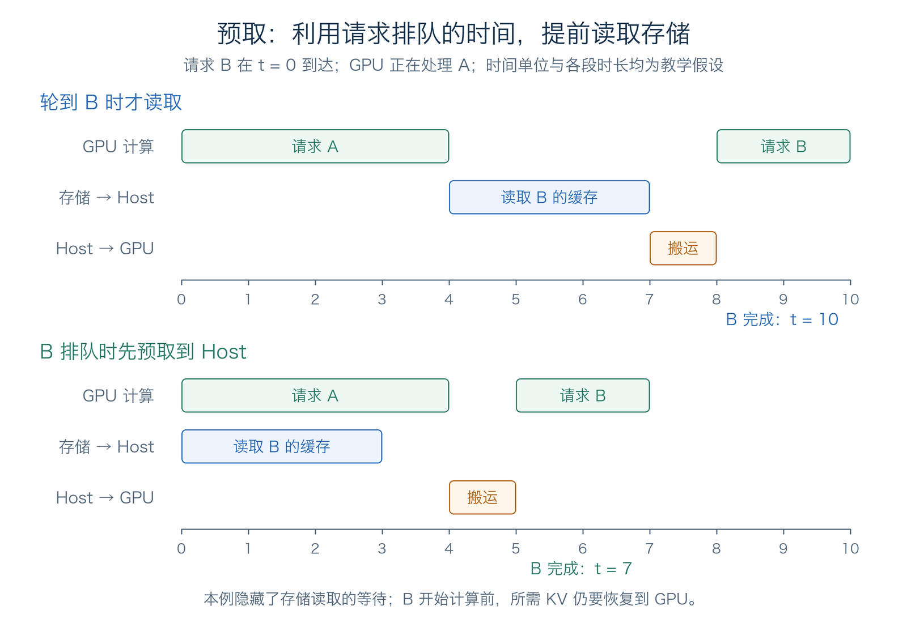

| 预取策略 | 请求可以执行时的动作 | 适用目标 |
|-|-|-|
| best_effort | 使用已取回的连续前缀，停止额外等待，剩余部分重新计算。 | 避免存储读取额外拖延请求。 |
| wait_complete | 等待计划预取的数据全部完成。 | 尽量减少重复 Prefill。 |
| timeout | 最多等待一段时间，完成或超时后继续执行。 | 在复用率和延迟之间取舍。 |

这些是 HiCache 提供的实际策略。以 2026 年 10 月 24 日访问的 HiCache 文档为准，其 L3 默认预取触发门槛为 256 token，可通过配置调整。这个工程门槛用于避免很小的读取操作，并不保证超过门槛就一定比重新计算快，默认值也可能随版本变化。

对于同一段可复用前缀，L1 命中的状态已在 GPU 上，而 L2 和 L3 命中还要付出数据恢复耗时：

$$T_{\mathrm{restore}} \approx T_{\mathrm{storage\to Host}} + T_{\mathrm{Host\to GPU}}$$

L2 命中只含后一项，L3 命中通常包含两项。在不考虑重叠时，只有当 $T_{\mathrm{restore}}$ 短于重新计算这段前缀的 Prefill 耗时，下层命中才有直接的延迟收益。假设某段前缀重算需 200 ms，从 Host 恢复需 40 ms，则 L2 复用能直接省时；若从较慢存储读取需 210 ms、再加上 Host 到 GPU 的 40 ms（共 250 ms），不重叠时的恢复反而比直接重算更慢。

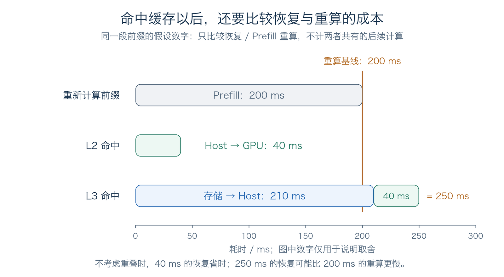

以首 token 延迟为目标时，更有用的判断是：

$$T_{\mathrm{extra\ wait}} < T_{\mathrm{prefill\ saved}}$$

左侧表示选择加载后额外增加的等待时间，右侧表示缓存复用能省下的 Prefill 时间。估计时要考虑 SSD 排队、CPU 到 GPU 的传输，以及能被请求排队或计算隐藏的时间。GPU 计算拥挤时，即使加载本身稍慢，减少 Prefill 工作量也可能改善整体吞吐；延迟和吞吐目标可能得到不同选择。

策略选择还取决于未就绪部分的重算成本。下面固定缓存状态和搬运开销，只改变重算成本，比较三种策略何时得到首个 token。GPU 处理请求 A 时，请求 B 的 L3 预取可以提前进行；轮到 B 时，读取若未完成，就会产生等待与重算的取舍。

可复用前缀 X 为 12 tokens，轮到执行时已就绪 Y 为 4 tokens，额外等待上限 Z 为 2 个单位。全部读回还需 4 个单位，Host → GPU 搬运和新问题计算各需 1 个单位。

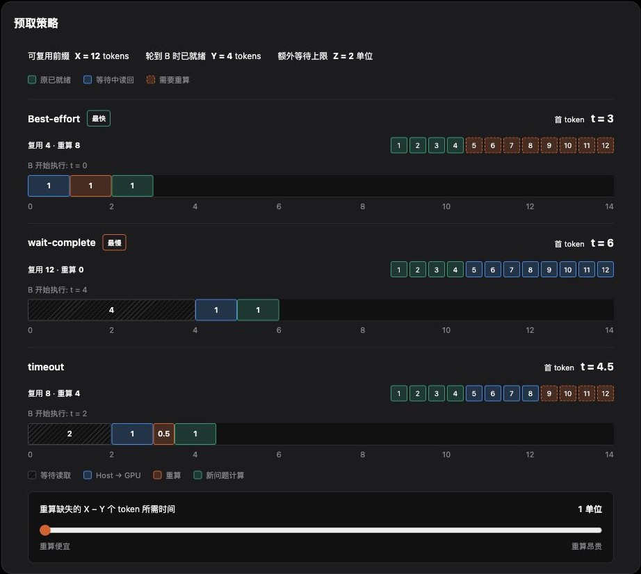

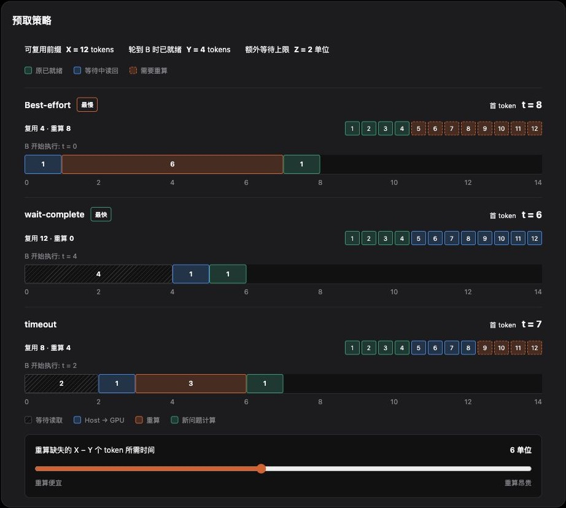

| 缺失部分的重算成本 | `best_effort` 首 token 时刻 | `wait_complete` | `timeout` |
|-|-|-|-|
| 1 个单位 | 3 | 6 | 4.5 |
| 6 个单位 | 8 | 6 | 7 |

同样的命中机会在不同重算成本下，会得出不同等待策略。表内数值全部来自教学演示，不能当作真实服务的秒数或默认超时建议。

混合模型还需要完整性检查。固定源码对按页对应的附加状态，可以按各池共同的连续命中长度限制可用前缀；SWA、MAMBA 等窗口或尾部状态若不完整，则可能丢弃整次预取。因此，读回多少 FULL KV token，不能直接等同于混合模型能复用多少 token。

## 已有 KV 不能替代缺失的快照

前文 Gated DeltaNet 章节已经说明，同一前缀边界必须同时具备 Attention KV、递归和卷积状态。下面看这个条件如何影响已有缓存的增量备份。

请求甲是“文档＋问题甲”，Host 已保存它的全注意力 KV，以及读完问题甲后的递归快照。请求乙是“文档＋问题乙”。复用文档时，需要的是“只读完文档”的快照；甲的末尾快照已经包含问题甲，不能拿来代替。

原课程用一次历史修复说明这个问题：旧备份路径主要由新节点触发，已有 Host 全注意力 KV 的前缀容易被视为已备份，后来生成的新递归快照缺少单独补存的机会。

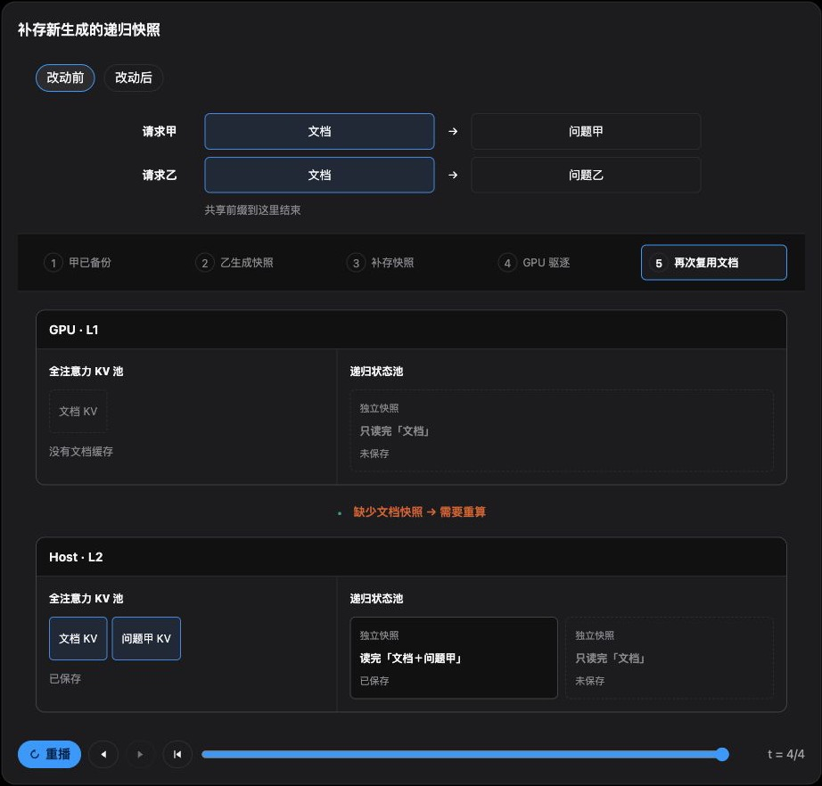

修复后，write-through 路径检查缺失的组件状态，单独补存新快照。已有 KV 和旧快照保留原样，避免重复拷贝整段前缀。

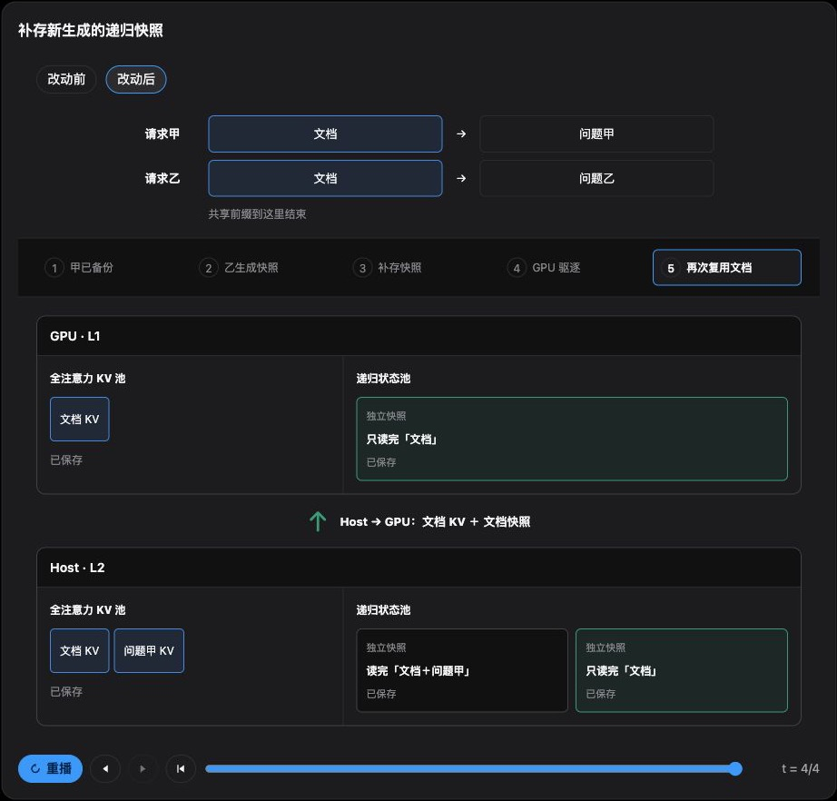

[PR #33639](https://github.com/sgl-project/sglang/pull/33639) 的作者在受控驱逐测试中报告，最后 10 个请求完整恢复 6.4K 共享前缀的数量由 1 个增至 10 个，输入 token 命中率由 15.74% 增至 64.00%。每个请求包含 6.4K 共享 token 和 3.6K 新 token，64% 表示共享部分全部恢复，不能解释成吞吐或模型质量提升。

这个测试使用 Qwen3-Next-80B-A3B-Thinking、TP2、Host ratio 12、`direct` 与 `page_first_direct`、`write_through`，没有配置 L3。PR 的增量路径限定于 write-through，已有备份进行时会跳过，并未在该修复中实现 write-back 增量补存。三种备份策略的时机仍按前文区分，不能把这一测试写成 Mooncake L3 的通用恢复成功率。

投机解码还需要恢复兼容的 draft 历史。target 命中前缀而 draft 缺失历史时，候选 token 的接受率可能下降。多池备份接口可以组织这些状态，但具体恢复布局与模型结构相关，不能由通用接口推断所有 MTP、EAGLE、DSpark 模型都已验证。

## Host 也可以只作传输缓冲

已经接入 L3、但 Host 内存有限时，支持的版本和模型组合可以选择 `buffer_only`：长期历史交给 L3，Host 只承担临时搬运，不再长期保留可供直接命中的 L2 副本。

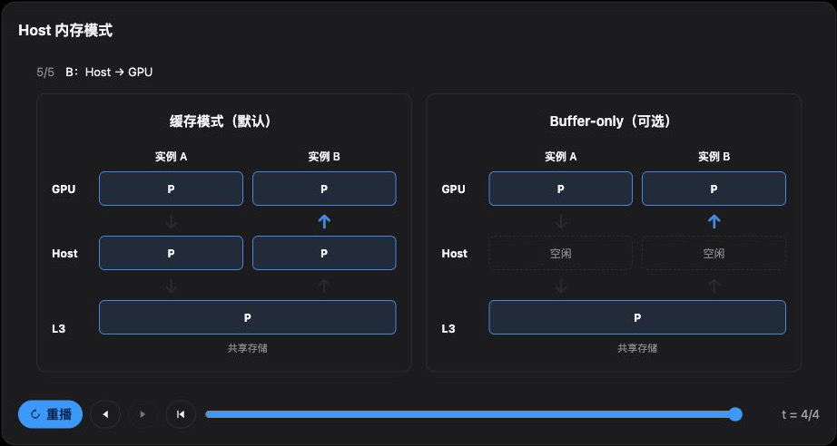

实例 A 备份时，GPU → Host → L3；写入完成后释放 Host 缓冲。实例 B 恢复时，L3 → 本实例 Host → GPU；搬运完成后再次释放缓冲。传输路径没有改变，改变的是搬完之后是否继续保留 Host 副本。

这样可以用更小的 Host 池完成传输，代价是少了直接命中 L2 的机会，GPU 未命中后的复用更依赖 L3 的读取速度。

这里有明确版本边界：本章核对的固定提交 `1d019ce1c85e11ff2f425344e66f446b106f6074` 中，`--hicache-host-memory-mode buffer_only` 只支持 FULL/SWA unified trees，含 MAMBA 的组合会被拒绝。原课程把它作为可选方案介绍，实际部署前仍须检查安装版本与模型组件，不能直接照搬到所有混合模型。

## 性能数字必须带上基线

前面的图解释机制，下面两组数字来自原作者的实际基准报告。它们使用不同模型、硬件和请求形状，应分别阅读，并沿用前文 Benchmark 的观测边界。输入吞吐按各自基准的统计口径说明。

### 长上下文对照中，预填充要单列

2025 年的 LooGLE 长上下文问答测试，在 8 张 H20-3e 上运行 DeepSeek-R1、TP8，依次增加 Host L2、3FS L3，并单独测试预先填充 L3 的情况。

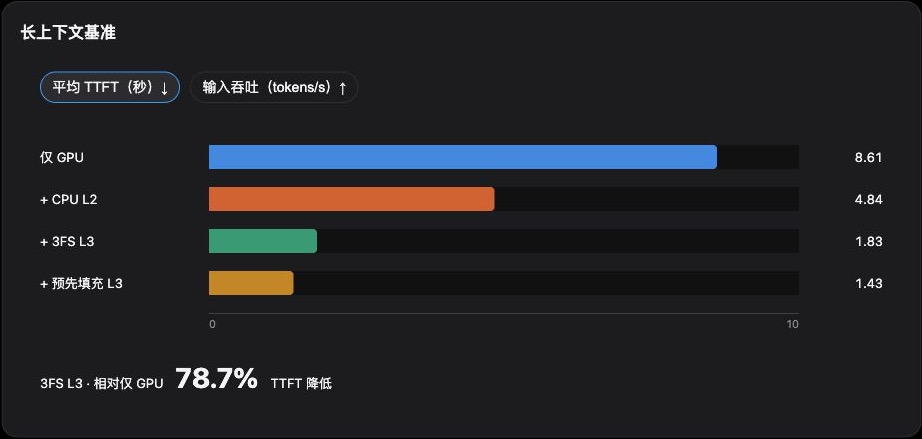

| 缓存配置 | 平均 TTFT | 输入吞吐 |
|-|-|-|
| 仅 GPU | 8.61 s | 8,157 tokens/s |
| 增加 Host L2 | 4.84 s | 12,451 tokens/s |
| 增加 3FS L3 | 1.83 s | 51,168 tokens/s |
| 预先填充 L3 | 1.43 s | 76,322 tokens/s |

普通 L3 相对仅 GPU 的平均 TTFT 降幅约为 78.7%。预先填充改变了初始缓存状态，不能把它的全部收益归到“增加一个存储层”上。

配置提纲使用 page size 64、上下文上限 65,536、chunked prefill 6,144、Host ratio 2、`page_first` 与 `kernel`、`wait_complete`。原资料未给出完整的并发、网络、存储容量及重复测试误差，数字应保留为来源报告。

### 15.5 倍衡量的是有效输入吞吐

2026 年多轮基准比较 L1、L1＋L2、L1＋L2＋500 GiB Mooncake L3。这里的 DeepSeek-V4-Flash 与后文的 DeepSeek V4.1 Flash 不是同一版本，测试条件如下：

| 条件 | DeepSeek-V4-Flash | Inkling-Small |
|-|-|-|
| 模型状态 | FULL、SWA；配置示例为 FP8 路径 | FULL、SWA、MAMBA |
| GPU / TP | 4 × H200，TP4 | 8 × H200，TP8 |
| 客户端与轮数 | 48 个客户端，60 轮 | 64 个客户端，30 轮 |
| 每轮新增输入 / 输出 | 4,096 / 16 tokens | 1,216 / 64 tokens |
| L3 | 500 GiB Mooncake | 500 GiB Mooncake |

两组提纲都采用 page size 64、Host ratio 2、`page_first` 与 `kernel`、`write_through` 与 `wait_complete`，最大执行请求与客户端并行均为 16，request-rate 为 64，并使用 round barrier、FIFO 和固定 seed 20260626。

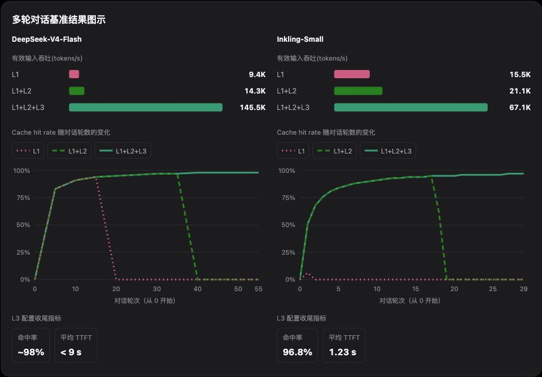

| 模型的有效输入吞吐 | L1 | L1＋L2 | L1＋L2＋L3 |
|-|-|-|-|
| DeepSeek-V4-Flash | 9.4K | 14.3K | 145.5K tokens/s |
| Inkling-Small | 15.5K | 21.1K | 67.1K tokens/s |

DeepSeek 的 145.5K / 9.4K 约为 15.5 倍，是同一个模型在这组负载下的层级对照。固定 benchmark 脚本将完整 prompt 的 token 总数除以墙钟持续时间，包含命中缓存的前缀。它反映处理完整输入的服务能力，不能解释成 GPU 对新增 Prefill token 的计算速度或 Decode 速度增加 15.5 倍。

原作者报告，DeepSeek 的 L3 配置在预热后的后续轮保持约 98% 命中，平均 TTFT 低于 9 s。Inkling 的收尾命中率为 96.8%，收尾 TTFT 为 1.23 s。收尾指标不等于全程所有请求的平均值，两行绝对吞吐也不能用于比较模型优劣。

这些结果说明，工作集超过较小缓存容量时，下层能够保留更多复用机会。实际评估还要看新增 I/O、Host 占用、存储等待及尾延迟。原博客的启动命令只是配置提纲，含模型路径与 Mooncake 配置占位，缺少完整环境锁定和误差统计，不能当作本章已完成的复现。

## 适用场景判断与服务指标验证

开启分层缓存并不总是降低延迟，评估某个业务场景能否从 HiCache 获益，需要先看重复前缀与容量压力是否同时存在：

- **高收益场景：**多轮对话重复携带历史、围绕同一份长文档反复问答、Agent 多次使用相同任务前缀。这些负载具有较长的共享前缀，且当并发历史较多、两次复用间隔较长、GPU 显存不足以把热点前缀常驻留在 L1 时，L2 与 L3 才能补回因驱逐而失去的命中。
- **收益受限边界：**若热点前缀本就能常驻 L1，或请求几乎没有公共前缀、输入很短，又或 PCIe / 网络搬运链路已经拥堵，增加下层缓存容量未必能改善延迟，反而会因为备份写入消耗额外带宽和 Host 内存。此外，HiCache 优化的对象是重复 Prefill，不能仅凭开启它就推断 Decode 步速会变快，也不会因此提高模型支持的最大上下文长度。

在模型和硬件支持的环境中，可以先从 GPU（L1）与 Host（L2）两层开始验证：

```bash
python3 -m sglang.launch_server \
  --model-path Qwen/Qwen3-0.6B \
  --enable-hierarchical-cache
```

`--enable-hierarchical-cache` 会启用分层缓存机制，但不会自动配置共享 L3；Host 池大小、写策略、预取策略及外部存储后端接入方式，需结合实际安装版本的 [HiCache 使用与配置文档](https://github.com/sgl-project/sglang/blob/1d019ce1c85e11ff2f425344e66f446b106f6074/docs/docs/advanced_features/hicache_best_practices.mdx) 核对。压测验证时，可构造共享长前缀的重复请求并在两次请求间插入背景流量触发 GPU 驱逐，在与关闭 HiCache 基线保持模型、请求分布和并发一致的前提下，同时核查 TTFT、输入吞吐、尾延迟（如 P99 TTFT）以及各层实际复用的 token 数、Host 占用和搬运负载。

结合本章机制，可以用以下六个问题自查分层缓存的关键链路：

| 自查问题 | 核对要点 |
|-|-|
| 已有 Paged KV Cache 和前缀缓存，为什么还需要 HiCache？ | Paged KV Cache 解决显存分页分配与碎片回收，前缀缓存避免相同前缀的重复 Prefill，但两者都受限于 GPU 显存容量；HiCache 用 Host 内存和外部存储承接被 GPU 驱逐的历史副本。 |
| 同一段前缀命中 L1、L2 和 L3 时，执行前分别需要做什么？L3 一定是共享存储吗？ | L1 命中可直接在 GPU 参与计算；L2 命中需分配 GPU 槽位并从 Host 搬回 GPU；L3 命中通常先读到 Host 再搬回 GPU。L3 是否跨实例共享取决于存储后端与部署配置。 |
| 某段前缀重算需 150 ms，从 Host 恢复需 30 ms，从存储读取还需 200 ms，不考虑重叠时两种下层命中是否都有收益？ | L2 命中耗时 30 ms < 150 ms，有直接延迟收益；L3 命中总耗时约 200 + 30 = 230 ms > 150 ms，不重叠时比直接重算更慢。 |
| 排队预取有什么作用？`best_effort`、`wait_complete` 和 `timeout` 如何取舍？ | 预取利用前序请求占用 GPU 的排队窗口提前把 L3 数据读到 Host。轮到执行仍未读完时，`best_effort` 立即用已就绪前缀并重算剩余部分，`wait_complete` 等全部读完以省下重算，`timeout` 用等待上限折中。 |
| 为什么第 0 层 KV 就绪后就能开始计算？需要满足什么数据依赖？ | Transformer 按层顺序前向执行，计算第 0 层只需第 0 层的历史 KV，可与后续层的 H2D 搬运重叠；但进入第 $i$ 层计算前，第 $i$ 层所需的全部状态必须已到达 GPU。 |
| 开启 HiCache 后命中率上升，但 TTFT 尾延迟变差，应从哪些方面排查？ | 检查 L3 存储读取延迟与带宽拥堵、`wait_complete` 等待耗时是否超过重算耗时、Host 缓冲池是否因打满而阻塞预取，以及大量一次性前缀触发的无效备份写入负载。 |

## 实现演进与阅读线索

下表保留原课程时间线中的可检索线索。日期按原网页列示，不替代逐个 PR 的合入记录核验。

| 网页列示日期 | 演进内容 | 实现线索 |
|-|-|-|
| 2025-02-24 | GPU 与 CPU 分层缓存 | [#2693](https://github.com/sgl-project/sglang/pull/2693) |
| 2025-07-07 | 高效 CPU–GPU 搬运 | [#7313](https://github.com/sgl-project/sglang/pull/7313) |
| 2025-07-18 | 外部存储层 | [#7704](https://github.com/sgl-project/sglang/pull/7704) |
| 2026-04-14 | 递归状态与辅助 buffer 存储 | [#21259](https://github.com/sgl-project/sglang/pull/21259) |
| 2026-08-06 | target 与 draft 状态恢复 | [#30393](https://github.com/sgl-project/sglang/pull/30393) |
| 2026-08-10 | 分支 checkpoint 增量备份 | [#33639](https://github.com/sgl-project/sglang/pull/33639) |
| 2026-08-19 | Host 改作传输缓冲 | [#34798](https://github.com/sgl-project/sglang/pull/34798) |

## 源码锚点与验证边界

HiCache 的实际收益取决于省下的重复 Prefill 时间能否抵消恢复在关键路径上增加的等待。容量保住历史副本，页优先布局和逐层事件为传输重叠提供条件，多池快照守住混合模型的恢复边界。本章原课程机制与配置核对至 SGLang `1d019ce1c85e`，多轮基准脚本核对至 `2969ab3d4147`；Unified 与 Mini-SGLang 的职责对照、Host／Storage 命中口径、L3 入队预取及 H2D 准入与提交时序的源码补充核对至 `0c44fbff44da7d1a11f0e8b4299e4b8a702ac414`，未进行 GPU 复测。各版本的配置限制和性能结论应分别阅读，完整出处集中在文末〈参考〉。下一章将视角从单实例多级缓存推向集群级 Prefill/Decode 分离与 Mooncake 跨节点 KV 调度。
