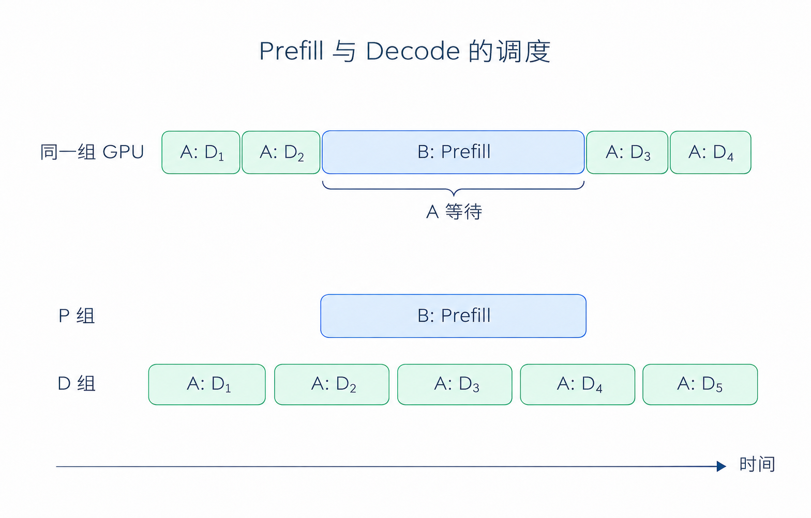
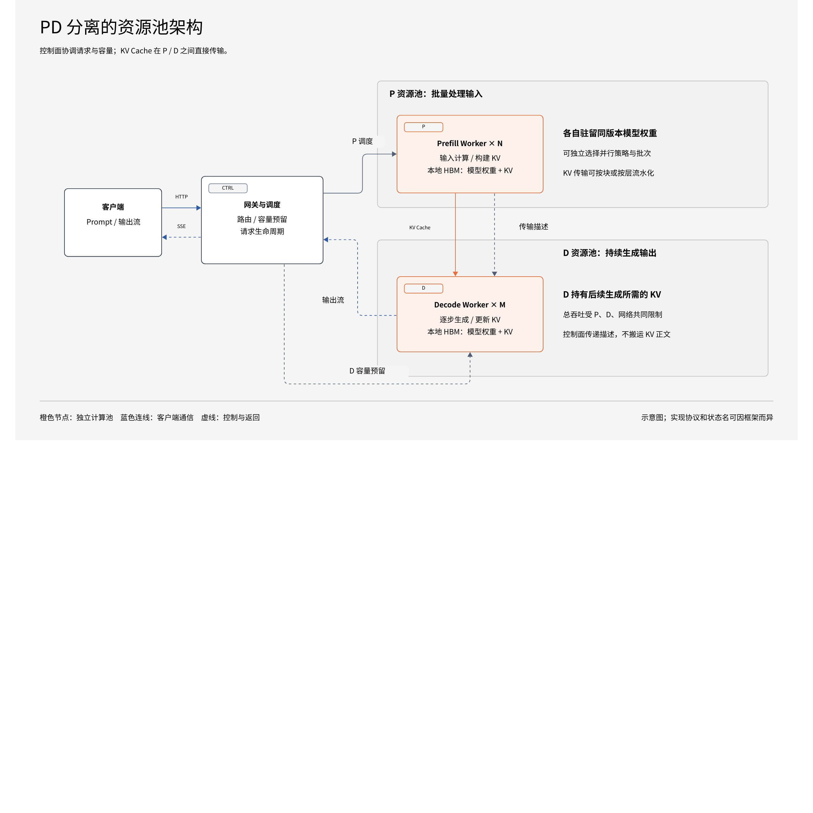
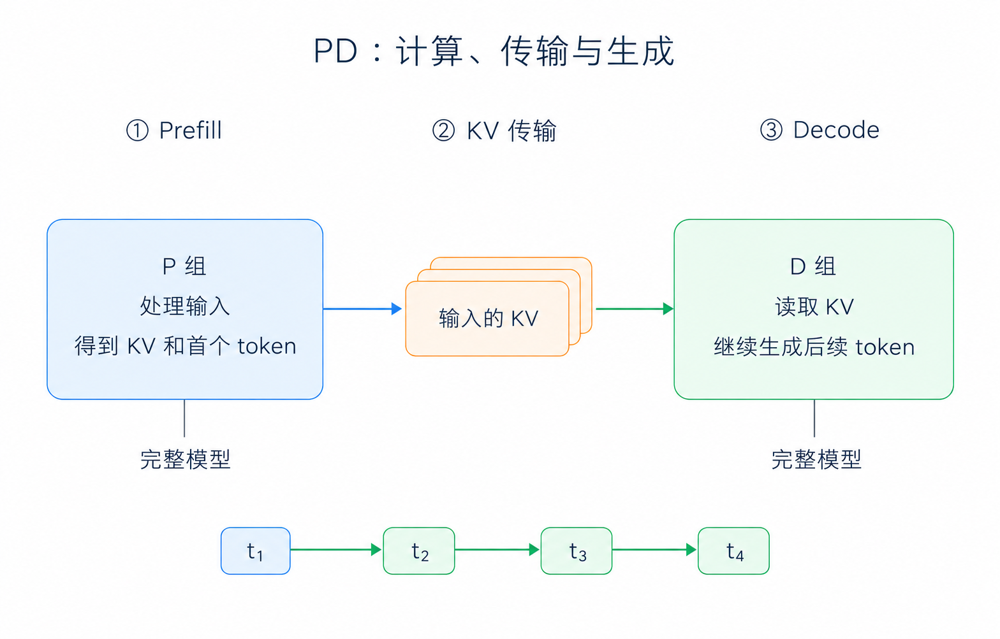
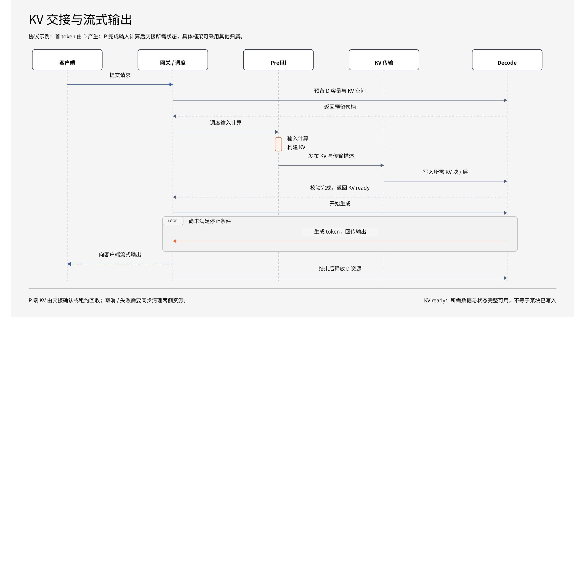
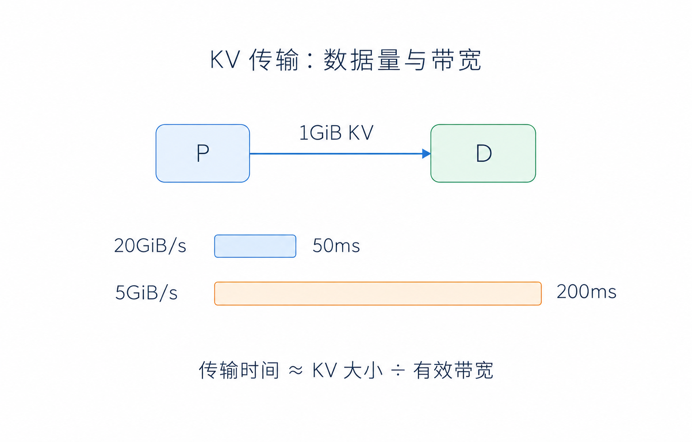
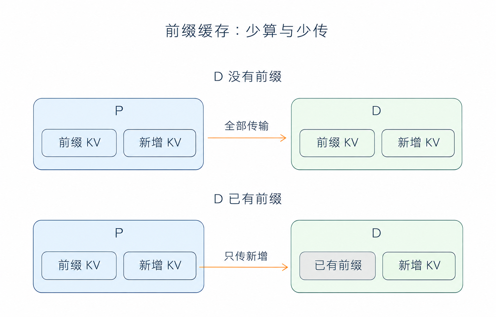
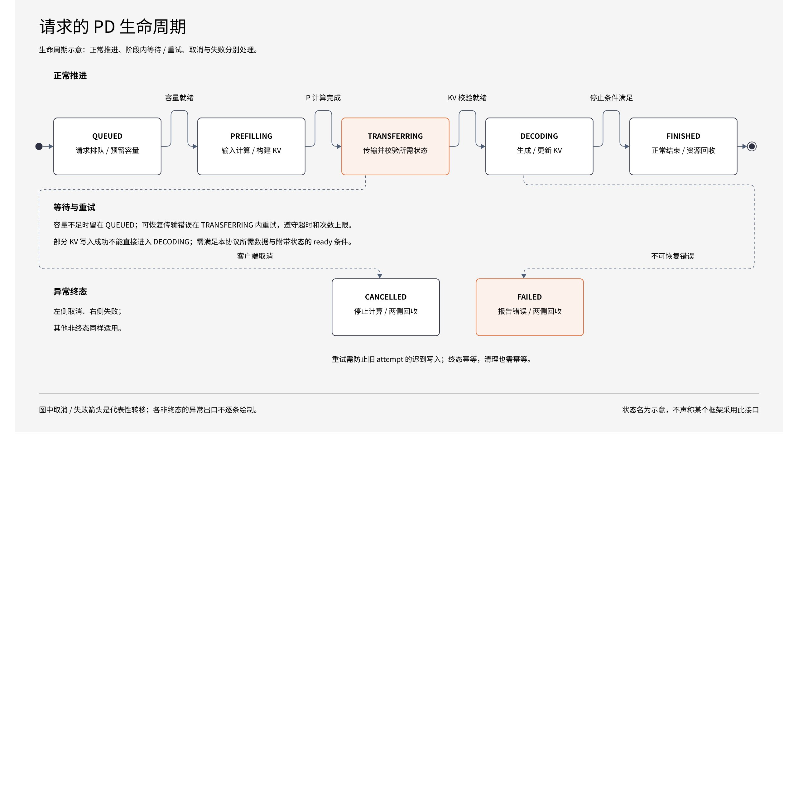
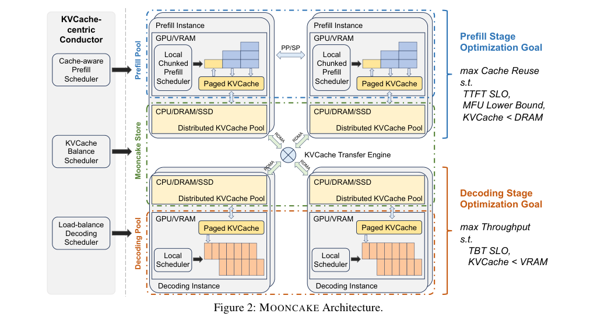

# PD 分离与跨节点 KV 调度：从架构契约到 Mooncake

```{contents} 本页目录
---
depth: 2
local: true
---
```

前一章已经说明，查到历史副本以后，还要把数据恢复到可执行状态。PD 分离（Prefill / Decode 分离，也称预填充与解码分离、Disaggregated Serving）又增加了一次跨实例交接：同一条生成请求的 Prefill 和 Decode 由不同实例或独立 GPU 资源池完成，P 端算好的状态通过 KV Cache 交接给 D 端。这样可以减少两阶段共用计算资源时的干扰，也让两端按各自的工作负载独立分配容量与优化参数。

<callout emoji="💡">
**核心判断：**PD 分离把同一个生成请求的两个计算阶段放到不同的资源池，通过 KV Cache 交接状态。它允许分别优化首 token 延迟（TTFT）和后续生成间隔（ITL / TPOT），但会增加传输、调度、权重副本和故障处理成本。是否值得拆，取决于业务 SLO 下的有效吞吐（Goodput）与总成本。
</callout>

## 长 Prefill 会打断流式输出

设请求 A 正在生成回答，请求 B 带着长文档到达。同一组 GPU 如果转去执行 B 的长 Prefill，A 就要等这轮计算结束，才能继续 Decode。用户看到的是回答中途停顿，即使整条请求的平均 TPOT 变化不大，某次 token 间隔也可能明显变长。

判断这类停顿，应沿用 Benchmark 章节的口径，重点查看 ITL 的分布和尾部抖动。客户端一次非空 chunk 可能包含多个 token，chunk 到达间隔与逐 token ITL 要分别记录。TPOT 会把多轮等待平均到整条请求中，不能单独用它判断流式输出是否稳定。



原文图：混部时，新请求的 Prefill 插入已有请求的 Decode 轮次之间；分离后，两组设备分别处理输入和后续生成。时间为示意。

Chunked Prefill 把长输入切成多个计算块。如果调度器在块间安排 Decode，就能缩短已有请求的单次等待；仅仅切块，并不保证 Decode 获得执行机会，前文 Mini-SGLang 的纯阶段选批就是这种区别。块大小仍要兼顾 Prefill 效率与输出间隔，两阶段也仍然共享 GPU。

PD 分离将两类计算放到不同的设备组，与常规合设部署及相邻并行、缓存技术的分工边界对比如下：

| 比较项／相邻技术 | PD 合设或技术职责 | PD 分离下的特征与关系 |
|-|-|-|
| 请求执行与 KV 驻留 | 单实例处理输入并持续生成，KV 通常留在实例本地 | P 实例处理输入，D 实例接管生成；KV 需跨实例传输或经共享层获取 |
| 扩缩容与调度目标 | 扩实例同时增加 P、D 能力；同一调度器内折中平衡两阶段 | 两池独立扩缩；P 侧控 TTFT，D 侧控 ITL 节奏，并协调状态交接与预留 |
| TP / PP / DP | TP 按张量切分算子与权重，PP 按层流水切分，DP 增加服务副本 | P、D 可各自采用不同 TP / PP / DP 配置，跨池交接需处理 KV 布局转换与层级映射 |
| Continuous Batching / Chunked Prefill | 前者动态腾出槽位接纳新请求，后者将大 Prompt 切块调度 | 合设和分离都需要；分离后 Chunked Prefill 仍可改善 P 池长短请求公平性与传输重叠 |
| Prefix Caching / KV Offloading | 前者复用相同前缀已算好的 KV，后者将 KV 卸载到 CPU 或远端存储层 | 可与 PD 分离组合，降低 P 计算量并改变 P/D 配比与网络迁移量 |

把两个阶段拆开后，长 Prefill 不再直接占用 D 端的执行轮次，但 D 的排队、batch 大小和 KV 接收仍会影响生成速度。同机不同 GPU 也不一定完全隔离：两个阶段可能争抢 NIC、PCIe、主机内存、CPU 和电力预算；即使 GPU 池拆开，也要检查这些共享瓶颈。

## 系统架构与 P/D 职责边界

本节按同一模型、标准 Attention KV 路径说明分工：P 池负责批量处理输入并构建 KV，D 池维护活跃生成请求并逐步更新 KV。控制面协调路由、容量预留和状态交接，KV 数据面尽量走 P 与 D 的直接传输路径。每端可以由一张卡或一组卡组成，也可以在适配条件满足时使用不同类型的加速器。

| 分工 | 处理的工作 | 留在本端的状态 |
|-|-|-|
| P | 处理输入，生成各层输入 KV；原文所述流程还在这里产生首个 token | 输入的 KV，直到交接完成；可按缓存策略保留可复用前缀 |
| D | 接收所需 KV 和请求状态，继续逐 token 生成 | 收到的历史 KV，以及生成过程中追加的 KV |



两端都会经过模型的全部层，因此每个设备组都需要驻留完整模型权重。组内仍可用 TP、EP 或 PP 分摊模型；“完整模型”指整组覆盖全部层，不要求每个 Rank 单独持有全部权重。围绕这两个资源池，完整 PD 分离服务由六个核心组件协同工作：

| 组件 | 职责 | 必须掌握的状态 |
|-|-|-|
| 入口网关 | 鉴权、限流、请求规范化、流式连接、取消传播 | `request_id`、租户、客户端连接、截止时间、请求 `attempt` |
| 路由与调度 | 选择 P / D，综合缓存命中、负载、拓扑和容量 | token 队列、预计执行时间、D KV 水位、预留和缓存目录 |
| Prefill Worker | 计算或复用 Prompt 状态，发布可交接的 KV | 实际 token 序列、有效前缀、KV 分块与完成状态 |
| KV Transfer Engine | 数据传输、布局适配、完成通知、失败清理 | 源／目标地址、块版本、长度、传输标识、完成状态 |
| Decode Worker | 验证兼容性，接管采样与生成，维护 KV 生命周期 | 生成位置、输出 token、采样状态、停止条件、KV 页表 |
| 观测与控制 | 收集全链路指标，按阶段扩缩容，提供回退策略 | 请求时间戳、资源队列、网络拥塞、错误与回收水位 |

控制消息（如请求标识、块清单和 ready 通知）通常很小，而 KV 数据可能达到 GiB 级。若全部经过网关转发，网关会承担额外拷贝、带宽和内存压力，还会把流式控制与大块数据拥塞耦合起来。直接 GPU／主机间传输是常见优化方向，但实际路径可能包含内存注册、host staging、格式转换、多个 PCIe 跳转和 NIC 带宽限制，应使用链路观测确认。常见物理部署组合的权衡如下：

| 部署方式 | 优势 | 主要限制 |
|-|-|-|
| 同机不同 GPU | 可利用 NVLink / NVSwitch，缩短交接路径 | 独立扩容粒度、权重驻留、拓扑和共享带宽受单机约束 |
| 同机架跨服务器 | 资源池规模更灵活，可独立调参 | NIC 数量、有效链路带宽、机架交换容量与 NUMA 影响显著 |
| 跨机架 | 扩大资源调配范围 | 交换网络收敛比（oversubscription）、拥塞和尾延迟需要验证 |
| 异构 GPU 资源池 | 可分别选择计算、带宽、显存和成本更匹配的设备 | 权重精度、KV 格式、内核、并行布局与可靠性更复杂 |
| 共享 KV 缓存层 | 有机会复用前缀，减少重复 P 计算，支持更灵活放置 | 新增缓存目录、一致性、读写带宽和冷热数据管理成本 |

没有充分测量时，不建议把跨地域交接视为默认在线路径，其传播时延、跨域带宽和数据安全要求都可能超过交互服务的收益空间。按照常见流程，请求经过 Router 选定 P/D 配对后，P 计算输入 KV 并产生首个 token；D 准备接收空间，获得所需 KV、首个 token 和请求信息，再从第二个 token 继续生成。交接完成后，新增的 KV 留在 D 上，后续每轮 Decode 无需重新向 P 获取全部历史。



原文图：P 处理输入并产生首个 token，D 接收历史状态后继续生成；两端各自运行完整模型。

上图展示的是“P 端产生首 token”的分工；工程实现也可以采用“先为 D 预留容量，P 完成输入处理并传输必要状态，D 校验可用后产生首 token”的交接时序（如下图所示），框架还可配置 push / pull 传输方式。



无论采用哪种时序，首 token 的归属都必须写进协议，它会直接改变 TTFT 与第一次 ITL 的表现：

| 协议形态 | 交接时需要注意 | 指标影响 |
|-|-|-|
| P 采样并先返回首 token | D 要知道该 token，明确 KV 已缓存的最后位置，并保持采样与停止状态连续 | KV 传输或 D 接管等待可能暴露在首个与第二个输出 token 之间（拉长首次 ITL） |
| P 计算 logits，D 采样首 token | 交接 Prompt KV、logits 或约定的等效状态；双方必须明确 logits 对应位置 | 交接成本更多进入客户端 TTFT |
| D 接收 Prompt KV 后完成首 token 所需计算 | 部分实现会保留或重算末尾位置，需区分逻辑 Prompt 长度、已缓存长度和待处理 token | TTFT 包含 D 侧这部分计算；不能把它误计为重复完整 Prefill |

```text
TTFT = 客户端与网关开销 + 分词与模板处理
     + P 排队 + P 执行
     + KV 传输中暴露在关键路径上的耗时
     + D 接管排队 + D 首 token 处理 + 出站网络
```

有了所有 KV 并不代表可以直接采样首 token：采样需要对应的输出分布，若未移交 logits 或等效输出，D 要按引擎约定完成相关计算。只优化 TTFT 而不看第一次 ITL，会误判流式交互体验。跨实例交接时，除了 KV 字节，还必须对齐以下八类状态语义（部分可由相同输入重建，部分须显式迁移）：

| 状态类别 | 典型内容 | 遗漏风险 |
|-|-|-|
| 请求与执行标识 | `request_id`、`attempt_id`、租户、deadline | 旧 attempt 回写、取消错配、重复生成 |
| 模型身份 | 模型权重 revision、adapter / LoRA 身份、计算精度 | 复用错误模型状态，输出静默错误 |
| 实际输入 | 模板渲染后的 token IDs、特殊 token、有效长度 | P、D 分词或模板差异导致状态错位 |
| 位置与 Attention | 已缓存位置、position IDs、RoPE 配置、窗口与 mask 语义 | 生成位置错误，长上下文行为异常 |
| KV 格式 | 层、head、dtype、scale、block size、layout 版本、分片映射 | 字节存在但含义不匹配，或解码读取越界 |
| 生成状态 | 已输出 token、采样参数、必要的 RNG 状态、重复惩罚上下文、停止状态 | 重复输出、错误停止或采样不连续 |
| 约束与解析状态 | 结构化输出 grammar、工具／推理解析所需历史，或可重建这些状态的输入 | 生成格式和流式解析失真 |
| 多模态与混合状态 | 图像／音频特征、位置输入，或 Gated DeltaNet 等混合模型的递归／卷积状态 | 仅传标准文本 KV 不足以恢复完整请求 |

每个传输块完成与整个请求 ready 是两个不同事件。稳妥的交接方式是先分配目标 KV 页，再传输数据，最后提交块清单和执行位置；D 确认所有必要块、元数据和计算可见性都满足条件后，才允许请求进入 Decode。部分传输失败时应撤销本次接管，源端 KV 也不能在目标安全接管之前被释放或覆盖。

### 握手与预分配先于 Prefill

《SGLang PD Disaggregation (Open Source)》把前面的交接条件落实为两端的队列：P 端先确认握手和目标容量准备完成，再安排 Prefill；D 端收齐 KV 后，才把请求交给 Decode。下图和队列说明依据该设计稿，不能直接当作所有当前后端的完整运行路径。


图：Sender 与 Receiver 建立握手后，D 端预分配接收空间并通知 P；P 执行 Prefill 并发送 KV，D 确认接收完成后开始 Decode。来源：SGLang PD 公开设计稿；原图仅增加白色底色以保证文字可读，箭头间距不表示实测时间。

| 一端与阶段 | 处理的工作 | 进入下一阶段的条件 |
|-|-|-|
| P：Bootstrap Queue | 为每条请求创建 Sender，轮询握手与预分配状态 | Bootstrap 完成后进入 Waiting Queue |
| P：Waiting Queue | 由 PrefillAdder 准入，执行 Prefill，并启动传输 | 请求进入在途传输队列 |
| P：Inflight Queue | 非阻塞轮询 Sender | 传输完成后返回请求 |
| D：PreallocQueue | 为请求创建 Receiver，握手，并在 KV 容量可用时预分配 | 容量准备好后进入 TransferQueue |
| D：TransferQueue | 非阻塞轮询 Receiver | 传输完成后进入 WaitingQueue |
| D：WaitingQueue | 构建 PrebuiltExtendBatch，填充元数据并跳过 Prefill forward | 将准备完成的批次并入 RunningBatch，继续 Decode |

P 的 Bootstrap Queue 将下游容量约束放到 Prefill 准入之前，减少“已经算完，目标端却没有接收空间”的积压。D 的 PrebuiltExtendBatch 则把收到的状态接入本地调度：跳过的是已经完成的 Prefill 计算，请求表、KV 索引和生成位置仍要建立。首 token 的归属仍按本节前面列出的协议约定处理。

### 传输接口让调度循环轮询状态

设计稿将发送和接收放到后台线程，通过非阻塞 Python 接口推进状态。Scheduler 在每轮循环中接收新请求、检查队列、安排可运行批次；尚未完成的网络传输留在对应队列中等待。非阻塞返回只表示调用方可以继续工作，D 仍须等必要 KV 和元数据就绪。

| 对象或接口 | 在设计稿中的职责 |
|-|-|
| KVArgs / KVManager | 描述引擎 rank、接收端数量、KV 地址与长度，以及 ib_device、max_inflight、max_sge 等传输配置 |
| KVSender | 使用 bootstrap_addr、bootstrap_room、dest_ranks 建立请求发送状态；init(num_kv_indices) 准备传输，send(kv_indices) 提交 KV 索引 |
| KVReceiver | 使用 bootstrap_addr 和 bootstrap_room 建立接收状态；init(kv_indices, aux_index) 登记目标 KV 索引与可选 aux 索引 |
| poll() / failure_exception() | 查询状态，或进入失败异常处理；由调度循环决定推进、等待或清理 |
| KVBootstrapServer | 为双方提供握手服务；与实际 KV 数据搬运分工 |

原文给出的 KVPoll 状态为 Failed、Bootstrapping、WaitingForInput、Transferring 和 Success。它们描述传输对象的进度，与用户请求是否已经生成完毕分别判断。

数据面使用 RDMA Queue Pair 建立通信，并通过 Scatter-Gather Elements（SGE）描述非连续内存块。这里的 SGE 是一组地址与长度描述，不能等同于模型并行里的 All-Gather collective。设计稿还提出 P、D 使用不同 TP 的 KV 传输能力；实际接入仍需满足层、head、分页和 rank 映射，下一节继续计算这些搬运与布局转换的成本。

## KV 容量、传输带宽与交接成本

合设部署时，Prefill 生成的 KV 直接留在本地显存供 Decode 读取；分离后，D 池必须跨链路接收历史状态。直接代入第 3 章的原始 KV 容量公式（设 BF16/FP16 下 $s=2$、$d_h=128$，不含分页取整与元数据），三类典型结构的单请求迁移量级如下：

| 假设模型结构 | 每 token KV | 2,048 token | 8,192 token | 32,768 token |
|-|-|-|-|-|
| 32 层、32 KV heads，MHA | 512 KiB | 1 GiB | 4 GiB | 16 GiB |
| 32 层、8 KV heads，GQA | 128 KiB | 0.25 GiB | 1 GiB | 4 GiB |
| 80 层、8 KV heads，GQA | 320 KiB | 0.625 GiB | 2.5 GiB | 10 GiB |

未考虑计算与传输重叠时，单次 KV 交接耗时可分解为建链与准备、线路搬运、布局转换和同步确认四部分：

$$T_{\mathrm{transfer}} \approx T_{\mathrm{setup}} + \frac{M_{\mathrm{wire}}}{B_{\mathrm{effective}}} + T_{\mathrm{layout}} + T_{\mathrm{sync}}$$

| 传输 1 GiB KV 的链路或场景 | 理论线速下界 | 假设有效带宽 | 仅数据搬运时间 |
|-|-|-|-|
| 教学速算：较高有效带宽 | 无 | 20 GiB/s | 50 ms |
| 教学速算：有效带宽降为四分之一 | 无 | 5 GiB/s | 200 ms |
| 100 Gbit/s 网卡（约 12.5 GB/s） | 85.9 ms | 8 GB/s | 134.2 ms |
| 400 Gbit/s 网卡（约 50 GB/s） | 21.5 ms | 32 GB/s | 33.6 ms |

注：后两行按 $1\mathrm{~GB/s}=10^9\mathrm{~B/s}$、$1\mathrm{~GiB}=2^{30}\mathrm{~B}$ 换算。以上均为教学假设，不含建链、内存注册、格式转换、竞争和排队。多条请求并发传输时会竞争链路带宽，应使用相同拓扑、块大小和并发下测得的有效带宽，而非端口标称峰值。



原文图：同样传输 1 GiB KV，有效带宽下降四倍，纯传输时间也增加四倍。

单请求传输几十毫秒并不代表网络成本很低，并发吞吐预算比单次传输更关键：若每秒 $\lambda$ 条请求进入 D，每条平均迁移 $M$ 字节，则平均单向数据需求约为 $\lambda \times M$。例如每秒 100 条请求、每条迁移 1 GiB，单向 KV 流量即达约 107.4 GB/s（约 859 Gbit/s），尚未计入热点、复制、重试和安全余量。即使集群总带宽足够，单个 P Worker 出口或 D Worker 入口也可能先被打满，需分别检查每张 NIC、每台主机、机架交换和集群对分带宽（bisection bandwidth）；全双工不能把同一方向的可用带宽直接翻倍。

如果 P 很快完成输入计算，但 KV 迟迟不能交给 D，服务仍会在两端之间积压。工程上可按 KV 块或层将已完成、不可变的状态提前传给 D，在 P 计算后续部分时隐藏部分通信；但实际 TTFT 应计入关键路径上的暴露通信时间，不能机械地把 P 时间和传输时间替换成 $\max$。不同传输粒度的取舍如下：

| 粒度选择 | 可能收益 | 代价 |
|-|-|-|
| 较大传输块 | 减少提交、元数据和注册开销，提高带宽利用 | 更晚才可发送，重叠机会较少，大请求占链路更久 |
| 较小传输块 | 更早开始传输，利于流水与公平调度 | 消息数量、同步、管理和小包开销增加 |
| 逐层传输 | 可与后续层的 P 计算重叠 | 需要严格层映射、完成依赖和源状态生命周期管理 |
| 复用目标已有前缀 | 只补传缺失块，减少字节量 | 要求兼容缓存键、块目录和引用管理，不能仅凭文本相同跳过 |

GPUDirect RDMA 在受支持的 GPU、NIC、驱动和拓扑下让 NIC 直接访问 GPU 内存，减少部分主机中转；NVLink / NVSwitch 则提供机内高速互联。但数据写入完成不等于目标计算已安全可见，执行 stream 和传输完成事件必须建立正确依赖。

显存与并行重分片同样需要专门记账。单个部署实例的显存预算包含分片后权重、KV Cache、激活与临时 workspace、CUDA Graph／通信缓冲／引擎管理开销以及预留安全空间；交接时同一份 KV 可能暂时同时存在于两端，且 D 接收输入 KV 后还要留出继续生成的容量（若可用 KV 预算为 40 GiB、每条当前占 1 GiB，能安全接纳的并发数远少于 40 条）。此外，P 和 D 可以采用不同并行策略（如 P 用 `TP=4`、D 用 `TP=2`），此时不能简单按内存原样拷贝，必须根据层、KV head、block 和 rank 映射做聚合、重排或复制（Resharding），并将布局转换耗时与传输放大纳入预算。某一个 rank 显存满载时，其他 rank 的剩余显存通常不能自动补位。

## 两池调度、背压与 P/D 容量配比

长 Prefill 通常更容易受算力限制，小 batch 的 Decode 则更容易受显存带宽限制。P 侧路由不能只看队列请求数（十条 100-token 请求与十条 30,000-token 请求成本悬殊），至少要按输入长度、可复用前缀和剩余 token 工作量评估负载，并结合长度分桶、chunk 预算、aging 与 deadline 防止长请求饥饿。D 侧调度则同时受步延迟与显存限制：输出长度在接纳时通常未知，需结合上限、历史分布与安全余量做预留。选路时应将缓存、负载与拓扑放在同一目标下衡量：

```text
候选成本 = 预计 P 等待 + 未缓存部分 P 计算
         + 暴露的 KV 传输与布局转换
         + 预计 D 接管等待
         + SLO 风险与租户公平性惩罚

约束：模型与 KV 兼容、D 容量足够、deadline 可满足、拓扑允许
```

若 D 满载时仍持续接受大量 P 请求，会产生已经算完却无处生成的 KV，导致 P 显存、传输队列和网关请求一起积压，最终同时触发 OOM 和超时。下游背压（Backpressure）必须传到 Prefill 之前：可以在 P 前预留 D，或设置有界交接队列、短租约与明确拒绝策略。高利用率下，长输入、长输出和突发流量会放大排队方差（Little 定律 $N=\lambda W$ 仅能核对稳态平均在途数，不能直接给出 P99）。两池比例失衡或交接受阻时的常见排查方向如下：

| 观察到的现象 | 优先检查 | 调整方向 |
|-|-|-|
| P 前排队持续增长，D 仍有空余 | 输入长度分布、P 的处理能力、前缀命中率或路由热点 | 增加 P 容量，优化路由均衡，或减少重复 Prefill |
| P 已算完堆积，D 上生成请求积压或 KV 水位高 | 输出长度、活跃请求数、D 的生成能力与 KV 容量、背压是否生效 | 增加 D 容量，检查 batch 与前置准入／预留配置 |
| 两池 GPU 利用率都不高，等待 KV 的请求不断积累 | NIC、CPU、内存注册、同步、拓扑或 KV 重分片瓶颈 | 先排查传输路径和接收端，单纯增加 P 可能加重积压 |
| TTFT 好，但首个到第二个 token 很慢 | P 先返回首 token，但 KV 传输或 D 接管仍在等待 | 将首次 ITL 纳入监控，优化传输重叠或调整预留时机 |
| 平均 TPOT 好，但少量长停顿严重 | 调度抖动、网络竞争、缓存逐出、过大 batch 或客户端缓冲 | 限制 batch 上界，隔离传输竞争，按 P95 / P99 ITL 调优 |

设计初始容量点时，可从目标负载推导 P/D 副本配比。设请求到达率为 $\lambda$，平均未缓存输入长度为 $E[S_{\mathrm{uncached}}]$，平均输出长度为 $E[O]$；在目标 SLO 下，每个 P 部署副本的实测输入能力为 $C_p$，每个 D 副本的实测输出能力为 $C_d$，则粗略要求：

$$n_p C_p \geq \lambda E[S_{\mathrm{uncached}}], \qquad n_d C_d \geq \lambda E[O]$$

若 $C_p$、$C_d$ 为饱和吞吐，可引入目标利用率 $u$，按 $n \geq W / (u \times C)$ 初估（若已是目标 SLO 下的可持续能力，则不再重复折减；每个副本可能包含多张 GPU）：

| 教学假设项 | 数值与推导 |
|-|-|
| 到达率 $\lambda$ 与平均长度 | 20 请求／秒；平均未缓存输入 4,000 token，平均输出 256 token |
| 每副本饱和能力与目标利用率 | $C_p = 12,000$ 输入 token／秒，$C_d = 800$ 输出 token／秒；目标利用率 $u = 0.7$ |
| P / D 初始副本数 | $n_p = \lceil 80,000 / 8,400 \rceil = 10$；$n_d = \lceil 5,120 / 560 \rceil = 10$ |

上例算出的 10∶10 仅对应特定假设，文档问答（长输入短输出）与长回答生成会呈现截然不同的配比。此外，可持续 D token/s 足够不代表 KV 放得下，还要按请求在 D 驻留期间的 KV“字节 × 时间”积分核对显存上限。线上扩缩容需考虑模型加载与缓存预热的冷启动成本：缩容时应先停止接纳新请求，等待活跃请求排空或按协议迁移，并设置滞回与冷却时间，避免池间来回震荡。

平台也不必把所有请求都送入同一路径：对于少量短问短答、低并发服务或缺少高速互联的部署，混部往往更划算；生产中可采用混合路由，保留合设池直接处理短请求，将长输入或严格 ITL 请求送入 PD 路径，但切分规则应结合缓存命中、D 水位和网络拥塞动态判断，并保证回退池有真实剩余容量。

PD 分离只把 Prefill 和 Decode 分到不同引擎。P 端如果仍使用 attention DP，内部的 Prefill 与 idle 协调、Delayer 的适用范围见〈SGLang PrefillDelayer 的动机、决策与适用场景〉。D 端没有 Prefill 调度路径，会忽略该开关。

### 按请求配对支持两池独立调整

Dynamic Connection 让路由器为每条新请求选择一对 P、D 实例。设计稿提出 Least Loaded Policy，并允许 P 池和 D 池拥有不同数量的实例。按请求建立配对后，P0 可以将请求 A 的 KV 交给 D0，将请求 B 的 KV 交给 D1，各池不必保持固定的一一绑定。

固定配对会限制可用容量。假设 P0 仍有 Prefill 余量，而与它绑定的 D0 的生成能力或 KV 容量已经用满，即使 D1 有空余，P0 的新请求也无法直接利用 D1。请求级选路让调度器根据当时的负载选择目标；增加一个 D 实例时，已有 P 实例也可以将后续请求交给它，从而单独扩充生成能力。P、D 两阶段耗时受输入长度、输出长度和缓存命中分别影响，固定配比难以适应这种变化。

这里需要区分连接的几层含义：

| 层次 | 生命周期与作用 |
|-|-|
| 请求级 P/D 配对 | 为一条请求确定计算端和接管端；后续 Decode 通常继续留在选中的 D 上 |
| 请求握手与传输状态 | 通过 bootstrap_room 等标识对应双方的 Sender、Receiver、目标 KV 索引和完成状态 |
| 可复用的网络连接 | HTTP session、控制 socket 和传输引擎连接有各自生命周期，可以被多条请求使用 |

设计稿没有规定每条请求都新建并销毁 RDMA QP。以固定提交 0c44fbff44da 的源码作补充核查，Gateway 分别从两池选择端点，并把选中 P 的 bootstrap 地址和本次 bootstrap_room 传给请求；连接管理代码复用 HTTP session 与 ZMQ socket。实际 RDMA QP 的创建和复用由传输后端负责，不能由“每请求动态配对”推导具体 QP 行为。

这种动态配对提供了负载调度和独立扩缩容的条件。在途请求能否迁往另一 D 实例，仍取决于 KV、生成状态和输出序号的迁移协议；Dynamic Connection 本身没有提供无损迁移保证。

### 扩缩容增减完整服务实例

原文的 Autoscaling 只说明：监控 P、D workers 的 GPU 利用率，并按实时使用情况增减 worker。它没有定义 worker 对应一个进程、Pod、单卡还是多卡组，也没有给出阈值、观察窗口和扩缩容控制器实现。

按一般部署方式理解，资源增减单位应是可独立提供 Prefill 或 Decode 服务的实例，包含运行模型所需的完整 TP／PP 等并行组。P 池和 D 池分别调整这种实例的数量。下表及后面的算例只考虑 TP 切分，假定 PP=1，且每个实例只含一个模型副本：

| 部署方式 | 常见的容量增减单位 |
|-|-|
| 单实例 TP=1，模型可放入单卡 | 一张卡上的完整 P 或 D 实例 |
| 单实例 TP=8 | 一组 8 张卡组成的完整 P 或 D 实例 |
| P 与 D 使用不同 TP | 两池各自按自己的实例宽度增减 GPU 资源 |

例如，教学配置有 2 个 TP=4 的 P 实例和 3 个 TP=8 的 D 实例，共使用 8＋24＝32 张 GPU。若只增加一个同配置的 D 实例，P 仍为 2 个，D 变为 4 个，总卡数变成 40。这是在 D 池中增加副本；从某个正在运行的 TP=8 组中撤走一个 rank，则涉及模型分片、collective 和状态布局的重新配置，需要另外的弹性并行机制。

部署单元和路由单元也要分开看。一个 Pod 可以承载一个或多个进程，多节点实例又可能跨多个 Pod；当前 Router 还可按模型副本与 Attention DP 组，将同一服务地址展开为多个 DP-aware 逻辑 worker。共享 TP／EP 通信组的 rank 或这种虚拟路由条目，不能直接视为可独立删除的完整模型副本。

GPU 利用率可以触发进一步检查，但两池增加什么容量仍应沿用本节前面的队列与 SLO 判断。P 侧重点看待处理的未缓存输入、排队和 TTFT，D 侧重点看活跃生成请求、KV 水位和 ITL。模型加载、预热、缩容排空及冷却时间也遵守前面的运维约束。新增实例登记到路由池以后，请求级动态配对才会把新增容量用于后续请求；前缀缓存是否随实例变化影响路由，下一节继续讨论。

## P 命中前缀也可能要传 KV

分层缓存与跨节点复用已经解决了“历史 KV 能否恢复”的问题。PD 分离还要问：恢复后的 KV 是否已在 D 上，且能否直接用于这条请求？

| 缓存状态 | P 是否需要重算已命中前缀 | P→D 是否仍需传该前缀 |
|-|-|-|
| P 命中，D 没有该前缀 | 不需要 | 需要，D 仍缺少历史状态 |
| P 命中，D 也有兼容前缀，协议支持复用 | 不需要 | 可只传缺失部分 |
| P 命中，D 虽有副本但不兼容或协议不支持复用 | 不需要 | 不能据此假定可省略传输 |



原文图：P 命中前缀能少算；D 也保留可复用前缀、且交接协议支持时，才能进一步少传。

HiCache 让 P 有机会保留和恢复更多前缀，减少重复 Prefill；Mooncake 提供跨节点搬运和复用 KV 的能力。是否能进一步减少 P→D 数据量，需要结合 D 的缓存状态、布局兼容性和实际交接协议判断。缓存命中率与传输节省应分开统计。

## 与前缀缓存、量化、投机解码及特殊模型的组合

减少传输等待可以从数据量、有效带宽和计算传输重叠入手，但把 PD 分离与 Prefix Caching、Chunked Prefill、量化、投机解码及非标准模型结构组合时，必须逐项检查状态边界：

| 优化手段或模型机制 | 对 PD 分离的收益与影响 | 工程约束与容易误用的假设 |
|-|-|-|
| Prefix Caching | 降低 P 重算；D 若有兼容前缀可只传缺失块 | 缓存键须覆盖模型 revision、adapter、位置配置；跨租户共享需隔离与鉴权，匹配全部前缀后末尾位置仍可能需计算 logits |
| KV 量化与权重量化 | KV 低精度减少传输字节与长上下文显存；权重量化改善 D 访存 | 须同步传输 scale 与布局；若 D 端需反量化，显存与接管耗时未必同比下降，FP8 不能简单当成物理开销减半 |
| RDMA 与计算通信重叠 | 提高有效带宽，利用分块／逐层发送隐藏部分搬运等待 | 依赖网络与加速器拓扑适配，且受限于首个块可发送时机与目标端消费方式 |
| 投机解码（Speculative Decoding） | D 端批量验证多个候选 token，减少自回归串行步数 | 需额外管理 draft 权重、候选 KV 与回滚；不能套用一轮一 token 曲线，也不能将两项独立加速比直接相乘 |
| GQA / MQA 与 MLA | 显著缩减每 token 缓存体积与网络传输量 | 高 TP 下 GQA 可能触发 KV 复制；MLA 缓存的是压缩 latent 与位置相关状态，不能硬套普通 MHA 公式 |
| MoE 与混合／多模态／多 LoRA | 按阶段独立配置 EP / TP 或编码器分离 | MoE 需计入专家权重驻留与 all-to-all；滑动窗口、状态空间、多模态特征与 LoRA 身份都必须在交接协议中对齐 |

## 请求生命周期、故障恢复与多租户安全

在分布式环境下，PD 分离把单实例内部的状态流转变成了跨节点协议。传输完成必须满足全部必要状态的提交条件，取消或失败都要回收两个资源池和传输层的资源。



上图展示了请求在 PD 分离系统中的状态流转（状态名仅为教学示意）：正常路径依次经过 `QUEUED`（校验、估算工作量、等待接纳或预留）→ `PREFILLING`（计算未缓存输入，维护源 KV 与 `attempt`）→ `TRANSFERRING`（分配目标页、传块、校验并提交）→ `DECODING`（逐步生成与流式输出，维护 KV 增长）→ `FINISHED`（关闭流、释放引用和预留），异常路径则进入 `CANCELLED` 或 `FAILED` 终态。工程实现必须守住以下故障恢复与版本演进边界：

| 故障或运维场景 | 可考虑的处理策略 | 必须保护的不变量 |
|-|-|-|
| P 执行失败或 KV 部分传输失败 | 尚未向客户端输出 token 时，分配新 `attempt` 重算或重传缺失块；否则返回失败 | 释放旧 KV 和 D 预留，阻止旧 `attempt` 延迟回写接管；未完成状态严禁被 D 消费 |
| D 接管前容量不足 | 撤销预留、换 D 实例、短暂有界等待或直接拒绝 | 防止 P 结果无限积压导致连环 OOM，避免已过期请求继续占用资源 |
| D 流式生成中故障 | 具备验证过的状态迁移与序号对齐协议才续接，否则明确返回流中断 | 已输出 token 之后严禁静默重算覆盖，防止输出内容改变或流式序号错乱 |
| 网关故障或客户端取消 | 取消信号沿控制链路传播；通过租约、心跳与回收扫描清理孤儿请求 | 处理传输完成通知与取消的竞态，保证两侧显存与页表引用不泄漏，释放操作幂等 |
| 滚动升级与排空（Drain） | 按模型权重、RoPE、adapter 与布局版本划分兼容域；下线前停止新接纳并排空在途请求 | 严禁仅因张量 shape 相同就跨版本交接 KV；回滚时不能直接强杀仍有活跃生成的实例 |

在安全与多租户隔离方面，KV Cache 携带输入上下文的中间表示，应按业务敏感数据处理：缓存命名空间须经授权隔离，不能把 hash 命中等同于访问许可；RDMA 内存范围、租约和访问密钥须严格受限，不向外部暴露内部句柄；配额限流不能只看请求数，必须将输入／输出 token、KV 字节、GPU 时间和迁移带宽一并纳入租户配额，并在释放后确保页表与访问权限立即失效。

## 主流论文、开源框架角色与公平压测方法

阅读公开论文、框架文档或部署报告时，首先要区分“单阶段容量测试”“系统级联合优化”与“框架连接器能力”。例如 SGLang 团队在 2025 年 5 月发布的 DeepSeek-V3 大规模部署结果（每节点 8 张 H100，节点间 InfiniBand）分别报告了两个阶段的独立容量：

| 独立测试阶段 | 配置 | 输入长度 | 每节点吞吐 |
|-|-|-|-|
| Prefill | 4 节点，EP32 | 2K | 54,543 input token/s |
| Decode | 9 节点，EP72 | 2K | 22,282 output token/s |

两阶段分别测试，并假设未测试的一端有足够资源。这是阶段容量数据，不能合并成同一套部署的端到端吞吐，也不能将 input token/s 与 output token/s 直接视为同一指标。

该部署文章报告 Decode 相对 TP16 基线最高提高约 5.2 倍，但同时使用了 EP、更大的 batch 和其他优化。它证明整套方案在相应条件下有效，无法单独证明 PD 带来了多少提升；“最高 5.2 倍”也不应直接等同于上表 EP72 这一行的增益。

为了避免把不同层面的结论混为一谈，下表梳理了 PD 分离代表性论文与主流开源系统的核心阅读价值及常见误读边界：

| 系统／论文 | 核心设计重点与阅读价值 | 证据边界与不要误解之处 |
|-|-|-|
| DistServe（OSDI ’24） | 将 P/D 分离并独立配置并行度，按带宽感知放置，优化 TTFT 与 TPOT 约束下的 Goodput | 实机基于 32 张 A100（OPT-13B/66B/175B，跨机 25 Gbps），高带宽部分含模拟；优化的是 SLO Goodput 而非无约束原始吞吐 |
| Splitwise（ISCA ’24） | 阶段专用同构／异构硬件配置、动态混合池兜底负载失衡，分析吞吐、成本与供电预算 | P 产首 token，长输入按层异步迁移；大集群异构收益主要来自经实测校验的模拟器，未覆盖任意 MoE 或投机解码实测 |
| Mooncake（FAST ’25） | 以分布式 KV 缓存为中心，结合主机 DRAM 路径、Conductor 缓存感知调度与过载早拒 | 公开复现实验使用 LLaMA2/3-70B 架构 dummy model 回放匿名轨迹；仅接入 Transfer Engine 不等于拥有完整调度与缓存目录 |
| vLLM / SGLang | 提供实际引擎内核、KV Connector（如 Mooncake / NIXL 后端）、异构 Attention TP staging buffer 等集成 | vLLM 明确提示 disaggregated prefill 本身不直接提升吞吐；连接器不等于完整生产调度，MoE / MLA / 投机解码组合需查固定版本兼容矩阵 |
| NVIDIA Dynamo | 多后端服务编排、独立 P/D 资源池管理、缓存感知路由与状态交接协调 | 实际算子与传输依赖所选后端引擎，不能替代后端内核与连接器版本的端到端准确性验证 |

如果要设计可信的性能实验判断自己的服务是否值得分离，应沿用前文统一的 Benchmark 方法，在同一模型、精度、总卡数（或按包含网络、CPU、缓存服务的总成本归一化）下比较开启了 Continuous Batching、Chunked Prefill 与 Prefix Caching 的调优合设基线，并遵循以下压测与可观测性规范：

| 评估与运维维度 | 推荐实验与观测做法 | 需要回答的核心问题与排障顺序 |
|-|-|-|
| 压测负载与发压模型 | 覆盖短短、长短、短长、长长及混合分布；同时理解 Closed-loop（固定并发）与 Open-loop（按预定到达率发压） | Closed-loop 在变慢时会自动降低到达率掩盖排队；Open-loop 才能真实检验目标 offered load 下的队列稳定性与早拒比例 |
| 延迟、Goodput 与消融 | 报告 TTFT、TPOT、ITL、E2E 的 P50/P95/P99、首次 ITL 与最大停顿；依次对同构 PD、传输重叠、前缀复用、异构做消融 | 拒绝和超时请求不得从分母中消失；区分收益究竟来自阶段隔离、缓存命中还是硬件增加 |
| 全链路时间戳与阶段指标 | 用统一 `request_id` 与 `attempt_id` 串联入站、准入、P 排队／执行、KV 传输／提交、D 接管／首 token／末 token 与资源释放 | 单段耗时优先用同进程单调时钟；拆分统计暴露传输耗时、KV 物理水位、唯一块数与回收差值 |
| 典型线上症状排查 | 先看单请求全链路 trace 定位慢阶段，再查资源指标，避免盲目更换 GPU | 首 token 慢查“入口→P 队列→P 执行→暴露传输→D 接管”；中途卡顿查“流式缓冲→D 步延迟→KV 逐出→网络竞争”；取消后显存不降查“信号传播→活跃传输→引用计数→预留租约” |
| 从验证到上线路径 | 按“固定配置功能与数值验证 → 同构性能对比 → 网络分块与重叠调优 → 缓存与动态路由 → 异构与特殊特性 → 小流量灰度”推进 | 上线前确保合设或旧版回退池有真实剩余容量，并为错误率、联合 SLO、ITL 尾部、传输失败和 KV 泄漏配置守护指标 |

PD 分离的收益来自减少两阶段干扰，以及分别调优和分配容量；代价是额外模型副本、KV 交接与分布式状态管理。只有把客户端延迟、传输等待、容错边界与总资源预算放在同一组实验中，才能判断这种分工是否适合当前负载。

## 集群级实证：Mooncake 的 KVCache 中心化架构

前面的架构协议、带宽账本与容错不变量定义了 PD 分离的通用工程边界。Moonshot AI 与清华大学发表于 FAST ’25 的 **Mooncake**（服务 Kimi 线上流量）将这套思想推向整个推理集群：在分离 Prefill Pool 与 Decode Pool 的同时，聚合 GPU 服务器自身的 CPU、主机 DRAM、本地 SSD 与多张 RDMA 网卡组成分布式 **Mooncake Store**，由全局调度器 **Conductor** 联合缓存位置、传输带宽和队列负载完成路由与过载早拒。



| 组成 | 主要职责 | 约束 |
|-|-|-|
| Prefill Pool | 复用输入前缀，只为未命中部分计算新的 KV | TTFT、计算利用率和主机缓存容量 |
| Decode Pool | 将请求加入 Continuous Batching，持续生成 token | TBT 和活跃 KV 的显存容量 |
| Mooncake Store | 管理分布式 KV 块与副本，执行跨节点传输 | 缓存容量、传输带宽与副本有效性 |
| Conductor | 根据缓存位置、队列和执行时间选择 P/D 实例 | 请求能否同时满足 TTFT 与 TBT |

这里的资源池是职责划分。Mooncake Store 复用现有 GPU 服务器的资源，不能仅凭架构图推断它要求独立采购一批存储服务器。来源为论文 §3.1、图 2，PDF 第 2、4 页。

在单条请求的流转中，Mooncake Store 以 16～512 token 的分页块（论文实验取 256 token）为单位管理缓存，块键采用链式前缀哈希以严格绑定前文语境，并通过引用计数保护在途块、按 LRU 回收空闲块。Conductor 选定目标 P/D 实例后，P 实例先从远端或本地 DRAM 拉取命中的前缀块到 GPU，仅对未命中后缀做分块增量 Prefill，同时按层把新算出的 KV 异步流式传往 D 实例的 CPU 内存；D 实例在收齐全部所需 KV 并确认满足 TBT 预算后，将请求并入下一轮 Continuous Batching。

### Mooncake 加载带宽门槛：算力越强对传输要求越高

前文多级缓存章节已经介绍“额外等待小于省下的 Prefill 时间”的判断。Mooncake 在 §2.2 给出了针对模型和机器参数的近似分析。

设输入长度为 n，命中前缀长度为 p，模型层数为 l，隐藏维度为 d，单元素字节数为 s，GQA 的 Query head 与 KV head 比为 gqa。论文用下式近似 Prefill 的计算量：

$$F(n)=l(an^2d+bnd^2)$$

复用前缀约省下 F(p) 的计算，并加载下面大小的 KV：

$$S_{KV}(p)=p\,l\,\frac{2d}{gqa}\,s$$

若有效计算吞吐为 G，KV 加载带宽为 B，论文在这一近似模型下要求 S_KV(p)/B 小于 F(p)/G，可化为：

$$\frac{B}{G}>\frac{2ds}{gqa(apd+bd^2)}$$

| 论文参数或结果 | 含义 |
|-|-|
| LLaMA3-70B，l 为 80，d 为 8192，gqa 为 8，s 为 2 字节 | 表 1 的模型配置，a 为 4，b 为 22 |
| 命中 8192 token，8 张 A800 | 理论最低加载带宽约为 6 GB/s |
| 同样前缀，8 张 H800 | 理论最低加载带宽约为 19 GB/s |
| 网络与 H2D 都参与加载 | 论文将 B 视为受两者中较慢一项限制的有效带宽 |

GPU 计算更快，会缩短重算时间，因此对加载带宽的要求可能更高。6 GB/s 和 19 GB/s 是论文近似模型的门槛；实际传输不能完全重叠，网络拥塞与额外等待会进一步提高要求。

前缀命中只跳过已经完成的历史计算。新增 token 的 Attention 仍要读取可见的历史 K/V，不能把命中比例直接当作整次前向计算量的同比降幅。来源为论文 §2.2、表 1、公式 1 和 2，PDF 第 3、4 页。

### Conductor 按预计完整 TTFT 路由并扩散热点副本

缓存命中最长的节点可能已经排了很多请求。队列最短的节点也可能没有所需缓存。Conductor 用预计 TTFT 比较候选 Prefill 实例：

$$\widehat{TTFT}_i=\widehat{T}_{transfer,i}+\widehat{T}_{queue,i}+\widehat{T}_{prefill,i}$$

| 估计项 | 论文做法 | 容易误判的地方 |
|-|-|-|
| Prefill 时间 | 用离线数据拟合多项式回归，输入包括请求长度与命中前缀长度 | 请求数相同不代表计算量相同 |
| 排队时间 | 累加已排队请求的预计 Prefill 时间 | 忽略长请求会低估队列成本 |
| 传输时间 | 考虑需要搬运的 KV 大小与当前网络状态 | 缓存所在节点也可能成为网络热点 |

算法 1 还用全局最佳命中长度与候选节点本地命中长度的比值，以及 kvcache_balancing_threshold，决定是否采用远端 KV。论文脚注明确说该阈值当时手动调整。它是实现中的启发式门槛，不应写成系统已经自动学习了最优复制策略。

请求转到其他实例后，取回的 KV 会保存在那里，热点副本由此逐步扩散。Conductor 同时选择 Decode 实例；预计 TTFT 或 TBT 超过 SLO 时，拒绝请求，§4.1 给出的上层响应为 HTTP 429。

论文图 5 的平均 TTFT 分别为随机调度 19.65 秒、负载均衡 5.27 秒、本地缓存感知 3.58 秒、全局缓存感知 3.07 秒。全局策略比本地缓存感知进一步降低约 14%，说明缓存布局与请求路由需要一起考虑。来源为论文 §4、算法 1、图 5，PDF 第 7、8 页。

### Transfer Engine 按 NUMA/PCIe 拓扑聚合多网卡 RDMA

网卡标称带宽不等于 KV 实际搬运带宽。数据经过远端 NUMA 内存、UPI 或不合适的 PCIe 路径时，即使网卡没有跑满，其他链路也可能已经成为瓶颈。

| Transfer Engine 机制 | 作用 |
|-|-|
| 拓扑感知选路 | 为内存区域配置 preferred 和 secondary NIC，优先走本地 NUMA 或适合 GPU Direct RDMA 的路径 |
| 多 NIC 分片 | 将一次传输拆成 16 KB slice，允许多个 NIC 协同搬运 |
| 预注册内存与批量提交 | 面向 DRAM、VRAM 提供传输接口，并通过 getTransferStatus 检查完成或失败 |
| Endpoint Pool | 按需建连接，用 SIEVE 管理连接池，限制活跃连接规模 |
| 临时故障换路 | NIC 或连接不可用时选择其他可达路径并重新提交 |

16 KB 是内部传输 slice，前面的 16 到 512 token 是缓存 block，二者不能混用。零拷贝也不表示没有网络、PCIe 或内存读写开销。

Transfer Engine 的临时链路恢复能力，不能直接推导成节点永久故障后的 KV 持久化保证。来源为论文 §3.2.2、§3.2.3、图 4，PDF 第 5、6 页。

### Chunked Pipeline Parallelism（CPP）跨节点流水执行超长 Prefill

长输入需要更多并行计算，但把 Tensor Parallel 扩到节点外，会增加逐层 AllReduce。Sequence Parallel 也会带来跨节点通信，并可能争用 KV 传输网络。

Mooncake 使用 Chunked Pipeline Parallelism（CPP）：将若干 Prefill 节点组成流水线组，把同一请求切成 chunk，让不同 chunk 在不同流水线阶段并发推进。自回归依赖仍需满足，不能把后一个 chunk 当作没有前文的独立请求。

Chunked Prefill 限制单轮处理的输入量，CPP 则进一步让长请求通过跨节点流水线执行。论文给出的理由是通信主要发生在 stage 边界，容易与计算重叠，并能减少因输入长度变化而频繁调整并行组。它没有给出可迁移到任意模型和网络的统一最优 chunk 大小。来源为论文 §3.3，PDF 第 6、7 页。

### FAST ’25 实测口径：有效请求容量与生产统计边界

可复现实验使用模拟 LLaMA3-70B 架构的 dummy model。端到端实验中，每种系统各使用 16 个节点，每节点有 8 张 A800-SXM4-80GB 和 4 张 200 Gbps RDMA NIC。基线为 vLLM 0.5.1；Prefix Caching 与 Chunked Prefill 因当时实现限制分别测试，没有组合开启。论文没有明确给出这组端到端实验的具体 P/D 节点配比。

| 工作负载 | 请求数 | 平均输入／输出 token | Cache Ratio |
|-|-|-|-|
| Conversation | 12,031 | 12,035／343 | 40% |
| Tool & Agent | 23,608 | 8,596／182 | 59% |
| Synthetic | 3,993 | 15,325／149 | 66% |

前两类来自 Kimi 各一小时的真实轨迹，按到达时间回放；Synthetic 混合 ShareGPT、Leval、LooGLE，按 Poisson 过程生成到达时间。公开轨迹保留长度、时间戳和重映射的前缀 hash ID，不包含真实文本或 token 内容。表中的 Cache Ratio 是工作负载特征，不能直接当作有限缓存部署后的实测命中率。来源为论文 §5.1、§5.2.1、表 2，以及附录 A，PDF 第 8、9、14 页。

#### 有效请求容量衡量同时满足 TTFT 与 TBT 的比例

默认 TTFT 阈值为 30 秒，TBT 阈值分别为 100、200、300 ms。每个请求的实验 TBT，取最长 10% 的 token 到达间隔的平均值。这个定义与全部间隔平均值、单独的 P90 都不同。

只有 TTFT 和 TBT 同时低于各自阈值，才算有效请求。论文 §5.1 将 Effective Request Capacity 定义为有效请求占全部请求的比例，图 1 的纵轴也是比例；不能直接改写成固定 90% 或 95% 达标要求下的 requests/s。

| 结果 | 具体比较 | 可以支持的结论 |
|-|-|-|
| +498%、+157%、+59% | Conversation，TBT 为 100、200、300 ms，相比普通 vLLM 的达标请求比例 | 严格 TBT 下，分离 Prefill 干扰有较大收益 |
| +42% | Tool & Agent，TBT 为 200 ms，相比 vLLM Prefix Caching | 重复前缀较多的负载也能受益 |
| 命中率最高为本地缓存的 2.36 倍，Prefill GPU 时间最多减少 48% | 独立缓存消融，10 个 Prefill 节点，各可缓存 3M token，输出限制为 1 token | 扩大共享缓存可减少 Prefill 计算，不能当作端到端吞吐提升 |

+498% 是相对增长，表示约为基线的 5.98 倍，不是增加 498 个百分点。59% 到 498% 也不能推广成“全部工作负载相对最强基线的提升”。来源为论文 §5.2.2、§5.3.2，图 1、6、10，PDF 第 1、9 到 11 页。

#### 生产集群统计与 16 节点复现实验分开解读

论文报告，Kimi 的 A800 与 H800 生产集群相比此前基于 vLLM 的系统，分别能够处理多 115% 和 107% 的请求。这是作者的历史生产统计，没有披露足以复现的完整模型、负载、SLO 和节点配比，不能当作 16 节点 dummy model 实验的另外两组结果。

同样，数千节点、每日超过 1000 亿 token 是论文的生产陈述。附件没有独立 SSD 性能消融，也没有主动拒绝策略的独立收益实验或故障恢复时间实测。

论文另做了 16 节点 Synthetic 的 P/D 配比实验，使用 TTFT 10 秒、TBT 100 ms；约 1∶1 的配比表现最好。这个条件与默认 30 秒不同，也不能推出所有部署都应固定使用 1∶1。来源为论文摘要、§5 开头和 §5.5、图 15，PDF 第 1、8、12、13 页。

<callout emoji="✅">
**本章核心自查：**能分别写出首 token 在 P 端采样与在 D 端采样时对 TTFT 和首次 ITL 的不同影响，解释为何并发单向 KV 流量预算比单次传输耗时更易撞上网卡上限，并说明 Mooncake Conductor 为何不能只挑前缀命中最长的节点。
</callout>

Mooncake 论文与开源仓库链接统一收录于文末〈[参考](https://bytedance.larkoffice.com/wiki/EZcawGzFrirc8bkkvuqclJCpnXd#KfJjdPcQFoPtsFx53LEmk19Fyrh)〉。从单实例 Radix 树、单机三级 HiCache 到跨机 PD 分离与 Mooncake 全局池，缓存与调度的边界已扩展到整座集群；下一章进入全书综合案例——DeepSeek V4.1 Flash 推理系统。
