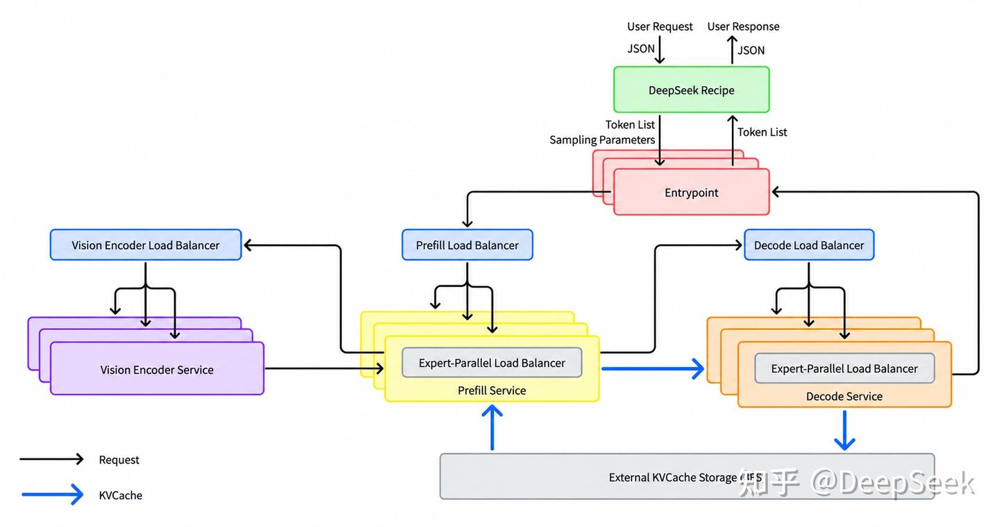
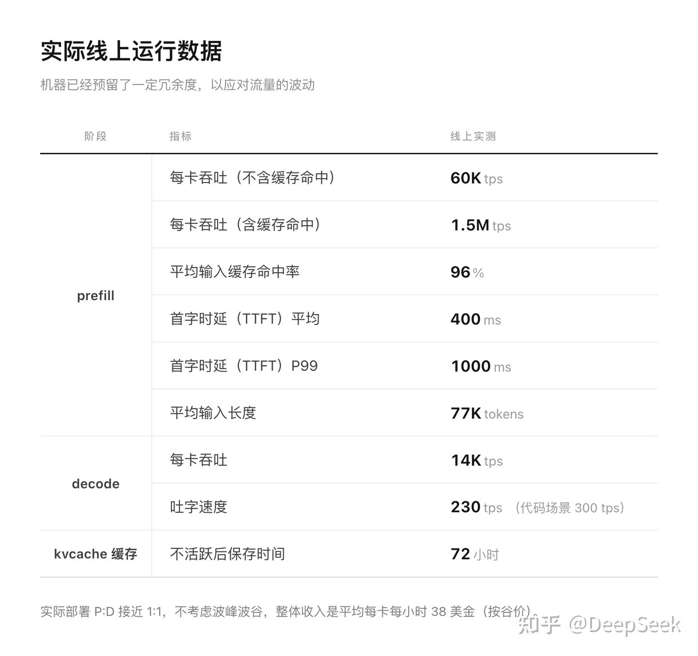
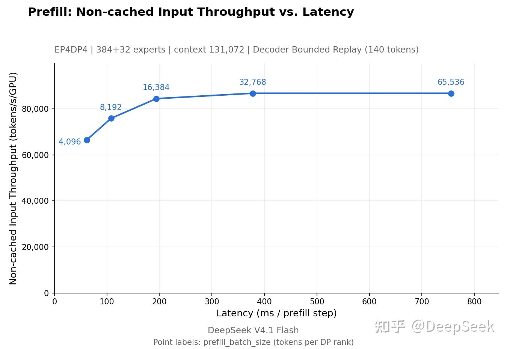
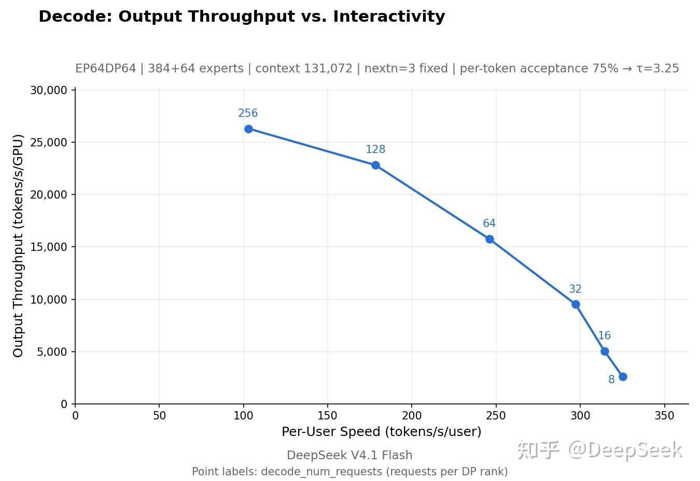

# 综合生产案例：DeepSeek V4.1 Flash 推理系统

```{contents} 本页目录
---
depth: 2
local: true
---
```

前面的章节分别建立了大规模并行（EP / DPA）、低精度计算、结构化与投机解码、MLA / SWA 状态演进、分层缓存及跨节点 PD 分离。本章以官方发布的《DeepSeek V4.1 Flash 大规模推理部署实践》为全书综合收官案例，按**角色分离与协议边界、非对称 EP/DPA 并行与三级负载均衡、Block KV 与 SWA 有限回放、DSpark 动态投机与零开销异步调度、线上统计与离线曲线解读**五个层次，看生产级超大规模集群怎样把所有拼图严丝合缝地扣在一起（注：文中 256 专家、Top-8 与配额数值用于解释机制，官方配置与生产统计均单独标明）。

## 架构解耦与协议边界：多阶段池化加 Recipe 编解码

### Vision、Prefill 与 Decode 分离后共享外部状态

原文围绕多厂商芯片支持、常见 8 卡机器做 Prefill、64～128 卡超节点做 Decode，以及历史 KV 保留 72 小时以上组织系统。Vision Encoder、Prefill 与 Decode 分离部署，让各阶段独立分配资源，并分别优化 TTFT 和 TBT。

架构图中的黑色箭头表示请求，蓝色箭头表示 KVCache。DeepSeek Recipe 在用户 JSON 与 token 序列之间转换；Entrypoint 连接各类负载均衡器；Prefill 与 Decode 实例内部各有专家负载均衡；外部 KV 存储为跨请求复用提供数据。



DeepInfer 集成分布式推理、投机解码、SWA Bounded Replay 与结构化输出，原文声明支持英伟达和华为昇腾平台。DeepSeek Recipe 提供协议与 token 的编解码。文章同时说明，KVCache 管理和负载均衡与内部基础设施耦合较深，代码尚未完整开源，不能把文章的生产能力直接等同于公开仓库的全部能力。

### DeepSeek Recipe 守住特殊 token 边界与流式增量解析

Recipe 将 Chat Completions、Responses 和 Messages API 请求转换为统一对话格式，复用模型模板与编码逻辑，再按模型版本生成 prompt 和 token 序列。输出侧把模型 token 解析为正文、思考内容和工具调用事件，再转换为各协议的流式响应。转换、编码和解析由 Rust 实现，同时提供 Python 绑定。

| 处理环节 | 机制与目的 |
|-|-|
| 输入 special token | 构建 prompt 时记录模板显式插入的 special token 及位置，直接映射到对应 token ID；普通文本按基础词表编码。 |
| 用户文本中的同形字符串 | 用户输入、工具返回和参数中的 `<｜User｜>`、`<｜image｜>` 按普通文本编码，避免文本被解释成协议控制 token。 |
| 输出控制标记 | 依据 token ID 识别 `</think>` 与 DSML 特殊标记；普通 token 拼出的同形字符串保留为内容，不获得控制语义。 |
| 分段加速 | 以已知 special token 边界切分普通文本，各段并行编码，再按原顺序拼接，降低超长上下文分词时延。 |

这些边界同时影响性能与正确性。跳过普通文本中的 special token 匹配和切分，减少扫描工作；只允许模板显式插入控制 token，则避免把同形文本误当成角色或模态边界。

流式解析还要保留跨 chunk 状态。一个 UTF-8 码点、DSML 标签或工具参数可能跨多个 token chunk。解析器先缓冲不完整字节，补齐后再交给状态机；思考、正文和工具参数分段用 KMP 增量匹配分隔标记。末尾若只有半个标记，就保留匹配进度，已经确定的内容尽早返回。

工具名解析完成后即可输出。参数按 DSML 边界直接生成 JSON 片段：字符串逐段转义，非字符串值如数组和对象按原始 JSON 文本输出。这样可以避免等待完整参数、构造完整对象后再序列化，也能缩短首个参数片段的等待。

## 非对称 EP/DPA 并行与多层级负载均衡

### EP 扩容保持逻辑专家总数不变

**扩大 EP，是让更多张 GPU 共同承载同一套专家。**模型的逻辑专家总数和每个 token 选择的 Top-k 都保持不变。忽略专家复制、共享专家和 Expert TP，若有 E 个专家、G 张卡，均匀分配后每卡承载 E／G 个专家。

| 配置 | 一个 EP 组的 GPU 数 | 256 个专家均分到每卡的数量 |
|-|-|-|
| EP8 | 8 | 32 |
| EP64 | 64 | 4 |
| EP128 | 128 | 2 |

原文采用 Attention DP，并明确 #DP＝#EP。因此，EP8／DP8 表示同一组 8 张卡在 Attention 子层按请求做数据并行，在 MoE 子层按专家做专家并行。一套实例共用 8 张卡，两个并行度不用相乘。

实际系统还会给热门专家放置冗余副本，并动态调整专家到卡的映射。因此，实际每卡的物理专家实例数可能高于 E／G；复制专家增加的是同一组权重的副本，不会增加模型的逻辑专家数。

### 专家有效 batch 随跨卡汇集的 token 数增长

讨论 batch 时，需要区分服务处理的请求数、本步进入 MoE 的 token 总数，以及每个专家实际收到的 token 数。专家 GEMM 的输入行数由最后一项决定。

设每卡本步有 T 个输入 token，共 G 张卡；模型有 E 个路由专家，每个 token 选择 k 个专家。在均衡路由、专家不复制的简化条件下：

$$N=GT,\qquad m_{\mathrm{expert}}\approx\frac{GTk}{E}$$

其中 N 是全组输入 token 数，m 是单个专家平均收到的 token 数。每卡处理的专家任务总量则约为：

$$\frac{E}{G}\times\frac{GTk}{E}=Tk$$

**保持每卡 T 不变时，扩大 EP 会让每卡负责更少的专家、每个专家处理更多 token，每卡总计算量大致不变。**相同权重能供更多 token 复用，GEMM 的行维也更大，因而通常更容易提高计算效率。

例如，8 张卡各有 128 个 token，模型有 256 个专家、Top-8。假设单卡能放下全部专家，比较独立副本与一个 EP 组：

| 比较项 | 每卡保存完整专家副本 | 8 卡组成 EP8／DP8 |
|-|-|-|
| 全服务输入 token 数 | 1024 | 1024 |
| 每卡专家实例数 | 256 | 32 |
| 每个专家实例的平均 batch | 128 × 8／256＝4 | 1024 × 8／256＝32 |
| 每卡专家任务总量 | 256 × 4＝1024 | 32 × 32＝1024 |

原先同一个专家的 8 份副本各算 4 个 token，EP 则把任务汇集给同一个专家实例处理 32 个 token。一次线性变换 Y＝XW 的输入 X，可由约 [4，h] 变为 [32，h]；h 是隐藏维度。dispatch 将 token 送往专家所在卡，combine 再把结果送回原 rank。

这个比较依赖于减少了分散的专家副本。**如果已经使用同一个 EP 组，只增加卡数，却固定全组 token 总数 N，每个专家的平均 batch 仍约为 Nk／E。**仅改变专家放置位置不会凭空增加 token；从同一个全局 batch 的 Expert TP 改为 EP，也不能自动宣称专家 batch 增大。

相对于每卡保存完整专家副本，EP 还能减少每卡的专家权重显存，为 KV Cache 和更多并发请求腾出空间。相对于已经切分权重的 Expert TP，这项显存优势需要重新比较。

### Prefill 用窄 EP 控通信，Decode 用 Wide-EP 攒专家批次

官方文章建议 Prefill 采用 EP2～8／DP2～8，在显存足够时选尽可能小的规模；Decode 采用 EP64～128／DP64～128，在可用硬件范围内采用 Wide-EP。以下用 token 数量和通信代价解释这一选择，属于机制分析，不是对各配置的独立性能实测。

沿用 256 个专家、Top-8，假设 Prefill 每卡每步处理 2048 个 token，普通自回归 Decode 每卡有 16 个请求、各贡献 1 个 token：

| EP／DP 规模 | Prefill 每专家平均 token 数 | Decode 每专家平均 token 数 |
|-|-|-|
| 2 | 128 | 1 |
| 8 | 512 | 4 |
| 64 | 4096 | 32 |
| 128 | 8192 | 64 |

Prefill 一个请求就能贡献很多 token，较小的 EP 组通常已能形成较大的专家矩阵。当 GEMM 已进入高效区间，继续扩大 EP 的收益会减弱，却会增加通信参与者和同步范围，跨越高速互联边界时尤其需要重新衡量。显存足够还应包含激活、KV Cache 和通信缓冲空间。

小 EP／DP 指单个实例的并行规模，不限制整个服务的 GPU 总数。例如，64 张卡可以部署为 8 套 EP8／DP8 实例，分别承接请求，把通信限制在各自组内。

Decode 的本地 token 数通常更少，小专家 batch 难以摊薄权重读取和 kernel 开销。Wide-EP 汇集更多 Attention DP rank 的 token，让专家获得更大的 batch；每卡驻留的专家权重也更少。在每轮触达大量专家、权重读取占比较高的负载下，这可能进一步减少每卡的权重读取压力。

**Wide-EP 的关键是让专家 batch 扩大，同时保持单卡 Attention batch 较小。**直接增加单卡 Decode 请求数，会增加本地 KV Cache 占用及 Attention 读取历史 KV 的工作量，可能拉长 token 间延迟。128 张卡各处理 16 个请求时，Attention 各自处理本卡请求，MoE 则能汇集全组 2048 个 token。

原文还使用 DSpark 投机解码，一次验证可能包含多个候选 token。因此，“每请求每步 1 个 token”只用于普通自回归示例；分析实际部署时，应按本步真实进入计算的 token 数统计 T，并把有效接受的输出 token 与验证 token 区分开。

扩大 EP 的收益依赖充足并发、高速互联和专家负载均衡。低流量、热点专家、通信尾延迟或 Attention／KV 成为主要瓶颈时，更多卡未必更划算。应在相同负载和 TTFT／TBT 要求下比较每卡有效吞吐；“尽可能大”是该部署条件下的建议，不是无条件单调变快的规律。

### 二次代价模型 compute-quota 指导路由与动态切块

原文把拟合的注意力子层计算代价记作 compute-quota，用预先拟合的二次代价模型 `cost(q, c)` 指导路由和切块。可以将其理解为：已有 c 个 token 的计算结果，再处理 q 个新 token，预计需要多少计算时间。单卡调度用它与纳秒单位的时间预算比较。

| 参数 | 含义 |
|-|-|
| q | 需要新计算的 token 数。评估请求时为未命中的后缀；选择 chunk 时为本步准备计算的长度。 |
| c | 已经算完的前缀长度，包括命中的缓存前缀，以及此前 chunk 已完成的部分。 |

忽略缓存页对齐和重放细节，假设输入共 10,000 个 token，已有前缀 8,000 个，剩余代价为 `cost(2000, 8000)`。若本步只处理 500 个，就评估 `cost(500, 8000)`；完成后前缀增长为 8,500，下一个 500-token chunk 对应 `cost(500, 8500)`。

前缀 KV 命中省掉了前缀的重复计算，新 token 的 Attention 仍需读取其注意力机制要求的历史 KV。因此，未命中 token 数相同的请求，计算代价也可能因前缀长度而不同。

二次项的直觉可以用普通因果全注意力说明。第 i 个新 token 可关注 c＋i 个位置，q 个新 token 的注意力配对数量为：

$$\sum_{i=1}^{q}(c+i)=qc+\frac{q(q+1)}{2}$$

固定 c 后，上式包含 q 的二次项。**这只是普通全注意力的教学推导，并非 V4.1 的实际耗时公式。**V4.1 包含压缩、滑窗等注意力设计，实际耗时还取决于硬件和算子。官方文章没有公开拟合表达式、系数或误差，不能用配对数量直接替代纳秒耗时，更不能把它当作完整 TTFT。

单卡每步剩余时间预算为 R、请求剩余未计算长度为 q_remain 时，切块原则可表示为：

$$q^*=\max\{q\in\mathbb{Z}_{\ge 0}\mid q\le q_{\mathrm{remain}},\ \operatorname{cost}(q,c)\le R\}$$

调度器对 q 反解，选择满足剩余预算的最大 chunk。前缀长度或剩余预算变化时，chunk size 随之变化；时间预算也不能替代 KV 容量等准入条件。

### 按输入总长分桶，按计算代价占比动态分配引擎

分桶看输入总长度，包含已命中的前缀；引擎配额则按各桶上一轮的 compute-quota 需求占比分配。输入长度决定请求归类，计算代价决定该类需要多少资源。

| 输入总长度桶 | 上一轮计算需求占比，示例 | 20 套引擎按比例分配 |
|-|-|-|
| <16K | 20% | 4 套 |
| 16K～64K，不含 64K | 30% | 6 套 |
| 64K～256K，不含 256K | 40% | 8 套 |
| ≥256K | 10% | 2 套 |

设桶 i 的计算需求为 Q_i、可分配引擎总数为 N_engine，比例原则可以写成：

$$n_i\approx N_{\mathrm{engine}}\frac{Q_i}{\sum_j Q_j}$$

例如，总长 100K、已有前缀 99K 的请求仍进入 64K～256K 桶，代价却按剩余部分 `cost(1K, 99K)` 估算。少量长请求可能消耗大量计算，大量高命中请求也可能只有较少的 Prefill 工作，所以不能直接用请求数量占比代替计算需求占比。

按长度分类有助于控制长短请求相互干扰；按需求动态调整，则能减少某桶排队、另一桶空闲的资源错配。这是对设计动机的分析。原文未给出“上一轮”的统计周期、配额取整、最低引擎数和迁移协议，也没有表示每次 GPU forward 后都重新划分实例。

### DP 组间拉取与组内最低负载 rank 分配

按原文的调度语境，一个 Prefill 引擎实例包含一组 Attention DP ranks。假设同一个长度桶内有 A、B 两套实例，均为 EP8／DP8：A 包含 A0～A7，B 包含 B0～B7，共占用 16 张 GPU。

| 调度层级 | 决定什么 | 原文规则及示例 |
|-|-|-|
| 分桶 | 进入哪类长度桶，各桶配多少引擎 | 按输入总长分类，按上一轮 compute-quota 需求占比重分引擎。 |
| DP 组间 | 由 A 还是 B 这套引擎承接 | 按目前剩余的 compute-quota 拉取；原文没有展开拉取协议。 |
| DP 组内 | 给 A0～A7 中的哪个 rank | 每收到一个请求，分发给当前 compute-quota 负载最低的 rank。 |
| 单卡内 | 本步计算哪些请求及多大的 chunk | FIFO 出队，按剩余时间预算反解 q。 |

组内分配采用逐请求更新的负载比较。假设 A0、A1、A2 的剩余计算代价依次为 100、40、70，其余 ranks 均高于 40，新请求先交给 A1；计入该请求代价后，再为下一个请求比较负载。这些数值只是统一代价单位的示例。

组间不做前缀亲和路由，是因为任意 Prefill 引擎都能命中共享存储中的前缀，不必为了某段缓存固定选择 A。不同缓存类型仍可能涉及 3FS 读取、跨机取回和 H2D；“都能命中”并不意味着传输时间为零。

**请求分给 A1，确定的是它在 Attention 部分的归属。**进入 MoE 后，token 仍按专家位置发送到 A 组内对应的卡，再合并回原 rank。组间路由不会为每层 MoE 临时借用 B 的专家。

负载均衡也分为两类：Prefill Load Balancer 通过请求与 chunk 分配平衡 Attention 工作；Expert-Parallel Load Balancer 通过冗余专家和放置调整平衡 MoE 工作。请求分配均衡，仍可能因专家路由偏斜而产生热点。进入共享 EP 通信时，较早到达的卡还要等待较慢的卡，因此这些层级需要配合。

### Decode、Vision 与 EPLB 冗余专家各自按专属信号均衡

Prefill 的 compute-quota 主要描述注意力计算负载。Decode、Vision Encoder 和专家层处理的数据不同，需要使用各自的负载信号。

| 角色 | 负载信号 | 原文策略 |
|-|-|-|
| Decode | 请求数与 KVCache 总长度 | 统一路由到所有 Decode 实例的所有卡。短请求倾向并发较小、KV 总长偏大的卡；长请求倾向 KV 总长较小的卡。 |
| Vision Encoder | 正在处理的图片 patch 数 | Prefill 机器先随机选择一台 Vision Encoder 机器，再选择其中 patch 负载最小的卡，生成 embedding。 |
| MoE 专家 | 近期各专家的实际负载 | 为热门专家放置冗余副本，周期性调整专家到卡的映射。 |

Decode 同时看请求数和 KV 总长，是为了兼顾每步 batch 与 Attention 代价。原文将具体启发式关联到 DualPath 的组内调度算法；这里保留其路由原则，不补造未公开的评分权重。Vision Encoder 的 patch 数按 `(width / patch_size) × (height / patch_size)` 计算，一般单卡即可部署，原文建议选择可用范围内成本最低的卡。

Expert-Parallel Load Balancer 统计最近 N 步负载，每 M 步重新分配专家。专家权重通过 scale-up network 中的 `symm_mem` 在并行组内转移。冗余专家是已有专家的副本，不会改变模型的逻辑专家总数。

| 阶段 | 冗余专家配置 | 统计／重排周期 | 原文线上 moe_lb |
|-|-|-|-|
| Prefill | 每卡 4 个起步，再向上填充至总专家实例数为 EP size 的倍数。 | 100 步／1000 步 | EP2／DP2：1.0320；EP4／DP4：1.0618。 |
| Decode | 每卡 1 个起步，再取整。原文 EP64 示例中，每卡合计 7 个专家实例，不含共享专家。 | 1000 步／10000 步 | 1.090。 |

moe_lb 的口径为最慢 rank 与平均值的比值，越接近 1，负载越均衡。这些是原文对应部署的统计，不能直接当作其他硬件和请求分布的保证。离线基准图另列自己的专家实例配置，应按各图说明解读。

### 平滑扩缩容与在途 KV 转发承接单卡故障半径

P/D 分离后，Prefill 与 Decode 的需求比例随流量变化。原文用未命中 token 数估算 Prefill 实例需求，用正在计算的请求数估算 Decode 实例需求，并为扩缩容设置速率限制和上下界。

| 场景 | 处理方式 |
|-|-|
| Decode 缩容 | 收到下线通知后进入 1 分钟宽限期；结束时，把仍未完成的请求及其 KVCache 一次性转发给其他实例继续计算。 |
| 流量冲击 | 保留尚未占用的 ready 机器，并让在线实例数高于计算需求。配额占用率高于 0.8 时禁止缩容。 |
| 实例故障 | 错误重启在分钟量级，依靠冗余配额和请求级重新路由恢复服务。 |
| 大 EP 组单卡故障 | 一个实例的全部卡构成单一通信域，任一张卡故障会使整个实例不可用；重启时按实际健康卡数重新确定 EP 规模。 |

Wide-EP 的取舍因此还包括故障影响范围和长尾请求。减少单实例内的计算浪费，需要与实例级冗余、退出迁移和健康卡重组共同设计。

并行与调度决定计算工作分给谁，缓存决定其中多少历史工作可以跳过。共享缓存让请求路由摆脱对某台计算机器的前缀亲和依赖；下面继续看 Block KV 与 SWA 状态怎样分别保存、加载和恢复。

## 双周期缓存分层：3FS Block KV 与 SWA 有限回放

### 长期 Block KV 落盘 3FS，短期 SWA 留驻机器内存

普通分页 KV 的地址与所有权见前文。本系统进一步按模型数据和复用周期区分 Block KVCache 与 State KVCache。Block KV 按 128 token 一块保存，包含 4 层的 main KV 和 indexer K；SWA 状态使用前 20 层各一个长度为 134 token 的 ring，对应窗口 128 加投机回退余量 6，不保存压缩中间态。

| 数据 | 保存位置 | 副本与管理 |
|-|-|-|
| 运行中的 Block KV 与 State KV | 推理卡显存 | 由 Prefill／Decode 实例管理，为当前计算服务。 |
| 可复用 SWA KV | 产出它的 Prefill／Decode 机器内存 | 单副本，不进入 3FS；跨机命中经 400G VLAN 取回。 |
| 分页 Block KV | 独立 3FS 存储集群 | kvcache-store 管理，应用层不复制，依靠 3FS 自身冗余。 |

Block KV 不作为本机内存中的长期缓存保存。独立存储让所有 Prefill 实例能访问同一前缀，减少缓存亲和路由与负载均衡的冲突，也让缓存容量和计算实例独立扩缩容。读取时仍会经过宿主机共享内存作为传输缓冲，这与长期缓存的保存位置不同。

原文报告约 100 PiB SSD 容量，agent 流量 TTL 为 3 天，chatbot 流量为 7 天。chatbot 热门前缀的长尾复用更明显；文章称 TTL 降到 3 天左右会使其命中率下降 0.5%～1%，未进一步说明这一变化采用相对比例还是百分点口径。

SWA KV 主要服务会话内的分钟级复用。各 Entrypoint 按 key 分管目录，逻辑上提供统一的位置查询；本机没有副本时跨机取回。线上 SWA TTL 约 180 秒、命中率超过 98%。因此，“KV 保留 72 小时以上”不能理解为所有种类的 KV 都保存相同时间。

#### Block KV 读取按元数据匹配、异步取盘与逐层换入三段推进

| 阶段 | 动作 | 等待与重叠 |
|-|-|-|
| 匹配 | Entrypoint 在本机 CHECK 角色的 kvcache-store 上做哈希链前缀匹配，只查元数据。 | 路由前必须得到命中长度，原文将其列为不能掩盖的关键路径。 |
| 取 KV | 独立进程异步从 3FS 读取，搬到宿主机 shm。 | 与其他工作并行推进。 |
| 换入 | engine 内线程将 shm 数据逐层搬入 HBM。 | 目标是让逐层 H2D 与前向计算重叠。 |

原文指出，CUDA copy engine 对细粒度 KV Block 拷贝效果不佳，因此使用 GDR，由 RDMA 网卡执行搬运；在其部署中可以打满 PCIe 带宽且不占 SM。这描述的是该传输路径，不表示传输零成本，也不保证任意硬件和存储拥堵状态下都能完全隐藏等待。

Block KV 由 Decode 实例落盘，使 Prefill 和 Decode 产生的历史都能复用。3FS 针对约 112 KiB 的 KV block 随机读写优化，原文峰值聚合读带宽为 10 TiB/s、写带宽约 850 GiB/s。这里是整个存储集群的聚合量，不是单卡或单请求带宽。

#### 10+2 纠删码与并发多读降低慢节点长尾

3FS 使用 10＋2 纠删码，每个 EC 组可以容忍 2 个节点故障。读取时同时向组内 11 台 Storage 节点请求，任意 10 个返回即可解码，以降低慢节点影响。每个 Storage 节点运行 GC Worker，按 LRU 周期性清理旧缓存，将磁盘使用量控制在水位线以下。

### SWA Bounded Replay 把跨层重算压回固定单窗口近似

V4 的路径将 SWA KV 落盘，未命中时按“层数 × 窗口”重算以精确恢复。原文指出，这类状态主要在会话内短时间复用，落盘却占了持久 KV 近一半容量。完全不落盘、只依赖精确重算的 Zero SWA Caching，又会产生过高重算代价，V4.1 线上没有采用这条路径。

V4.1 改用 SWA Bounded Replay：只重算最近 128 个 token，并把 Attention 截断在重放段内。从位置 s 开始回放，位置 i 只读取下面范围的 key：

$$j\in[\max(s,i-127),\ i]$$

得到的是近似 SWA 状态。回放 token 数固定为 128，不再按“层数 × 窗口”扩展；执行这段回放的总耗时仍取决于层数、算子和硬件，不能将固定窗口解释成整个网络的计算时间与层数无关。

| 使用位置 | 回放内容与复用边界 |
|-|-|
| Encoder SWA Bounded Replay | SWA 缺失时，重算命中前缀最后 128 个 token，与未命中后缀一同前向。回放段只重建 SWA，已有 Block KV 原样复用，不重算、不覆写。 |
| Decoder SWA Bounded Replay | CED 架构中，完整 Prefill 计算集中在 encoder，decoder 的 Block KV 由 encoder 末层 hidden state 投影得到。每次 Prefill 只在 decoder 层回放 prompt 末尾 128 个 token，产出供 Decode 使用的 SWA，不放入前缀缓存。 |

对 decoder SWA 的精确重建，原文给出的对照是 20 个 decoder 层处理最后 2560 个 token。改为 128-token 回放后，文章报告总 Prefill 计算量近乎减半。这是对应架构的计算量陈述，不等于所有部署的端到端 TTFT 都减半；近似恢复的质量结论也不能由计算量直接推出。

**块边界对齐与 134-token 投机余量：**受 YOCO 截断约束，系统对长度 $L$ 的输入最多匹配到 $L-134$，在此范围内查询 128 对齐的 Block KV 边界 $L_1$，再查找 $[L_1-128, L_1]$ 内的 SWA 快照；若缺失 SWA 快照，则保留已命中的 Block KV 不覆写，仅回退重放末尾 128 个 token 重建窗口状态。

| 阶段 | SWA 快照时机 |
|-|-|
| Prefill 结束 | 从序列末尾留出 1 个 token 后，向下对齐到 128 的倍数保存；不足一个块则不存。Chunked Prefill 中途不存，只在最后一个 chunk 保存。 |
| Decode 进行中 | 显存中保留额外副本区，每跨过一个 128-token 边界就复制当前窗口；请求结束时保存最近完成的副本，并将附着位置向下对齐到 128。 |
| 投机回退余量 | 拷贝位置最多越过边界 5 个 token，由 134-token ring 比窗口多出的 6 个位置吸收。 |

## 执行与解码协同：DSpark 动态投机、异步调度与独立约束编译

### DSpark 按置信度与硬件曲线动态分配验证预算

DSpark 在 DFlash 的 base logits 上增加只依赖前一个 token ID 的低秩 logit bias，用很轻的串行修正补充相邻 token 的局部条件化信息。服务系统再通过 Confidence Head 估计各个 draft token 的接受率，使用变长验证分配算力。

原文线上 draft 一次生成 5 个 token。调度器结合硬件 profiling 得到的吞吐曲线和接受率，选择使有效吞吐最大的前缀子集进行验证，将更多验证预算给预期收益更高的候选。相比固定验证 5 个 token，原文报告该线上场景吞吐提高 6%。

“前缀子集”保留了候选位置的依赖：后面的候选只有在前缀有效时才有意义。原文实现包含接受率累乘、全局排序和 top-k，因此不能把它理解成任意抽取几个孤立的高分 token。这里的收益是接受后有效输出的收益，不应直接用参与验证的 token 数代替。

### 零开销异步调度配合 GPU TileLang 算子延迟确定验证长度

前文已经解释 Mini-SGLang 和 NanoFlow 的 overlap。DeepInfer 同样把批次准备和结果处理与 GPU 执行重叠，但还要处理 DSpark 的动态验证长度。

```text
同步路径：
schedule(N) → forward(N) → sample(N) → post-process(N)

异步重叠：
GPU：forward(N) → sample(N)
CPU：schedule(N+1) → launch_forward(N+1)
     → post-process(N-1) → launch_sample(N+1)
```

同步路径在 post-process 前需要 GPU 到 CPU 同步，随后 CPU 后处理和下一轮调度会让 GPU 等待。异步路径把这些工作放入 GPU 正在执行当前轮的时间窗口。原文称之为 Zero-Overhead Batch Scheduler；它描述被重叠的调度开销，不表示模型计算或通信时间消失。

schedule(N＋1) 执行时，第 N 步 confidence 尚未回传，因此 CPU 只确定总预算。逐请求的验证长度随后由 GPU 上的 TileLang kernel 重算：累乘接受率、全局排序取 top-k，并融合 remap scatter，结果写回 pinned buffer。这样不必为了逐请求长度提前阻塞 CPU 调度。

### 结构化输出语法自动机编译移出推理引擎

JSON Schema、正则和 EBNF 等格式约束先在独立 SO 机器上编译成语法自动机。编译与推理解耦，约束结果在请求进入 engine 前异步取回；Decode 每步更新自动机状态，取得合法 token 集合并生成 mask，再用于约束采样。

自动机和 mask 的基本机制见前文约束解码章节。本系统的新增要点是编译服务独立部署，以及编译结果在进入推理引擎前就绪；原文没有给出这部分的单独性能消融，也没有指定这里一定使用哪种公开约束库。

## 线上统计与离线曲线分开解读

线上统计图注明，机器已经预留冗余以应对流量波动，P∶D 接近 1∶1。以下数字来自官方文章的生产统计，不能用来替代固定硬件、并发、请求分布和软件版本的独立复现。

| 阶段 | 指标 | 原文线上值 |
|-|-|-|
| Prefill | 每卡吞吐，不含缓存命中 | 60K token/s |
| Prefill | 每卡吞吐，含缓存命中 | 1.5M token/s |
| Prefill | 平均输入缓存命中率 | 96% |
| Prefill | 平均 TTFT／P99 TTFT | 400 ms／1000 ms |
| Prefill | 平均输入长度 | 77K token |
| Decode | 每卡吞吐 | 14K token/s |
| Decode | 单用户吐字速度 | 230 token/s；代码场景 300 token/s |
| KVCache | 图中不活跃后的保存时间 | 72 小时 |

文章另报告单集群服务吞吐为每天 155 万亿 token，按谷价估算平均每卡每小时收入 38 美元。含缓存命中的输入吞吐包含直接复用的 token，不能解释成 GPU 真正计算了同等数量的新 token；收入也不是利润，不能省略定价口径和资源冗余。



### Prefill 大 batch 的收益会趋缓

Prefill 离线图的横轴是每步延迟，纵轴是不含缓存命中的输入 token/s/GPU；点标签为每个 DP rank 的 prefill_batch_size。图中配置为 EP4／DP4、384＋32 experts、context 131,072，以及 Decoder Bounded Replay 140 tokens。



点标签从 4096 增至 65,536。曲线显示，batch 增大初期吞吐上升明显，达到 32,768 后继续翻倍，吞吐基本持平而单步延迟继续增加。它支持“超过高效区间后，大 batch 的边际收益下降”，但不是 EP 规模扫描，不能据此直接证明所有部署都应选 EP4。

### Decode 吞吐与交互速度存在取舍

Decode 离线图的横轴是单用户 token/s，纵轴是输出 token/s/GPU；点标签为每个 DP rank 的请求数。图中配置为 EP64／DP64、384＋64 experts、context 131,072、固定 nextn＝3、per-token acceptance 75%，并标注 τ＝3.25。



请求数从 8 增至 256 时，每卡总吞吐上升，单用户速度下降。判断配置时应同时看两轴，并沿用前文的延迟与有效吞吐口径。图上的数值不应与线上 14K token/s/GPU 直接当作同条件对比。

原文正文描述线上 draft 为 5、SWA 回放窗口为 128；离线图分别标为固定 nextn＝3 和 Decoder Bounded Replay 140 tokens，Prefill 图的冗余专家数也有独立配置。本章保留这些差异，不推测未说明的原因。两张图没有完整列出 GPU 型号、精度、软件提交与压测协议，因此不补造可复现配置。

<callout emoji="✅">
**本章核心自查：**能解释 DeepSeek V4.1 Flash 为何在 Prefill 选窄 EP（EP2～8）而在 Decode 选超宽 EP（EP64～128），为什么长期 Block KV 落盘 3FS 而短期 SWA 仅留内存配合 128-token Bounded Replay，以及零开销异步调度如何用 GPU 算子避免等待上一轮置信度回传。
</callout>

这套生产系统把模型状态形态、并行通信半径与存储层级对齐到了同一本工程账上（官方部署文章、DeepInfer 与 3FS 链接统一收录于文末〈[参考](https://bytedance.larkoffice.com/wiki/EZcawGzFrirc8bkkvuqclJCpnXd#KfJjdPcQFoPtsFx53LEmk19Fyrh)〉）。掌握全部核心机制与生产架构之后，最后一章正文章回到线上调优现场，串起长上下文参数调优、AIPerf 容量压测与服务端 Profiling 归因。
