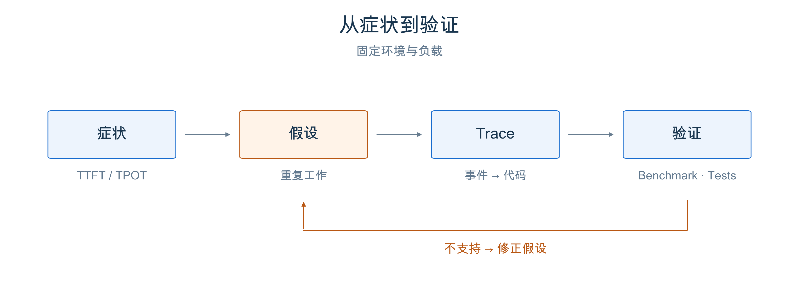
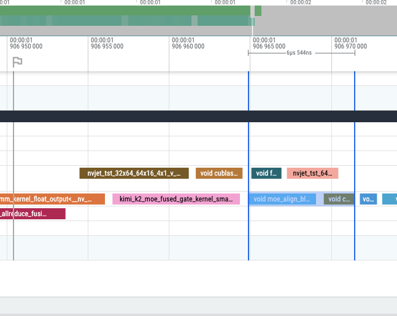

# 生产调优、容量压测与 Profiling 归因

```{contents} 本页目录
---
depth: 2
local: true
---
```

前五篇已经依次拆解了混合批调度、多维并行、量化、投机解码、多级缓存与 PD 分离的内部机理。当工程师拿到一套真实模型与硬件集群准备上线时，需要一套闭环工程方法把机制转化为稳定容量：先按业务长度与前缀复用特征调定显存、切块和缓存参数，再用客户端压测工具（以 NVIDIA AIPerf 为例）扫描并发、回放轨迹并审计 SLO Goodput，最后在出现延迟毛刺或吞吐异常时用 PyTorch Profiler 与 Nsight Systems 下钻到具体 step 与 kernel。

## 长上下文参数调优：先稳住容量，再平衡 TTFT 与 ITL

大量长上下文请求通常同时放大 Prefill 计算量和 KV 占用。调参优先检查 `--chunked-prefill-size`、`--mem-fraction-static` 与 `--max-running-requests`；有长前缀复用时，再评估 Radix Cache 和 HiCache。以下主要讨论长输入、短到中等输出，长输出的附加压力在本节后面单独说明。

### 请求分布决定调优目标

| 需要固定的信息 | 记录内容 | 影响 |
|-|-|-|
| 模型与环境 | 模型和 tokenizer 版本、引擎版本、GPU 型号与显存、卡数及互联。 | 决定权重、KV 结构、后端支持和多卡通信成本。 |
| 输入与输出长度 | 分别记录 P50/P95，说明是否启用推理模式。 | 长输入增加 Prefill；长输出延长请求驻留并持续增加 KV。 |
| 负载强度 | 客户端并发、到达速率、目标活跃请求数与突发情况。 | 区分引擎容量限制、排队压力和过量请求接纳。 |
| 前缀复用 | 公共 token 前缀长度、重复频率、会话间隔与工作集大小。 | 决定缓存是否能省去重复 Prefill，以及是否需要主机缓存。 |
| 验收目标 | TTFT、ITL/TPOT、端到端延迟和 SLO 内吞吐。 | 避免用更高吞吐掩盖尾延迟恶化。 |

指标口径沿用第 4 章〈[推理基准](https://bytedance.larkoffice.com/wiki/EZcawGzFrirc8bkkvuqclJCpnXd#doxmyY6hn6oMy0X2hIG4DWlU7dg)〉。固定请求分布与缓存冷热条件后再比较参数，否则无法判断改动本身的收益。

### Prefill 切块与活跃并发一起压测

| 参数 | 调整方向 | 代价与约束 |
|-|-|-|
| `--chunked-prefill-size` | 可比较 `2048`、`4096`、`8192`，Prefill OOM 时先尝试较小值。 | 小 chunk 降低临时显存和单轮工作量，但切块及调度开销可能使长请求整体 Prefill 更慢。 |
| `--max-running-requests` | 从能稳定容纳的低并发开始，逐步增加。 | 长请求持有大量 KV，不能沿用短请求下的高并发；过多活跃请求也会抬高 Decode 尾延迟。 |
| `--mem-fraction-static` | 有运行时显存余量且 KV 池不足时可提高；激活或 Graph OOM 时可降低。 | KV 池与运行时空间存在取舍，提高比例不能解决所有 OOM。 |
| `--context-length` | 按业务上限设置，并为实际生成长度留出空间。 | 主要是长度限制，不会缩短已有输入，也不能单靠它保证上下文扩展后的质量。 |
| `--kv-cache-dtype` | 支持时对比 BF16/FP16 与 `fp8_e4m3` 等路径。 | 需要核对硬件、Attention 后端和 scale 来源，并做长上下文质量回归。 |
| `--tp-size` | 单卡容量不足时评估更多卡。 | KV 是否按 TP 分摊取决于 head 切分与复制；不能简单假设单卡占用等于全模型占用除以 TP。 |

Chunked prefill 只限制单轮工作量，本身不保证 Decode 获得计算时间。长 Prefill 与 Decode 混跑时，可在模型和版本支持的前提下，把 `--enable-mixed-chunk` 纳入对照；小 chunk 与 mixed chunk 如何影响 ITL，见第 14 章〈[Mixed Chunk 决定单次 forward 的组成](https://bytedance.larkoffice.com/wiki/EZcawGzFrirc8bkkvuqclJCpnXd#doxmyK9FnHerogdDIgYYq4tjbVe)〉。低并发、延迟敏感场景未必受益，不能默认全部开启。

压测同时看 TTFT、ITL/TPOT、输入与输出 token 吞吐，以及 P95/P99 端到端延迟。只看总 token/s，可能漏掉排队、Decode 间隔或请求尾延迟的恶化。

### OOM 与 KV 容量不足需要分开处理

| 现象 | 优先动作 | 观察重点 |
|-|-|-|
| 长输入 Prefill 时 CUDA OOM | 减小 chunk；必要时降低静态显存比例，给激活和 workspace 留余量。 | 失败阶段、临时显存峰值、Graph 捕获是否占用过多显存。 |
| Decode 时 CUDA OOM | 减小活跃并发，检查运行时显存余量。 | 活跃请求数、batch 形状与实际生成长度。 |
| 没有 OOM，但 KV 池经常满并发生 retraction | 减少活跃并发；有余量时扩大 KV 池，再评估调度预留。 | Token usage、retraction 频率和等待队列。 |
| 请求排队但 GPU 利用率偏低 | 先查容量、缓存加载和调度约束，再评估是否提高并发。 | 不要把存储等待、保守准入或通信等待误判为算力不足。 |

`--schedule-conservativeness` 可用于调整对后续生成所需容量的估计：频繁发生容量 retraction 时，提高它会让准入更保守；反向调整则需要确认没有加剧缓存压力。Waiting queue 排序与容量预留都不等于计算公平保证，机制见[容量预留不保证 Decode 获得计算时间](https://bytedance.larkoffice.com/wiki/EZcawGzFrirc8bkkvuqclJCpnXd#doxmyAT3QGJH6Gamc79wkgrk4Xg)。

`--max-total-tokens` 通常保留自动推导。`--max-prefill-tokens` 在查阅时文档中还受模型最大上下文长度影响，不能把一个小配置值直接当成长输入的硬切块上限。

### 重复长前缀优先评估缓存

同一份长文档的多次问答、固定 system prompt 和多轮对话，可能复用大量前缀。保持 Radix Cache 开启，尽量让公共前缀的 token 序列稳定；时间戳、随机 ID 或变化的内容如果出现在前面，会缩短后续可匹配前缀。还要保持模型、适配器、位置和 Attention 配置等缓存身份兼容。

| HiCache 参数 | 作用 | 约束 |
|-|-|-|
| `--enable-hierarchical-cache` | 开启分层 KV 缓存 | 用于扩大可复用历史的保留范围，需核对模型状态与后端支持。 |
| `--hicache-ratio` | 按 GPU Cache 容量的倍数配置 Host Cache | 依赖 GPU 池规模，部署时要核算实际主机内存。 |
| `--hicache-size` | 显式指定 Host Cache 大小，单位 GB | 优先于 ratio；多 worker 的总内存还需按部署拓扑核算。 |

HiCache 需要 CPU 内存，并增加 GPU↔CPU 或外部存储搬运。选择 `write_through` 时，GPU 已缓存数据还会占用 Host 容量，要给下层命中后的读取与恢复留空间。缓存生命周期、写入策略和完整前缀恢复见[分层 KV 缓存与完整前缀恢复](https://bytedance.larkoffice.com/wiki/EZcawGzFrirc8bkkvuqclJCpnXd#doxmyFWISLnGhL7pd2dKTfYUqxg)。

<callout emoji="💡">
**适用边界：**每个请求都是不同长文档、没有共享前缀时，HiCache 不能省掉首次 Prefill，也不能替代活跃请求当前所需的 GPU KV 容量。前缀历史缓存与活跃 KV offload 是不同机制。
</callout>

### 容量估算与低精度回归先于加并发

提高并发前先用第 3 章的原始 KV 容量公式做一次手算兜底：例如 32 层、8 KV heads、`head_dim=128`、BF16 的全注意力模型每 token 约占 128 KiB，单请求写满 32K 即需约 4 GiB（第 3 章的 36 层 Qwen3-4B 对应 144 KiB/token、32K 占 4.5 GiB）；MLA、滑窗或 GDN 混合模型则按第 20 章各自的缓存项分别累加。

FP8 KV 可以减少原始 payload，但权重 FP8 不等于 KV FP8。查阅时官方文档建议 FP8 KV 提供适合模型的 scaling factors，例如通过 `--quantization-param-path`；部分路径未提供 scale 时使用 1.0，可能影响质量。至少覆盖长文档抽取、跨段信息关联、多轮问答和接近长度上限的样本，不能只验服务成功启动。

### 固定负载后逐步调整配置

下面假设模型支持 64K 上下文、双卡显存足够。`0.85`、`4096` 和 `8` 仅供压测起步，不是默认值；与上一节的短一些输入示例相比，活跃并发必须重新评估。

```bash
python3 -m sglang.launch_server \
  --model-path /models/your-model \
  --tp-size 2 \
  --context-length 65536 \
  --mem-fraction-static 0.85 \
  --chunked-prefill-size 4096 \
  --max-running-requests 8 \
  --enable-metrics
```

1. 固定模型、硬件和请求分布，记录启动日志中的实际 dtype、KV token 容量、Graph 配置以及所用参数。
2. 低并发测试不同 prefill chunk，比较 Prefill OOM、TTFT、ITL 和输入吞吐，不同时修改多个变量。
3. 确定 chunk 后逐步增加活跃请求数，观察 KV 占用、retraction、排队和 P95/P99 延迟。
4. 先确认显存余量，再调整静态比例；需要更大容量时分别对比 KV 低精度与多卡配置。
5. 共享前缀负载单独比较冷缓存、热缓存和工作集超过 GPU 容量时的行为，再评估 HiCache 的搬运与 Host 内存成本。

若输出同样很长，请求会长期驻留并持续追加 KV，仅缩小 Prefill chunk 无法解除 Decode 容量与带宽压力；当目标负载下长 Prefill 仍反复拉高流式 ITL 尾部时，再按第 22 章〈[PD 分离与跨节点 KV 调度](https://bytedance.larkoffice.com/wiki/EZcawGzFrirc8bkkvuqclJCpnXd#doxmywD2I30mXr7PCuxVUiuQdow)〉核算阶段拆分收益与跨机传输成本。调定候选参数后，下一步是用可审计的客户端压测验证真实容量区间。

## 用 AIPerf 验证服务容量

前面已经统一 Benchmark 的观测边界和指标口径。AIPerf 把这些约束落实成一套客户端工作流：固定负载建立基线，扫描并发找到容量区间，再用逐请求记录、生产 trace 和时间片检查结果是否适用于业务。`aiperf profile` 是客户端压测入口，服务端算子、CUDA stream 和 kernel 的性能归因仍要使用 PyTorch Profiler 或 Nsight。

这里依据 NVIDIA 的 [AIPerf 综合 Benchmark 教程](https://docs.nvidia.com/aiperf/v0.8.0/getting-started/ai-perf-comprehensive-llm-benchmarking)，并用 v0.8.0 参数与专题参考核对计时和统计语义。页面 URL 是 v0.8.0，正文仍标注工具 v0.5.0、演示日期 2025 年 11 月 13 日、更新日期 2026 年 2 月 2 日。下面区分历史演示结果与版本化参数说明，不把页面路径当作演示已在 v0.8.0 重新执行的证明。本稿没有安装 AIPerf、启动模型服务或运行压测。

### 固定输入输出长度建立基线

运行压测前，服务需要已经就绪。先确认 `/v1/models` 返回的服务模型名称，再配置客户端 `--model`；`--tokenizer` 单独指定与服务一致的 tokenizer。以下安装命令固定到所查阅的参考版本，建议在独立虚拟环境运行，并保存实际安装信息：

```bash
python3 -m pip install 'aiperf==0.8.0'
```

```bash
python3 -m pip show aiperf
```

下面假设目标服务在 `http://127.0.0.1:8000`，对外模型名为 `Qwen/Qwen3-0.6B`：

```bash
aiperf profile \
  --model Qwen/Qwen3-0.6B \
  --url http://127.0.0.1:8000 \
  --endpoint-type chat \
  --streaming \
  --concurrency 100 \
  --request-count 1000 \
  --isl 1000 \
  --osl 500 \
  --tokenizer Qwen/Qwen3-0.6B \
  --artifact-dir artifacts/baseline-c100
```

| 参数 | 控制对象 | 报告时的注意事项 |
|-|-|-|
| `--concurrency` | 客户端在途请求数；请求完成后补发 | 不等于服务端 batch size、GPU 活跃序列数或真实用户数 |
| `--request-count` | 本轮最多发送的请求数量 | 同时报告尝试、成功、失败与取消数量 |
| `--isl` | 合成输入的目标 token 长度均值 | 不用于覆盖自定义 trace；核对实际输入长度和长度分布配置 |
| `--osl` | 请求输出上限的目标均值 | 实际输出可能因 EOS 等条件提前结束，吞吐用实测输出 token 数 |
| `--streaming` | 开启流式响应 | 核对 chunk、首个有效输出和结束帧的解析口径 |
| `--artifact-dir` | 本轮结果目录 | 每轮用唯一目录，保存配置和逐请求数据 |

原文演示使用 Qwen3-0.6B、vLLM v0.11.0、8 个独立副本和 8 张 H200，每副本一张卡；这不是 8 路 Tensor Parallel。演示集群已经下线。其静态负载结果是平均 TTFT 347.15 ms、平均 Request Latency 2101.75 ms、输出吞吐 22521.42 token/s、请求吞吐 45.70 request/s，1000 条请求、21.88 s、零错误。它们是该历史集群的聚合观察值，不能当作单卡或本地单副本能力。

### 并发扫描先找非劣工作点

固定模型、长度、tokenizer、采样和缓存条件后，再逐步提高并发。原文扫描了 10、50、100、200、500：

| 客户端并发 | 原文总输出 TPS | 原文平均 TTFT |
|-|-|-|
| 10 | 3045 token/s | 约 250 ms |
| 50 | 12890 token/s | 约 270 ms |
| 100 | 22521 token/s | 约 347 ms |
| 200 | 35999 token/s | 约 420 ms |
| 500 | 29836 token/s | 约 1129 ms |

在这组样本中，从并发 200 增加到 500 后，吞吐下降，首 token 等待变长。可以据此寻找需要进一步测试的饱和区间，但不能仅凭这张表确认根因是排队、KV 容量还是客户端瓶颈，也不能将 200 写成所有部署的最优并发。

如果一个工作点吞吐更低、延迟也更高，它被另一个工作点支配。Pareto 分析用于筛掉这些点，再从剩余点中按 SLO 和资源预算选择。改进实现、调整缓存或换硬件后，整个前沿都可能移动；“资源效率与用户体验永远不能同时提高”不是通用结论。

原文的 TPS/GPU 列存在算术冲突：文字说总 TPS 除以 8，22521 对应列却写 11261，约等于除以 2。若按声明的 8 卡计算，应约为 2815 token/s/GPU。这个数字只是对原文的算术核对，不是新实验结果。由于缺少运行配置与原始记录来解释差异，本节不采用该列或据此推导单卡扩展效率。TPS/User 的计算窗口也应明确，不能默认等于总吞吐除以客户端并发。

批量扫描时，每个压力点要独立保存结果，重复多轮，并保证正式测量窗口足够长。原文固定 1000 条请求，在并发 500 时只有两倍并发数；这尤其需要检查启动、排空阶段占比，不能仅凭请求总量声称稳态。AIPerf 的 `aiperf plot --paths` 可用于比较已有结果目录，绘图不会修正输入条件或统计口径。

### 逐请求导出让统计可审计

AIPerf 除终端汇总外，还导出逐请求 JSONL 和聚合文件：

| 文件 | 用途 |
|-|-|
| `inputs.json` | 检查实际请求载荷，分享前注意其中的输入内容 |
| `profile_export.jsonl` | 逐请求记录，包括 metadata、metrics 与顶层 error |
| `profile_export_aiperf.json` | 聚合结果和运行配置 |
| `profile_export_aiperf.csv` | 便于表格分析的聚合结果 |

导出中的 `metadata.benchmark_phase` 用于区分阶段，取消标记位于 `metadata.was_cancelled`，错误位于顶层 `error`。失败或取消记录可能缺少 TTFT，`metrics` 也可能为空；不要直接索引并将全部行视作成功请求。主教程提到 `warmup` 与 `profiling` 阶段，导出专题的示例主要展示 `profiling`，实际记录仍要按安装版本检查。

下面计算成功、未取消且有有效 TTFT 的 profiling 请求的 P75，采用与常见线性插值一致的分位数算法。保存为 `audit_ttft.py`，将导出路径作为参数传入；被排除的请求要另外统计，不能从验收报告里消失。

```python
import json
import math
import sys
from collections import Counter

values = []
excluded = Counter()
with open(sys.argv[1], encoding="utf-8") as stream:
    for line in stream:
        row = json.loads(line)
        meta = row.get("metadata") or {}
        if meta.get("benchmark_phase") != "profiling":
            excluded["non_profiling"] += 1
            continue
        if row.get("error") is not None or meta.get("was_cancelled", False):
            excluded["error_or_cancelled"] += 1
            continue
        metric = (row.get("metrics") or {}).get("time_to_first_token") or {}
        value = metric.get("value")
        if (metric.get("unit") != "ms"
                or isinstance(value, bool)
                or not isinstance(value, (int, float))
                or not math.isfinite(value)
                or value < 0):
            excluded["missing_or_invalid_ttft"] += 1
            continue
        values.append(value)
if not values:
    raise SystemExit("No valid profiling TTFT observations")
values.sort()
position = (len(values) - 1) * 0.75
left = int(position)
right = min(left + 1, len(values) - 1)
p75 = values[left] + (values[right] - values[left]) * (position - left)
print(f"n={len(values)}, P75 TTFT={p75:.2f} ms, excluded={dict(excluded)}")
```

```bash
python3 -I audit_ttft.py artifacts/baseline-c100/profile_export.jsonl
```

原文演示给出的 P75 TTFT 是 422.87 ms。自己的结果应同时附样本数、分位数算法、过滤规则与单位；不同工具的默认分位数或样本集合未必相同。

### Trace 回放保留负载特征

Mooncake 公开 trace 提供到达时间、输入输出长度和输入块 hash 标识，适合构造具有长尾长度与共享输入结构的工作负载。它不提供原用户文本，因此不能验证真实问答质量。重复 hash 表示可复用结构，也不等于服务端实测 KV 命中；真实收益还受模型、token 序列、缓存身份、路由和 eviction 影响。Mooncake 的跨节点系统机制仍见原有专题，本节只讨论客户端负载构造。

准备好并核验来源的本地 trace 后，可以显式按固定计划回放：

```bash
aiperf profile \
  --model Qwen/Qwen3-0.6B \
  --url http://127.0.0.1:8000 \
  --endpoint-type chat \
  --streaming \
  --input-file mooncake_trace.jsonl \
  --custom-dataset-type mooncake_trace \
  --fixed-schedule \
  --tokenizer Qwen/Qwen3-0.6B \
  --artifact-dir artifacts/mooncake-fixed
```

v0.8.0 CLI 参考说明 trace 数据会自动启用固定计划，并提供 `--no-fixed-schedule` 禁用。原综合教程说“去掉 `--fixed-schedule` 就会尽快回放”，不能直接用于这个版本。容量测试应显式选择负载模式、并发或请求速率，并从记录核对实际发出过程。

固定计划的 `timestamp` 以相对计划起点的毫秒表示。`--fixed-schedule-auto-offset` 用于把起点调整到零；加速回放与此不同，综合教程另提供 `--synthesis-speedup-ratio`。改变速度、共享前缀长度或过滤超长请求，都会改变测试问题，报告必须列出这些变换及被移除的请求数量。

原文取前 5 分钟的 1765 条请求，以 5 倍速度回放。报告记录 1690 条成功、75 条超过该服务配置的 32K 上下文限制，约 95.75% 成功率；输出吞吐为 4675 token/s，平均 TTFT 407.42 ms。这组输入长度、输出长度、到达方式都与前面的 1000→500 合成负载不同，不能将其吞吐下降直接解释为引擎退化。若先过滤超长请求，得到的是过滤后负载的容量，不再是原始 trace 的完整验收。

### Goodput 同时报告速率和比例

沿用前文 Goodput 的 request/s 定义。v0.8.0 AIPerf 支持一个字符串内声明多个阈值，请求必须同时满足所有适用条件：

```bash
aiperf profile \
  --model Qwen/Qwen3-0.6B \
  --url http://127.0.0.1:8000 \
  --endpoint-type chat \
  --streaming \
  --input-file mooncake_trace.jsonl \
  --custom-dataset-type mooncake_trace \
  --fixed-schedule \
  --tokenizer Qwen/Qwen3-0.6B \
  --goodput 'time_to_first_token:370 request_latency:648' \
  --artifact-dir artifacts/mooncake-slo
```

这两个延迟阈值使用毫秒，是原文演示条件，业务验收应在测试前自行确定。AIPerf 的 `request_latency` 也要核对结束帧计时，不能自动视作前文严格的“最后一个含 token 输出”口径。

| 输出 | 单位与分母 | 解读 |
|-|-|-|
| `goodput` | request/s | 每秒完成且满足 SLO 的请求数量 |
| `good_request_fraction` | 0～1；达标请求除以有效请求加错误请求 | 含错误分母的达标比例，v0.8.0 专题明确提供此字段 |
| Goodput ÷ 成功请求吞吐 | 无量纲 | 同窗口、同分子口径下，表示成功请求中达标的比例；存在错误时不等于上一行 |

原文另一轮演示报告请求吞吐 26.67 request/s、Goodput 7.43 request/s，二者之比约 27.86%。若吞吐只统计成功请求，这个比值就不能直接写成“全部尝试请求中约 28% 达标”。错误与取消如何计入本次结果，还要看导出配置和字段。

原文进一步把这组聚合吞吐当成单服务器能力，推算需要 38 或 135 台服务器，本节不沿用该估算。前文已经说明测试对象是多副本集群；扩容还会改变每副本负载、排队和缓存命中，既要核算实际资源，也要在目标总负载下重测 Goodput。Goodput 只覆盖已声明的 SLO，不能替代输出质量、错误分类或资源安全验收。

### 时间片区分负载变化与预热

`--slice-duration 10` 按墙钟时间生成 10 秒窗口，追加以下导出：

| 文件 | 内容 |
|-|-|
| `profile_export_aiperf_timeslices.csv` | 适合逐片比较的表格数据 |
| `profile_export_aiperf_timeslices.json` | 层级化时间序列结果 |

时间片可与前面的 trace、Goodput 参数一起使用。v0.8.0 专题说明最后一个时间片可能不足整片时长，但没有在该页明确请求按开始还是结束归属、token 怎样计入跨片吞吐。比较结果前，应从实际导出或实现补齐这些规则，不按整场平均值猜测。

原文某轮 10 秒切片中，首片平均 TTFT 545 ms、下一片 381 ms，而两片请求数从 111 变成 223。这提示初始化、缓存和负载分布值得进一步核查，不能仅凭两个均值确认收益全来自 warmup。应先声明预热策略，分别报告冷启动与正式窗口，再配合输入长度、到达过程和服务指标解释变化；不要看完结果后只删除不利的首片。

短窗口还要报告有效样本数，高分位数不能靠极少请求支持。持续上升的延迟需要进一步查内存、队列、缓存和同机资源争用；一分钟内没有上升趋势，不能证明没有内存泄漏或已具备长期稳定性。

### 服务观测与缓存实验补齐归因

| 补充能力 | 控制方式 | 验证边界 |
|-|-|-|
| 服务端指标 | `--server-metrics` 追加 Prometheus 兼容端点；v0.8.0 CLI 说明默认采集基础 URL 下 `/metrics` | 各 worker 指标需要实际暴露且可访问；没有某项指标时，客户端不能凭空补出 GPU 或队列状态 |
| 取消实验 | `--request-cancellation-rate 20 --request-cancellation-delay 0.5` | 比例单位为百分比；0.5 秒从请求完全发送后起算。客户端断开后，要另外观察服务端终止、KV 释放与其他请求延迟 |
| 前缀合成 | `--synthesis-prefix-len-multiplier` 等参数 | 改变共享前缀长度、独立前缀树和请求长度后，应记录新负载；合成共享率不是服务端命中率 |
| 用户维度计时 | `--user-centric-rate`、`--num-users`、`--session-turns-mean` | 检查多轮间隔、上下文增长与缓存复用；不能据 TTFT 单独推导精确缓存 TTL |

用户维度计时的 `--user-centric-rate` 是所有用户合计的目标 QPS。15 个用户、目标 1 QPS 时，每用户相邻轮次的计划开始间隔为 15 秒。回复按时完成后，在下一个计划时刻发送；若回复超过间隔，收到回复后立即发下一轮，并从当前时刻重设后续计划，不连续补发追赶。同一用户等待上一轮完成，实际吞吐仍受服务时延与客户端限制影响。

`--shared-system-prompt-length` 可以构造共同前缀，后续轮次还会累积输入与回复。专题中的 virtual history 用于在启动时混合不同会话年龄，不能据此认定服务器 KV 已预热。共享前缀可能被其他用户刷新，所以“相邻请求间隔 15 秒”也不保证相应缓存条目真的闲置了完整 15 秒。

高并发时，还要确认压测端 CPU、网络、连接池和临时端口没有先达到上限。将压测端放进 Kubernetes 集群可以改变网络边界并减少外部链路影响，但不能完全消除网络开销；客户端位置应与测试目的相符。

AIPerf 在客户端侧回答了“哪个并发点违背了 SLO、哪几个时间片发生了退化”。一旦发现吞吐拐点或尾延迟抖动，就要跨过 HTTP 边界进入服务端采集执行时间线，确认根因究竟在排队、模型算子、跨卡通信还是 CPU 调度提交。

## 用 Profiler 解释 SGLang 性能

完成部署和长上下文调参后，Benchmark 能告诉我们延迟与吞吐怎样变化。要解释变化来自排队、模型计算、通信还是 CPU 提交，需要把同一负载放到时间线上。这里介绍生产版 SGLang 的采集入口。

采集前固定模型、软件版本、请求分布和缓存冷热条件，并记录所有临时开关。Profiler 会扰动执行，开启采集后的延迟不应直接代替正常服务的性能结果。

### 按观测对象选择工具

| 工具 | 主要观察对象 | 适合回答的问题 |
|-|-|-|
| PyTorch Profiler | CPU operator、CUDA kernel、调用栈和时间线 | 哪段模型前向耗时最多，CPU 提交与 GPU 工作如何对应 |
| Nsight Systems | 进程、线程、CUDA API、stream、NVTX 与通信时间线 | GPU 空闲发生在哪里，计算、传输和 CPU 工作有没有重叠 |
| Nsight Compute | 单个 kernel 的硬件计数器 | DRAM 吞吐、寄存器、shared memory、occupancy 与 warp stall 是否限制 kernel |

先从 Benchmark 的异常指标选一个窗口。例如，TTFT 变慢时查看 Prefill 及其前面的等待；ITL 抖动时查看对应 Decode step。时间线确认了热点之后，再对少量 kernel 采集硬件计数器，避免一次生成过大的 trace。

### PyTorch 采集窗口按执行步控制

常用入口可以按已有工作负载选择：

| 入口 | 用法 | 适用场景 |
|-|-|-|
| `sglang.benchmark.serving --profile` | 客户端发起采集，同时发送在线负载 | 一次受控压测与 trace 配套保存 |
| `sglang.benchmark.offline_throughput --profile` | 离线调用 Engine 并采集 | 排除 HTTP，观察保留 Scheduler 的吞吐路径 |
| `sglang.benchmark.one_batch --profile` | 固定静态 batch 并采集 | 隔离 Prefill／Decode 的模型前向 |
| `python3 -m sglang.profiler` | 向运行中的服务发起采集 | 在已有请求尚未结束时截取执行窗口 |
| `POST /start_profile`、`POST /stop_profile` | 显式设置开始步、步数与采集内容 | 精确控制短窗口或程序化采集 |

下面假设服务已经在 `127.0.0.1:30000` 启动，输出目录在服务端可写：

```bash
curl -X POST http://127.0.0.1:30000/start_profile \
  -H 'Content-Type: application/json' \
  -d '{"output_dir":"/tmp/profiles","start_step":3,"num_steps":10,"activities":["CPU","GPU"],"detailed_annotations":true}'
```

随后在另一个终端向同一服务发送负载。这是短窗口采集示例，不是稳态容量测试：

```bash
python3 -m sglang.benchmark.serving \
  --backend sglang \
  --base-url http://127.0.0.1:30000 \
  --dataset-name random \
  --num-prompts 20 \
  --max-concurrency 4 \
  --random-input-len 1024 \
  --random-output-len 256
```

`start_step` 指采集范围的起始执行步，包含该步；`num_steps` 指要记录的执行步数。按文档示例，`start_step=3`、`num_steps=10` 记录第 3～12 步。它们都不表示请求数或输出 token 数，具体 step 如何对应当前调度循环还要查看目标版本。设置 `num_steps` 后自动结束；省略它则持续采集，结束时显式调用：

```bash
curl -X POST http://127.0.0.1:30000/stop_profile
```

输出目录还存在客户端和服务端的区别。使用 `serving --profile` 时，客户端按 `--profile-output-dir`、客户端 `SGLANG_TORCH_PROFILER_DIR`、`/tmp` 的顺序选择路径，再通过 `/start_profile` 传给服务端。直接调用 API 且省略 `output_dir` 时，服务端才使用自身环境变量或 `/tmp`。文件写在执行 worker 所在的机器上，客户端选中的路径也必须在那些机器上可用。

### Step 标注把耗时对应到负载

开启 `detailed_annotations` 后，SGLang 在 `step[...]` 标记中加入按请求聚合的 query 与 KV 长度。`c_` 对应 context／Prefill，`g_` 对应 generation／Decode；mixed forward 同时包含两组。设请求的 query token 数为 `N_Q`，KV token 数为 `N_KV`：

| 字段 | 聚合量 | 解释用途 |
|-|-|-|
| `sq` | `Σ N_Q` | 本步处理的 query token 总量 |
| `sqsq` | `Σ N_Q²` | 保留各请求 query 长度的平方项 |
| `sqsk` | `Σ N_Q·N_KV` | 保留 query 与各自 KV 长度的乘积，用于估算 Attention 工作量 |
| `sk` | `Σ N_KV` | 本步各请求 KV 长度总量；不是唯一物理 KV 页数或显存字节数 |

官方给出的普通 Decode 标记如下：

```text
step[DECODE bs=64 g_sq=64 g_sqsq=64 g_sqsk=100032 g_sk=100032]
```

普通 Decode 中，每个请求提供一个 query token，因此 `g_sq` 与 `bs` 相同。即使两个 step 的 `bs` 都是 64，KV 总长度也可能不同，Attention 成本不能只按 batch size 判断。投机解码的 draft 与 target verify 一步可能处理多个 query token，此时 `sq` 不再等于请求数。

这些聚合量可以辅助前文 Roofline 分析，但不足以单独算出所有模型算子的 FLOPs 和内存流量，还需结合层数、head 布局、dtype 与实际 kernel。官方说明它们只在采集开启且启用详细标注时添加，并支持 eager 与 CUDA Graph 路径；不要由此推断整个 Profiler 没有开销。

### 分布式 Trace 要先确认文件位置

`merge_profiles=true` 可以合并 TP、DP、PP、EP 等并行角色的 trace。直接调用 API 时，将它与 `output_dir`、`num_steps` 一起传入即可；命令行也提供 `sglang.profiler --merge-profiles`。

| 部署情况 | 合并前提 | 输出 |
|-|-|-|
| 单机多 rank | 各 rank 的输出可由合并流程访问 | 单 rank trace，以及 `merged-{profile_id}.trace.json.gz` |
| 多节点且有共享存储 | 所有节点访问同一输出目录，例如 NFS 或 Lustre | 可自动合并分布式 trace |
| 多节点且只有本地目录 | 同名路径不等于共享文件 | 当前文档不支持直接自动合并；先保留并收集各 rank 文件 |

单 rank 文件按 `{profile_id}-TP-{tp}-DP-{dp}-PP-{pp}-EP-{ep}.trace.json.gz` 命名。合并后仍要核对参与 rank、采集窗口与时间对齐，不能因为生成了一个文件，就默认分布式各段已经完整。

P/D 分离需要分别采集 Prefill 和 Decode worker。客户端使用 `--profile --pd-separated`，再选择 `--profile-prefill-url` 或 `--profile-decode-url`；两者互斥，各自可以接收多个 worker URL。Benchmark 请求仍应通过业务 router 的地址发送，worker URL 用来控制采集。例如，router 已在 `127.0.0.1:8000` 提供服务、Prefill worker 在 `30000` 时：

```bash
python3 -m sglang.benchmark.serving \
  --backend sglang \
  --base-url http://127.0.0.1:8000 \
  --dataset-name random \
  --num-prompts 10 \
  --random-input-len 1024 \
  --random-output-len 256 \
  --profile \
  --pd-separated \
  --profile-prefill-url http://127.0.0.1:30000
```

采 Decode 时另跑一轮，改用 `--profile-decode-url` 指向 Decode worker，并保持相同负载与缓存条件。单边 GPU trace 不能独自解释完整 TTFT，还要结合 router、排队和 KV 传输观测。

### Capture 与 Replay 分开采集

上面的入口主要采集服务运行中的 Prefill／Decode。CUDA Graph capture 发生在服务启动阶段，使用独立的启动参数：

```bash
SGLANG_TORCH_PROFILER_DIR=/tmp/profiles \
SGLANG_GRAPH_BATCH_CAPTURE=1 \
python3 -m sglang.launch_server \
  --model-path /models/your-model \
  --enable-profile-cuda-graph
```

`/models/your-model` 是占位路径，需要换成已准备且支持该配置的模型。当前文档只说明 Decode CUDA Graph runner 的 capture profiling：

| 开关 | 保存内容 |
|-|-|
| `--enable-profile-cuda-graph` | 启用 capture profiler，输出每 kernel 的 CPU／CUDA 汇总和 CUDA memory snapshot |
| `SGLANG_ENABLE_CUDA_GRAPH_CAPTURE_TRACE=1` | 每 TP rank 保存一份覆盖整个 capture pass 的合并 trace |
| `SGLANG_GRAPH_BATCH_CAPTURE=1` | 每个 capture batch size、每个 rank 保存独立 trace |

两个环境变量都依赖启动参数；同时设置时，整段合并 trace 开关优先。Trace 写入 `${SGLANG_TORCH_PROFILER_DIR}/graph_capture_profile/`，未设目录时默认 `/tmp/graph_capture_profile/`。分 batch 采集按 `wait=2, warmup=0, active=1` 跳过 capture 前的两次 dummy run。

这类 trace 适合解释启动缓慢、捕获形状和显存开销。正常 Decode 的 replay 收益，仍要回到运行期窗口测量，不能把 capture 时长算进稳态 TPOT。

### Nsight 必须覆盖服务端进程

Nsight Systems 要观察模型 GPU 工作，就应包住启动服务的进程及其 worker。只执行 `nsys profile ... sglang.benchmark.serving`，通常采到的是 HTTP 客户端；另一个终端里独立启动的服务不会因此进入采集。原文的简化示例声称这种做法能看到服务端逐层 NVTX，本节不采用该示例。

需要逐层定位时，可在 Nsight 下启动 SGLang，并用 CUDA Profiler API 限定窗口。以下示例沿用官方页的 `--disable-cuda-graph` 写法；该参数在一些较新部署文档中已弃用，须按安装版本 `--help` 换成对应阶段的 Graph 关闭配置。

```bash
nsys profile \
  --trace-fork-before-exec=true \
  --cuda-graph-trace=node \
  --capture-range=cudaProfilerApi \
  --capture-range-end=stop \
  -o layerwise_profile \
  python3 -m sglang.launch_server \
    --model-path /models/your-model \
    --enable-layerwise-nvtx-marker \
    --disable-cuda-graph
```

等待服务就绪后，在另一个终端发出控制请求，再发送负载：

```bash
curl -X POST http://127.0.0.1:30000/start_profile \
  -H 'Content-Type: application/json' \
  -d '{"start_step":3,"num_steps":10,"activities":["CUDA_PROFILER"]}'
```

这里的 `CUDA_PROFILER` 用来触发 `cudaProfilerStart()`／`cudaProfilerStop()`，与上面的 PyTorch `CPU`／`GPU` activities 不同。`--capture-range=cudaProfilerApi` 让 Nsight 只记录两次调用之间的工作；设置步数后由服务端自动结束该窗口。

CUDA Graph capture 内的 kernel launch 不会按普通 eager 路径重新发出全部逐层 NVTX。为了定位 Python 层和模块而关闭 Graph，会改变执行方式。排查完后应恢复实际部署配置，再验证原负载下的延迟与吞吐；保留 Graph 的实验则可以通过 `--cuda-graph-trace=node` 展开节点，同时记录采集开销。

这些 nsys 命令面向 Linux GPU 环境。`--trace-fork-before-exec=true` 会采集 fork 后、exec 前的阶段，NVIDIA 文档提示这可能引发崩溃或死锁，排查时需评估是否确有必要。`--capture-range-end=stop` 的文档语义是停止采集而保持目标运行；若另用 `--delay`、`--duration`，则要核对结束与 `--kill` 策略，避免终止服务。采集宜使用独立测试实例。

Nsight Systems 也能采集部分 GPU metrics，但进一步分析单个 kernel 的寄存器、shared memory 和 warp stall，通常使用 Nsight Compute。`--python-backtrace=cuda` 会增加开销，也可能干扰基于 CUDA event 的 kernel 计时。

### Trace 文件也需要验收

| 现象 | 优先检查 |
|-|-|
| 找不到 trace | 客户端选中的路径、服务端实际写入节点、目录权限，以及采集期间是否有执行步 |
| Trace 太大，浏览器难以打开 | 减少采集步数、请求数和输出长度；保留能复现热点的最小窗口 |
| `Python replay stack is empty` 断言 | 官方页将其列为可能的 PyTorch bug，可尝试 `SGLANG_PROFILE_WITH_STACK=False`，并记录调用栈信息因此缺失 |
| 只有客户端活动，没有模型 kernel | nsys 是否覆盖服务端及 worker，而不只是 HTTP 客户端 |
| 找不到完整的逐层 NVTX | Graph 是否开启，是否使用了逐层 marker，采集范围是否覆盖有效前向 |
| 分布式文件不完整 | rank 列表、各节点目录、共享存储及窗口是否一致 |

PyTorch Chrome trace 可用 [Perfetto](https://ui.perfetto.dev/) 或 Chrome 的 `chrome://tracing` 查看。Trace、调用栈和详细标注可能包含模型路径与工作负载信息，上传或共享前先检查敏感内容。Nsight 报告使用与生成版本兼容的工具打开，以实际产出的 `.nsys-rep` 等文件为准，不照搬原文中较旧的 `.qdrep` 后缀。

### 读 Trace 要结合执行依赖

采集到有效窗口后，Profiler 负责记录 CPU operator 与 GPU kernel，Trace 保存事件数据，Perfetto 等 viewer 把它们展示成时间线。Benchmark 的指标已经在前文统一；这里用内部事件检验性能变化的原因，再回到同条件 Benchmark 验证结果。

时间线横轴表示时间，不同 track 对应 CPU thread、GPU stream 等。色块的宽度表示事件持续时间。先找耗时长的事件，再找频繁重复的短事件，最后检查事件间的空隙。一个只有几微秒的 kernel，跨层、跨步反复执行后，也可能形成值得处理的开销。

图：CPU 提交与 GPU 执行的时间线。虚线连接提交与对应 kernel；这是教学示意，不代表实测数据。


单个 stream 出现空隙时，还要检查其他 stream 是否工作，以及 CPU 提交、数据传输和依赖是否让后续计算等待。不同 stream 的 kernel 可以重叠执行，所有事件 duration 的总和不能直接当成请求延迟。需要确认省下的工作是否处在影响完成时间的依赖路径上。

### 从症状提出可检查的假设

前面的采集入口解决了怎样取得数据。分析时，每次选一个明确症状，把可能原因写成能在 Trace 中检查的假设。

| 症状 | 待检验的假设 | 所需观测 |
|-|-|-|
| TTFT 升高 | 队列等待变长，或 Prefill 工作量、耗时增加 | 请求到达与准入时间、Prefill 起止及输入长度；GPU Trace 需结合请求侧观测 |
| TPOT／ITL 抖动 | Decode 被插入的 Prefill 或其他工作阻塞 | 相应 Decode step、阶段切换、CPU 提交及通信依赖 |
| 吞吐难以增长 | 有效 batch 不足，或计算、通信存在等待 | 实际 batch、各 rank 与 stream 的事件和等待；需要时补充硬件计数器 |

在相同 rank、相同执行阶段截取短窗口，将可疑事件对应到代码。每次集中改一个问题，先确认目标开销减少，再恢复部署配置并关闭 Profiler，重复跑同条件 Benchmark，同时检查正确性。Trace 不支持假设时，返回假设继续排查。

图：从指标提出假设，再用 Trace、代码改动、Benchmark 与正确性检查完成验证。



### MoE padding 案例省掉独立执行

Datawhale 课程用 BBuf 的 SGLang PR #13587 展示这条分析路径。该改动于 2025 年 11 月 21 日合并，属于 Kimi K2 优化系列，修改范围集中在 MoE 公共函数。以下代码按合并提交 `bfcf15a129fd4e26ef8d4af140f30cbcf02a6696` 核对，性能与正确性数字来自课程转述的作者记录，本文没有重新运行 GPU 实验。

MoE 将 token 分配给 expert 后，需要把每个 expert 的工作量补齐到 block size 的整数倍。例如，3 个 token 按 block size 4 对齐，需要加入一个 padding 位置，并写入无效 token 标记。优化前，`moe_align_block_size()` 在 `sorted_ids.shape[0] <= 4096` 时由 alignment kernel 完成 padding；超过这个阈值时，先执行 `sorted_ids.fill_(topk_ids.numel())`，再执行 alignment。

待检验的假设很具体：已有 alignment kernel 的填充能力能否覆盖大 buffer 路径，从而省掉独立的 fill kernel？先对齐作者两张截图中的同一段 MoE alignment 工作。

图：Before，main 版本。原始截图来自 BBuf 的 PR #13587，保留原始像素与标注。


图：After，PR 版本。来源同上。



Before 的选区从被截断为 `void at:...` 的事件开始，之后才是 `void moe_align_bl...`；After 直接从 alignment 事件开始。截断名称需要结合 diff 才能对应到 `sorted_ids.fill_()`，不能只凭色块像素宽度识别操作。原图选区分别标为 7.854 μs 和 6.544 μs，差约 1.310 μs，即这段局部路径耗时下降约 16.7%。

```python
# Before
fuse_sorted_ids_padding = sorted_ids.shape[0] <= 4096
if not fuse_sorted_ids_padding:
    sorted_ids.fill_(topk_ids.numel())
sgl_moe_align_block_size(..., fuse_sorted_ids_padding)

# After
sgl_moe_align_block_size(..., True)
```

最后一个参数控制 kernel 是否负责 padding。改成 `True` 后，Python 层删除大小判断与独立 `fill_()`。该提交的 `sgl-kernel/csrc/moe/moe_align_kernel.cu` 在 `pad_sorted_token_ids` 为真时，仍向相关填充区域写入 `numel`，即无效 token 标记。必要的初始化仍然存在，减少的是一次独立 kernel 的执行开销；不能把它推广成任意 buffer 都可以跳过初始化。

### 端到端收益由负载限定

局部路径快了约 16.7%，整模型仍有其他计算与通信。作者另用 DeepSeek-R1、TP8 测试端到端表现：random input／output length 均为 1,000，`random-range-ratio=1`，每组有 5 个 warmup 请求。以下保留全部并发档位，Output throughput 指输出 token 吞吐。

| 最大并发 | 请求数 | Output throughput，main → PR（token/s） | 变化 | Mean TPOT，main → PR（ms） |
|-|-|-|-|-|
| 1 | 5 | 105.806 → 105.542 | −0.25% | 9.067 → 9.164 |
| 4 | 20 | 372.914 → 373.976 | +0.28% | 10.243 → 10.211 |
| 16 | 80 | 1,049.407 → 1,060.126 | +1.02% | 14.590 → 14.482 |
| 32 | 160 | 1,657.395 → 1,675.659 | +1.10% | 18.158 → 18.030 |

这组记录中，并发 1 的吞吐略降，并发 4 的变化较小，并发 16 和 32 的吞吐提高约 1%。课程列出的数据没有重复运行分布或误差区间，因此较小差异的稳定性仍需复测。它支持的是这些负载下的观测结果，不能据此声称所有模型与并发都获得相同收益。

PR 正文另附一次 GSM8K 测试，实际完成 1,319 道题，accuracy 为 0.938，invalid 为 0。这证明作者记录了输出质量检查，但缺少成对的 main／PR accuracy，尚不足以证明两版完全等价。

这个案例把假设、事件和代码对应起来：独立 fill 是目标开销，alignment kernel 接手 padding 是机制，端到端 Benchmark 则限定收益范围。复现时，既要确认 fill 事件消失和 padding 语义保留，也要在关闭采集后重复测量性能与正确性。接下来用 DeepSeek 的公开 profile，检查两种微批排程在原始事件中的表现。

### 公开 profile 先核实验条件

前面的案例从 SGLang 改动出发验证局部收益，DeepSeek 的 profile-data 则提供了自有框架的原始执行事件。README 说明，三个 profile 都模拟了完全均衡的 MoE 路由。它们适合检查通信与计算如何交错，不能直接代表热点专家、真实流量或生产 SLO。

| 文件 | README 声明的条件 | 阅读范围 |
|-|-|-|
| train.json | EP64、TP1、4K 序列；一对前向／反向 chunk，每个 chunk 含 4 个 MoE 层 | DualPipe 的局部训练排程；为简化分析排除 PP 通信 |
| prefill.json | EP32、TP1、4K prompt、每 GPU 16K 输入 token | 两个微批重叠计算与 All-to-All；同时平衡 Attention 工作量 |
| decode.json | EP128、TP1、4K prompt、每 GPU 128 条请求 | 两个微批交错推进计算与 All-to-All |

三份 JSON 的 deviceProperties 均标为 NVIDIA H800、Compute Capability 9.0、132 个 SM；distributedInfo 均为 NCCL、rank 0，world_size 分别为 64、32、128。实际 kernel 事件全部来自 device 0。world_size 描述作业规模，不表示文件已经合并所有 rank；元数据列出的其他 GPU 泳道也不能当作已捕获的实际工作。

仓库中的 JPG 是排程说明图，JSON 是捕获窗口中的事件，README 给出实验条件。图中块宽不能直接换算成毫秒，图上的 SM 分工也不能代替硬件 occupancy 计数器。训练图按前向和反向 chunk 交错，推理图按两个微批交错；训练图画出的 PP 框属于策略示意，不能据此改变 train.json 排除 PP 通信的范围。

这组 H800 profile 与第 15 章 LMSYS 博文的 H100／EP72 消融属于不同实验。README 没有声明 MTP 配置或接受率，因此不能把博文里的 dummy Attention kernel、70% 接受率和 simulated MTP 吞吐补到这些 trace 上。仓库也没有提供完整服务启动参数、运行代码版本、网络拓扑和多 rank 同步记录。

### Prefill 为计算和通信分别留出资源

Prefill 原图把计算标为 108 SM、通信标为 24 SM。两份微批的 Attention、共享专家和路由专家计算，与另一微批的 dispatch／combine 交错；箭头表示数据依赖。相同微批的专家 GEMM 仍须等 dispatch 数据就绪，后续消费者也须等 combine 完成。


图：Prefill 排程原图。黄色为 micro-batch 0，绿色为 micro-batch 1；ATTN 包含 MLA 与 MoE routing gate，SHARED 为共享专家。108／24 是作者给出的计算与通信资源安排，图形宽度不是实测时间。

README 还要求两份微批的 Attention 工作量平衡，因此同一 prompt 可以被拆到两边。只按 token 数均分，未必能让 Attention 耗时接近，因为不同位置要读取的 causal 上下文不同。切分仍须保留位置与前文依赖；公开仓库没有给出足以复现这套切分的完整实现。

原始事件提供了比示意图更具体的检查点：prefill.json 的 stream 7 主要包含计算、量化和布局处理，stream 16 包含 EP dispatch、combine 与通知。它们分别记录 3,525 和 580 个 kernel；另有 6 个 NCCL kernel 位于 stream 13。

例如，第一条 EP combine 相对最早 kernel 起点在 123.846 ms 开始，持续 7.963 ms，其中 6.638 ms 与 stream 7 已记录的 kernel 区间交叠。这能证明捕获到的计算和通信事件同时存在；它不能直接换算成隐藏了多少通信开销，因为事件可能包含等待，且缺少同条件无重叠的对照。

Trace 中还能找到 clean_and_count_expert、get_fused_mapping、expand_to_fused_with_scales、FP8 transpose 和加权归并等工作。通信返回后仍有本地布局转换、scale 整理与结果还原，第 15 章的 dispatch → 专家 GEMM → combine 是职责概括，实际执行包含这些适配步骤。

### Decode 把网络在途等待留给计算

Decode 原图把计算标为 132 SM，通信在途窗口标为 0 SM。README 的解释是：RDMA 消息发出后，让出 GPU SM，继续执行独立计算；在消费通信结果前，再等待 All-to-All 完成。这里的 0 SM 描述在途窗口，发送、接收和结果整理仍有自己的 GPU 工作。


图：Decode 排程原图。通信条表示逻辑传输窗口，不能把整条都当成持续占用 SM 的 CUDA kernel，也不能理解为整次通信不使用 GPU。两种颜色区分微批，箭头表达不同阶段的数据依赖。

| 图中阶段 | 作者给出的范围 |
|-|-|
| ATTN-0 | combine All-to-All 之后、core Attention 之前的 MLA down／up projection 及其他操作 |
| ATTN-1 | Core Attention、Attention output projection 与 MoE routing gate |
| SHARED / MLP | 共享专家与路由专家计算；两者在排程中分别安排 |

ATTN-0 与 ATTN-1 是原图对一次 Attention 路径的阶段划分，不是两套不同的 Attention 算法。把这段工作拆开，是为了找出哪些计算不依赖当前通信结果、可以先提交；同一微批的消费顺序仍受箭头所示依赖约束。decode.json 没有这两个同名的完整 CPU／NVTX scope，不能按图中名称声称已经完成逐阶段计时。

decode.json 中有 235 个 dispatch_ll 和 235 个 combine_ll kernel，主要计算与这些短通信 kernel 大多都在 stream 7。网络在途部分不会自动变成该 stream 上的一条持续执行 kernel，因此“kernel 几乎在同一条 stream 上”不能直接否定 RDMA 与计算重叠。反过来，单靠两条 stream 的交叠也不足以证明网络时间已经全部隐藏。

文件还记录了一次 cudaGraphLaunch，host API 的 duration 为 4.071 ms。它是 CPU 调用事件，GPU graph 的完成范围要从关联的 GPU kernel 和完成依赖核对，不能把这项 API 用时直接作为 Decode step 延迟。

### 原始事件要区分累计耗时与时间窗口

沿用前文的时间线定义，对每份文件只筛选 ph="X"、cat="kernel"、device=0 的 GPU kernel。CPU operator、CUDA API、flow、memcpy 和 memset 不加入以下 kernel 统计。ts 与 dur 按 Chrome／PyTorch trace 的微秒口径解析，下面统一换算为毫秒。

| 文件 | Kernel 数 | 最早开始至最晚结束 | duration 总和 | Kernel 区间并集 |
|-|-|-|-|-|
| prefill.json | 4,111 | 2,120.106 ms | 3,749.293 ms | 2,107.938 ms |
| decode.json | 3,647 | 95.889 ms | 89.786 ms | 89.784 ms |
| train.json | 963 | 129.012 ms | 244.041 ms | 128.500 ms |

duration 总和会把不同 stream 的同时执行重复计入；区间并集只计算“至少有一个已记录 kernel”的时间；最早开始至最晚结束则还包含事件间的空隙。Prefill 的累计时间明显超过窗口，就是跨流相加不能代表延迟的直接例子。这三项都不是客户端 TTFT、完整训练步时间或 nvidia-smi GPU-Util。

下面的最小脚本可复核这三份 JSON。保存为 summarize_kernel_window.py，在已下载的固定仓库目录中执行。它只计算本卡已记录的 kernel 区间，不生成网络、SM 利用率或吞吐估计。

```python
import json
import sys

for path in sys.argv[1:]:
    with open(path, encoding="utf-8") as f:
        trace = json.load(f)
    events = [
        e for e in trace["traceEvents"]
        if e.get("ph") == "X" and e.get("cat") == "kernel"
        and e.get("args", {}).get("device") == 0
    ]
    intervals = sorted((e["ts"], e["ts"] + e["dur"]) for e in events)
    right = float("-inf")
    covered = 0
    for start, end in intervals:
        covered += max(0, end - max(start, right))
        right = max(right, end)
    span = max(end for _, end in intervals) - intervals[0][0]
    total = sum(e["dur"] for e in events)
    print(f"{path}: n={len(events)}, span={span / 1000:.3f} ms, "
          f"sum={total / 1000:.3f} ms, union={covered / 1000:.3f} ms")
```

```bash
python3 summarize_kernel_window.py prefill.json decode.json train.json
```

进一步分析时，先在 CPU operator 与 CUDA kernel 的关联中定位一个具体阶段，再检查生产者完成、数据就绪和消费者开始的关系。Prefill 的跨 stream 重叠、Decode 的短通信 kernel 与网络在途时间，以及训练的前向／反向 scope，需要按各自语义读取。DeepSeek 自有框架的 kernel 名不能直接映射为当前 SGLang 的同名函数。

公开 profile 提供了机制的时间证据；是否能在自己的服务中复现，还要固定模型、硬件、路由分布和并行配置，取得本地 trace，并在关闭采集后比较 Benchmark 与正确性。它们也没有提供足以从上述窗口直接计算每节点 token/s 的完整吞吐口径。

<callout emoji="✅">
**本章核心自查：**区分长输入 Prefill OOM、Decode OOM 与无 OOM 频繁 retraction 三种现象对应的调参方向；说明为何 Closed-loop 固定并发会掩盖过载排队，以及为何 `nsys profile` 必须包裹服务端进程而非压测客户端。
</callout>

保存压测原始明细、采集开关、时间片窗口与各 rank trace 后，从客户端 SLO 现象到服务端单步算子耗时的归因链路便完整闭合。正文二十四章到此收束；后续两篇附录分别汇总 Mini-SGLang 的实战排障与源码查阅表，以及生产版 SGLang 的外部插件扩展机制。
